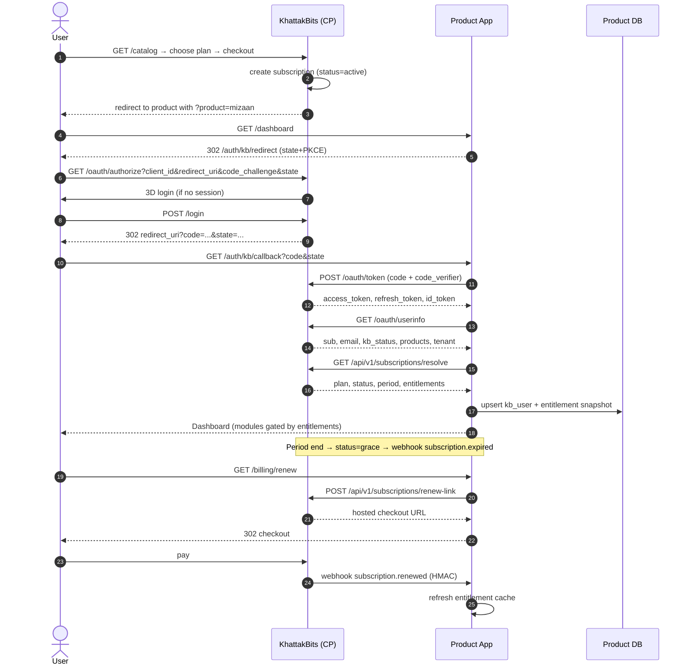

# KhattakBits — Status Report & Target Architecture

**Review date:** 12 Nov 2026  
**Repository:** `E:/LaraProjects/saas-starter` (branch `master`, HEAD `aa21c32`)  
**Method:** Har claim code se verify kiya gaya — `composer.json`, `app/Core/**`, `app/Modules/**`, `routes/*.php`, `database/migrations/*`, `resources/js/**`, `config/*`. `php artisan route:list --except-vendor` aur `php artisan test` chalaye gaye.

> **Verification snapshot**
>
> - `php artisan test` → **101 passed (543 assertions)**, 23.52s
> - `php artisan route:list --except-vendor` → 60+ routes, **zero `/api/*` routes**
> - `composer.json` → `laravel/framework ^13.17`, `inertiajs/inertia-laravel ^3.5`, `spatie/laravel-permission ^8.3`
> - **Passport, Sanctum, Socialite, Cashier — installed nahi hain**
> - Local runtime: PHP 8.5.12, Node 22.22.2

---

## EXECUTIVE SUMMARY

Sach yeh hai: **starter kit (Role 3) bohat acha hai, control plane (Role 1) aur identity hub (Role 2) abhi maujood hi nahi hain.** Jo aap "KhattakBits" kehte hain, woh abhi tak ek solid **single-tenant Laravel admin starter** hai — SaaS control plane nahi. Audit, mailer, documents, CSP, RBAC — yeh sab production-grade hain. Lekin `product`, `plan`, `subscription`, `invoice`, `tenant`, `oauth_client` — in mein se **ek bhi table ya model nahi** hai.

| Area                                                       | Completion | Verdict                                                                                                                      |
| ---------------------------------------------------------- | ---------- | ---------------------------------------------------------------------------------------------------------------------------- |
| **Control Plane** (catalog, plans, subscriptions, billing) | **0 %**    | Kuch bhi nahi. Koi `products`, `plans`, `subscriptions`, `invoices` table nahi.                                              |
| **Identity Hub / SSO**                                     | **15 %**   | Global `users` + `is_active` lockout + safe-redirect hook hai. OAuth2 server, tokens, userinfo, introspection — sab missing. |
| **Starter Kit**                                            | **80 %**   | Audit, Mailer, Documents/Recycle Bin, CSP, RBAC, module registry, 101 tests. Module generator, API layer, tenancy missing.   |
| **Multi-tenancy**                                          | **0 %**    | Poore codebase mein ek bhi `tenant_id` column nahi.                                                                          |
| **Admin Panel**                                            | **12 %**   | `/settings/*` (users, roles, email, audit, recycle bin, system) hai. Catalog/plans/subscriptions/OAuth clients UI nahi.      |
| **Deployment readiness**                                   | **35 %**   | Tests green, security headers, health `/up`. Lekin no CI, no docs, no queue supervisor config, no expiry scheduler.          |
| **OVERALL**                                                | **~24 %**  | Architecture strong, product surface missing.                                                                                |

**Bottom line:** Vision ka 75 % **build karna** hai, 25 % **refactor**. Aap ke paas jo hai woh foundation ke liye kaafi hai — magar control plane ke bina "KhattakBits" sirf ek acha Laravel starter hai, SaaS platform nahi.

---

# TASK 1 — FULL PROJECT REVIEW

## 1.1 Structure Overview

### Backend — `app/`

```
app/
├── Core/                          ← shared kernel (starter kit ka asli jauhar)
│   ├── Console/                   CreateAdmin.php, PurgeBin.php, PruneEmails.php
│   ├── Exceptions/                DocumentException.php
│   ├── Http/Controllers/          AttachmentController, AuthController,
│   │                              DocumentActivityController, PasswordResetController,
│   │                              ProfileController
│   ├── Http/Middleware/           EnsureUserActive.php, SecurityHeaders.php
│   ├── Jobs/                      SendEmailJob.php
│   ├── Models/                    Attachment, AuditLog, DeletedDocument, DocumentView,
│   │                              EmailAccount, EmailLog, EmailTemplate, Setting
│   │   └── Concerns/              HasAttachments.php, IsDocument.php
│   ├── Providers/                 CoreServiceProvider.php
│   └── Support/                   Audit, Authority, DocumentColumns, DocumentRegistry,
│                                  DocumentViews, EmailTemplates, MailHostGuard, Mailer,
│                                  MenuBuilder, ModuleRegistry, Naming, PermissionCatalog,
│                                  SettingsStore, TableQuery
├── Http/
│   ├── Controllers/Controller.php
│   └── Middleware/HandleInertiaRequests.php
├── Models/User.php
├── Modules/                       ← plug-and-play
│   ├── AccountingDemo/            menu.php, routes.php  (SIRF shell — sab links
│   │                              Examples/List par jate hain)
│   ├── Examples/                  full CRUD reference module (Controller, Request,
│   │                              Resource, Model, Migration)
│   ├── Home/                      menu.php, routes.php → '/' = Home/Dashboard
│   └── Settings/                  9 controllers: AuditLog, EmailAccount, EmailLog,
│                                  EmailSettings, EmailTemplate, RecycleBin, Role,
│                                  System, User
└── Providers/AppServiceProvider.php
```

**Module system kaise chalta hai** — `app/Core/Support/ModuleRegistry.php:9-30`:

```php
foreach (glob(app_path('Modules/*'), GLOB_ONLYDIR) ?: [] as $dir) {
    $file = $dir.'/menu.php';
    if (! is_file($file)) { continue; }
    $def = require $file;
    $modules[$def['key']] = ['name' => basename($dir), 'path' => $dir, 'def' => $def];
}
uasort($modules, fn ($a, $b) => ($a['def']['order'] ?? 100) <=> ($b['def']['order'] ?? 100));
```

- **Routes** — `routes/web.php:41-45` har module ka `routes.php` `auth + EnsureUserActive` group ke andar `require` karta hai. Yani module routes **automatically protected** hain. Yeh design acha hai.
- **Migrations** — `app/Core/Providers/CoreServiceProvider.php:34-40` `loadMigrationsFrom($module['path'].'/Database/Migrations')`. Yani module apni migration khud laata hai.
- **Menu** — `MenuBuilder` + `HandleInertiaRequests::share()` → `menu` prop → `AppShell.vue`.
- **Permissions** — `PermissionCatalog::groups()` DB ki `permissions` table se tree banata hai, module labels se enrich karta hai.

**Kya missing hai module system mein:** module **enable/disable per product** ka koi concept nahi. `ModuleRegistry` filesystem se `glob` karta hai — yani jo folder hai woh active hai. Product-wise gating ke liye registry ko DB-backed hona padega.

### Database — 15 migrations

| Table                                             | Migration                                      | Kaam                      |
| ------------------------------------------------- | ---------------------------------------------- | ------------------------- |
| `users`, `password_reset_tokens`, `sessions`      | `0001_01_01_000000`                            | Laravel base              |
| `cache`, `jobs`                                   | `0001_01_01_000001/2`                          | Base                      |
| permission tables (5)                             | `2026_10_26_101855`                            | Spatie v8                 |
| `attachments`                                     | `2026_10_26_113043`                            | Polymorphic, private disk |
| users + `is_active`, `last_login_at`              | `2026_10_27_070652`                            | Disable/audit             |
| `settings`                                        | `2026_10_27_070653`                            | Key-value + cache         |
| `audit_logs`                                      | `2026_10_27_070654` + `2026_10_28_061446`      | IP + UA + meta            |
| `deleted_documents`, `document_sequences`         | `2026_10_28_102652`                            | Recycle bin + naming      |
| `document_views`                                  | `2026_10_29_110000`                            | Activity tracking         |
| `email_accounts`, `email_logs`, `email_templates` | `2026_10_29_120000/100/130000`                 | Central mailer            |
| `demo_entries`                                    | `app/Modules/Examples/Database/Migrations/...` | Reference module          |

**Gap:** `products`, `plans`, `subscriptions`, `invoices`, `payments`, `tenants`, `oauth_clients`, `entitlements`, `webhook_deliveries` — **NOT FOUND**.

### Auth & Security

- **Login** — `app/Core/Http/Controllers/AuthController.php:24-58`. `Auth::attempt([... 'is_active' => true])` → disabled user credential level par hi reject. Session regenerate, `last_login_at`, audit log.
- **Disable enforcement** — `EnsureUserActive.php:12-24` har authenticated request par `is_active` check; `false` ho to logout + session invalidate + redirect. **Yeh sirf isi app ke andar kaam karta hai** (vision ka gap).
- **Throttling** — `CoreServiceProvider.php:63-75`: `login` = 5/min (email+IP) + 20/min (IP); `password-reset` = 5/min IP + 3/min email. Email rotate kar ke bypass nahi hota — `SecurityTest` mein proven.
- **Open redirect** — `AuthController::isSafeRedirect()` (line 47-68): `//` aur `/\` block, relative paths allow, absolute URLs sirf `ALLOWED_SSO_HOSTS` env + `app.url` host. Test: `SecurityTest::login_redirect_rejects_open_redirect_attacks`.
- **CSP** — `SecurityHeaders.php:9-11`: `default-src 'self'; script-src 'self'; ... frame-ancestors 'none'`. Mode `config/security.php` → `CSP_MODE` (`report-only` default). Local par off (Vite HMR).
- **RBAC** — Spatie v8, `teams => false` (`config/permission.php:151`). `Authority.php` privilege-escalation guard: `canAssignRoles`, `canManageUser`, `canEditRole`.

### Frontend

- Inertia 3 + Vue 3.5, Vite 8, Tailwind 4. Aliases: `@` → `resources/js`, `@core` → `resources/js/core` (`vite.config.js:17-22`).
- 65 `.vue` files. Layouts: `AppShell`, `ListPage`, `FormPage`, `ReportPage`, `SettingsPage`, `PageHeader`, `CommandPalette`.
- Composables: `useServerList`, `useCan`, `useRowDelete`, `useUnsavedGuard`, `useFloating`, `useFormat`, `useDocSide`, `useActiveModule`.
- **3D login** — `resources/js/core/login3d/`: `BookScene.vue`, `scene.js` (13 KB), `book.js`, `coverArt.js` (22 KB), `face.js`, `materials.js`, `metrics.js`, `submitLogin.js`, `ease.js`. Lazy-loaded chunk (`BookScene.vue:16` dynamic `import('./scene.js')`), failure par `emit('unsupported')` → graceful fallback.

### Queues & Cron

- Queue driver: `database` (`.env.example`). `SendEmailJob` (`app/Core/Jobs/SendEmailJob.php`) → email delivery async.
- Scheduler — `routes/console.php:12-13`:
  ```php
  Schedule::command('bin:purge')->dailyAt('03:00');
  Schedule::command('emails:prune')->dailyAt('03:30');
  ```
- **Gap:** subscription expiry job, webhook retry job, token cleanup — **NOT FOUND**.

---

## 1.2 Feature Status Matrix

| #  | Feature                                          | Status       | Evidence                                                                                                          | Notes                                                                                                                                                                                                         |
| -- | ------------------------------------------------ | ------------ | ----------------------------------------------------------------------------------------------------------------- | ------------------------------------------------------------------------------------------------------------------------------------------------------------------------------------------------------------- |
| 1  | Storefront / public catalog                      | **Missing**  | `routes/web.php`                                                                                                  | Public route sirf `/login`, `/forgot-password`. `/` = `Home/routes.php` → auth-protected dashboard.                                                                                                           |
| 2  | Product registry (DB)                            | **Missing**  | `database/migrations/*`                                                                                           | Koi `products` table nahi.                                                                                                                                                                                    |
| 3  | Plans & pricing                                  | **Missing**  | —                                                                                                                 | `plans`, `plan_entitlements` nahi.                                                                                                                                                                            |
| 4  | Modules / features / doctypes / reports registry | **Partial**  | `ModuleRegistry.php`, `app/Modules/*/menu.php`, `DocumentRegistry.php`                                            | **Code-level** registry hai (filesystem glob). DB-backed nahi, product se linked nahi, `AccountingDemo/menu.php` mein doctypes/reports sirf **labels** hain — koi model/permission nahi.                      |
| 5  | Subscription engine                              | **Missing**  | —                                                                                                                 | Lifecycle, status machine, grace period — kuch nahi.                                                                                                                                                          |
| 6  | Payments / invoices                              | **Missing**  | —                                                                                                                 | `invoices`, `payments`, gateway integration nahi.                                                                                                                                                             |
| 7  | OAuth2 server (Passport)                         | **Missing**  | `composer.json`                                                                                                   | `laravel/passport` absent. `config/permission.php:159` mein sirf comment mention hai.                                                                                                                         |
| 8  | Sanctum API tokens                               | **Missing**  | `composer.json`, `routes/`                                                                                        | Sanctum absent, `routes/api.php` **maujood nahi**, `bootstrap/app.php:13-17` mein `api:` key hi nahi.                                                                                                         |
| 9  | SSO redirect                                     | **Partial**  | `AuthController.php:40-45`, `isSafeRedirect()`                                                                    | `redirect_uri` / `return_to` accept karta hai aur allowlisted host par redirect karta hai. **Auth code issue nahi hota, token exchange nahi** — yani SSO ka sirf "redirect" hissa hai, "identity" hissa nahi. |
| 10 | Product-scoped roles                             | **Missing**  | `config/permission.php:151` (`teams => false`), `Authority.php`                                                   | Roles global. `product_id` / `tenant_id` scoping nahi.                                                                                                                                                        |
| 11 | Subscription-resolve API                         | **Missing**  | `route:list`                                                                                                      | Koi `/api/*` route nahi.                                                                                                                                                                                      |
| 12 | Webhooks (outbound/inbound)                      | **Missing**  | —                                                                                                                 | HMAC, retry, delivery log — kuch nahi.                                                                                                                                                                        |
| 13 | Multi-tenancy                                    | **Missing**  | `grep -ri tenant` → 0 hits                                                                                        | Na `tenant_id`, na tenancy package, na DB-per-tenant.                                                                                                                                                         |
| 14 | Audit logging engine                             | **Complete** | `Audit.php`, `audit_logs` table, `AuditLogController`, `Settings/AuditLog/*.vue`                                  | Login/logout/failed, user CRUD, role changes, document lifecycle. IP (45) + UA (255) + JSON meta. `Audit::changes()` before/after diff.                                                                       |
| 15 | Central mailer & templates                       | **Complete** | `Mailer.php`, `EmailTemplates.php`, `SendEmailJob.php`, `email_accounts/logs/templates` tables, `Settings/Email*` | SMTP accounts, `MailHostGuard` (SSRF guard), daily limit, delivery log (body store nahi hoti), `{{ token }}` replace (Blade eval nahi).                                                                       |
| 16 | Document lifecycle / Recycle Bin / activity      | **Complete** | `IsDocument.php`, `DeletedDocument.php`, `PurgeBin.php`, `DocumentActivityController.php`, `DocumentViews.php`    | Soft-delete registry, restore/purge, view dedupe (`DOCUMENT_VIEW_DEDUPE_MINUTES`), `document_sequences` naming.                                                                                               |
| 17 | Secure attachments                               | **Partial**  | `AttachmentController.php`                                                                                        | Type-level permission + record existence check + MIME/extension whitelist + daily quota. **Magar `show()`/`destroy()` ownership check nahi karte** — neeche bug B-1.                                          |
| 18 | CSP / security headers                           | **Complete** | `SecurityHeaders.php`, `config/security.php`                                                                      | CSP (report-only/enforce), HSTS, X-Frame-Options DENY, nosniff, Referrer-Policy, Permissions-Policy.                                                                                                          |
| 19 | 3D WebGL ledger login                            | **Complete** | `login3d/*` (9 files), `Pages/Auth/Login.vue`                                                                     | Gaze/eye tracking, book flip, key insert, `unsupported` fallback.                                                                                                                                             |
| 20 | Admin panel                                      | **Partial**  | `app/Modules/Settings/**`                                                                                         | Users, Roles, Audit, Email (accounts/templates/log), Recycle Bin, System. **Catalog / plans / subscriptions / OAuth clients / tenants UI — NOT FOUND.**                                                       |
| 21 | RBAC                                             | **Complete** | Spatie v8, `PermissionCatalog`, `Authority`, `can:` middleware in `Settings/routes.php`                           | Matrix UI, privilege-escalation guards, 12 dedicated tests.                                                                                                                                                   |
| 22 | Queues / cron for expiry                         | **Partial**  | `SendEmailJob`, `routes/console.php:12-13`                                                                        | Email queue + purge/prune jobs. **Subscription expiry / webhook retry — NOT FOUND.**                                                                                                                          |
| 23 | Tests                                            | **Good**     | `tests/Feature/*` (8 files)                                                                                       | 101 passed / 543 assertions. Coverage: security, documents, email, password reset. **Zero tests for SSO/subscription/API (kyunke code hi nahi).**                                                             |
| 24 | CI/CD                                            | **Missing**  | `.github` → NOT FOUND                                                                                             | Koi workflow nahi.                                                                                                                                                                                            |
| 25 | Docs                                             | **Missing**  | `README.md`                                                                                                       | Default Laravel README. Sirf `AUDIT.md` (27 Oct 2026, historical) maujood hai.                                                                                                                                |
| 26 | Health check                                     | **Complete** | `bootstrap/app.php:15`                                                                                            | `health: '/up'`.                                                                                                                                                                                              |
| 27 | Module generator                                 | **Missing**  | `php artisan list \| grep module`                                                                                 | `make:module` nahi. `make:*` sirf Laravel defaults.                                                                                                                                                           |
| 28 | API layer (versioned)                            | **Missing**  | `routes/`                                                                                                         | Sirf `web.php` + `console.php`.                                                                                                                                                                               |


**Count:** Complete **8**, Partial **6**, Missing **14**.

---

## 1.3 Aap ke Likhe Hue Status Ki Verification

| Aap ka claim                          | Verdict                           | Evidence                                                                                                                                                                                                                                                                                                                                                                                                                                                                                                                                                 |
| ------------------------------------- | --------------------------------- | -------------------------------------------------------------------------------------------------------------------------------------------------------------------------------------------------------------------------------------------------------------------------------------------------------------------------------------------------------------------------------------------------------------------------------------------------------------------------------------------------------------------------------------------------------- |
| **User Directory = Ready**            | ✅ **Confirm** (magar global-only) | `app/Modules/Settings/Http/Controllers/UserController.php` — list, filter (status/role), search, create, update, bulk-status, `Authority::canManageUser` guard. UI: `Pages/Settings/Users/{Index,Form}.vue`. Tests: `partial update keeps active flag and roles`, `user manager cannot take over a more powerful account`. **Note:** directory global hai — koi `product_id` ya product access column nahi.                                                                                                                                              |
| **Open-Redirect Protection = Ready**  | ⚠️ **Partially correct**          | `AuthController::isSafeRedirect()` maujood + tested (`SecurityTest`). Block karta hai: `//evil.com`, `/\evil.com`, non-allowlisted host. **Magar:** (a) scheme validate nahi hota (`javascript:` parse_url mein host nahi dega → false, safe; lekin `https://` vs `http://` allowlist same hai), (b) `ALLOWED_SSO_HOSTS` **khaali** hai `.env.example` mein — yani cross-domain SSO redirect abhi kaam nahi karega, (c) `state`/`nonce` param ka concept nahi (CSRF on SSO). **Verdict: redirect-level protection ready, SSO-level protection missing.** |
| **OAuth2 Server = Not ready**         | ✅ **Confirm**                     | `composer.json` mein `laravel/passport` nahi. Koi `/oauth/*` route nahi. Koi `oauth_clients` table nahi.                                                                                                                                                                                                                                                                                                                                                                                                                                                 |
| **API Tokens = Not ready**            | ✅ **Confirm**                     | `laravel/sanctum` nahi, `routes/api.php` nahi, `bootstrap/app.php` mein `api:` nahi, `HasApiTokens` trait `User.php` mein nahi.                                                                                                                                                                                                                                                                                                                                                                                                                          |
| **Multi-Product Scoping = Not ready** | ✅ **Confirm**                     | `config/permission.php:151` → `'teams' => false`. `Authority.php` poora global (`hasRole('super-admin')`, `getAllPermissions()`). Koi `product_id` column permission tables mein nahi.                                                                                                                                                                                                                                                                                                                                                                   |

**Score: 2 confirm, 1 partially correct, 2 confirm.** Aap ka self-assessment accurate hai — sirf open-redirect ko "Ready" ke bajaye "Partial" likhna chahiye.

---

## 1.4 Gaps, Bugs, Security Risks, Tech Debt

### 🔴 Bugs (verified)

**B-1 · Attachment IDOR — `show()` / `destroy()` par ownership check nahi**  
`app/Core/Http/Controllers/AttachmentController.php:92-107`

```php
public function show(Request $request, Attachment $attachment)
{
    $this->allow($request, $this->typeConfig($attachment->attachable_type), 'view');
    // ❌ na owner check, na parent record ka authorization
    abort_unless(Storage::exists($attachment->path), 404);
    return Storage::download($attachment->path, $attachment->name, ...);
}
```

`index()` mein `ensureRecord()` chalta hai, lekin `show`/`destroy` route-model binding se seedha `Attachment` uthate hain. Natija: jis user ke paas `examples.entries.view` hai, woh `/attachments/{any_id}` hit kar ke **kisi bhi** `demo_entry` ki file download kar sakta hai — chahe woh record uska na ho. `destroy` ke saath **deletion** bhi possible.

**Fix:** `show`/`destroy` mein bhi `ensureRecord($cfg, $attachment->attachable_id)` + policy check, ya `Attachment::where('uploaded_by', $request->user()->id)` scope non-admin ke liye.

**B-2 · `examples/forbidden` test route production code mein**  
`app/Modules/Examples/routes.php:13` — `Route::get('forbidden', fn () => abort(403));`  
Yeh `SecurityTest` ke liye hai, magar har environment mein registered hai. `if (app()->environment('local','testing'))` mein wrap karein.

**B-3 · Module routes filesystem se load hote hain, is liye "disable module" possible nahi**  
`ModuleRegistry::all()` `glob(app_path('Modules/*'))` karta hai. Product-wise feature gating ke liye registry DB-backed chahiye — warna ek product mein module band karne ka koi tareeqa nahi.

**B-4 · `Model::preventLazyLoading()` globally on**  
`CoreServiceProvider.php:47`. Production mein sirf warning log hota hai (line 48-52), lekin **naye module developers ke liye footgun** hai — `->with()` bhoolne par local/testing mein 500. Deliberate hai, magar documentation zaroori hai.

**B-5 · `SettingsStore::all()` `Cache::rememberForever`**  
`SettingsStore.php:11-14`. Har settings write par `Cache::forget` hota hai (line 30), theek hai — lekin **multi-server** par `database`/`file` cache store use karne se doosre node par stale values rahengi. Production mein Redis lazmi.

### 🟠 Security risks

| #   | Risk                                                              | Evidence                                        | Impact                                                                                                                                                        |
| --- | ----------------------------------------------------------------- | ----------------------------------------------- | ------------------------------------------------------------------------------------------------------------------------------------------------------------- |
| S-1 | **Global user disable cross-product propagate nahi hota**         | `EnsureUserActive.php` sirf local session check | Disabled user product app mein **session expire hone tak** andar rahega (default 120 min, `SESSION_LIFETIME`). Vision ka core requirement fail.               |
| S-2 | **CSP `connect-src 'self'`**                                      | `SecurityHeaders.php:10`                        | Product app browser se `khattakbits.com/api/*` call nahi kar sakega. Server-side calls theek hain; agar SPA se direct call chahiye to CSP relax karna padega. |
| S-3 | **`ALLOWED_SSO_HOSTS` khaali**                                    | `.env.example`                                  | Cross-domain SSO redirect silently block ho jayega (`isSafeRedirect` false → `/` par redirect).                                                               |
| S-4 | **`SESSION_DOMAIN=null`**                                         | `.env.example:35`                               | Subdomain session sharing (Method 3) abhi possible nahi.                                                                                                      |
| S-5 | **No CSRF/state protection on SSO redirect param**                | `AuthController.php:40`                         | `redirect_uri` user-controlled hai. Allowlist tight ho to safe, lekin OAuth `state` ke bina **login CSRF** possible hai jab asli OAuth flow bane.             |
| S-6 | **Email body log nahi hoti — acha**                               | `email_logs` migration comment                  | ✅ Positive. Lekin **`meta` JSON mein secrets na jayein** — `Audit::log()` caller par depend karta hai.                                                        |
| S-7 | **`is_active` index hai lekin `revoked_at`/`token_version` nahi** | `2026_10_27_070652`                             | Token revocation design ke liye column chahiye.                                                                                                               |
| S-8 | **No rate limit on API (kyunke API hi nahi)**                     | —                                               | Jab API banegi, `throttle:api` + per-client limits lazmi.                                                                                                     |

### 🟡 Tech debt / inconsistencies

1. **`AccountingDemo` ek shell hai** — `routes.php` har menu item ko `Examples/List` par bhejta hai. Vision ke "modules: Accounting, CRM" ka koi asli implementation nahi. Naming misleading hai.
2. **`README.md` default Laravel** — koi project docs nahi.
3. **No `.github/workflows`** — 101 tests hain magar koi CI nahi chalata.
4. **`AUDIT.md` stale hai** — iske P0 (exception handler `Response` import, attachment IDOR) **fix ho chuke hain** (`bootstrap/app.php:10` mein `use Symfony\Component\HttpFoundation\Response;` maujood). Document ko "resolved" mark karein warna future reader confuse hoga.
5. **Two `Controller` base classes** — `App\Http\Controllers\Controller` aur `App\Core\Http\Controllers\*` usi ko extend karte hain. Theek hai, magar `app/Http/Controllers/` mein sirf base class hai — confusion.
6. **`app/Core/Support/` mein 14 classes** — `Authority`, `Audit`, `Mailer` **static** hain, `SettingsStore`, `ModuleRegistry` **singleton DI** hain. Mixed style. Static classes testability kam karte hain.
7. **Frontend mein `Pages/Settings/*` 12 folders** — module-based frontend structure nahi hai (`Pages/<Module>/`). Bade product mein yeh flat structure phat jayega.
8. **`composer.json` mein `name: laravel/laravel`** — starter kit ka apna package name hona chahiye.
9. **No `declare(strict_types=1)`** — poore codebase mein nahi.
10. **PHP constraint `^8.3` magar runtime 8.5** — deployment target clear karein.

### 🔵 Vision se direct conflicts

| Vision requirement                                                                 | Reality                                            |
| ---------------------------------------------------------------------------------- | -------------------------------------------------- |
| "Products are listed in a public catalog"                                          | Koi public catalog route nahi. `/` auth-protected. |
| "Subscription stored in KhattakBits (source of truth)"                             | Subscription entity hi nahi.                       |
| "Product apps never own billing data"                                              | Product apps ka concept hi nahi — sirf ek app hai. |
| "One global user account, disabling locks ALL products"                            | Disable sirf local app mein.                       |
| "OAuth2 Authorization Code flow"                                                   | Sirf redirect; no code, no token.                  |
| "Per-product roles"                                                                | Global roles (`teams => false`).                   |
| "Multi-tenancy"                                                                    | Zero.                                              |
| "Starter kit: SSO client, subscription guard, entitlement checks, renewal screens" | Kuch bhi nahi.                                     |

---

## 1.5 Prioritized Roadmap

### P0 — Control plane ka minimum viable core (bina iske kuch bhi possible nahi)

| #    | Kaam                                                                                                   | Effort | Dependency |
| ---- | ------------------------------------------------------------------------------------------------------ | ------ | ---------- |
| P0-1 | Migrations + models: `products`, `plans`, `plan_entitlements`, `subscriptions`, `invoices`, `payments` | 4–5 d  | —          |
| P0-2 | Product registry admin UI (`/admin/products`, `/admin/plans`) — Settings module ke patterns par        | 5–6 d  | P0-1       |
| P0-3 | Install + configure **Passport**, `oauth_clients` per product, PKCE enable                             | 3 d    | P0-1       |
| P0-4 | `GET /api/v1/subscriptions/resolve` + `GET /api/v1/entitlements` (Sanctum/Passport bearer)             | 3 d    | P0-1, P0-3 |
| P0-5 | `SubscriptionGuard` + `Entitlement` helper **starter kit** mein (product side)                         | 3 d    | P0-4       |
| P0-6 | Global disable propagation: `token_version` + `user.disabled` webhook + product-side `blocked_at`      | 3 d    | P0-3       |
| P0-7 | Expiry scheduler job (`subscriptions:expire`) + grace period state machine                             | 2 d    | P0-1       |
| P0-8 | Fix **B-1** attachment IDOR, **B-2** forbidden route                                                   | 0.5 d  | —          |
| P0-9 | CI: `.github/workflows/tests.yml` (PHP 8.5, sqlite, `npm run build`)                                   | 0.5 d  | —          |

**P0 total: ~24 working days (~5 weeks, 1 senior dev)**

### P1 — Revenue + trust

| #    | Kaam                                                                                            | Effort |
| ---- | ----------------------------------------------------------------------------------------------- | ------ |
| P1-1 | Checkout + gateway (Stripe/JazzCash/1Bill — aap decide karein), webhooks inbound                | 6–8 d  |
| P1-2 | Invoices (PDF), receipts, dunning emails (existing `EmailTemplates` se)                         | 4 d    |
| P1-3 | Webhook dispatcher: HMAC signing, retry with backoff, `webhook_deliveries` log                  | 4 d    |
| P1-4 | Product-scoped roles (`teams=true` with `team_id = tenant_id`, ya custom `product_roles` table) | 4 d    |
| P1-5 | Public catalog + pricing pages (Inertia, SEO)                                                   | 3 d    |
| P1-6 | Renewal flow inside product app (`POST /api/v1/subscriptions/renew-link` → hosted checkout)     | 3 d    |
| P1-7 | Sanctum tokens for mobile/SPA + token scopes                                                    | 2 d    |
| P1-8 | Admin: tenants overview, OAuth clients UI, subscription actions (upgrade/downgrade/suspend)     | 6 d    |


**P1 total: ~32–34 working days (~7 weeks)**

### P2 — Scale & polish

| #    | Kaam                                                                            | Effort |
| ---- | ------------------------------------------------------------------------------- | ------ |
| P2-1 | Multi-tenancy (single-DB + `tenant_id` + global scope)                          | 8–10 d |
| P2-2 | `php artisan make:module` generator + stubs                                     | 2 d    |
| P2-3 | Starter kit split into composer packages (`khattakbits/core`, `khattakbits/ui`) | 5 d    |
| P2-4 | Feature flags / plan-based module gating (DB-backed `ModuleRegistry`)           | 4 d    |
| P2-5 | Observability: Sentry, structured logs, `/up` + metrics                         | 2 d    |
| P2-6 | Docs site (yeh chaar documents ka base)                                         | 2 d    |
| P2-7 | Per-tenant DB option (enterprise tier)                                          | 8 d    |

**P2 total: ~31–33 days**

**Grand total to full vision: ~90 working days ≈ 4.5 months (1 senior dev), ya ~10 weeks (2 devs parallel).**

---

# TASK 2 — TARGET ARCHITECTURE

## 2.1 Flow Diagram

```
┌──────────────────────────────────────────────────────────────────────────────┐
│                          KHATTAKBITS (Control Plane)                         │
│                                                                              │
│  ┌──────────┐   ┌──────────┐   ┌─────────────┐   ┌──────────────────────┐    │
│  │ Catalog  │──▶│  Plan    │──▶│ Subscription│──▶│ Invoice / Payment    │    │
│  │ products │   │ pricing  │   │  (source of │   │  (gateway webhook)   │    │
│  │ modules  │   │ limits   │   │   truth)    │   │                      │    │
│  └──────────┘   └──────────┘   └──────┬──────┘   └──────────────────────┘    │
│                                       │                                      │
│                          ┌────────────┴────────────┐                         │
│                          │  OAuth2 Server          │                         │
│                          │  (Passport + PKCE)      │                         │
│                          │  client_id per product  │                         │
│                          └────────────┬────────────┘                         │
└───────────────────────────────────────┼──────────────────────────────────────┘
                                        │
        1. user clicks "Open App"       │  2. GET /oauth/authorize
        ───────────────────────────────▶│     ?client_id=mizaan
                                        │     &redirect_uri=https://mizaanbitserp.com/auth/kb/callback
                                        │     &response_type=code&scope=openid profile subscription
                                        │     &code_challenge=...&state=...
                                        ▼
                              ┌──────────────────────┐
                              │  3D Ledger Login     │
                              │  (KhattakBits)       │
                              └──────────┬───────────┘
                                        │  3. redirect_uri?code=...&state=...
                                        ▼
┌──────────────────────────────────────────────────────────────────────────────┐
│                      PRODUCT APP (e.g. mizaanbitserp.com)                    │
│                                                                              │
│  POST /oauth/token  ──▶ access_token + refresh_token + id_token              │
│  GET  /oauth/userinfo ─▶ { sub, email, name, kb_status, products[], roles[] }│
│  GET  /api/v1/subscriptions/resolve ─▶ plan, status, period, entitlements    │
│                                                                              │
│  ┌────────────────┐  ┌──────────────────┐  ┌───────────────────────────┐    │
│  │ Subscription   │  │ Entitlement      │  │ Tenant mapping            │    │
│  │ Guard (middle) │  │ ::has('module.x')│  │ kb_tenant_id ↔ local      │    │
│  └────────────────┘  └──────────────────┘  └───────────────────────────┘    │
│  Dashboard / Modules                                                         │
└──────────────────────────────┬───────────────────────────────────────────────┘
                               │
                    4. Period end → status = grace
                               ▼
                    ┌──────────────────────┐
                    │  Expired / Renew     │
                    │  screen in product   │
                    └──────────┬───────────┘
                               │ 5. POST /api/v1/subscriptions/renew-link
                               ▼
                    ┌──────────────────────┐
                    │ KhattakBits checkout │  (hosted, product never sees card)
                    └──────────┬───────────┘
                               │ 6. payment success → subscription.renewed
                               ▼
                    7. webhook + resolve cache refresh → product unlocks
```



## 2.2 Contract — KhattakBits ↔ Product App

### 2.2.1 Product registration (admin)

`POST /admin/products` — payload:

```json
{
  "key": "mizaanbitserp",
  "name": "Mizaanbits ERP",
  "domain": "mizaanbitserp.com",
  "callback_path": "/auth/kb/callback",
  "webhook_url": "https://mizaanbitserp.com/webhooks/khattakbits",
  "status": "active",
  "modules": ["accounting", "inventory", "crm"],
  "features": [
    {"key": "module.accounting", "label": "Accounting", "type": "boolean"},
    {"key": "limit.invoices_per_month", "label": "Invoices / month", "type": "quota"}
  ]
}
```

System generate kare: `client_id` (public, `kb_live_<26 chars>`), `client_secret` (shown **once**, DB mein `hash`), `signing_secret` (webhook HMAC, 32 bytes), `redirect_uris[]`.

**Tables (naye):**

```sql
products            (id, key UNIQUE, name, domain, status, starter_version, timestamps)
product_modules     (id, product_id, module_key, is_enabled, config JSON)
product_features    (id, product_id, key, label, type ENUM(bool,quota,enum), meta JSON)
product_doctypes    (id, product_id, key, label, module_key)
product_reports     (id, product_id, key, label, module_key)
plans               (id, product_id, code, name, price_cents, currency, interval, trial_days, is_active, sort)
plan_entitlements   (id, plan_id, feature_key, enabled BOOL, limit_value BIGINT NULL)
subscriptions       (id, uuid, user_id, product_id, plan_id, tenant_id NULL,
                     status ENUM(trialing,active,past_due,grace,expired,cancelled,suspended),
                     current_period_start, current_period_end, grace_until NULL,
                     cancel_at NULL, seats INT, meta JSON, timestamps)
invoices            (id, uuid, subscription_id, number UNIQUE, subtotal, tax, total, currency,
                     status ENUM(draft,open,paid,void), issued_at, due_at, paid_at)
invoice_lines       (id, invoice_id, description, qty, unit_price, amount)
payments            (id, invoice_id, gateway, gateway_ref UNIQUE, amount, currency, status, paid_at, meta)
oauth_clients       (id, product_id, client_id UNIQUE, client_secret_hash, redirect_uris JSON,
                     scopes JSON, webhook_url, signing_secret, is_confidential BOOL, revoked_at)
tenants             (id, uuid, product_id, subscription_id, name, slug, status,
                     db_name NULL, config JSON, timestamps)
tenant_user         (tenant_id, user_id, product_role, UNIQUE(tenant_id,user_id))
webhook_deliveries  (id, product_id, event, event_id UNIQUE, payload JSON, signature,
                     status ENUM(pending,delivered,failed), attempts, response_code, next_retry_at)
```

### 2.2.2 OAuth2 — Authorization Code + PKCE

**Authorize** (browser, user session required):

```
GET https://khattakbits.com/oauth/authorize
  ?response_type=code
  &client_id=kb_live_mizaan_xxx
  &redirect_uri=https%3A%2F%2Fmizaanbitserp.com%2Fauth%2Fkb%2Fcallback
  &scope=openid%20profile%20email%20subscription%20entitlements
  &state=<random 32 bytes, base64url>
  &code_challenge=<BASE64URL(SHA256(verifier))>
  &code_challenge_method=S256
```

Validation order (Passport default + custom):

1. `client_id` exists, `revoked_at IS NULL`
2. `redirect_uri` **exact string match** `oauth_clients.redirect_uris` se (prefix match **nahi**)
3. `scope` ⊆ client ke allowed scopes
4. `code_challenge` required (`S256` only — `plain` disable)
5. user authenticated + `is_active = true` + product par active subscription (ya `trialing`)
6. `state` product side par verify hota hai, control plane sirf echo karta hai

**Token:**

```
POST https://khattakbits.com/oauth/token
Content-Type: application/x-www-form-urlencoded

grant_type=authorization_code
&client_id=kb_live_mizaan_xxx
&client_secret=<secret>              # confidential clients only
&code=<auth_code>
&redirect_uri=https://mizaanbitserp.com/auth/kb/callback
&code_verifier=<original verifier>
```

Response:

```json
{
  "token_type": "Bearer",
  "access_token": "eyJ0eXAiOi...",
  "refresh_token": "def50200...",
  "expires_in": 900,
  "scope": "openid profile email subscription entitlements",
  "id_token": "eyJhbGciOiJSUzI1NiIs..."
}
```

**Access token TTL = 15 min** (short, kyunke revocation propagation ka yeh pehla layer hai). **Refresh token TTL = 30 days**, rotate on use.


**Scopes:**

| Scope          | Kya deta hai                |
| -------------- | --------------------------- |
| `openid`       | `id_token` (OIDC)           |
| `profile`      | `name`                      |
| `email`        | `email`, `email_verified`   |
| `subscription` | plan, status, period, grace |
| `entitlements` | feature flags + quotas      |
| `tenant`       | tenant id/slug/status       |
| `roles`        | product-scoped roles        |

### 2.2.3 `id_token` / `userinfo` claims

```json
{
  "iss": "https://khattakbits.com",
  "sub": "usr_01J8X...",
  "aud": "kb_live_mizaan_xxx",
  "iat": 1762944000,
  "exp": 1762944900,
  "email": "ali@example.com",
  "email_verified": true,
  "name": "Ali Khan",
  "kb_status": "active",
  "kb_token_version": 7,
  "products": [
    {"key": "mizaanbitserp", "role": "admin", "tenant_id": "tnt_01J8Y...", "status": "active"}
  ],
  "tenant_id": "tnt_01J8Y...",
  "roles": ["admin", "accountant"],
  "entitlements_hash": "sha256:9f2c...",
  "subscription": {
    "status": "active",
    "plan": "business",
    "period_end": "2026-12-01T00:00:00Z"
  }
}
```

`sub` **stable** hai (`users.id` se derive, `usr_` prefix). Email badal sakta hai, `sub` nahi.

### 2.2.4 Endpoints

| Method | Path                               | Auth    | Kaam                                |
| ------ | ---------------------------------- | ------- | ----------------------------------- |
| `GET`  | `/oauth/authorize`                 | session | Consent + auth code                 |
| `POST` | `/oauth/token`                     | client  | Code/refresh exchange               |
| `GET`  | `/oauth/userinfo`                  | Bearer  | Claims (2.2.3)                      |
| `POST` | `/oauth/token/introspect`          | client  | Token validity + `active` flag      |
| `POST` | `/oauth/token/revoke`              | client  | Revoke access/refresh               |
| `GET`  | `/api/v1/subscriptions/resolve`    | Bearer  | Subscription + entitlements (full)  |
| `GET`  | `/api/v1/entitlements`             | Bearer  | Sirf flags + quotas (light, cached) |
| `POST` | `/api/v1/subscriptions/renew-link` | Bearer  | Hosted checkout URL                 |
| `POST` | `/api/v1/sso/backchannel-logout`   | signed  | Force logout (product receives)     |
| `GET`  | `/api/v1/health`                   | —       | Version + `min_starter_version`     |

**`GET /api/v1/subscriptions/resolve?product=mizaanbitserp`**

```json
{
  "data": {
    "subscription_id": "sub_01J8Z...",
    "status": "active",
    "product": {"id": 3, "key": "mizaanbitserp", "name": "Mizaanbits ERP"},
    "plan": {"code": "business", "name": "Business", "interval": "month"},
    "period": {
      "start": "2026-11-01T00:00:00Z",
      "end": "2026-12-01T00:00:00Z",
      "grace_until": "2026-12-08T00:00:00Z"
    },
    "tenant": {"id": "tnt_01J8Y...", "slug": "acme", "status": "active"},
    "seats": {"limit": 25, "used": 18},
    "entitlements": {
      "module.accounting": true,
      "module.inventory": true,
      "module.crm": false,
      "limit.invoices_per_month": 5000,
      "limit.users": 25
    },
    "etag": "sha256:9f2c...",
    "issued_at": "2026-11-12T08:20:00Z",
    "cache_ttl": 60
  }
}
```

`304 Not Modified` support: product `If-None-Match: <etag>` bheje → bandwidth bachta hai.

**`POST /api/v1/subscriptions/renew-link`**

```json
// request
{"product": "mizaanbitserp", "plan": "business", "return_url": "https://mizaanbitserp.com/billing/return"}
// response
{"data": {"checkout_url": "https://khattakbits.com/checkout/sess_01J...", "expires_at": "..."}}
```

### 2.2.5 Webhooks (KhattakBits → Product)

**Headers:**

```
X-KB-Event: subscription.renewed
X-KB-Event-Id: evt_01J8Z...          # idempotency key
X-KB-Timestamp: 1762944000
X-KB-Signature: t=1762944000,v1=<hex hmac_sha256(signing_secret, "t.body")>
X-KB-Delivery-Attempt: 1
```

**Events:**

| Event                    | Kab               | Payload (core)                                    |
| ------------------------ | ----------------- | ------------------------------------------------- |
| `subscription.created`   | checkout success  | `subscription_id, user_id, product, plan, period` |
| `subscription.renewed`   | payment success   | + `previous_period_end, new_period_end`           |
| `subscription.expired`   | grace khatam      | + `expired_at`                                    |
| `subscription.cancelled` | user cancel       | + `cancel_at, effective_at`                       |
| `plan.changed`           | upgrade/downgrade | + `from_plan, to_plan, effective_at`              |
| `user.disabled`          | admin disable     | `user_id, token_version, reason`                  |
| `user.enabled`           | re-enable         | `user_id, token_version`                          |
| `tenant.provisioned`     | tenant create     | `tenant_id, slug, product, plan`                  |
| `tenant.suspended`       | non-payment       | `tenant_id, reason`                               |

**Verification (product side):**

```php
$ts = (int) $request->header('X-KB-Timestamp');
abort_if(abs(time() - $ts) > 300, 400);                 // replay window 5 min
$expected = hash_hmac('sha256', $ts.'.'.$request->getContent(), $secret);
abort_unless(hash_equals($expected, $sigFromHeader), 401);
```

**Retry policy:** exponential backoff — 10s, 30s, 2m, 10m, 1h, 6h, 24h (7 attempts, ~31h). `2xx` = delivered. `410 Gone` = client ne webhook delete kiya → stop retrying. Har attempt `webhook_deliveries` mein log.

### 2.2.6 Global user disable — instant propagation

Problem: session 120 min tak zinda rehti hai, token 15 min. Is liye **3 layers**:

```
Layer 1 — Token (0–15 min)
  users.token_version BIGINT
  disable karte waqt token_version++ (aur revoked_at = now())
  id_token mein kb_token_version claim
  Product har request par: if (jwt.token_version < local.kb_token_version) → 401

Layer 2 — Webhook (seconds)
  user.disabled event → product `kb_users.blocked_at = now()`
  Product middleware: if (kb_users.blocked_at) → logout + 401
  (yeh DB lookup already hoti hai, extra cost nahi)

Layer 3 — Back-channel logout (instant, browser)
  Control plane POST https://<product>/auth/kb/backchannel-logout
    body: logout_token (JWT, signed, sub + sid + jti)
  Product: sid se session destroy → user ka agla request 302 /login
```

**Kyun zaroori hai teen layers:** Layer 3 browser tab band hone par fail ho sakta hai; Layer 2 network failure par retry hota hai; Layer 1 hamesha kaam karta hai (lekin slow). Teen mil kar **effectively instant** banate hain.

**Shared Redis (optional, agar same network):** control plane `PUBLISH kb:revoke <user_id>`, products subscribe → 0 latency. Same-root-domain products ke liye sabse fast.

### 2.2.7 Caching, grace period, offline fallback

| Cheez                    | Policy                                                                                                                                                 |
| ------------------------ | ------------------------------------------------------------------------------------------------------------------------------------------------------ |
| Resolve response         | Product side Redis, `cache_ttl` (60s) + ETag                                                                                                           |
| Entitlements             | 5 min TTL, `entitlements_hash` se invalidate                                                                                                           |
| Negative cache (expired) | 30s (taake renewal ke baad jaldi unlock ho)                                                                                                            |
| Grace period             | `grace_until = period_end + 7 days`, status `grace` — **read-only mode** (writes block)                                                                |
| Offline fallback         | Product DB mein `kb_entitlement_snapshot` (last good JSON). Control plane down ho to **72 hours** tak last snapshot se chalao, phir banner + read-only |
| Clock skew               | `issued_at` + `cache_ttl` par bharosa karein, local clock par nahi                                                                                     |
| Fail-open vs fail-closed | **Security-critical** (user disabled) → fail-**closed**. **Billing** (expiry) → grace + fail-open (customer ko galti se lock na karein)                |

---

## 2.3 Passport vs Sanctum — Decision

**Verdict: DONO. Aur wajah clear hai.**

|                           | Passport                                 | Sanctum                         |
| ------------------------- | ---------------------------------------- | ------------------------------- |
| OAuth2 Authorization Code | ✅ Built-in                               | ❌ (personal access tokens only) |
| PKCE                      | ✅                                        | ❌                               |
| Refresh tokens            | ✅                                        | ❌                               |
| Scopes                    | ✅                                        | ✅ (abilities)                   |
| Token introspection       | ✅                                        | ❌                               |
| OIDC `id_token`           | ⚠️ Partial (custom grant/claims chahiye) | ❌                               |
| SPA cookie auth           | ⚠️ Heavy                                 | ✅ Best-in-class                 |
| Mobile tokens             | ✅                                        | ✅ Simpler                       |
| Complexity                | High                                     | Low                             |

**Aap ke 3 use cases:**

1. **Satellite products (mizaanbitserp.com, bitcart.com, lawbits.com)** → **Passport**. Yeh third-party clients hain, unhe `client_id`/`client_secret`, auth code, refresh token chahiye. Sanctum yeh de hi nahi sakta.
2. **First-party SPA** (KhattakBits ka apna Vue frontend) → **Sanctum** (stateful cookie) ya simply session — already session chal rahi hai. Sanctum tab zaroori hai jab mobile app bane.
3. **Mobile apps** → **Sanctum** personal access tokens (simple, revocable, per-device).

**Isliye:** `laravel/passport` (OAuth2 server + OIDC) **aur** `laravel/sanctum` (first-party tokens) dono install karein. Dono ek hi app mein coexist kar sakte hain — Passport `oauth_*` tables, Sanctum `personal_access_tokens`. Guard separation:

```php
// config/auth.php
'guards' => [
    'web'      => ['driver' => 'session', 'provider' => 'users'],
    'api'      => ['driver' => 'passport', 'provider' => 'users'],   // third-party
    'sanctum'  => ['driver' => 'sanctum',  'provider' => 'users'],   // first-party
],
```

**⚠️ Install karte waqt:** `composer require laravel/passport` chalayein aur verify karein ke constraint Laravel 13 (`^13.17`) ke saath resolve hota hai. Agar resolve na ho to `--with-all-dependencies` ya specific version pin karein. Yeh maine verify nahi kiya (package install nahi kiya) — pehla step yehi hoga.

**OIDC `id_token`:** Passport by default OIDC-compliant `id_token` nahi deta. Do options:

- **A)** `openid` scope ke liye custom claim set Passport ke `AccessToken` par (`Passport::tokenCan` + custom `id_token` generator) — 2-3 din.
- **B)** `web-token/jwt-framework` se khud sign karein (RS256, Passport ki keys reuse) — 1-2 din, zyada control.  
  **Recommendation: B.** `id_token` ko stateless rakhein, `userinfo` endpoint alag.

---

## 2.4 Kya Maujood Hai vs Kya Banana Hai

| Component                                 | Status         | Kahan                                         |
| ----------------------------------------- | -------------- | --------------------------------------------- |
| Global `users` + `is_active`              | ✅              | `users` table, `User.php`, `EnsureUserActive` |
| Session auth + login/logout               | ✅              | `AuthController`                              |
| Safe redirect allowlist                   | ✅ (partial)    | `AuthController::isSafeRedirect`              |
| Audit logging                             | ✅              | `Audit.php`, `audit_logs`                     |
| RBAC (global)                             | ✅              | Spatie v8, `Authority`                        |
| Email infra (renewal emails ke liye)      | ✅              | `Mailer`, `EmailTemplates`                    |
| Module registry                           | ✅ (code-level) | `ModuleRegistry`                              |
| Settings store                            | ✅              | `SettingsStore`                               |
| Health endpoint                           | ✅              | `/up`                                         |
| **`products` table + catalog**            | ❌              | —                                             |
| **`plans` + `plan_entitlements`**         | ❌              | —                                             |
| **`subscriptions` + state machine**       | ❌              | —                                             |
| **Invoices / payments**                   | ❌              | —                                             |
| **Passport + `oauth_clients`**            | ❌              | —                                             |
| **`/oauth/*` routes**                     | ❌              | —                                             |
| **`/api/v1/*` routes + `routes/api.php`** | ❌              | —                                             |
| **Entitlement resolver**                  | ❌              | —                                             |
| **Webhook dispatcher + HMAC**             | ❌              | —                                             |
| **`token_version` revocation**            | ❌              | —                                             |
| **`tenants` + `tenant_id` scoping**       | ❌              | —                                             |
| **Product-scoped roles**                  | ❌              | —                                             |
| **Admin UI: catalog/plans/subs/OAuth**    | ❌              | —                                             |
| **Expiry scheduler job**                  | ❌              | —                                             |
| **`make:module` generator**               | ❌              | —                                             |
| **CI pipeline**                           | ❌              | —                                             |

**Existing 8 components ka code reuse hoga — throw away kuch nahi karna.** `EmailTemplates` renewal/dunning emails ke liye, `Audit` subscription actions ke liye, `Settings` patterns admin UI ke liye, `TableQuery` naye list endpoints ke liye — sab directly kaam aayenge.

---

## Answers to "Remaining" (jo code mein nahi mila)

1. `products` / `plans` / `subscriptions` / `invoices` / `payments` — **NOT FOUND**
2. Passport / Sanctum / Socialite — **NOT FOUND** (`composer.json`)
3. `routes/api.php` — **NOT FOUND**
4. OAuth2 endpoints (`/oauth/*`) — **NOT FOUND**
5. Entitlement / feature-gating helper — **NOT FOUND**
6. Webhook dispatcher / HMAC signing — **NOT FOUND**
7. `tenant_id` kisi bhi table mein — **NOT FOUND**
8. Product-scoped roles — **NOT FOUND** (`teams => false`)
9. Subscription expiry job — **NOT FOUND** (`routes/console.php` mein sirf 2 commands)
10. `make:module` command — **NOT FOUND**
11. CI workflow — **NOT FOUND** (`.github` absent)
12. Public catalog / pricing pages — **NOT FOUND**
13. Renewal / expired screens — **NOT FOUND**
14. Project documentation — **NOT FOUND** (`README.md` Laravel default)
