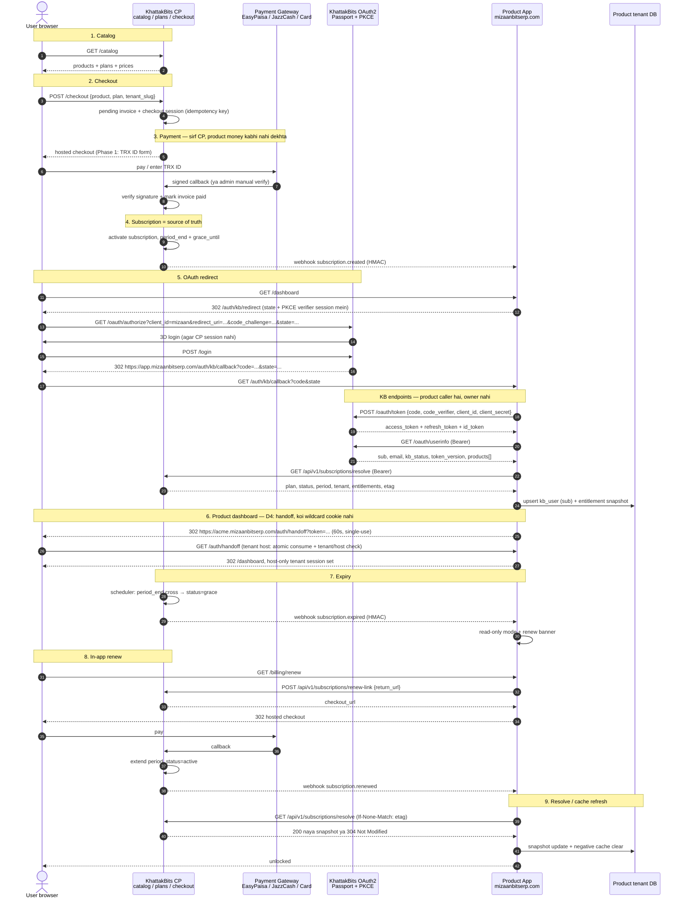
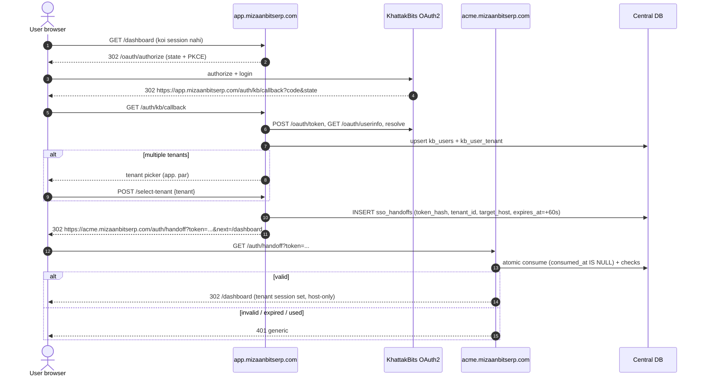

# 02 — Architecture Decisions (Package Split, Versioning, Tenancy)

**Date:** 12 Nov 2026 · **Revised:** 12 Nov 2026 (approved decisions added)
**Repo:** `E:/LaraProjects/saas-starter` (branch `master`)
**Location:** `docs/platform/` — platform-series documents. `docs/01-04` (status report, deployment, integration, development) purani series hai aur **change nahi ki gayi**.
**Inputs:** `docs/01-STATUS-REPORT.md`, `composer.json`, `app/Core/**`, `app/Modules/**`, `routes/*.php`, `config/*.php`, `database/migrations/*`, `resources/js/**`, `vite.config.js`, `node_modules/@inertiajs/vite/types/pagesTransform.d.ts`
**Decisions locked (from user):** private Composer packages + thin product skeleton; multi-DB tenancy per product; payments only in KhattakBits; Passport (PKCE) + Sanctum; subscription owned by control plane.

Yeh document code **nahi** badalta. Sirf extraction ka plan, blockers, aur approved decisions ka record.

---

## 0. Approved Decisions (authoritative — baaki sab inke taabe)

Yeh 5 decisions **final** hain. Neeche jahan bhi "recommendation" ya "pending" jaisa likha ho, woh §0 se override hai.

| # | Decision | Iska seedha asar |
|---|---|---|
| **D1** | **Mirror users CENTRAL** + `kb_user_tenant` pivot. `audit_logs` har row mein user ka **name + email snapshot** rakhega (FK nahi, snapshot) | Tenant export/restore ke baad bhi audit readable rahega; `user_id` cross-DB FK ban hi nahi sakta (§5.5) |
| **D2** | **`audit_logs` = tenant-level** (data changes: doc.*, role.*, settings.*, email_*). **`security_events` = central** (login, logout, login failed, password reset, user disable/enable) | Aaj ke `auth.*` aur `user.status` calls audit se hat kar `security_events` mein jayenge (§5.2b) |
| **D3** | **Subdomain-only**: `{slug}.<product-domain>`. Custom domains **Phase 2**. TLS = **wildcard cert per product domain, DNS-01 challenge** | `tenants`/`domains` resolve subdomain se; cert automation DNS API par (HTTP-01 nahi) |
| **D4** | **Koi wildcard session cookie nahi.** Sirf **host-only** cookies. SSO callback `app.<domain>` par hota hai, phir **one-time handoff token** se tenant subdomain ko session milta hai | Har subdomain ka apna session; `SESSION_DOMAIN` khali. Handoff design §5.4.1 |
| **D5** | **Local password login sirf break-glass platform admin** ke liye — env flag (default **off**), audited, optionally IP-restricted. **Tenant users ke liye password login bilkul nahi** | `AuthController`/`PasswordResetController` core mein rehte hain magar conditional routes; tenant user ka reset KB par |


---

## 1. Corrected End-to-End Flow

### 1.1 Jo ghalat tha `01-STATUS-REPORT.md` mein

`docs/01-STATUS-REPORT.md:352-364` mein product app ke **andar** likha tha:

```
│  POST /oauth/token  ──▶ access_token + refresh_token + id_token              │
│  GET  /oauth/userinfo ─▶ { sub, email, name, kb_status, products[], roles[] }│
```

Yeh galat hai. `/oauth/token` aur `/oauth/userinfo` **KhattakBits ke endpoints** hain (same file ka `2.2.4` table, lines 565-578, yehi kehta hai). Product sirf **caller** hai — server-to-server, `client_secret` + `code_verifier` ke saath. Box ke andar likhne se reader ko lagta hai product ye routes expose karta hai, jo security ke lehaz se ulta hai: product ke paas token *issue* karne ka koi haq nahi hona chahiye.

Teen chhoti ghaltiyan aur:

| # | Ghalat | Sahi |
|---|---|---|
| 1 | `subscription.created` checkout ke foran baad product ko bhejna | Product ko webhook tab bhejein jab tenant provision ho (ya pehle login par `resolve` hi kaafi hai) — warna unknown tenant par webhook 404 hota hai |
| 2 | `P->>KB: GET /oauth/userinfo` bina token type | Bearer access token, `Accept: application/json`; `userinfo` har request par nahi, sirf login/refresh par |
| 3 | Expiry → renew → resolve linear | Renew ke baad **webhook + resolve** dono; webhook miss ho jaye to resolve hi recovery path hai (grace + negative cache 30s) |

### 1.2 Corrected sequence (9 steps)



**Rule jo diagram se nikalta hai:** har arrow jismein `oauth` ya `subscriptions` hai, woh **product → KhattakBits** hai. Product ke apne sirf 3 endpoints hain: `/auth/kb/redirect`, `/auth/kb/callback`, `/auth/handoff` (plus `/auth/kb/backchannel-logout`).

---

## 2. Package Split Map

**Legend:** `CORE` = `khattakbits/core`, `UI` = `khattakbits/ui`, `SSO` = `khattakbits/sso-client`, `CP` = control-plane-only, `SKEL` = product-skeleton (product repo mein rehta hai, package nahi).

Jahan poora folder aik hi destination par jata hai, wahan folder-level row hai — us folder ki **har** file ka destination wohi hai. Heterogeneous folders (config, migrations) file-by-file hain.

**`CP` ka result: zero rows.** Yeh ghalti nahi — is scope mein control-plane-only code maujood hi nahi hai. `docs/01-STATUS-REPORT.md:16` ke mutabiq `products`, `plans`, `subscriptions`, `invoices`, `payments`, `oauth_clients` — koi table/model nahi. CP code **naya likha jayega** (catalog, plans, checkout, Passport server, webhook dispatcher, admin UI), extract nahi hoga. Isi liye §2 ka poora map sirf teen packages + skeleton ke darmiyan hai.

### 2.1 `app/Core` — 37 files

| Path | Dest | Reason | Refactor |
|---|---|---|---|
| `Console/CreateAdmin.php` | CORE | Admin bootstrap har product mein chahiye | Y — tenant context (`tenancy()->initialize()`) ke andar chalayein |
| `Console/PurgeBin.php`, `Console/PruneEmails.php` | CORE | Recycle bin + mailer retention | Y — schedule package provider mein, `routes/console.php` se hatao |
| `Exceptions/DocumentException.php` | CORE | Documents feature ka exception | N |
| `Http/Controllers/AttachmentController.php` | CORE | Attachments core feature | **Y — IDOR (B-1) + tenant scope + routes package mein** |
| `Http/Controllers/DocumentActivityController.php` | CORE | Views/activity tracking | Y — `doc_type` registry se validate, hard-coded `[a-z0-9_]+` nahi |
| `Http/Controllers/AuthController.php` | CORE | Session login — **D5: sirf break-glass admin** | Y — `KB_AUTH_BREAK_GLASS=false` default; flag off ho to routes register hi na hon; login attempt `security_events` mein |
| `Http/Controllers/PasswordResetController.php` | CORE | Break-glass admin ka reset | Y — tenant users ka reset KhattakBits par (`/forgot-password` redirect); local sirf break-glass |
| `Http/Controllers/ProfileController.php` | CORE | Profile + password change | Y — password change break-glass ke liye local, tenant user ke liye KB `change-password` URL par redirect |
| `Http/Middleware/EnsureUserActive.php` | CORE | Disabled user lockout | **Y — `kb_users.blocked_at` + `token_version` bhi check kare** |
| `Http/Middleware/SecurityHeaders.php` | CORE | CSP + security headers | Y — CSP directives config se aayein (3D login ke liye `worker-src`) |
| `Jobs/SendEmailJob.php` | CORE | Queued mail | Y — tenant-aware payload |
| `Models/Attachment.php`, `DeletedDocument.php`, `DocumentView.php` | CORE | Documents/recycle bin | Y — `uploaded_by` FK cross-DB nahi ho sakta (§5.2a) |
| `Models/AuditLog.php` | CORE | Audit | Y — tenant connection par |
| `Models/EmailAccount.php`, `EmailLog.php`, `EmailTemplate.php` | CORE | Mailer | N |
| `Models/Setting.php` | CORE | Key-value settings | N |
| `Models/Concerns/HasAttachments.php`, `IsDocument.php` | CORE | Reusable traits | Y — `config('khattakbits.user_model')` use karein, `App\Models\User` nahi |
| `Providers/CoreServiceProvider.php` | CORE | Kernel boot | **Y — 3 providers mein toote: Core, Ui, Sso** |
| `Support/Audit.php` | CORE | Audit writer | Y — static → DI (`AuditWriter` contract), warna product override nahi kar sakta |
| `Support/Authority.php` | CORE | Privilege-escalation guard | Y — static → DI |
| `Support/Mailer.php`, `MailHostGuard.php`, `EmailTemplates.php` | CORE | Mail stack | Y — `EmailTemplates` `ModuleRegistry` par depend karta hai, registry injectable ho |
| `Support/ModuleRegistry.php` | CORE | Module discovery | **Y — `app_path('Modules/*')` glob (line 17) package modules nahi dhoondh sakta** |
| `Support/MenuBuilder.php`, `DocumentRegistry.php`, `PermissionCatalog.php` | CORE | Menu/docs/permissions registry | Y — `App\Models\User` type-hint hatao → `Authenticatable` |
| `Support/SettingsStore.php` | CORE | Cached settings | Y — cache key tenant-aware (`settings.all.{tenant}`) |
| `Support/Naming.php`, `TableQuery.php`, `DocumentColumns.php`, `DocumentViews.php` | CORE | Doc numbering, list query, schema, view counter | Y — static → instance; `DocumentViews` user model se decouple |

### 2.2 `app/Models`, `app/Http`, `resources/js/core`

| Path | Dest | Reason | Refactor |
|---|---|---|---|
| `app/Models/User.php` | CORE | Base user (CP + product mirror) | **Y — `kb_user_id` (OIDC `sub`) add, `password` nullable, D5 break-glass ke liye `is_break_glass` flag** |
| `app/Http/Controllers/Controller.php` | CORE | Base controller (sirf 1 file) | Y — `KhattakBits\Core\Http\Controllers\Controller` bane, 5 core controllers usay extend karein |
| `app/Http/Middleware/HandleInertiaRequests.php` | CORE | Shared Inertia props | Y — `kb` prop (subscription/entitlements) add; product override kar sake |
| `resources/js/core/layouts/*` (13 files: `AppShell`, `CommandPalette`, `FormCard`, `FormGrid`, `FormPage`, `FormSection`, `ListPage`, `Page`, `PageHeader`, `ReportPage`, `SettingsPage`, `SubNav`, `UserMenu`) | UI | Layout shell | Y — `@core/` imports → `@khattakbits/ui/` |
| `resources/js/core/ui/*` (21 files: `Checkbox`, `ConfirmDialog`, `DatePicker`, `DocStatusBadge`, `DocumentActivity`, `EmptyState`, `Field`, `FileAttachments`, `Icon`, `Input`, `LineItems`, `ListView`, `Modal`, `PermissionMatrix`, `ReadField`, `ReportGrid`, `RowAction`, `Select`, `SideSection`, `StatusBadge`, `Toaster`) | UI | Reusable components | Y — same alias change + `defineProps` audit (product-specific props nikalein) |
| `resources/js/core/composables/*` (8: `useActiveModule`, `useCan`, `useDocSide`, `useFloating`, `useFormat`, `useRowDelete`, `useServerList`, `useUnsavedGuard`) | UI | Client helpers | Y — `useServerList` ka URL contract config se |
| `resources/js/core/login3d/*` (9: `BookScene.vue`, `book.js`, `coverArt.js`, `ease.js`, `face.js`, `materials.js`, `metrics.js`, `scene.js`, `submitLogin.js`) | UI | 3D ledger login | Y — `three` peer dependency declare karein; `submitLogin` endpoint prop se |

**Note (scope se bahar magar critical):** `app/Modules/Settings/**` (9 controllers, 6 resources, 3 requests, `menu.php`, `routes.php`) asal mein **CORE** hai — yeh starter ka admin surface hai. `app/Modules/Home`, `Examples`, `AccountingDemo` → **SKEL** (reference/example code product repo mein rehna chahiye).

### 2.3 `config/` — 15 files

| Path | Dest | Reason | Refactor |
|---|---|---|---|
| `config/attachments.php` | CORE | Attachment policy | **Y — line 3 `App\Modules\Examples\Models\DemoEntry` import karta hai; config mein app class nahi ho sakti. `types` ko `AttachmentTypeRegistry` (code) mein le jayein, config sirf limits rakhe** |
| `config/documents.php` | CORE | View dedupe window | N |
| `config/email.php` | CORE | Private host guard | N |
| `config/security.php` | CORE | CSP mode | Y — `mergeConfigFrom` + app override |
| `config/permission.php` | CORE | Spatie v8, `teams => false` (line 151) | Y — multi-DB mein `cache` store tenant-aware; `teams` ko `true` **nahi** karna (tenant DB khud boundary hai) |
| `config/app.php`, `auth.php`, `cache.php`, `database.php`, `filesystems.php`, `logging.php`, `mail.php`, `queue.php`, `services.php`, `session.php` | SKEL | Laravel infra config; har product apni values rakhta hai | N — sirf **D4**: `session.domain => null` (host-only) aur tenancy connection add hoga |

### 2.4 `database/migrations/` — 15 files

| Path | Dest | Reason | Refactor |
|---|---|---|---|
| `0001_01_01_000000_create_users_table.php` | CORE (split) | `users` central, `password_reset_tokens` + `sessions` bhi central | **Y — 2 migrations mein todein; product mein `password` nullable** |
| `0001_01_01_000001_create_cache_table.php`, `..._000002_create_jobs_table.php` | SKEL | Queue/cache driver ka choice product ka | N |
| `2026_10_26_101855_create_permission_tables.php` | CORE | RBAC (tenant-level) | Y — `model_has_roles` morph hai (FK nahi), theek; magar `roles` seed per tenant chahiye |
| `2026_10_26_113043_create_attachments_table.php` | CORE | Attachments | **Y — line 22 `constrained('users')` cross-DB FK → plain `unsignedBigInteger` + index (§5.5)** |
| `2026_10_27_070652_add_admin_columns_to_users_table.php` | CORE | `is_active`, `last_login_at`, `token_version` | Y — `token_version` yahin add karein |
| `2026_10_27_070653_create_settings_table.php` | CORE | Settings | Y — tenant connection |
| `2026_10_27_070654_create_audit_logs_table.php` (+ 2 alters) | CORE | Audit — **D2: tenant-level, data changes only** | **Y — line 16 `constrained()` FK drop; `user_email` (190) snapshot column add (D1); `auth.*` events yahan se nikalein** |
| `2026_10_28_102652_create_document_tables.php` | CORE | Recycle bin + sequences | Y — line 19 `deleted_by` FK drop (§5.5) |
| `2026_10_29_110000_create_document_views_table.php` | CORE | Views | Y — line 18 `user_id` FK drop (§5.5) |
| `2026_10_29_120000_create_email_accounts_table.php` | CORE | SMTP accounts | N |
| `2026_10_29_120100_create_email_logs_table.php` | CORE | Mail log | Y — line 23 `user_id` FK drop (§5.5) |
| `2026_10_29_130000_create_email_templates_table.php` | CORE | Templates | N |
| `app/Modules/Examples/Database/Migrations/2026_10_29_100000_create_demo_entries_table.php` | SKEL | Example module | N |

### 2.5 `routes/` — 2 files

| Path | Dest | Reason | Refactor |
|---|---|---|---|
| `routes/web.php` | CORE + SKEL | Lines 3-9 core imports, 12-23 auth, 25-48 attachments/documents/modules | **Y — package `routes/web.php` (auth, attachments, documents) + skeleton `routes/web.php` sirf `require` + module loop** |
| `routes/console.php` | SKEL | Schedule entries | Y — `PurgeBin`/`PruneEmails` schedule package provider mein jaye |

---

## 3. Extraction Blockers + Fixes

| # | Blocker | Kahan | Fix |
|---|---|---|---|
| B1 | **Hard-coded `App\Core` namespace** — 37 files + `routes/web.php:3-9`, `bootstrap/app.php:3-4`, `bootstrap/providers.php:3`, 7 test files | repo-wide | Package PSR-4 `KhattakBits\Core\` → `src/`. Ek mechanical rename + import rewrite. Transition ke liye `composer.json` mein `class_alias` shim 1 release tak |
| B2 | **Config published vs package config** — `config/attachments.php:3` app model import karta hai; `config/*.php` app root mein publish ho chuki hain | `config/` | Package `config/khattakbits.php` + `mergeConfigFrom()`; app override `config/khattakbits.php` (published stub). Model class config se hatao → registry |
| B3 | **Inertia page resolution** — `resources/js/app.js:5` na `pages` na `resolve` deta hai; `@inertiajs/vite` khud `import.meta.glob('./Pages/*.vue')` inject karta hai (`node_modules/@inertiajs/vite/types/pagesTransform.d.ts:11-21`) | `resources/js/app.js` | Explicit `resolve` likhein jo 2 globs merge kare: `./Pages/**/*.vue` + `../../vendor/khattakbits/ui/resources/js/Pages/**/*.vue`, local precedence pehle. `pages` shorthand package pages support nahi karta |
| B4 | **Migrations from packages** — `loadMigrationsFrom` sirf central chalega; `stancl/tenancy` `tenants:migrate` alag command chalata hai | `CoreServiceProvider.php:31-36` | Package migrations `database/migrations/` mein (prefixed timestamps, collision-free); docs mein `php artisan migrate` + `php artisan tenants:migrate` dono. Migration `--path` package ka ho to `--realpath` |
| B5 | **Vite alias** — `@core` → `./resources/js/core` (`vite.config.js:21`) | `vite.config.js` | `@khattakbits/ui` alias → `vendor/khattakbits/ui/resources/js`; `@core` ko 1 release deprecated alias rakhein. `server.fs.allow` mein vendor path add karein (symlink dev ke liye) |
| B6 | **Tailwind vendor scanning** — `resources/css/app.css:3-5` mein sirf `@source '../js'`; vendor Vue files ki classes purge ho jayengi | `resources/css/app.css` | `@source '../../vendor/khattakbits/ui/resources/js';` add karein (Tailwind v4 syntax) |
| B7 | **`ModuleRegistry` filesystem glob** — `app_path('Modules/*')` (line 17) | `ModuleRegistry.php` | Registry ko `ModuleProvider` accept karne dein: `ModuleRegistry::register(key, path, def)`. Product `AppServiceProvider` se register kare, package khud bhi |
| B8 | **Package → app dependency** — `MenuBuilder`, `DocumentRegistry`, `DocumentViews`, `Authority`, `Audit` seedha `App\Models\User` type-hint karte hain | `app/Core/Support/*` | `Illuminate\Contracts\Auth\Authenticatable` + `config('khattakbits.user_model')` resolver |
| B9 | **Local auth hamesha registered** — `routes/web.php:12-23` | `routes/web.php` | **D5:** `KB_AUTH_BREAK_GLASS` (default `false`) + `KB_BREAK_GLASS_IPS`; flag off ho to login/password-reset routes register hi na hon. Tenant users ke liye password login kabhi nahi |
| B10 | **Tests package namespace par** — 7 files `App\Core\*` import karte hain | `tests/Feature/*` | Package tests `orchestra/testbench` mein package repo ke andar; skeleton mein sirf integration tests |
| B11 | **`composer.json` name `laravel/laravel`** (line 2) | `composer.json` | Skeleton → `khattakbits/product-skeleton`; `type: project` |
| **B12** | **Cross-DB foreign keys** — 5 migrations `constrained('users')` karti hain, magar `users` central hoga | §5.5 | **Blocking — Step 0.** FK drop → `unsignedBigInteger` + index. Iske baghair `tenants:migrate` fail. Detail §5.5 |

---

## 4. Versioning & Update Flow

### 4.1 Semver rules

| Bump | Kab | Example |
|---|---|---|
| **MAJOR** | Namespace change, config key rename, migration jo data migrate kare, PHP/Laravel minimum bump, public PHP API break | `App\Core` → `KhattakBits\Core` |
| **MINOR** | Naya feature, naya optional config key, naya command/route (backward compatible) | `khattakbits:doctor` command |
| **PATCH** | Bug fix, security fix, sirf behaviour correction | Attachment IDOR fix |

`core` aur `sso-client` **lockstep minor** release honge (`^1.4` dono par), kyunke `sso-client` core ke `SettingsStore`/`Audit` par depend karta hai. `ui` independent (`^0.x` se shuru, 1.0 tab jab API freeze ho).

Skeleton `composer.json` mein: `"khattakbits/core": "^1.4"`, `"khattakbits/sso-client": "^1.4"`. Patch auto-allow, minor manual review.

### 4.2 Core bug fix → saare products (IDOR example)

1. Fix `khattakbits/core` repo mein: `AttachmentController::show()/destroy()` mein record-level authorization + tenant scope + signed URL.
2. Package repo mein Testbench feature test: `user A, attachment of record B` → 403/404 expect.
3. `CHANGELOG.md` → `## [1.4.1] - 2026-11-14 / ### Security`.
4. Tag `v1.4.1` → GitHub release (private repo).
5. Har product repo: `composer update khattakbits/core --with-dependencies` → `php artisan migrate --force` (agar migration ho) → `npm run build` → deploy.
6. **Propagation guarantee:** koi auto-push nahi hai (alag repos hain). Isliye `khattakbits:doctor` command jo `/api/v1/health` se `min_starter_version` compare kare aur admin dashboard par "outdated" banner dikhaye. Optional: Renovate/Dependabot private repos par `composer` ecosystem enable karein.
7. **Security SLA:** advisory + patch **supported minors** (1.3.x, 1.4.x) dono par, 48 hours. Purane major ko support nahi.

### 4.3 Package change ko product ke against locally test karna

Product repo ke `composer.json` mein (temporary, commit **na** karein):

```json
"repositories": [
  { "type": "path", "url": "../khattakbits-core", "options": { "symlink": true } },
  { "type": "path", "url": "../khattakbits-sso-client", "options": { "symlink": true } }
]
```

```bash
composer require "khattakbits/core:*@dev" --with-dependencies
php artisan vendor:publish --tag=khattakbits-config --force
php artisan migrate
npm run build
```

Symlink hone ki wajah se Vite ko `server.fs.allow` mein `../khattakbits-core` chahiye, warna dev server 403 deta hai. Release se pehle `@dev` constraint hata kar `^1.4` par wapas.

### 4.4 Changelog policy

- Har package ka apna `CHANGELOG.md`, [Keep a Changelog](https://keepachangelog.com) format.
- Sections: `Added`, `Changed`, `Deprecated`, `Removed`, `Fixed`, `Security`.
- **Rule:** package ki `src/`, `config/`, `database/`, `resources/` ko touch karne wala har PR apne saath changelog entry + version bump laata hai — same PR mein. Bump ke baghair PR merge nahi.
- MAJOR ke liye `UPGRADE.md`: qadam-ba-qadam + codemod command.
- Tag format `vX.Y.Z`; release notes changelog se copy.

---

## 5. Tenancy Architecture (multi-DB)

`stancl/tenancy` **v3.10.1** Laravel 13 support karta hai — Packagist metadata (`repo.packagist.org/p2/stancl/tenancy.json`, checked 12 Nov 2026) ke mutabiq `illuminate/support: ^10.0|^11.0|^12.0|^13.0`. Yeh claim metadata se hai, actual install se **NOT VERIFIED** — pehla qadam `composer require stancl/tenancy:^3.10` chalana hoga. Agar resolve fail ho to alternative: **custom `TenantDatabaseManager`** (stancl ka core idea 300 lines mein replicate) — magar pehle v3.10 try karein.

### 5.1 Central DB (product app, ek hi)

| Table | Kyun central |
|---|---|
| `tenants`, `domains` | stancl ka core; tenant resolve yahin se hota hai |
| `kb_users` (mirror) | **D1** — ek `sub` = ek row |
| `kb_user_tenant` (pivot) | Kaun user kis tenant ka member hai + local role hint |
| `kb_snapshot` | Last good `resolve` response (JSON + `etag` + `fetched_at`) — offline fallback 72h |
| `kb_oauth_state` | PKCE verifier + `state` login ke dauraan |
| `sso_handoffs` | **D4** — one-time handoff tokens (§5.4.1) |
| `webhook_events` | `X-KB-Event-Id` idempotency; tenant resolve se **pehle** dedupe chahiye |
| `security_events` | **D2** — login/logout/failed/password/disable (§5.2b) |
| `sessions` | Login `app.` par hota hai, phir handoff — session central |
| `personal_access_tokens` | Sanctum, device-level |
| `jobs`, `failed_jobs`, `cache` | Queue workers central context mein chalte hain; job payload mein `tenant_id` |

### 5.2 Approved decisions ka asar (D1, D2)

**(a) D1 — Mirror users CENTRAL + `kb_user_tenant` pivot.**

Wajah: ek hi insaan aik product ke 2 tenants mein ho sakta hai (apni company + client ki company). Tenant-level mirror users rakhte to: same `sub` ke 2 rows, `user.disabled` webhook par N updates, seat counting double, 2FA state duplicate. Central rakhne se `sub` → 1 row aur disable ek hi jagah lagta hai.

**Snapshot rule (aap ka point):** `audit_logs` mein `user_id` FK **nahi** hoga — sirf `unsignedBigInteger` + index, aur saath **`user_name` + `user_email`** ki copy. Aaj `user_name` maujood hai (`database/migrations/2026_10_27_070654_create_audit_logs_table.php:17`), `user_email` **nahi** — woh add karna hai. Wajah: tenant DB ka export/restore alag DB par restore ho sakta hai jahan `kb_users` ka woh row maujood na ho; snapshot ke baghair audit "user #47 ne invoice cancel ki" keh kar gum ho jata hai.

**(b) D2 — Event split: kaunsa event kahan.**

| Event | Kahan | Aaj kahan hai |
|---|---|---|
| `auth.login`, `auth.logout`, `auth.failed`, `auth.password_requested`, `auth.password_reset` | `security_events` (central) | `audit_logs` — `AuthController.php`, `PasswordResetController.php` |
| `user.status` (disable/enable) | `security_events` (central) | `audit_logs` — `UserController.php` |
| `doc.*` (created/updated/deleted/submitted/cancelled/amended/restored/purged) | `audit_logs` (tenant) | theek hai |
| `role.*`, `user.created`, `user.updated`, `settings.updated`, `email_*` | `audit_logs` (tenant) | theek hai |

`security_events` columns: `id, kb_user_id, tenant_id (nullable), event, email_attempted, ip, user_agent, meta, created_at` — tenant_id nullable kyunke `auth.failed` par tenant maloom bhi nahi hota.

`document_sequences` bhi tenant-level — har tenant apni `INV-00001` series rakhta hai.

### 5.3 Tenant-level tables

`demo_entries` (aur baaki module data), Spatie `roles`/`permissions`/`model_has_*`, `settings`, `audit_logs`, `attachments`, `deleted_documents`, `document_views`, `document_sequences`, `email_accounts`, `email_logs`, `email_templates`.

Note: Spatie ka `model_has_roles` morph columns use karta hai (FK nahi), is liye tenant DB mein `users` table ke baghair chalta hai — verified `database/migrations/2026_10_26_101855_create_permission_tables.php:84-92`. `config/permission.php:151` `teams => false` hi rahega: tenant DB khud boundary hai.

### 5.4 D3 — Tenant identification (subdomain-only)

| Option | Verdict |
|---|---|
| **Path** (`mizaanbitserp.com/acme/...`) | ❌ Reject — cookie path scope leak, route caching, asset URL rewrite |
| **Subdomain** (`{slug}.mizaanbitserp.com`) | ✅ **Approved (D3)** — stancl `DomainTenantResolver`, ek wildcard cert |
| **Custom domain** (`erp.customer.com`) | ⏸ **Phase 2** — `domains` table mein row, per-domain cert |

```
mizaanbitserp.com              → marketing / "Open app" → KB catalog
app.mizaanbitserp.com          → SSO callback + tenant picker (session yahin)
{slug}.mizaanbitserp.com       → tenant app (handoff ke baad session)
```

**Reserved slugs:** `www, app, admin, api, auth, status, docs, mail, assets, cdn, assets-static`.

**TLS (D3):** per product domain **ek wildcard cert** — `*.mizaanbitserp.com` + `mizaanbitserp.com` (SAN). Issue **DNS-01** se (HTTP-01 wildcard nahi de sakta), taake naya tenant subdomain banne par cert dobara issue na karni pare. Renewal 30 din pehle, cron se. Naya tenant = naya DNS record (wildcard `*.mizaanbitserp.com` A record pehle se hai, is liye **koi DNS change bhi nahi chahiye**) — sirf `tenants`/`domains` row.

### 5.4.1 D4 — Host-only cookies + SSO handoff

**Koi wildcard cookie nahi.** `SESSION_DOMAIN` khali, har subdomain ka apna host-only session. Iska matlab: `app.` par login karne se `acme.` par session **nahi** milta — uske liye handoff token hai.

**Kyun (justification):** wildcard cookie ka blast radius poora product hai — kisi aik tenant ke module mein XSS ya leaked cookie har tenant par valid ho jati hai. Host-only mein blast radius aik tenant. Qeemat: tenant switch par aik extra redirect (~100ms).

**Flow:**



**`sso_handoffs` schema:**

| Column | Type | Kaam |
|---|---|---|
| `id` | ULID | internal |
| `token_hash` | char(64), unique | `sha256(raw)` — raw token kabhi store nahi |
| `kb_user_id` | unsignedBigInteger, index | kis user ke liye |
| `tenant_id` | string, index | kis tenant ke liye (binding) |
| `target_host` | string(190) | `acme.mizaanbitserp.com` (binding) |
| `return_to` | string(190) nullable | relative path only |
| `expires_at` | timestamp | `now + 60s` (config `handoff.ttl`) |
| `consumed_at` | timestamp nullable | single-use marker |
| `ip`, `user_agent` | string | forensics |
| `created_at` | timestamp | prune 24h baad |

**Rules (sab lazmi):**

1. **Single use** — consume `UPDATE sso_handoffs SET consumed_at = now() WHERE token_hash = ? AND consumed_at IS NULL AND expires_at > now()`; `affectedRows === 1` warna 401. Read-then-write race nahi.
2. **Expiry 60s** — page slow ho to user dobara `app.` par jaye, token dobara milega.
3. **Tenant check** — `handoff.tenant_id` === host se resolve hua tenant. Match na ho → 401 + `security_events` (`sso.handoff_tenant_mismatch`). Yeh tenant-hopping rokta hai.
4. **Host binding** — `handoff.target_host` === `$request->getHost()`, warna 401.
5. **Membership check** — `kb_user_tenant` mein row ho aur `kb_users.blocked_at` null ho; disabled user ko handoff kabhi na mile.
6. **`return_to`** sirf relative path (`/` se shuru, `//` aur `\` reject) — open redirect band.
7. **Token URL mein hai** → handoff route par `Referrer-Policy: no-referrer` header aur foran 302 (token HTML mein render na ho).
8. **Rate limit** `/auth/handoff` — 10/min per IP + 5/min per token_hash.
9. **Prune** — consumed/expired rows 24h baad delete (forensics ke liye thoda rakhein).

**Break-glass (D5) isse alag hai:** platform admin `app.` par local login kar sakta hai (`KB_AUTH_BREAK_GLASS=true`), magar tenant DB mein uski koi membership nahi hoti — woh handoff se tenant mein **nahi** jata; woh `app.` par admin surface use karta hai. Tenant user ke liye password field maujood hi nahi.

### 5.5 Mandatory Step 0 — cross-DB foreign keys ka fix

**Yeh blocking hai.** `users` central hai, tenant DB mein `users` table **nahi** hogi. Jis bhi migration mein `constrained('users')` hai, `php artisan tenants:migrate` us par fail karega (MySQL errno 150, SQLite "no such table: main.users").

**Kitni migrations:** **5**, chaar nahi — `audit_logs` wala alag row mein tha is liye pehle count 4 lag raha tha:

| Migration | Line | Column |
|---|---|---|
| `2026_10_26_113043_create_attachments_table.php` | 22 | `uploaded_by` |
| `2026_10_27_070654_create_audit_logs_table.php` | 16 | `user_id` |
| `2026_10_28_102652_create_document_tables.php` | 19 | `deleted_by` |
| `2026_10_29_110000_create_document_views_table.php` | 18 | `user_id` |
| `2026_10_29_120100_create_email_logs_table.php` | 23 | `user_id` |

**Fix (har aik par same pattern):**

```php
// BEFORE — tenant DB par fail
$table->foreignId('uploaded_by')->nullable()->constrained('users')->nullOnDelete();

// AFTER — plain column, koi cross-DB FK nahi
$table->unsignedBigInteger('uploaded_by')->nullable()->index();
```

`down()` mein `dropConstrainedForeignId` ki jagah `dropColumn` (ya `dropIndex` + `dropColumn`) — kyunke index manually bana hai.

**Saath mein (D1/D2):**

```php
// audit_logs: snapshot columns, FK nahi
$table->unsignedBigInteger('user_id')->nullable()->index();
$table->string('user_name', 100)->nullable();
$table->string('user_email', 190)->nullable();   // naya — D1
```

**Verification (Step 0 ka definition of done):**

1. Fresh tenant DB par `php artisan tenants:migrate --tenants=acme` — zero errors.
2. `Schema::connection('tenant')->getForeignKeys('attachments')` → `users` par koi FK nahi.
3. Test: tenant context mein `Attachment::create(['uploaded_by' => 999999])` — DB reject **na** kare (dangling id allowed by design, app-level check).
4. Existing single-DB data ke liye upgrade migration: FK drop kare magar data touch na kare (SQLite par Laravel 11+ table-rebuild se karta hai, `doctrine/dbal` ki zaroorat nahi — pehli run par verify karein).

**Yeh `03-EXTRACTION-PLAN.md` ka Step 0 hoga** aur package extraction se **pehle** merge hoga — kyunke baad mein yeh fix 4-5 published packages ke migrations ko touch karega, jo semver MAJOR bump ban jata hai.

---

## 6. Decisions — Resolved

| Purana sawal | Jawab |
|---|---|
| Mirror users central ya tenant-level? | **Central + `kb_user_tenant`** (D1) |
| `audit_logs` kahan? | **Tenant-level**, `security_events` central (D2) |
| Tenant identification? | **Subdomain-only**, custom domains Phase 2, wildcard TLS via DNS-01 (D3) |
| Wildcard session cookie? | **Nahi** — host-only + one-time handoff (D4) |
| Products mein local login? | **Sirf break-glass admin**, flag default off, audited, optional IP allowlist (D5) |

**Still open (non-blocking, Phase 2):**

1. Custom domain TLS automation kis se (Caddy on-demand vs Cloudflare for SaaS vs Forge)?
2. Break-glass IP allowlist env mein ya DB settings mein (runtime change bina deploy)?
3. `security_events` retention — 90 din ya 1 saal? (audit_logs tenant ke saath jayega, uska retention tenant ka faisla)

---

**Document series convention:** naye platform documents `docs/platform/` mein rahenge — `02-ARCHITECTURE-DECISIONS.md`, `03-EXTRACTION-PLAN.md` … `11-MASTER-ROADMAP.md`. Purane `docs/01-04` chhede nahi jayenge; jab deployment ka kaam aaye to `docs/02-DEPLOYMENT-GUIDE.md` ko **update** karein (multi-DB + multi-domain sections add), scratch se rewrite na karein.

---

*Yeh document decisions record karta hai, implementation nahi. Code changes ke liye alag `IMPLEMENT` prompt chahiye.*
