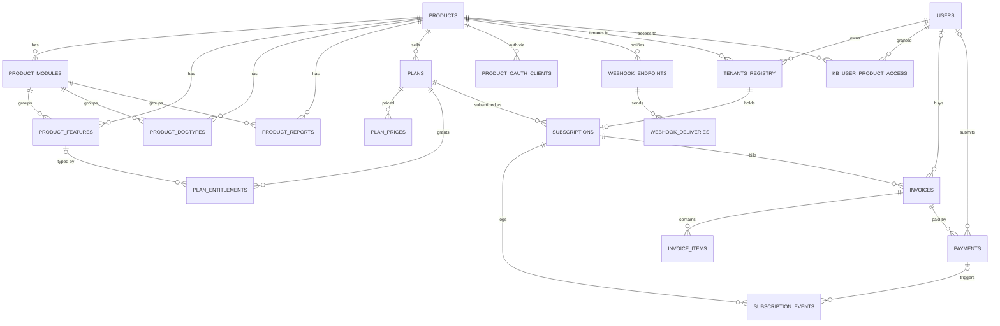
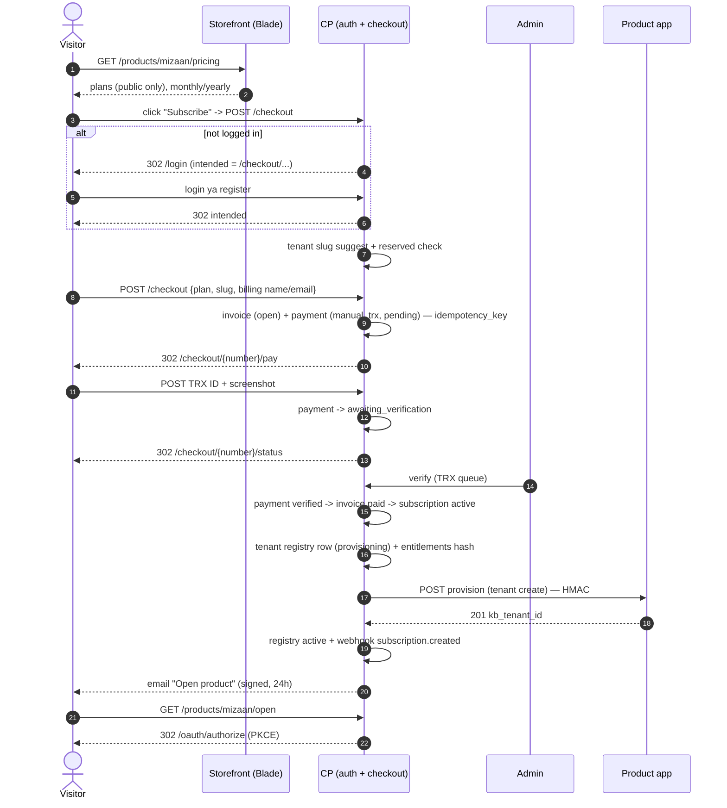

# 04 — Control Plane Design (data model, state machine, entitlements, admin, storefront)

**Date:** 13 Nov 2026 · **Revised:** 13 Nov 2026 (**v5** — path-based tenancy sync with `07`: `tenants_registry.subdomain` → `product_url`, handoff references retired; changelog §9)  
**Repo:** `E:/LaraProjects/saas-starter` (branch `extract/package-skeleton`)  
**Depends on:** `docs/platform/02-ARCHITECTURE-DECISIONS.md` (§0 D1–D5, §5), `docs/platform/03-EXTRACTION-PLAN.md` (Part C)  
**Inputs:** `composer.json`, `.env`, `config/database.php`, `phpunit.xml`, `app/Modules/Settings/**`, `khattakbits-core/src/Support/{TableQuery,PermissionCatalog,MenuBuilder,DocumentRegistry,Naming}.php`, `khattakbits-ui/src/**`  
**Rule:** Yeh document **schema snippets + design** hai. Koi migration, model ya code nahi likha gaya.

---

## 0. DB target (detected, not assumed)

| Evidence                 | Value                                                                              |
| ------------------------ | ---------------------------------------------------------------------------------- |
| `.env:8`                 | `DB_CONNECTION=mysql`                                                              |
| `.env:9-11`              | `DB_HOST=127.0.0.1`, `DB_PORT=3306`, `DB_DATABASE=admin_core`                      |
| `config/database.php:20` | `'default' => env('DB_CONNECTION', 'sqlite')` — fallback sirf env missing hone par |
| `phpunit.xml:26-27`      | `DB_CONNECTION=sqlite`, `DB_DATABASE=:memory:`                                     |
| `composer.json`          | `laravel/framework 13.38.0`, PHP 8.5 (AGENTS.md)                                   |

**Verdict: MySQL is the target database.** Tests SQLite par chalte hain.

Local MySQL `127.0.0.1:3306` par is waqt **connection refused** de raha hai, is liye server version **NOT VERIFIED**. Design **MySQL 8.0+** assume karta hai (`json` columns, instant `ADD COLUMN`) magar yeh teen constraints lazmi hain taake SQLite suite bhi chale:

1. **Koi partial/filtered unique index nahi** (MySQL mein bhi nahi hai, SQLite mein hai) — "ek hi active X" app-level check + plain unique se enforce hoga.
2. **Koi generated column, `FULLTEXT`, ya `CHECK` constraint nahi** — Laravel inhein cross-driver reliably nahi banata.
3. **`ENUM` nahi** — `string(20)` + PHP enum cast. Wajah: naya state add karne par MySQL ENUM ka `ALTER` table rebuild karta hai (8.0 se pehle), aur SQLite par `enum` `check` constraint ban jata hai jo `ALTER` nahi hota.

**Yeh control plane ki apni single central DB hai** (`admin_core`). `02` §5.1 ka "central DB" **product app** ka hai (`tenants`, `domains`, `users`, `kb_user_tenant`) — dono alag databases hain, naam ki similarity coincidence hai. Product ka central DB yahan se sirf HTTP se baat karta hai. (`sso_handoffs` 13 Nov 2026 ko retire ho gaya — path-based tenancy, `07` §3.6.)

---

## 1. Data model

### 1.1 ERD



### 1.2 Ownership: control plane vs core package

| Table                                                                          | Kahan                                | Kyun                                                                                                                                      |
| ------------------------------------------------------------------------------ | ------------------------------------ | ----------------------------------------------------------------------------------------------------------------------------------------- |
| 18 tables neeche §1.3 mein                                                     | **CP app** (`app/Modules/Platform`)  | Catalog/billing/tenancy sirf CP ka kaam hai; product ko in ka pata bhi nahi chalna chahiye                                                |
| `users`, `settings`, `audit_logs`, `document_sequences`                        | **`khattakbits/core`** (already hai) | CP aur products dono use karte hain; `Naming::next()` invoice numbering bhi isi se chalega                                                |
| `security_events`                                                              | **`khattakbits/core`** (banana hai)  | D2 ne central kaha; CP aur har product apne central DB mein likhta hai. **Aaj maujood nahi** — koi migration nahi (NOT VERIFIED as built) |
| `sessions`, `cache`, `jobs`, `personal_access_tokens`, `password_reset_tokens` | Laravel/host                         | Framework infra                                                                                                                           |

**Ek code-level cheez core mein jayegi, table nahi:** entitlement snapshot ka **contract** (`KhattakBits\Core\Entitlements\EntitlementSet` — `fromArray()`, `flag()`, `limit()`, `quota()`, `hash()`). Wajah: CP snapshot *banata* hai, product usay *padhta* hai. Shape dono taraf same hona chahiye warna har product apna parser likhega. Tables CP mein rahengi.

`security_events` (D2, `02` §5.2b): `id, kb_user_id nullable, tenant_id nullable, event, email_attempted, ip, user_agent, meta json, created_at` — append-only, **1 saal retention** (§8 D2, decided — `02` §6 ka open question yahan band). Prune: `security:prune-events --older-than=365d`, roz 03:00, chunked 1000, `created_at` par index lazmi.


### 1.3 Migration-ready columns

Convention: har table `created_at`/`updated_at` (Laravel timestamps) unless likha ho ke nahi. Money **integer minor units** mein (PKR ka minor unit = paisa, 2 dp) — float kabhi nahi, warna `entitlements_hash` har recompute par badal jayega.

```php
// ── products ─────────────────────────────────────────────────────────────
id                  bigIncrements
key                 string(40)   unique          // 'mizaan' — kb-product.json ka key
name                string(120)
tagline             string(190)  nullable
description         text         nullable
domain              string(190)  nullable unique // 'mizaanbitserp.com' — path-based; display/branding +
                                                //   `tenantUrl()` ka base (`07` §5.2). Resolution isse nahi hoti
docs_url            string(190)  nullable
support_email       string(190)  nullable
logo_path           string(190)  nullable
status              string(20)   index default 'draft'   // draft|active|sunset|archived
min_starter_version string(20)   nullable        // 'khattakbits:doctor' outdated banner (02 §4.2)
manifest_version    string(40)   nullable
manifest_hash       char(64)     nullable        // sha256, idempotent sync (§6)
manifest_synced_at  timestamp    nullable
metadata            json         nullable
softDeletes         deleted_at
// index: (status, name)

// ── product_modules ──────────────────────────────────────────────────────
id                  bigIncrements
product_id          foreignId  constrained('products') cascadeOnDelete
key                 string(60)                  // 'accounting'
name                string(120)
description         string(255) nullable
is_core             boolean default false       // disable nahi ho sakta
status              string(20)  index default 'active'  // active|deprecated|removed
deprecated_at       timestamp nullable
removed_at          timestamp nullable           // §6 grandfather rule isi par chalti hai
sort_order          unsignedSmallInteger default 0
unique (product_id, key)
// NO softDeletes — status + removed_at audit-safe hai aur FK integrity bachati hai

// ── product_features ─────────────────────────────────────────────────────
id                  bigIncrements
product_id          foreignId  constrained('products') cascadeOnDelete
product_module_id   foreignId  nullable constrained('product_modules') nullOnDelete
key                 string(80)                  // 'inventory.warehouses', 'storage'
name                string(120)
description         string(255) nullable
type                string(10)                  // flag|limit|quota  ← authoritative typing
default_value       string(60)  nullable        // '0' | '-1' (unlimited)
unit                string(20)  nullable        // users|mb|calls|invoices
reset_period        string(10)  nullable        // month|year|null
status              string(20)  index default 'active'
unique (product_id, key)
index (product_module_id, status)

// ── product_doctypes ─────────────────────────────────────────────────────
// Mirror of DocumentRegistry ka shape (02 §2.1, DocumentRegistry::all())
id                  bigIncrements
product_id          foreignId  constrained('products') cascadeOnDelete
product_module_id   foreignId  nullable constrained('product_modules') nullOnDelete
type                string(60)                  // 'invoice' — DocumentRegistry key
label               string(120)
model               string(190) nullable        // FQCN, sirf documentation ke liye (CP load nahi karta)
permission_prefix   string(120)                 // 'accounting.invoices' — DocumentRegistry 'can'
url                 string(190) nullable        // '/accounting/invoices'
actions             json        nullable        // DocumentRegistry::ACTIONS ka override
status              string(20)  index default 'active'
unique (product_id, type)

// ── product_reports ──────────────────────────────────────────────────────
id                  bigIncrements
product_id          foreignId  constrained('products') cascadeOnDelete
product_module_id   foreignId  nullable constrained('product_modules') nullOnDelete
key                 string(80)
name                string(120)
description         string(255) nullable
route               string(190) nullable        // product-side path
permission          string(120) nullable
is_exportable       boolean default false
status              string(20)  index default 'active'
unique (product_id, key)

// ── plans ────────────────────────────────────────────────────────────────
id                  bigIncrements
product_id          foreignId  constrained('products') cascadeOnDelete
key                 string(60)                  // 'growth'
name                string(120)
description         text        nullable
tier                unsignedSmallInteger         // upgrade/downgrade comparison isi se
billing_mode        string(20)  default 'per_tenant'  // per_tenant (Phase 1) | per_seat (Phase 2)
seat_limit          unsignedInteger nullable     // null = unlimited
trial_days          unsignedSmallInteger default 0
grace_days          unsignedSmallInteger default 7
is_public           boolean default true        // storefront par dikhe ya sales-only
status              string(20)  index default 'draft'  // draft|active|retired
sort_order          unsignedSmallInteger default 0
unique (product_id, key)
index (product_id, status, sort_order)

// ── plan_prices ──────────────────────────────────────────────────────────
id                  bigIncrements
plan_id             foreignId  constrained('plans') cascadeOnDelete
currency            char(3)  default 'PKR'
interval            string(10)                  // month|year
amount_minor        unsignedBigInteger           // 1500000 = PKR 15,000.00
compare_at_minor    unsignedBigInteger nullable  // strike-through
is_active           boolean default true
unique (plan_id, currency, interval)
// Price history yahan NAHI rakhi — invoice_items amount freeze karte hain, is liye
// history invoices se derivable hai. Yeh jaan boojh kar hai (ek kam table, ek kam sync point).

// ── plan_entitlements ────────────────────────────────────────────────────
id                  bigIncrements
plan_id             foreignId  constrained('plans') cascadeOnDelete
product_feature_id  foreignId  nullable constrained('product_features') nullOnDelete
key                 string(80)                  // 'accounting.invoices', 'seats'
type                string(10)                  // flag|limit|quota — fallback typing
value               string(60)                  // '1' | '0' | '25' | '-1' (unlimited)
unit                string(20)  nullable
reset_period        string(10)  nullable
unique (plan_id, key)
// product_feature_id nullable kyunke plan aisi key grant kar sakta hai jo catalog mein
// abhi nahi (forward compat). Type precedence §3.1 mein.

// ── tenants_registry ─────────────────────────────────────────────────────
id                  bigIncrements
kb_tenant_id        char(26)  unique            // ULID — product app ke `tenants.id`
product_id          foreignId  constrained('products') cascadeOnDelete
slug                string(60)                  // 'acme' — path segment (`07` §3.5). IMMUTABLE
product_url         string(190) nullable        // 'https://mizaanbitserp.com/acme' — DERIVED, informational
                                                //   (support/emails/billing receipts). Unique NAHI:
                                                //   uniqueness `unique(product_id, slug)` se aati hai.
                                                //   (Pehle yahan `subdomain ... unique` tha — D4 retired
                                                //    13 Nov 2026; custom domain aane par `07` §13.1)
owner_user_id       foreignId  constrained('users') restrictOnDelete
status              string(20)  index default 'provisioning'
                                                // provisioning|active|read_only|suspended|archived
database_name       string(120) nullable        // product-side tenant DB (informational)
provisioned_at      timestamp nullable
last_seen_at        timestamp nullable
billing_profile     json        nullable        // { business_name, address, city, ntn, strn, phone, email } — §8 D3
notes               text        nullable
softDeletes         deleted_at                  // archive, delete nahi
unique (product_id, slug)
index (owner_user_id, status)
// Reserved slugs (D3: www, app, admin, api, auth, status, docs, mail, assets, cdn) app-level check
// billing_profile "current" value hai; invoice par snapshot freeze hota hai
// (invoices.billing_profile_snapshot), is liye baad mein address/NTN badalne se
// purane invoices nahi badalte — jo legal record ke liye lazmi hai.

// ── subscriptions ────────────────────────────────────────────────────────
id                  bigIncrements
public_id           char(26)  unique            // ULID — webhooks/API mein yeh jata hai, id nahi
tenants_registry_id foreignId  unique constrained('tenants_registry') cascadeOnDelete
plan_id             foreignId  constrained('plans') restrictOnDelete
status              string(20)  index           // §2 ke 7 states
current_period_start timestamp
current_period_end   timestamp  index
trial_ends_at        timestamp nullable
grace_ends_at        timestamp nullable  index
cancel_at_period_end boolean default false
cancelled_at         timestamp nullable
suspended_at         timestamp nullable
suspended_reason     string(190) nullable
seats                unsignedInteger default 1
currency             char(3) default 'PKR'
interval             string(10)
amount_minor         unsignedBigInteger         // current period ka frozen price
entitlements_hash    char(64)  nullable         // §3, ETag bhi isi se
entitlements_version unsignedInteger default 1  // har mutation par ++
entitlement_snapshot json      nullable         // last computed (debug/audit)
// unique(tenants_registry_id) = ek tenant per product ek hi subscription row.
// Plan change / renew / cancel-reactivate usi row ko mutate karte hain; history
// subscription_events + invoices mein rehti hai. Isse "partial unique index" ki
// zaroorat khatam ho jati hai (§0 constraint 1).
// index (status, current_period_end) — scheduler isi par chalta hai

// ── subscription_events ──────────────────────────────────────────────────
id                  bigIncrements                // append-only, updated_at NULL
subscription_id     foreignId  index constrained('subscriptions') cascadeOnDelete
type                string(40)  index            // created|trial_started|activated|renewed|
                                                 // upgraded|downgraded|plan_changed|past_due|
                                                 // entered_grace|expired|cancelled|reactivated|
                                                 // suspended|resumed|seat_changed|refunded
from_status         string(20)  nullable
to_status           string(20)  nullable
actor_type          string(10)                   // user|admin|system|payment
actor_id            foreignId  nullable constrained('users') nullOnDelete
invoice_id          foreignId  nullable constrained('invoices') nullOnDelete
payment_id          foreignId  nullable constrained('payments') nullOnDelete
data                json        nullable         // from/to plan, amounts, proration, reason
occurred_at         timestamp  index             // created_at se alag — backfill/import ke liye
created_at          timestamp
// UPDATED_AT = null

// ── invoices ─────────────────────────────────────────────────────────────
id                  bigIncrements
number              string(30)  unique           // Naming::next('INV') → INV-00001
subscription_id     foreignId  nullable constrained('subscriptions') nullOnDelete
tenants_registry_id foreignId  nullable constrained('tenants_registry') nullOnDelete
user_id             foreignId  nullable constrained('users') nullOnDelete   // buyer
status              string(20)  index default 'draft'
                                                // draft|open|paid|void|refunded|partially_refunded|uncollectible
currency            char(3) default 'PKR'
subtotal_minor      unsignedBigInteger default 0   // = sum of positive items
discount_minor      unsignedBigInteger default 0   // = abs(sum of negative discount|credit items)
tax_minor           unsignedBigInteger default 0   // = sum of tax items
total_minor         unsignedBigInteger default 0   // = subtotal + tax - discount  (>= 0, app invariant)
amount_paid_minor   unsignedBigInteger default 0
amount_due_minor    unsignedBigInteger default 0   // = total - amount_paid
period_start        timestamp nullable
period_end          timestamp nullable
issued_at           timestamp nullable
due_at              timestamp nullable  index
paid_at             timestamp nullable
idempotency_key     string(64)  nullable unique  // checkout session dedupe
billing_profile_snapshot json   nullable         // frozen at issue: business name, address, NTN (§8 D3)
notes               text        nullable
// NO softDeletes — invoice void hota hai, delete nahi (legal record)
//
// TOTALS ITEMS SE COMPUTE HOTE HAIN, YAHAN UNSIGNED STORE HOTE HAIN:
//   total_minor      = SUM(invoice_items.amount_minor)            <- signed sum, authoritative
//   subtotal_minor   = SUM(items WHERE amount_minor > 0)
//   discount_minor   = ABS(SUM(items WHERE amount_minor < 0 AND kind IN ('discount','credit')))
//   tax_minor        = SUM(items WHERE kind = 'tax')
//   amount_due_minor = total_minor - amount_paid_minor
// Assertion (har recompute par, usi DB transaction ke andar):
//   subtotal + tax - discount === total === SUM(items.amount_minor)  AND  total >= 0
// total negative ho (discount > charges) to checkout block hota hai / invoice void ho kar
// naya banta hai — negative invoice store nahi hoti. Items signed, header unsigned: is se
// "kabhi negative total" DB-level par bhi impossible rehta hai.
index (status, due_at), index (user_id, status)

// ── invoice_items ────────────────────────────────────────────────────────
id                  bigIncrements
invoice_id          foreignId  index constrained('invoices') cascadeOnDelete
kind                string(20)                   // plan|addon|proration|discount|tax|credit
description         string(190)
plan_id             foreignId  nullable constrained('plans') nullOnDelete
quantity            unsignedInteger default 1     // sign sirf amount par — do conventions nahi
unit_amount_minor   bigInteger                    // SIGNED — discount/credit lines negative
amount_minor        bigInteger                    // SIGNED — quantity * unit_amount_minor
period_start        timestamp nullable
period_end          timestamp nullable
metadata            json        nullable
// Signed kyunke discount, credit aur negative proration lines ka amount negative hota hai.
// unsignedBigInteger hota to discount line insert hi na hoti (ya abs() se sign gum ho jata
// aur total galat nikalta). Sum of signed items = invoice ka asli total.

// ── payments ─────────────────────────────────────────────────────────────
id                  bigIncrements
invoice_id          foreignId  index constrained('invoices') cascadeOnDelete
method              string(10)                   // manual|gateway  (derived category, sirf reporting/filter)
gateway             string(30)  NOT NULL         // manual_easypaisa|manual_jazzcash|jazzcash|easypaisa|card
status              string(20)  index default 'pending'
                                                // pending|awaiting_verification|verified|rejected|refunded|partially_refunded|failed
amount_minor        unsignedBigInteger
currency            char(3) default 'PKR'
reference           string(120) nullable  index  // TRX ID / gateway txn id — jo user ne bheja, RAW (display/audit)
reference_norm      string(120) nullable         // normalized TRX — duplicate guard (06 §2.3.1)
gateway_payload     json        nullable
submitted_by        foreignId  nullable constrained('users') nullOnDelete
verified_by         foreignId  nullable constrained('users') nullOnDelete
verified_at         timestamp nullable
rejection_reason    string(190) nullable
paid_at             timestamp nullable
unique (gateway, reference_norm)
// gateway NOT NULL hai — warna duplicate TRX IDs nahi rukti.
// MySQL (aur SQLite) mein NULL values unique index mein distinct gine jate hain, is liye
// gateway NULL hone par 'TX123' jitni baar chaho insert ho jata. Phase 1 mein gateway
// 'manual_easypaisa' / 'manual_jazzcash' hai, NULL nahi — is liye constraint asal mein kaam karti hai.
//
// UNIQUE reference_norm PAR HAI, reference PAR NAHI (06 §2.3.1, D1):
// exact-string index whitespace/case variants se bypass ho jata hai —
// '12345 678901' aur '12345678901' dono insert ho jate hain, aur ek hi TRX se kai
// invoices 'paid' ho sakti hain. reference_norm = uppercase + whitespace-strip
// (punctuation strip NAHI — 'TX-123' aur 'TX123' do alag IDs ho sakte hain).
// reference raw rehti hai display/audit ke liye.
//
// reference_norm nullable hai kyunke payment row checkout par banti hai, TRX ID baad mein
// aati hai. Jab tak NULL hai row unique index mein participate nahi karti (multiple pending
// payments allowed). App invariant: status 'awaiting_verification' ya usse aage jaye to
// reference_norm NOT NULL ho, warna validation fail.
//
// Do dafa same TRX ID = replay attempt → DB reject (1062) → app 409.
// Reject ke baad resubmission ka rule 06 §2.4.3 mein hai: CORRECTABLE reasons par wahi
// reference_norm dobara submit hoti hai (same row), LOCKING reasons par admin unlock chahiye.
index (status, created_at)
index (gateway, reference_norm, status)

// ── product_oauth_clients ────────────────────────────────────────────────
// Passport `oauth_clients` ke saath linkage. Passport install NAHI hai (NOT VERIFIED).
id                  bigIncrements
product_id          foreignId  constrained('products') cascadeOnDelete
oauth_client_id     string(64)  unique           // Passport client id — TYPE NOT VERIFIED
name                string(120)
redirect_uris       json                         // must include '<domain>/auth/kb/callback'
post_logout_uris    json        nullable
pkce_required       boolean default true
scopes              json        nullable        // ['openid','profile','email','subscription','entitlements'] — see 05 §1.5
is_first_party      boolean default false
secret_last4        string(4)   nullable        // full secret kabhi store nahi
status              string(20)  default 'active'  // active|rotated|revoked
last_used_at        timestamp nullable
index (product_id, status)
// Passport v12+ client id UUID (string) hai, v11 bigint. `string(64)` dono ko hold karta hai —
// is liye version decide hone tak yeh safe choice hai.

// ── webhook_endpoints ────────────────────────────────────────────────────
id                  bigIncrements
product_id          foreignId  constrained('products') cascadeOnDelete
url                 string(190)                  // https only (app-level validate)
secret              string(190)                  // 'encrypted' cast — HMAC signing key
events              json                         // ['subscription.*','invoice.paid'] ya ['*']
description         string(190) nullable
is_active           boolean default true
failure_count       unsignedInteger default 0
disabled_at         timestamp nullable           // auto-disable after N consecutive failures
last_success_at     timestamp nullable
last_failure_at     timestamp nullable
index (product_id, is_active)

// ── webhook_deliveries ───────────────────────────────────────────────────
id                  bigIncrements
public_id           char(26)  unique            // ULID → X-KB-Event-Id header (product idempotency)
webhook_endpoint_id foreignId  index constrained('webhook_endpoints') cascadeOnDelete
event               string(60)  index
payload             json
status              string(20)  index default 'pending'  // pending|delivered|failed|dead
attempts            unsignedSmallInteger default 0
response_code       unsignedSmallInteger nullable
response_body       text        nullable        // 4KB truncate
duration_ms         unsignedInteger nullable
next_retry_at       timestamp nullable  index
delivered_at        timestamp nullable
index (status, next_retry_at)
// Retention: 30 din (prune command). `webhook_deliveries` = CP ka outbox;
// product side ka `webhook_events` (02 §5.1) inbound dedupe hai — alag cheez.

// ── kb_user_product_access ───────────────────────────────────────────────
id                  bigIncrements
user_id             foreignId  constrained('users') cascadeOnDelete
product_id          foreignId  constrained('products') cascadeOnDelete
role                string(30) default 'member'   // owner|admin|member|billing|viewer
status              string(20) default 'active'   // active|invited|revoked
granted_by          foreignId  nullable constrained('users') nullOnDelete
granted_at          timestamp nullable
revoked_at          timestamp nullable
unique (user_id, product_id)
index (product_id, status)
```

**Naam ka note:** `kb_user_product_access` aap ne diya, rakh diya. Magar is CP mein users `users` table mein hain (koi `kb_users` mirror nahi), is liye `user_product_access` zyada consistent hota. Naam badalna sirf ek word ka kaam hai — faisla aap ka.

**`kb_user_product_access` vs `tenants_registry.owner_user_id`:** pehla "kaun product khol sakta hai / khareed sakta hai", doosra "kaun tenant ka owner hai". Dono lazmi hain — ek user kisi product ka access rakhta hai magar kisi tenant ka owner nahi ho sakta (e.g. billing contact), aur owner ka access revoke ho sakta hai baghair ownership badle.

---

## 2. Subscription state machine

### 2.1 States

| State       | Access                         | `access_mode` | Kaun set karta hai                        |
| ----------- | ------------------------------ | ------------- | ----------------------------------------- |
| `trialing`  | Full                           | `full`        | Checkout (agar `trial_days > 0`) ya admin |
| `active`    | Full                           | `full`        | Payment verified                          |
| `grace`     | Read-only + export             | `read_only`   | Scheduler (`period_end` cross)            |
| `past_due`  | Read-only                      | `read_only`   | Payment failure (Phase 2 auto-charge)     |
| `expired`   | Locked (billing + export only) | `locked`      | Scheduler (`grace_ends_at` cross)         |
| `cancelled` | Locked                         | `locked`      | User (period end par) ya admin (foran)    |
| `suspended` | Blocked — login bhi nahi       | `blocked`     | Sirf admin                                |

`access_mode` product ko batata hai UI kya dikhaye. Product apna faisla nahi karta — snapshot se padhta hai, warna 5 products 5 tarah ka behaviour banayenge.

### 2.2 Transitions

| From → To               | Trigger                                         | Actor         | Side effects                                                                      |
| ----------------------- | ----------------------------------------------- | ------------- | --------------------------------------------------------------------------------- |
| `∅ → trialing`          | checkout, `trial_days > 0`                      | user          | invoice (0 amount) optional, `trial_started`, webhook `subscription.created`      |
| `∅ → active`            | payment verified                                | payment event | period set, `activated`, webhook `subscription.created`                           |
| `trialing → active`     | payment verified                                | payment event | `trial_ends_at` null, period reset                                                |
| `trialing → grace`      | `trial_ends_at` cross                           | scheduler     | `entered_grace`, `grace_ends_at = now + grace_days`, webhook `subscription.grace` |
| `trialing → cancelled`  | user cancels                                    | user          | `cancelled_at`, access foran band (trial mein kuch pay nahi kiya)                 |
| `active → grace`        | `period_end` cross, koi payment nahi            | scheduler     | `entered_grace`, webhook `subscription.grace`                                     |
| `active → past_due`     | auto-charge fail                                | payment event | sirf Phase 2; Phase 1 mein yeh state reachable nahi                               |
| `active → active`       | renewal verified                                | payment event | `period_start/end` shift, `renewed`, webhook `subscription.renewed`               |
| `active → cancelled`    | `cancel_at_period_end` set + `period_end` cross | scheduler     | access `period_end` tak full rehta hai                                            |
| `active → cancelled`    | admin immediate cancel                          | admin         | `cancelled_at = now`, access foran `locked`, audit + `security_events`            |
| `active → suspended`    | abuse / fraud                                   | admin         | resolver suspended tenant ko **404** de, resolve `blocked` (`07` §10.4)            |
| `grace → active`        | payment verified                                | payment event | grace clear, naya period                                                          |
| `grace → expired`       | `grace_ends_at` cross                           | scheduler     | `expired`, webhook `subscription.expired`                                         |
| `grace → cancelled`     | user cancels                                    | user          | —                                                                                 |
| `past_due → active`     | payment verified                                | payment event | —                                                                                 |
| `past_due → grace`      | dunning exhaust                                 | scheduler     | —                                                                                 |
| `past_due → suspended`  | admin                                           | admin         | —                                                                                 |
| `expired → active`      | payment verified                                | payment event | `reactivated`, naya period `now` se                                               |
| `expired → cancelled`   | user / admin                                    | user, admin   | —                                                                                 |
| `cancelled → active`    | payment verified                                | payment event | `reactivated`; wahi row reuse hoti hai                                            |
| `suspended → active`    | admin resume                                    | admin         | `resumed`                                                                         |
| `suspended → cancelled` | admin                                           | admin         | —                                                                                 |

**Har transition `subscription_events` mein ek row likhta hai** (`from_status`, `to_status`, `actor_type`, `data`). Koi bhi state change baghair event ke nahi — yeh invariant hai, is liye state machine ek hi service (`SubscriptionStateMachine::transition()`) se guzarta hai, controllers se nahi.

**`02` §1.2 se ek deviation:** wahan step 7 `period_end` cross par `status=grace` set karke `subscription.expired` webhook bhejta hai. Design yahan do events mein torta hai — `subscription.grace` (grace entry) aur `subscription.expired` (grace khatam). Wajah: product ko "read-only ho jao" aur "ab band ho jao" alag alag batane padte hain, warna `expired` ka matlab do cheezein ho jata hai. Backward compat ke liye product `subscription.expired` par bhi read-only mode laga sakta hai — behaviour same rehta hai, sirf semantics saaf hoti hain.

### 2.3 Scheduler (single source of truth)

Ek command, har 10 minute. **Order matter karta hai — cancel pehle, grace baad mein:**

```php
// subscriptions:tick  — isi tarteeb se chalao, warna user ka cancel ignore ho jata hai
//
// 1. CANCELLATIONS (sab se pehle)
//    active WHERE cancel_at_period_end = 1 AND current_period_end <= now
//           -> status = cancelled, cancelled_at = now, event 'cancelled' (actor system)
//
// 2. ACTIVE -> GRACE (sirf woh jo cancel nahi hue)
//    active WHERE cancel_at_period_end = 0 AND current_period_end <= now
//           -> status = grace, grace_ends_at = now + plan.grace_days, event 'entered_grace'
//
// 3. TRIAL -> GRACE (trial_ends_at par, current_period_end par NAHI)
//    trialing WHERE trial_ends_at <= now
//           -> status = grace, grace_ends_at = now + plan.grace_days, event 'entered_grace'
//
// 4. GRACE -> EXPIRED
//    grace WHERE grace_ends_at <= now
//           -> status = expired, event 'expired'
//
// 5. WEBHOOK RETRIES
//    webhook_deliveries WHERE status = 'pending' AND next_retry_at <= now
```

**Step 1 pehle kyun:** agar step 2 pehle chale to `active` + `cancel_at_period_end = 1` wala row `grace` mein chala jayega, aur step 1 ka `WHERE status = 'active'` usay dobara nahi dhoond payega — user ne cancel kiya tha magar subscription grace mein baith kar renew banner dikhati rahegi, aur `grace_ends_at` cross hone par `expired` ho jayegi (cancel ki jagah). Dohra defence: step 2 mein `cancel_at_period_end = 0` explicit hai, is liye query order badal bhi jaye to double-processing nahi hoti.

**`trialing` ke liye `trial_ends_at`, `current_period_end` nahi:** trial ke dauraan `current_period_end` ka koi matlab nahi (period abhi shuru hi nahi hua, ya trial ke end par shuru hoga). Purana query `trialing/active WHERE current_period_end <= now` trial rows ko ya foran grace mein bhej deta tha (agar `current_period_end` = trial start) ya kabhi nahi bhejta tha (agar NULL). `trial_ends_at` hi trial ka asli clock hai — `trialing → active` transition usay `null` kar deta hai (§2.2).

Idempotency: har query `WHERE status = '<expected>'` ke saath chalti hai, is liye do workers aik hi row par race karein to sirf ek `UPDATE` affect karta hai (affected rows = 1). Double webhook nahi jayega. Steps 1–4 aik hi DB transaction mein nahi — har step ka apna transaction hai, taake step 3 fail ho to steps 1–2 ka kaam na jaye.

**Grace ke andar writes:** `grace` aur `past_due` = read-only. Product `access_mode: read_only` par naye records block karta hai, magar read + export + payment allow. `expired`/`cancelled` = `locked` (billing + export only). `suspended` = `blocked` (resolver suspended tenant ko **404** deta hai, `07` §3.6 / §10.4 — koi handoff nahi, kyunke path-based hai).

### 2.4 Product-side contract

Product `access_mode` par chalta hai — `status` string par apna faisla **nahi** karta. Mapping:

| Trigger | `access_mode` | Product ka behaviour |
|---|---|---|
| `subscription.created`, `subscription.renewed`, `subscription.activated` | `full` | Sab kuch allowed |
| `subscription.grace` | `read_only` | Naye records / edits block; read + export + "Renew" CTA allowed |
| `subscription.expired` | `locked` | Sirf billing + data export; koi write nahi |
| `subscription.cancelled` | `locked` | Same as expired |
| `subscription.suspended` | `blocked` | Handoff refuse; logged-in session terminate; koi page nahi |
| **missing / unknown `access_mode`** | — | **`read_only` treat karo** |

**Unknown value par `read_only` kyun, `full` ya `locked` nahi:**

- `full` ghalat hai — naya ya unknown state (kal ka `paused`, ya partial rollout) par paying customer ko free access mil jayega. Fail-open = revenue leak.
- `locked` bhi ghalat hai — snapshot parse bug ya naya mode aane par paying customer ka kaam ruk jayega. Support ticket jo product ki ghalti nahi.
- `read_only` beech ka rasta hai: data safe rehta hai, customer kaam dekh sakta hai, aur product **"Subscription status verify nahi ho saka"** banner dikha kar resolve retry karta hai (5 min TTL, §3.4). Fail-closed for writes, fail-open for reads.

**Sath hi:** `access_mode` na mile to product apne last good snapshot (`kb_snapshot`, `02` §5.1) se chalta hai, 72h tak — aur us snapshot ka `access_mode` bhi missing ho to `read_only`. Yeh `02` §1.1 point 3 ka recovery path hai.

---

## 3. Entitlement resolution

### 3.1 Inputs aur precedence

| # | Input                                      | Kya deta hai                                    | Precedence                                                  |
| - | ------------------------------------------ | ----------------------------------------------- | ----------------------------------------------------------- |
| 1 | `plan_entitlements`                        | key, value, unit, reset                         | base — jo plan grant karta hai                              |
| 2 | `product_features`                         | `type`, `unit`, `reset_period`, `default_value` | **typing jeet jati hai** — plan row ka `type` sirf fallback |
| 3 | `product_modules`                          | `status`, `removed_at`                          | module removed → key drop (§6)                              |
| 4 | `plans.seat_limit` + `subscriptions.seats` | effective seats                                 | `min()`                                                     |
| 5 | `subscriptions.status`                     | `access_mode`                                   | §2.1 table                                                  |

Rule: `type` **product_features** se aata hai jab `product_feature_id` maujood ho. Wajah: plan editor ghalti se `warehouses` ko `flag` bana de to resolution nahi badalni chahiye — catalog sach hai.

### 3.2 Algorithm

```
1. entitlements = plan_entitlements(plan_id) keyed by `key`
2. for each row:
     type  = product_features[row.product_feature_id].type ?? row.type
     unit  = product_features[..].unit ?? row.unit
     if type == 'flag'  → flags[key]  = value in ('1','true')
     if type == 'limit' → limits[key] = value === '-1' ? null : int(value)
     if type == 'quota' → quotas[key] = { limit: int, unit, reset }
3. limits['seats'] = min(plans.seat_limit ?? PHP_INT_MAX, subscriptions.seats)
4. for each module of product:
     modules[key] = module.status   // active | deprecated | removed
     if module.status == 'removed' AND module.removed_at <= subscription.current_period_start:
         drop every flag/limit/quota whose key starts with "{module.key}."
5. access_mode = map(subscription.status)          // §2.1
6. version    = subscriptions.entitlements_version
7. hash       = sha256(canonical_json(payload_without_generated_at))
```

Step 4 ka exact matlab: **removed module un subscriptions ko nahi marti jinka current period module removal se pehle shuru hua tha.** Woh period_end tak chalti hain, next renewal par key gayab ho jati hai. Yeh "grandfather" rule hai (§6).

### 3.3 Snapshot shape

```json
{
  "schema": 1,
  "product_key": "mizaan",
  "tenant_id": "01JQ8Z3K7M4X2V9B5N1C6D0RTA",
  "status": "active",
  "access_mode": "full",
  "plan": { "key": "growth", "tier": 2, "interval": "month", "amount_minor": 1500000, "currency": "PKR" },
  "period": { "start": "2026-11-01T00:00:00Z", "end": "2026-12-01T00:00:00Z",
              "grace_ends_at": null, "cancel_at_period_end": false },
  "flags":  { "accounting.invoices": true, "inventory.multi_warehouse": true },
  "limits": { "seats": 25, "warehouses": 3 },
  "quotas": { "api.calls": { "limit": 50000, "unit": "calls", "reset": "month" } },
  "modules": { "accounting": "active", "inventory": "active", "payroll": "removed" },
  "version": 7
}
```

Flat `flags` / `limits` / `quotas` maps — teen alag maps isliye ke client ko `typeof` check nahi karna padta. `limits` mein `null` = unlimited (JSON `-1` nahi, kyunke `-1` ko client ghalti se "1 se kam" samajh sakta hai).

|                                                                                                                                                                                                                                                                                                          |                                           |
| -------------------------------------------------------------------------------------------------------------------------------------------------------------------------------------------------------------------------------------------------------------------------------------------------------- | ----------------------------------------- |
| `entitlements_hash` payload ka `generated_at` **shamil nahi** karta (warna har request par hash badal jaye). Hash ka input: upar wala poora object minus `version` — `version` integer monotonic hai, hash content-addressed hona chahiye. Canonical JSON = recursive `ksort` + \`JSON_UNESCAPED_SLASHES | JSON_UNESCAPED_UNICODE\` + no whitespace. |

### 3.4 Cache

| Key                          | Value                              | TTL   | Invalidate                                 |
| ---------------------------- | ---------------------------------- | ----- | ------------------------------------------ |
| `kb:ent:{tenant_id}`         | poora snapshot JSON                | 300s  | har subscription write (plan/status/seats) |
| `kb:ent:{tenant_id}:v`       | `entitlements_version`             | 3600s | same                                       |
| `kb:plan:{plan_id}`          | plan + prices + entitlements array | 3600s | plan/price/entitlement save                |
| `kb:resolve:{tenant_id}:neg` | `blocked` / `unknown` marker       | 30s   | tenant activate                            |
| `kb:store:{product_id}`      | storefront product+plans (public)  | 600s  | product/plan save                          |

**TTL safety net hai, mechanism nahi.** Asli invalidation active hai: subscription write → `entitlements_version++` → `Cache::forget("kb:ent:{tenant}")` → webhook dispatch, sab ek DB transaction ke baad (transaction ke andar cache forget nahi, warna rollback par stale cache reh jata hai).

**`If-None-Match` / 304:** `GET /api/v1/subscriptions/resolve` `ETag: W/"{hash}"` bhejta hai. Product wahi hash bheje to 304 (body nahi). Yeh `02` §1.2 step 9 ka mechanism hai.

**Bulk rehash:** `plan_entitlements` badalne par us plan ke saare subscriptions ka hash badalna hota hai. `subscriptions:rehash --plan={id}` queue job — chunked 500, `entitlements_version++`, cache forget. Webhook **nahi** bhejta (product agle resolve par khud utha lega); sirf `subscription.entitlements_changed` bhejta hai agar `notify` flag ho.

---

## 4. Admin panel

**Naya module:** `app/Modules/Platform/` — bilkul `app/Modules/Settings/` ke pattern par (`routes.php`, `menu.php`, `Http/Controllers`, `Http/Requests`, `Http/Resources`). Menu `order => 20` (Settings 80 se pehle), `prefix => '/platform'`, `key => 'platform'`.

Har list screen: `TableQuery::json($query, $request, [...], XxxRow::class)` + `useServerList` + `ListView` + `/data` endpoint. Har form: `FormPage` + `FormCard` + `FormSection` + `FormGrid` + `Field`. Har mutation: `Audit::log()` + redirect/`back()` with flash.

### 4.1 Screens

| #  | Screen                     | Path                                                                            | Permission                    | Reused components                                                                             |
| -- | -------------------------- | ------------------------------------------------------------------------------- | ----------------------------- | --------------------------------------------------------------------------------------------- |
| 1  | Products list              | `/platform/products`                                                            | `platform.products.view`      | `ListPage`, `ListView`, `useServerList`, `StatusBadge`                                        |
| 2  | Product form               | `/platform/products/create`, `/platform/products/{product}`                     | `.create` / `.update`         | `FormPage`, `FormCard`, `FormSection`, `FormGrid`, `Field`, `Input`, `Select`                 |
| 3  | Modules list               | `/platform/products/{product}/modules`                                          | `platform.modules.view`       | `ListPage`, `ListView`, `RowAction`, `StatusBadge`                                            |
| 4  | Module form                | `/platform/products/{product}/modules/{module}`                                 | `platform.modules.update`     | `FormPage`, `FormSection`                                                                     |
| 5  | Features list + form       | `/platform/products/{product}/features`                                         | `platform.features.view`      | `ListPage`, `ListView`, `Modal` (inline edit)                                                 |
| 6  | Doctypes list + form       | `/platform/products/{product}/doctypes`                                         | `platform.doctypes.view`      | `ListPage`, `ListView`, `DocStatusBadge`                                                      |
| 7  | Reports list + form        | `/platform/products/{product}/reports`                                          | `platform.reports.view`       | `ListPage`, `ListView`                                                                        |
| 8  | Plans list                 | `/platform/plans`                                                               | `platform.plans.view`         | `ListPage`, `ListView` (filter: product, status)                                              |
| 9  | Plan form                  | `/platform/plans/create`, `/platform/plans/{plan}`                              | `.create` / `.update`         | `FormPage`, `FormSection`, `LineItems` (prices grid)                                          |
| 10 | Plan entitlements          | `/platform/plans/{plan}/entitlements`                                           | `platform.plans.entitlements` | `FormPage` + `PermissionMatrix` (flags) + `Input` grid (limits/quotas)                        |
| 11 | Subscriptions list         | `/platform/subscriptions`                                                       | `platform.subscriptions.view` | `ListPage`, `ListView` (filters: status, product, period)                                     |
| 12 | Subscription detail        | `/platform/subscriptions/{subscription}`                                        | `.view`                       | `Page`, `SubNav` (Overview/Events/Invoices), `ReadField`, `DocumentActivity` (event timeline) |
| 13 | Subscription actions       | `POST .../activate`, `/suspend`, `/resume`, `/cancel`, `/renew`, `/change-plan` | `.update`                     | `Modal`, `ConfirmDialog`, `Select`                                                            |
| 14 | Invoices list              | `/platform/invoices`                                                            | `platform.invoices.view`      | `ListPage`, `ListView`                                                                        |
| 15 | Invoice detail / print     | `/platform/invoices/{invoice}`                                                  | `.view`                       | `ReportPage`, `ReportGrid`, `ReadField`                                                       |
| 16 | Manual invoice             | `/platform/invoices/create`                                                     | `platform.invoices.create`    | `FormPage`, `LineItems`                                                                       |
| 17 | Payments list              | `/platform/payments`                                                            | `platform.payments.view`      | `ListPage`, `ListView`                                                                        |
| 18 | **TRX verification queue** | `/platform/payments/queue`                                                      | `platform.payments.verify`    | `ListPage`, `ListView`, `RowAction`, `ConfirmDialog`, `Modal` (reject reason)                 |
| 19 | Tenants overview           | `/platform/tenants`                                                             | `platform.tenants.view`       | `ListPage`, `ListView` (filters: product, status, owner)                                      |
| 20 | Tenant detail              | `/platform/tenants/{tenant}`                                                    | `.view`                       | `Page`, `SubNav`, `ReadField`                                                                 |
| 21 | OAuth clients              | `/platform/oauth-clients`                                                       | `platform.oauth_clients.view` | `ListPage`, `ListView`, `Modal` (secret shown once)                                           |
| 22 | OAuth client form          | `/platform/oauth-clients/{client}`                                              | `.update`                     | `FormPage`, `FormSection`                                                                     |
| 23 | Webhook endpoints          | `/platform/webhooks`                                                            | `platform.webhooks.view`      | `ListPage`, `ListView`                                                                        |
| 24 | Webhook deliveries         | `/platform/webhooks/{endpoint}/deliveries`                                      | `.view`                       | `ListPage`, `ListView`, `Modal` (payload + response)                                          |
| 25 | Users + product access     | `/platform/users`                                                               | `platform.users.view`         | `ListPage`, `ListView`, `Select` (role inline)                                                |
| 26 | User product access        | `/platform/users/{user}`                                                        | `.update`                     | `Page`, `SubNav`, `ListView`                                                                  |
| 27 | Overview / KPIs            | `/platform`                                                                     | `platform.dashboard.view`     | `Page`, `ReportGrid`, `ReportPage`                                                            |
| 28 | Storefront settings        | `/platform/storefront`                                                          | `platform.storefront.update`  | `SettingsPage`, `FormSection`                                                                 |

### 4.2 Route registration (Settings pattern)

```php
Route::prefix('platform')->group(function () {
    Route::middleware('can:platform.products.view')->group(function () {
        Route::get('products', [ProductController::class, 'index']);
        Route::get('products/data', [ProductController::class, 'data']);
    });
    Route::middleware('can:platform.products.update')->group(function () {
        Route::get('products/{product}', [ProductController::class, 'edit'])->whereNumber('product');
        Route::put('products/{product}', [ProductController::class, 'update'])->whereNumber('product');
        Route::post('products/{product}/manifest/sync', [ProductController::class, 'syncManifest']);
    });
    // ... baaqi screens isi shape par
});
```

### 4.3 Permission keys

`PermissionCatalog` `Permission::all()` se tree banata hai (`platform.products.view` → group `platform`, row `platform.products`, action `view`) — is liye keys **do segments + action** honi chahiye, warna `PermissionMatrix` grid toot jata hai.

```
platform.products.{view,create,update,delete}
platform.modules.{view,update}
platform.features.{view,create,update,delete}
platform.doctypes.{view,create,update,delete}
platform.reports.{view,create,update,delete}
platform.plans.{view,create,update,delete,entitlements}
platform.subscriptions.{view,create,update,cancel,suspend}
platform.invoices.{view,create,update,void}
platform.payments.{view,verify,refund}
platform.tenants.{view,update,suspend}
platform.oauth_clients.{view,create,update,rotate}
platform.webhooks.{view,create,update,test}
platform.users.{view,update}
platform.storefront.{view,update}
platform.dashboard.view
```

`platform.subscriptions.update` "activate/renew/change-plan" cover karta hai; `cancel` aur `suspend` alag hain kyunke yeh destructive hain aur `Authority::missing()` cross-check ke liye alag key chahiye.

### 4.4 `menu.php` skeleton

```php
return [
    'key' => 'platform', 'label' => 'Platform', 'prefix' => '/platform',
    'order' => 20, 'icon' => 'layers',
    'permissions' => [ /* §4.3 ki destructive keys */ ],
    'sections' => [
        ['title' => 'Catalog', 'items' => [
            ['label' => 'Products', 'href' => '/platform/products', 'can' => 'platform.products.view'],
            ['label' => 'Plans',    'href' => '/platform/plans',    'can' => 'platform.plans.view'],
        ]],
        ['title' => 'Billing', 'items' => [
            ['label' => 'Subscriptions',   'href' => '/platform/subscriptions',  'can' => 'platform.subscriptions.view'],
            ['label' => 'Invoices',        'href' => '/platform/invoices',       'can' => 'platform.invoices.view'],
            ['label' => 'TRX Queue',       'href' => '/platform/payments/queue', 'can' => 'platform.payments.verify'],
        ]],
        ['title' => 'Tenancy', 'items' => [
            ['label' => 'Tenants', 'href' => '/platform/tenants', 'can' => 'platform.tenants.view'],
        ]],
        ['title' => 'Integrations', 'items' => [
            ['label' => 'OAuth Clients',     'href' => '/platform/oauth-clients', 'can' => 'platform.oauth_clients.view'],
            ['label' => 'Webhook Endpoints', 'href' => '/platform/webhooks',      'can' => 'platform.webhooks.view'],
        ]],
        ['title' => 'Access', 'items' => [
            ['label' => 'Users', 'href' => '/platform/users', 'can' => 'platform.users.view'],
        ]],
    ],
];
```

### 4.5 Reuse honesty

`PermissionMatrix` ka contract `key.action` hai (`groups → rows → actions`). Flags usi shape mein hain, **limits/quotas nahi** (unhein value chahiye). Is liye §4.1 #10 do hisson mein hai: flags ke liye `PermissionMatrix` (readonly=false, model = granted flag keys), limits/quotas ke liye `FormSection` + `Input type=number` ka plain grid. `PermissionMatrix` ko force karna ghalat abstraction hota.

`DocumentActivity` `subscription_events` ke liye reuse ho jata hai — dono `{type, actor, at, meta}` feed hain. Agar props mismatch nikle to `SubscriptionTimeline.vue` package mein add karna behtar hai (product ko bhi chahiye).

---

## 5. Public storefront

### 5.1 Rendering decision (important)

**Inertia SSR enabled nahi hai** — `package.json` mein `@inertiajs/ssr` nahi, `resources/js/app.js` client-only (`createInertiaApp`). Inertia baghair SSR ke HTML shell bhejta hai; crawler ko product/plan content nahi milta.

**Is liye storefront = Blade, admin/app = Inertia.** Yeh split jaan boojh kar hai:

| Surface                                     | Renderer                                       | Kyun                                          |
| ------------------------------------------- | ---------------------------------------------- | --------------------------------------------- |
| `/`, `/products/*`, `/pricing`, legal pages | **Blade**                                      | SEO: server HTML, meta tags, JSON-LD, sitemap |
| `/checkout/*`                               | **Blade + Alpine-free plain JS**               | Payment forms par JS dependency kam rakhein   |
| `/login`, `/register`, `/password/*`        | **Inertia** (already maujood `Auth/Login.vue`) | App shell, 3D login scene                     |
| `/platform/*`, `/settings/*`                | Inertia                                        | Internal, SEO irrelevant                      |

Blade views `resources/views/storefront/` mein; layout `resources/views/storefront/layout.blade.php` (Tailwind same build se, `@vite(['resources/css/app.css'])`).

### 5.2 Pages + route names

| Route name                   | Path                                | Auth  | Kaam                                       |
| ---------------------------- | ----------------------------------- | ----- | ------------------------------------------ |
| `storefront.home`            | `/`                                 | guest | Products grid + trust signals              |
| `storefront.pricing`         | `/pricing`                          | guest | Saare public plans, product-wise           |
| `storefront.product`         | `/products/{product:key}`           | guest | Product detail, modules/features list      |
| `storefront.product.pricing` | `/products/{product:key}/pricing`   | guest | Us product ke plans, monthly/yearly toggle |
| `storefront.legal.terms`     | `/terms`                            | guest | —                                          |
| `storefront.legal.privacy`   | `/privacy`                          | guest | —                                          |
| `storefront.legal.refund`    | `/refund-policy`                    | guest | Manual TRX ke liye lazmi                   |
| `storefront.contact`         | `/contact`                          | guest | —                                          |
| `checkout.start`             | `POST /checkout`                    | auth  | Plan + slug → invoice draft                |
| `checkout.show`              | `/checkout/{invoice:number}`        | auth  | Order summary + billing form               |
| `checkout.pay`               | `/checkout/{invoice:number}/pay`    | auth  | Phase 1: TRX ID form                       |
| `checkout.status`            | `/checkout/{invoice:number}/status` | auth  | "Verification pending" + polling           |
| `checkout.open`              | `/products/{product:key}/open`      | auth  | OAuth kickoff (`02` §1.2 step 5)           |

`{product:key}` route binding — URLs mein `mizaan`, id nahi. `{invoice:number}` bhi same wajah.

### 5.3 Guest purchase flow



**Guest ke liye "register" = email + password + name.** Yeh CP ka primary auth hai — D5 ka break-glass flag **product skeleton** par lagta hai, CP par nahi. CP identity hub hai; yahan password login normal hai, warna koi customer hi login nahi kar sakta. D5 ka matlab yeh hai ke *product app* apna local login na khole.

**Slug rules:** auto-suggest product name se (`Str::slug`), reserved list (`07` §3.3 — actual routes se derived, `02` D3 ki purani static list nahi) + `unique(product_id, slug)` check (koi `unique(subdomain)` nahi — path-based mein `product_url` derived hai), live availability endpoint `GET /api/v1/tenants/slug-check?slug=`. Slug ek dafa confirm ho to **hamesha ke liye** lock — sirf provisioning tak nahi (`07` §3.5: rename = URL, emails, invoices sab tod dena).

**Failure paths:** TRX reject → payment `rejected` + reason email + invoice `open` rehta hai (dobara submit ho sakta hai). 7 din tak unpaid → invoice `uncollectible`, registry `archived`, slug release.

### 5.4 SEO

| Cheez                           | Kaise                                                                                                                                               |
| ------------------------------- | --------------------------------------------------------------------------------------------------------------------------------------------------- |
| `<title>`, `<meta description>` | Blade `@section`, per-page                                                                                                                          |
| Canonical                       | `https://{cp-domain}/products/{key}` — query strings (`?interval=year`) canonical se strip                                                          |
| Open Graph / Twitter            | `og:title`, `og:description`, `og:image` (`logo_path` se 1200×630 generated — **NOT VERIFIED**, image pipeline maujood nahi)                        |
| JSON-LD                         | `Product` + `Offer` per plan price, `AggregateOffer` pricing page par. `priceCurrency: "PKR"`, `price` major units (schema.org decimal, minor nahi) |
| `sitemap.xml`                   | `GET /sitemap.xml` — active products + public plans + legal pages; `lastmod` = `products.updated_at`                                                |
| `robots.txt`                    | `Disallow: /platform, /checkout, /settings, /login, /register`; `Sitemap:` line                                                                     |
| Pricing crawlability            | Blade SSR + **koi auth gate nahi** + prices HTML mein (JS toggle sirf display badle, dono prices markup mein hon)                                   |
| Hreflang                        | Filhaal nahi (single locale `en`). Phase 2                                                                                                          |

**`Cache-Control`:** storefront pages `public, max-age=600` + `ETag` from `kb:store:{product_id}` hash. `/checkout/*` aur `/platform/*` par `no-store` lazmi (invoice numbers URL mein hain).

---

## 6. Manifest sync (`kb-product.json` → catalog)

### 6.1 Shape

Product repo root par `kb-product.json`, `php artisan khattakbits:manifest` se generate (**command maujood nahi — banana hai**):

```json
{
  "schema": 1,
  "key": "mizaan",
  "name": "Mizaan ERP",
  "version": "1.4.2",
  "min_starter_version": "1.4.0",
  "modules": [
    { "key": "accounting", "name": "Accounting", "is_core": true,
      "features": [
        { "key": "accounting.invoices", "name": "Invoices", "type": "flag" },
        { "key": "accounting.periods",  "name": "Periods",  "type": "limit", "unit": "count" }
      ],
      "doctypes": [
        { "type": "invoice", "label": "Invoice", "model": "App\\Modules\\Accounting\\Models\\Invoice",
          "permission_prefix": "accounting.invoices", "url": "/accounting/invoices",
          "actions": ["view", "create", "update", "delete", "submit", "cancel"] }
      ],
      "reports": [
        { "key": "accounting.trial_balance", "name": "Trial Balance", "route": "/reports/trial-balance" }
      ]
    }
  ],
  "checksum": "sha256:..."
}
```

### 6.2 Push mechanism

`POST /api/v1/products/{key}/manifest`

| Header           | Value                                              |
| ---------------- | -------------------------------------------------- |
| `X-KB-Signature` | `t={ts},v1=HMAC_SHA256(secret, "{ts}.{raw_body}")` |
| `X-KB-Product`   | `mizaan`                                           |
| `Content-Type`   | `application/json`                                 |

- Secret per product (`products` ke saath store, `encrypted` cast) — webhook secret se **alag** key, kyunke blast radius alag hai (manifest write vs event read).
- Timestamp 300s window (replay protection) — same rule jo webhook receiver par hai.
- Idempotency: `products.manifest_hash` compare; same → `200 {applied:false, warnings:[]}`.
- Validation fail → `422` with `errors[]`, **kuch apply nahi hota** (all-or-nothing transaction).

### 6.3 Diff rules

| Manifest                            | DB      | Action                                                  |
| ----------------------------------- | ------- | ------------------------------------------------------- |
| Module present                      | absent  | `INSERT status=active`                                  |
| Module present                      | present | `UPDATE name/description/is_core` only                  |
| Module present, `status=removed`    | present | `status=active`, `removed_at=null` (module wapas aya)   |
| Module **absent**                   | present | `status=removed`, `removed_at=now()` — **DELETE NAHI**  |
| Feature/doctype/report absent       | present | `status=removed` (same rule)                            |
| Doctype `permission_prefix` changed | —       | warning + apply (permission rename product ka kaam hai) |

Hard delete kabhi nahi — `plan_entitlements.product_feature_id` FK aur audit history toot jati hai. Prune alag command se, 90 din baad, sirf jab koi reference na ho.

### 6.4 Module removed magar active subscriptions reference karte hain

Yeh sab se aam real case hai (product ne payroll hata diya, 40 tenants ne pay kiya hua hai). Rule:

1. `product_modules.status = 'removed'`, `removed_at = now()`. Row zinda hai.
2. **`plan_entitlements` rows touch nahi hoti.** Existing plans apni keys rakhte hain — warna renewal par price same rehta aur value gayab ho jati (billing mismatch).
3. **Resolution grandfather karti hai** (§3.2 step 4): key sirf un subscriptions se drop hoti hai jinka `current_period_start >= removed_at`. Purane period wale tenants `period_end` tak chalta rakhte hain.
4. Snapshot mein `modules.payroll = "removed"` aata hai — product UI "sunset" badge dikha sakta hai, feature band karne ka faisla product ka.
5. **New sales block:** plan editor removed module ki key add karne par `422` deta hai; storefront se removed module wale plan hide (`plans.is_public` auto-false **nahi** — sirf warning, kyunke plan mein doosre modules bhi hain).
6. **Admin alert:** `/platform/products/{product}` par banner — "3 plans, 40 subscriptions reference removed module `payroll`". Query `subscription_events` + `plan_entitlements` se.
7. **Deprecation window:** pehle `deprecated` (kaam karta hai, UI badge "sunset in N days"), 90 din baad `removed`. Do-step isliye ke ek din mein module hatana tenants ko bina warning todta hai.
8. **Prune:** `platform:prune-modules --product={key}` — sirf woh rows jo `removed` hain, 90 din purani hain, aur zero `plan_entitlements` + zero active subscription reference karti hain.

---

## 7. Build order

**Scope note:** `stancl/tenancy` **is CP mein nahi** — multi-DB tenancy product apps mein hai (`02` §5). CP single DB hai. Is liye yahan koi `tenants:migrate`, tenant connection, ya domain resolver ka kaam nahi. CP sirf product ko `POST /provision` call karta hai aur `kb_tenant_id` wapas leta hai — woh integration point S3 mein hai, tenancy implementation nahi.

| Sprint | Kaam                                                                                                                                                                            | Effort | Dependency            |
| ------ | ------------------------------------------------------------------------------------------------------------------------------------------------------------------------------- | ------ | --------------------- |
| **S0** | MySQL confirm + `security_events` (core) + Passport install/config + `khattakbits:manifest` command skeleton                                                                    | 2d     | —                     |
| **S1** | Catalog: `products`, `product_modules`, `product_features`, `product_doctypes`, `product_reports` + admin screens 1–7 + manifest sync (§6)                                      | 6d     | S0                    |
| **S2** | Plans + entitlements: `plans`, `plan_prices`, `plan_entitlements`, resolver + hash + cache (§3), `EntitlementSet` contract in core, admin screens 8–10                          | 6d     | S1                    |
| **S3** | Tenancy + subscription core: `tenants_registry`, `subscriptions`, `subscription_events`, state machine (§2), scheduler command, provisioning client, admin screens 11–13, 19–20 | 7d     | S2                    |
| **S4** | Billing: `invoices`, `invoice_items`, `payments`, TRX queue + verification, `Naming` invoice series, admin screens 14–18                                                        | 6d     | S3                    |
| **S5** | Storefront: Blade layout + 8 pages + SEO (§5.4) + checkout flow + transactional emails                                                                                          | 6d     | S2 (prices), S4 (pay) |
| **S6** | OAuth: Passport clients, `product_oauth_clients`, `/oauth/userinfo`, `GET /api/v1/subscriptions/resolve` (ETag/304), `/api/v1/subscriptions/renew-link`, admin screens 21–22    | 5d     | S3                    |
| **S7** | Webhooks: `webhook_endpoints`, `webhook_deliveries`, HMAC signing, retries + backoff, dead-letter, admin screens 23–24                                                          | 4d     | S3                    |
| **S8** | Access + polish: `kb_user_product_access`, screens 25–28, KPI dashboard, `platform:rehash` command                                                                              | 4d     | S4                    |
| **S9** | Hardening: rate limits, audit coverage, feature tests, seeders (demo product + 3 plans), docs                                                                                   | 5d     | all                   |

**Total ≈ 51 days ≈ 10 hafte solo; 2 devs par ~5.5 hafte** (S5/S6/S7 parallel ho sakte hain, S1→S2→S3 sequential hai).

**Critical path:** S1 → S2 → S3 → S4 → S6. S5 S2 ke baad shuru ho sakta hai (prices mil jate hain), magar checkout ka "pay" step S4 par depend karta hai — is liye S5 ko do hisson mein torta hoon: pages+SEO (S2 ke baad) aur checkout (S4 ke baad).

**Phase 1 vs Phase 2:**

- Phase 1 (S0–S9): manual TRX only. `gateway` = `manual_easypaisa` / `manual_jazzcash`, `method = manual`, admin verification queue. `gateway` **NOT NULL** hai — Phase 1 mein bhi null nahi, warna duplicate-TRX constraint bekaar ho jati hai (§1.3).
- Phase 2: gateway APIs (EasyPaisa/JazzCash/card) — `payments` schema already ready (`gateway`, `gateway_payload`, `unique(gateway, reference_norm)`), sirf callback controller + signature verify + `past_due` transitions chahiye. ~8d.

### 7.1 Test plan (must-have cases)

S9 ka "feature tests" isi list ko cover karta hai. Har case ek regression jo paisa ya access galat kar sakta hai.

| # | Test | Kya prove karta hai |
|---|---|---|
| **T1** | **Duplicate TRX rejected** — same `gateway` + `reference_norm` par doosra `payments` insert | **DB unique (1062) → app 409; ek hi payment row bachti hai. Yeh test `gateway` NOT NULL ke baghair fail hoga — isi liye Phase 1 mein bhi null nahi.** |
| **T1b** | Same TRX, alag whitespace/case — `'12345 678901'` phir `'12345678901'` | **1062 → 409. Yeh test `unique(gateway, reference)` par fail hoga (raw string compare), is liye `reference_norm` par hai — 06 §2.3.1** |
| T2 | Same TRX ID, different gateway | Allowed — `manual_easypaisa` TX1 aur `jazzcash` TX1 do alag rails hain, collision nahi |
| T3 | Do pending payments, `reference_norm` NULL | Dono insert hoti hain (checkout par row pehle banti hai, TRX baad mein) |
| T4 | `awaiting_verification` baghair `reference_norm` | Validation fail — app invariant, DB par nahi |
| T5 | `active` + `cancel_at_period_end = 1` + `period_end` past → tick | `cancelled`, **`grace` nahi** (scheduler ordering) |
| T6 | `trialing` + `trial_ends_at` past + `current_period_end` future → tick | `grace` (`trial_ends_at` clock, `current_period_end` nahi) |
| T7 | `grace` + `grace_ends_at` past → tick | `expired`, event `expired` |
| T8 | Invoice totals: items `[+1500000, -200000]` | `subtotal 1500000`, `discount 200000`, `total 1300000`, `SUM(items)` ke barabar |
| T9 | Discount > charges (total negative) | Checkout block / invoice void — negative total store nahi hoti |
| T10 | `entitlements_hash` stability | Same inputs, different array key order → same hash; `version` badalne par hash same |
| T11 | Removed module grandfather | `period_start < removed_at` → key snapshot mein maujood; `period_start >= removed_at` → key gayab |
| T12 | `resolve` with matching `If-None-Match` | `304`, koi body nahi, koi DB write nahi |

---

## 8. Decisions (resolved)

Charon **decided** hain. Neeche har faisla + uska schema/flow par asar.

### D1 — Seats: customer-bought, koi metering nahi (Phase 1)

`subscriptions.seats` hi authoritative hai. Customer checkout par seats chunta hai (ya plan ka `seat_limit` default lagta hai), CP usay store karta hai, aur entitlement `limits.seats = min(plans.seat_limit, subscriptions.seats)` banta hai.

**Phase 1 mein `used` nahi:** snapshot mein `limits`/`quotas` sirf limit rakhte hain, `used` field nahi. CP product se seat count nahi maangta. Wajah: metering ke baghair bhi plan enforce ho jata hai — product apne `kb_user_tenant` count ko khud limit se compare kar sakta hai (uska data uske paas hai), aur CP ko har resolve par product ka internal count chahiye hi nahi.

**Phase 2 (optional):** signed `POST /api/v1/usage` — product `{ tenant_id, seats_used, at }` push kare, CP `subscription_usage` table mein rakhe (yeh table abhi design mein nahi). Tab hi `used` snapshot mein aayega aur over-seat par billing ho sakti hai. **Yeh Phase 2 ka kaam hai, S0–S9 mein nahi.**

Asar: §3.2 step 3 jaisa hai (`min()`), §3.3 snapshot se `used` nahi aata, §1.3 `subscriptions.seats` par koi change nahi.

### D2 — `security_events` retention: 1 saal

365 din, har jagah consistent — §1.2 ka schema note, prune command `security:prune-events --older-than=365d`, aur `02` §6 ka open question yahan **band**. Wajah: CP mein security events billing/fraud investigation se jur jate hain (TRX replay, account takeover), aur 90 din us window se chhota hai. `audit_logs` (tenant-level) ka retention tenant ka faisla rehta hai — woh alag cheez hai.

### D3 — Koi `organizations` table nahi; `billing_profile` + invoice snapshot

`tenants_registry.billing_profile` (JSON) current business details rakhta hai: `business_name, address, city, ntn, strn, phone, email`. Har invoice issue hote waqt uski **copy** `invoices.billing_profile_snapshot` mein freeze ho jati hai.

**Snapshot kyun, sirf join kyun nahi:** invoice legal record hai. Agar customer 6 mahine baad address ya NTN badle aur hum join karein to purane invoices bhi naye address dikhane lagenge — tax filing aur audit dono ke liye ghalat. Is liye invoice apna data khud rakhta hai.

**Multi-product buyer:** abhi ek company jo 2 products le, uski 2 `tenants_registry` rows hongi (2 `kb_tenant_id`, 2 slugs → 2 paths) aur 2 alag invoices — koi consolidated bill nahi. Yeh **jaan boojh kar** accept kiya: `organizations` add karna baad mein additive hai (`organizations` + `tenants_registry.organization_id` nullable + `invoices.organization_id` nullable), magar abhi uski zaroorat nahi aur woh ek poora extra CRUD surface laata hai. Phase 1 mein billing per-product hai.

### D4 — Refunds: admin ka faisla, subscription par default prompt

`payments.status = refunded` (ya `partially_refunded`) hone par subscription **khud** nahi badalti. Flow:

| Case | Subscription par asar |
|---|---|
| **Full refund, current period** | Admin ko prompt: "Subscription bhi cancel karein?" — **default haan**, magar admin mana kar sakta hai (goodwill refund) |
| **Partial refund** | **Koi state change nahi** — sirf payment row + event |
| **Full refund, purana period** | Koi state change nahi (current period already paid hai) |

**Har refund par `subscription_events` row lazmi** — `type = 'refunded'`, `actor_type = 'admin'`, `data = { payment_id, amount_minor, scope: full|partial, cancelled: bool }`. Agar admin ne cancel chuna to usi transaction mein `cancelled` transition bhi hoti hai (do events: `refunded` + `cancelled`), warna sirf `refunded`. Isse refund ka poora audit trail subscription timeline par dikhta hai, `payments` table mein chhupa nahi rehta.

Asar: `subscription_events.type` enum mein `refunded` add (§1.3), `payments.status` values already maujood, koi naya column nahi.

---

## 9. Changelog

### 13 Nov 2026 — review pass (v2)

| # | Kya badla | Kahan | Kyun |
|---|---|---|---|
| 1 | `payments.gateway` **nullable → NOT NULL**, values `manual_easypaisa\|manual_jazzcash\|jazzcash\|easypaisa\|card`; comment corrected; `method` `manual\|gateway` par collapse; T1/T2/T3/T4 tests added | §1.3, §7.1, §7 | `unique(gateway, reference)` NULL gateway ke saath duplicate TRX nahi rokti (NULLs distinct). Purana comment isi ghalti ko justify kar raha tha. (**v4 row 10 ne index `reference_norm` par shift kiya** — gateway NOT NULL wali wajah barqarar hai) |
| 2 | `subscriptions:tick` order: cancel **pehle**, phir `active → grace` (`cancel_at_period_end = 0` explicit); `trialing` ke liye `trial_ends_at`; T5/T6 tests | §2.3, §7.1 | Purane order mein cancel kiya hua row grace mein chala jata tha; `current_period_end` trial ka clock nahi hai |
| 3 | `invoice_items.unit_amount_minor` + `amount_minor` **signed `bigInteger`**; totals ka compute/stored rule documented; T8/T9 tests | §1.3, §7.1 | Discount/credit lines negative hoti hain — unsigned column unhein reject karta ya sign kha jata |
| 4 | `security_events` retention **90 din → 1 saal**, prune command named | §1.2 | §8 Q2 ke saath consistent; `02` §6 ka open question band |
| 5 | §8 "Open questions" → **"Decisions (resolved)"** D1–D4; `tenants_registry.billing_profile`, `invoices.billing_profile_snapshot`, `subscription_events.type += refunded` | §8, §1.3 | Charon sawal band; schema unke mutabiq adjust hui |
| 6 | Naya **§2.4 Product-side contract** (grace → read_only, expired → locked, unknown → read_only) | §2.4 | Product-side behaviour pehle sirf §2.1 table mein implicit tha; ab explicit contract hai |
| 7 | Naya **§7.1 Test plan** (T1–T12) | §7.1 | "feature tests" S9 mein ek lafz tha — koi list nahi thi |

**Kya nahi badla:** 18 tables ki list, ERD, entitlement algorithm/hash/cache, admin screens (28), storefront routes, manifest sync, sprint effort (~51 din). In mein koi review point nahi tha.

### 13 Nov 2026 — cross-doc sync with `05-IDENTITY-HUB-SPEC.md` (v3)

| # | Kya badla | Kahan | Kyun |
|---|---|---|---|
| 8 | `product_oauth_clients.scopes` example `['openid','profile','email','subscriptions:read']` → `['openid','profile','email','subscription','entitlements']` | §1.3 | `05` §1.5 scope set authoritative hai; purana example illustrative tha aur OAuth spec se match nahi karta tha |
| 9 | `oauth_client_id` ka type note confirm | §1.3 | `05` §0.2 ne verify kiya ke Passport v13.10 client id **UUID** deta hai — `string(64)` sahi choice thi |

### 13 Nov 2026 — cross-doc sync with `06-PAYMENTS-DESIGN.md` (v4)

| # | Kya badla | Kahan | Kyun |
|---|---|---|---|
| 10 | `payments.reference_norm string(120) nullable` add; `unique(gateway, reference)` → **`unique(gateway, reference_norm)`**; `index(gateway, reference_norm, status)` add; comment rewrite (normalization rule + resubmission pointer) | §1.3 | **D1 (06 §7).** Exact-string index whitespace/case variants se bypass ho jata hai — `'12345 678901'` aur `'12345678901'` dono insert ho jate hain, aur ek hi TRX se kai invoices `paid` ho sakti hain. Normalization = uppercase + whitespace-strip (punctuation **nahi**, warna do alag IDs merge ho jate). `reference` raw rehti hai display/audit ke liye |
| 11 | `payments.status` mein **`partially_refunded`** add | §1.3 | **D2 (06 §7).** §8 D4 pehle se `partially_refunded` ka zikr karta tha magar §1.3 ki list mein nahi tha — doc apne aap se inconsistent tha. Ek payment par multiple partial refunds ho sakte hain, is liye amount `payment_refunds` table mein (06 §3.6) |
| 12 | **T1b** add (whitespace/case variant duplicate), T1/T3/T4 `reference` → `reference_norm`, §7 ka Phase 2 note update | §7.1, §7 | Naya unique index raw-string par nahi chalta; tests usi column ko target karein warna woh green rahenge magar bug zinda rahega |

**Kya nahi badla:** tables ki ginti (18), ERD, state machine, entitlement algorithm, admin screens, storefront, manifest sync, effort. D1/D2 sirf `payments` ki do lines aur unke tests chhoote hain — 06 ne `payments` ko extend kiya hai, replace nahi.

### 13 Nov 2026 — cross-doc sync with `07-MULTI-TENANCY-DESIGN.md` (v5)

Path-based tenancy ne `02` ke D3/D4 supersede kar diye (`07` §0). `04` mein `tenants_registry` ka URL-facing hissa usi ke mutabiq update hua — **koi column delete nahi hua**, `subdomain` ki jagah `product_url` aaya (derived, non-unique).

| # | Kya badla | Kahan | Kyun |
|---|---|---|---|
| 13 | `products.domain` ka comment: "D3 subdomain base" → "path-based; display/branding + `tenantUrl()` ka base; resolution isse nahi hoti" | §1.3 line 93 | `domain` ab **resolution** ke liye use nahi hota (`07` §5.2) — sirf `tenantUrl()` ka base aur branding. Column `unique` hi rehta hai |
| 14 | `tenants_registry.slug` comment: "subdomain label" → "path segment (`07` §3.5), **IMMUTABLE**" | §1.3 line 208 | Slug ab URL ka path segment hai; `07` §3.5 ne usay Phase 1 mein immutable karar diya |
| 15 | **`subdomain string(190) unique` → `product_url string(190) nullable`** (derived, non-unique) + comment mein uniqueness ka source (`unique(product_id, slug)`) aur `subdomain` ka retirement note | §1.3 line 209 | `subdomain` ka **poora maqsad** `handoff target_host` binding tha (D4). D4 retire hua to column ka koi kaam nahi bacha. `product_url` support/emails/billing receipts ke liye chahiye magar **derived** hai — usay store karke unique index banana do sources of truth bana deta hai |
| 16 | `active → suspended` row: "handoff refuse" → "resolver suspended tenant ko **404** de" | §2.2 line 464 | Path-based mein handoff hai hi nahi. 404 (403 nahi) — tenant ka wajood leak na ho (`07` §3.8) |
| 17 | Grace paragraph: "handoff refuse hota hai, `02` §5.4.1 rule 5" → "resolver 404 deta hai, `07` §3.6 / §10.4" | §2.3 line 514 | `02` §5.4.1 retire ho gaya; reference dead link ban jata |
| 18 | Slug rules: "reserved list (D3)" → `07` §3.3 (routes se derived); `unique(subdomain)` hataya; "active hone tak lock" → "**hamesha ke liye** lock" | §7 line 814 | (a) `02` D3 ki static list drift karti hai — `07` §3.3 actual routes se derive + coverage test. (b) `unique(subdomain)` ka column hi nahi raha. (c) Rename = URL + emails + invoices + `return_to` sab todna (`07` §3.5) |
| 19 | "2 subdomains" → "2 slugs → 2 paths" | §8 line 983 | Terminology; multi-product buyer ka behaviour same hai |
| 20 | §0 line 29 ka parenthetical: `kb_users`, `sso_handoffs` → `users`, `kb_user_tenant` + retirement note | §0 | `sso_handoffs` retire ho gaya, aur asli table name `users` hai (`07` §2.1) |

**Kya nahi badla:** tables ki ginti (18), `tenants_registry.owner_user_id`, `unique(product_id, slug)`, `index(owner_user_id, status)`, state machine ke 7 states, entitlement algorithm, admin screens, effort. **Ek bhi column delete nahi hua** — `subdomain` rename hua (`product_url`), taake agar Phase 2 custom domains `Option B` (handoff) chune to `07` §13.1 ka `tenant_domains` uski jagah le sake.

**Naya cross-doc dependency (CP ka kaam):** `05` §1.2 ka `GET /api/v1/users/tenants` aur `subscription.created`/`resolve` mein `tenant.owner` — `07` §11.3. `04` ke `tenants_registry.owner_user_id` aur `kb_user_product_access` usi endpoint ka source hain, is liye yeh `04` ke data model par **koi schema change** nahi maangta.

---

*Yeh document design hai, implementation nahi. Har schema snippet migration-ready hai magar migration file nahi hai. Jo cheez verify nahi ho saki woh NOT VERIFIED mark hai: MySQL server version, Passport install/version, `security_events` existence, `@inertiajs/ssr`, OG image pipeline, `khattakbits:manifest` command.*
