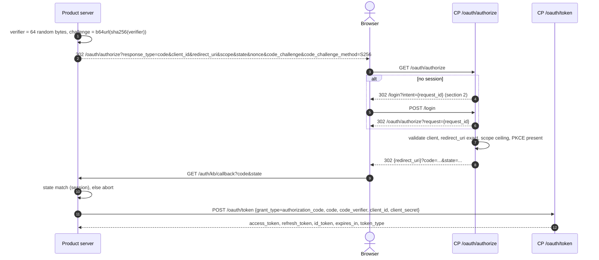
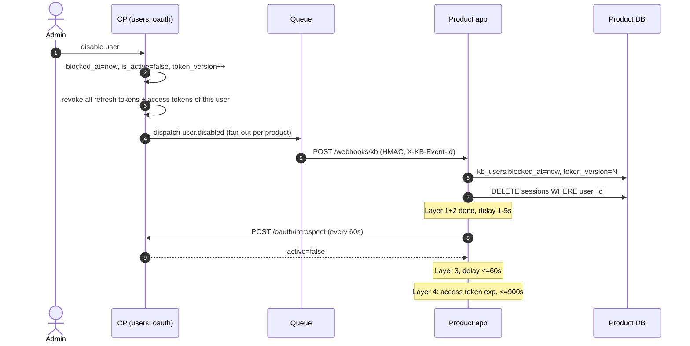

# 05 — Identity Hub Spec (OAuth2/OIDC, login interrupt, API contract, disable propagation)

**Date:** 13 Nov 2026
**Repo:** `E:/LaraProjects/saas-starter` (branch `extract/package-skeleton`)
**Depends on:** `docs/platform/04-CONTROL-PLANE-DESIGN.md` (§1.3 tables, §3.3 snapshot, §2.4 product contract), `docs/platform/02-ARCHITECTURE-DECISIONS.md` (§0 D1–D5, §5.4.1 handoff)
**Inputs:** `khattakbits-core/src/Http/Controllers/AuthController.php`, `khattakbits-core/src/Http/Middleware/EnsureUserActive.php`, `khattakbits-ui/src/login3d/submitLogin.js`, `resources/js/Pages/Auth/Login.vue`, `config/auth.php`, `config/session.php`, `composer.json`, `.env`
**Rule:** Design only. Koi migration, model ya controller nahi likha gaya.

**Table ownership:** `products`, `tenants_registry`, `subscriptions`, `product_oauth_clients`, `webhook_endpoints`, `webhook_deliveries`, `kb_user_product_access` — sab `04` §1.3 ke mutabiq. Yeh document unhein **reference** karta hai, dobara define nahi. Do naye tables yahan aate hain (§1.7.2, §2.3) — total `04` ke 18 + 2 = 20, plus Passport ke apne 5.

---

## 0. Verification — does Passport/Sanctum resolve on Laravel 13?

Command run (composer.json **nahi** badla, `diff` se confirm kiya):

```
composer require laravel/passport --dry-run
```

### 0.1 Result: **FAILED**

```
Your requirements could not be resolved to an installable set of packages.
```

Lekin wajah **Laravel 13 nahi** hai. Exact chain:

| Layer | Constraint | Verdict |
|---|---|---|
| `laravel/passport v13.7.1–v13.10.0` | `league/oauth2-server ^9.2` | ✅ Laravel 13 accept karta hai (koi `illuminate/auth` conflict nahi aaya) |
| `league/oauth2-server 9.2.0` | `php ~8.1.0 \|\| ~8.2.0 \|\| ~8.3.0 \|\| ~8.4.0` | ❌ **PHP 8.5.12** bahar |
| `league/oauth2-server 9.3.0 / 9.4.x` | `lcobucci/jwt ^5.6` | ✅ PHP 8.5 theek |
| `lcobucci/jwt 5.6.0 / 5.6.1` | `ext-sodium *` | ❌ **extension load nahi hai** |
| `laravel/passport v13.11.0` | `phpseclib/phpseclib 4.0.1` (exact pin) | ❌ advisory `PKSA-h7cz-q7zq-mdkt` ne block kiya |

Toh teen alag blockers hain, aur **teenon PHP 8.5 / extension side par hain**.

### 0.2 Fix — confirmed by second dry-run

`ext-sodium` sirf **commented out** hai, DLL maujood hai:

```
/c/php/php.ini:945   ;extension=sodium
/c/php/ext/php_sodium.dll            ← present
php -m | grep sodium → (khali)
```

```bash
# 1. php.ini line 945 se semicolon hatao
#    ;extension=sodium   ->   extension=sodium
php -m | grep sodium          # verify

# 2. phir install
composer require laravel/passport:^13.10
```

```
composer require laravel/passport --dry-run --ignore-platform-req=ext-sodium
```

Result:

```
Package operations: 13 installs, 0 updates, 0 removals
  - Installing phpseclib/phpseclib (4.0.3)
  - Installing lcobucci/jwt (5.6.1)
  - Installing league/oauth2-server (9.4.1)
  - Installing firebase/php-jwt (v7.2.1)
  - Installing laravel/passport (v13.10.0)
Using version ^13.10 for laravel/passport
```

**Verdict: Passport `v13.10.0` Laravel 13.38.0 ke saath resolve hota hai — bas `ext-sodium` chahiye.** `v13.11.0` nahi milega (phpseclib pin advisory-blocked); `^13.10` constraint composer ko `13.10.x` par rakhega, jo theek hai.

**`ext-sodium` optional nahi hai.** `lcobucci/jwt 5.6` ne sodium polyfill hata diya, is liye composer ise hard-require karta hai aur runtime par bhi chahiye. Agar host par sodium enable **nahi** ho sakta (shared hosting), tab hi alternative socho — aur woh alternative bura hai (§0.4).

### 0.3 Sanctum: **resolves cleanly**

```
composer require laravel/sanctum --dry-run
  - Locking laravel/sanctum (v4.4.0)
Using version ^4.4 for laravel/sanctum
```

Koi platform issue nahi, koi advisory nahi. `laravel/sanctum v4.4.0` Laravel 13 par theek hai.

### 0.4 Alternatives (agar sodium enable na ho sake)

| Option | Verdict |
|---|---|
| `paragonie/sodium_compat_ext_sodium` polyfill | ✅ Composer khud suggest karta hai. Pure-PHP sodium. **Magar** yeh sirf composer ka platform check pass karta hai — `lcobucci/jwt` ka `sodium_crypto_*` runtime use bhi polyfill se chalta hai. Slow (RSA signing par asar nahi, EdDSA par hai) |
| `league/oauth2-server` pin `9.2.0` | ❌ PHP 8.5 support nahi |
| Passport `v12.x` | ❌ `illuminate/auth ^9\|^10\|^11\|^12` — Laravel 13 nahi |
| **League OAuth2 server seedha (bina Passport)** | ❌ Wahi `league/oauth2-server 9.4.1` + `lcobucci/jwt` chain — **bilkul same sodium blocker**. Passport hataane se kuch nahi badalta |
| **Khud ka OAuth2 (Laravel Socialite inverted)** | ❌ PKCE + rotation + revoke khud likhna ~15 din aur security risk. Sirf tab jab sodium bilkul na ho |
| PHP 8.4 par shift | ✅ Sabse saaf fallback — `league/oauth2-server 9.2.0` sodium ke baghair chalta hai. Magar AGENTS.md PHP 8.5 kehta hai |

**Recommendation: `extension=sodium` uncomment karo.** Yeh 30-second ka kaam hai aur koi design compromise nahi.

### 0.5 Advisory note (honest)

Dry-run ne "7 security vulnerability advisories affecting 4 packages" dikhaya. Yeh **Passport ki wajah se nahi** — baseline already 7 hai (`composer audit --locked`):

| Package | Advisories |
|---|---|
| `symfony/http-foundation` | 4 |
| `symfony/http-kernel` | 1 |
| `symfony/mime` | 1 |
| `symfony/routing` | 1 (CVE-2026-118516) |

Passport install karne se yeh count **7 hi rehta hai** (dry-run ne bhi 7/4 hi dikhaya). Magar yeh pre-existing issue hai aur `symfony/*` patch bump se solve hota hai — **alag kaam hai, is spec ka nahi.** Ignore na karein.

---

## 1. OAuth2 / OIDC design

### 1.1 Architecture: Passport + thin OIDC layer

Passport OAuth2 deta hai (code+PKCE, token, revoke). Woh **OIDC nahi** deta — koi `id_token`, koi `/.well-known/openid-configuration`, koi JWKS nahi. Is liye do layers:

| Layer | Kya | Kahan |
|---|---|---|
| **Passport** | `/oauth/authorize`, `/oauth/token`, `/oauth/revoke` (RFC 7009), client registry, auth codes, refresh tokens | `laravel/passport` (vendor) |
| **OIDC layer** | `id_token` (RS256), `/oauth/jwks`, `/.well-known/openid-configuration`, `/oauth/userinfo` | CP app, `app/Modules/Identity/` |
| **Introspection** | `/oauth/introspect` (RFC 7662) | CP app — Passport mein nahi hai |

Yeh split jaan boojh kar hai: Passport ka core (auth code, PKCE verify, token storage, revocation) **dobara likhna** ghalti hogi; sirf jo cheez Passport mein hai hi nahi woh upar se add hoti hai.

### 1.2 Endpoints

| Method | Path | Auth | Kaam |
|---|---|---|---|
| GET | `/oauth/authorize` | session (login interrupt) | Consent skip + code issue |
| POST | `/oauth/token` | client secret + PKCE verifier | `authorization_code`, `refresh_token`, `client_credentials` |
| POST | `/oauth/revoke` | client secret | RFC 7009 |
| POST | `/oauth/introspect` | client secret | RFC 7662 |
| GET | `/oauth/userinfo` | user bearer | OIDC claims |
| GET | `/oauth/jwks` | public | RS256 public keys |
| GET | `/.well-known/openid-configuration` | public | Discovery |
| GET | `/api/v1/subscriptions/resolve` | bearer (client or user) | Snapshot |
| GET | `/api/v1/entitlements` | user bearer | Snapshot, tenant token se |
| POST | `/api/v1/subscriptions/renew-link` | bearer | Checkout URL |

`/oauth/token`, `/oauth/authorize`, `/oauth/revoke` **Passport ke hain** — CP unhein override nahi karta. `02` §1.1 ki ghalti yahi thi ke woh inhein product ke andar dikha raha tha.

### 1.3 Client registration (product create par auto)

Admin `POST /platform/products` kare to **usi transaction mein**:

```
1. products row insert
2. Passport client create:
     name         = "{product.name} ({product.key})"
     redirect_uris= ["https://{domain}/auth/kb/callback"]
     confidential = true
     password_client = false
     personal_access_client = false
3. product_oauth_clients row (04 §1.3):
     product_id, oauth_client_id, name, redirect_uris,
     pkce_required = true, scopes = default set,
     is_first_party = true, status = 'active'
4. secret shown ONCE in the admin response, DB mein sirf secret_last4
```

**Secret rotation:** `POST /platform/oauth-clients/{client}/rotate` → naya secret, `status = 'rotated'`, purana secret **24h tak valid** (grace), `secret_last4` update, `Audit::log('oauth_client.rotated')`. Product ko naya secret deploy karna hoga — is liye grace window lazmi hai warna rotation = outage.

`oauth_client_id` ka type `04` §1.3 mein `string(64)` rakha gaya tha kyunke Passport v12+ UUID deta hai. **Ab verify ho gaya: v13.10 UUID use karta hai** — `string(64)` sahi hai, `unsignedBigInteger` nahi.

### 1.4 Redirect URI allowlist

Teen layer, teenon lazmi:

| Layer | Check | Fail |
|---|---|---|
| 1. Registration | `product_oauth_clients.redirect_uris` (JSON array) — exact string match, **koi prefix/wildcard nahi** | `invalid_request` |
| 2. Host binding | Redirect host === `products.domain` ya `tenants_registry.subdomain` us product ka | `invalid_request` |
| 3. Scheme | `https` lazmi (localhost exempt sirf `APP_ENV=local`) | `invalid_request` |

**Exact match kyun, prefix nahi:** `https://mizaanbitserp.com/auth/kb/callback` ko prefix-match karne se `https://mizaanbitserp.com/auth/kb/callback.evil.com` bhi pass ho jata. OAuth 2.1 (draft-ietf-oauth-v2-1) exact match recommend karta hai, aur RFC 9700 §2.1 bhi.

**Path:** har product ka callback **fixed** hai — `/{prefix}/auth/kb/callback`. Product `kb-product.json` mein apna callback path declare karta hai, admin usay confirm karta hai. Free-form redirect URI input **nahi** hoga.

### 1.5 Scopes

| Scope | Kya deta hai | Kaun maangta hai |
|---|---|---|
| `openid` | `id_token` issue ho | Sab |
| `profile` | `name`, `picture`, `locale` userinfo mein | Sab |
| `email` | `email`, `email_verified` | Sab |
| `subscription` | `/api/v1/subscriptions/resolve`, snapshot `status`/`plan`/`period` | Sab (billing UI ke liye) |
| `entitlements` | `flags`/`limits`/`quotas`/`modules` snapshot mein | Sab (feature gating ke liye) |

Default set jo client create par lagta hai: `openid profile email subscription entitlements`.

**Scope rules:**
- `openid` ke baghair `id_token` nahi milta (OIDC spec).
- `subscription` ke baghair resolve `403 insufficient_scope` deta hai — `status`/`plan` fields **redact** nahi hote, poora call reject hota hai. Partial redaction confusing hai.
- Scope narrow karne ki ijazat hai (product kam maang sakta hai), barhane ki nahi — `product_oauth_clients.scopes` hard ceiling hai. Maanga hua scope ceiling se bahar → `invalid_scope`.

**`04` §1.3 correction:** wahan example `['openid','profile','email','subscriptions:read']` tha. Woh illustrative tha aur is scope set se match nahi karta. `04` ko update kar diya gaya hai (plural `subscriptions:read` → `subscription`, `entitlements` add).

### 1.6 Authorization code + PKCE



**PKCE lazmi (S256), `plain` reject.** `product_oauth_clients.pkce_required = true` default; `false` sirf tab jab koi legacy client ho — Phase 1 mein koi nahi. Confidential client hone ke bawajood PKCE lazmi hai (OAuth 2.1 requirement; auth code interception se bachata hai jab redirect URI registered ho magar attacker ke paas code aa jaye).

**Auth code TTL: 60s**, single-use (Passport default). Reuse attempt → **poora token family revoke** (RFC 9700 §4.1.1) — yeh Passport khud nahi karta, CP ko `TokenRevoked` event par family revoke karna hoga.

### 1.7 `id_token`

#### 1.7.1 Claims

| Claim | Value | Note |
|---|---|---|
| `iss` | `https://app.khattakbits.com` | `config('app.url')` — trailing slash nahi |
| `sub` | `users.id` (string) | **stable**, email nahi. Email badal sakti hai |
| `aud` | `product_oauth_clients.oauth_client_id` | string, array nahi (single audience) |
| `exp` | `iat + 300` | id_token chhota — 5 min. Access token alag |
| `iat` | now | |
| `auth_time` | session login time | Step-up auth ke liye |
| `nonce` | authorize request ka `nonce` | **echo, verify product par** |
| `email`, `email_verified` | user | `email` scope |
| `name` | user name | `profile` scope |
| `kb_token_version` | `users.token_version` | disable propagation (§5) |
| `kb_products` | user ke product keys | `kb_user_product_access` se |

**`sub` = `users.id` kyun, `uuid` kyun nahi:** `users.id` already stable hai aur `04` ke saare FKs usi par hain. Separate `sub` column add karna ek aur mapping layer hai bila faide. Magar `sub` **string** bhejna lazmi hai (OIDC spec: `sub` string hai) — `"47"`, `47` nahi. Warna strict clients reject karte hain.

#### 1.7.2 Signing keys — naya table

```php
// ── oauth_signing_keys ───────────────────────────────────────────────────
id              bigIncrements
kid             char(32)  unique        // key id, JWKS mein jata hai
alg             string(10) default 'RS256'
public_pem      text                    // public key (JWKS ke liye)
private_pem     text                    // 'encrypted' cast — kabhi log/expose nahi
status          string(10) index        // active|retiring|retired
activated_at    timestamp
retires_at      timestamp nullable      // is date ke baad JWKS se hatao
retired_at      timestamp nullable
created_at      timestamp
// exactly one row with status='active' — app-level invariant (no partial unique index, 04 §0)
```

**Rotation (90 din):**

```
1. naya key generate -> status='active'
2. purana -> status='retiring', retires_at = now + 30d
   (JWKS dono publish karta hai, is liye purane tokens verify hote rehte hain)
3. 30 din baad -> status='retired', JWKS se gayab
```

**Overlap 30 din kyun:** `id_token` TTL 5 min hai magar product apni `kb_snapshot` 72h tak rakhta hai — us snapshot mein purana `id_token` ho sakta hai. 30 din bohat zyada hai, magar sasta hai.

`GET /oauth/jwks` **sirf `active` + `retiring`** keys deta hai (`retired` nahi), `Cache-Control: public, max-age=3600`.

**RS256 kyun, ES256 nahi:** RS256 `ext-openssl` par chalta hai (verified present); ES256 ke liye sodium/ECDSA chahiye aur JWKS consumers mein kam support hai.

#### 1.7.3 JWKS + discovery

```json
GET /oauth/jwks
{ "keys": [ { "kty": "RSA", "use": "sig", "alg": "RS256", "kid": "kb-2026-11-a1b2c3",
              "n": "<base64url modulus>", "e": "AQAB" } ] }
```

```json
GET /.well-known/openid-configuration
{ "issuer": "https://app.khattakbits.com",
  "authorization_endpoint": "https://app.khattakbits.com/oauth/authorize",
  "token_endpoint": "https://app.khattakbits.com/oauth/token",
  "userinfo_endpoint": "https://app.khattakbits.com/oauth/userinfo",
  "jwks_uri": "https://app.khattakbits.com/oauth/jwks",
  "revocation_endpoint": "https://app.khattakbits.com/oauth/revoke",
  "introspection_endpoint": "https://app.khattakbits.com/oauth/introspect",
  "response_types_supported": ["code"],
  "grant_types_supported": ["authorization_code", "refresh_token", "client_credentials"],
  "subject_types_supported": ["public"],
  "id_token_signing_alg_values_supported": ["RS256"],
  "scopes_supported": ["openid", "profile", "email", "subscription", "entitlements"],
  "token_endpoint_auth_methods_supported": ["client_secret_basic", "client_secret_post"],
  "code_challenge_methods_supported": ["S256"] }
```

### 1.8 `/oauth/userinfo` claims

`Authorization: Bearer <access_token>`, scope `openid` lazmi.

```json
{
  "sub": "47",
  "email": "owner@acme.pk",
  "email_verified": true,
  "name": "Bilal Ahmed",
  "is_active": true,
  "kb_token_version": 7,
  "products": ["mizaan", "ledger"],
  "kb_tenant_id": "01JQ8Z3K7M4X2V9B5N1C6D0RTA",
  "roles": ["owner"],
  "subscription": { "status": "active", "plan": "growth", "period_end": "2026-12-01T00:00:00Z" }
}
```

| Claim | Source | Scope gate |
|---|---|---|
| `sub`, `is_active`, `kb_token_version`, `products` | `users` + `kb_user_product_access` | `openid` |
| `email`, `email_verified` | `users` | `email` |
| `name` | `users` | `profile` |
| `roles` | `tenants_registry` + `kb_user_tenant` (product side) — CP sirf product-level role deta hai | `profile` |
| `kb_tenant_id` | `tenants_registry.kb_tenant_id` — **sirf tab** jab token `X-KB-Tenant` ke saath bind ho | `subscription` |
| `subscription` | `subscriptions` snapshot (`status`, `plan.key`, `period.end`) | `subscription` |

**`kb_tenant_id` optional kyun:** user ke multiple tenants ho sakte hain (D1: ek insaan 2 tenants mein). Bina tenant context ke CP guess nahi karta — `null` deta hai aur product `resolve` se poochta hai.

**`roles` honesty:** tenant-level roles product ki DB mein hain (`kb_user_tenant`), CP ke paas nahi. CP sirf `kb_user_product_access.role` (`owner|admin|member|billing|viewer`) deta hai. Doc mein `roles` rakha hai magar woh **product-level** role hai — product apne tenant roles khud lagata hai. Yeh `02` §5.1 ke `kb_user_tenant` design se consistent hai.

### 1.9 Refresh token policy

| Rule | Value | Kyun |
|---|---|---|
| TTL | 30 din absolute, 7 din idle | Chori hone par window chhoti |
| Rotation | **har refresh par naya** refresh token | Reuse detection possible |
| Reuse detection | purana refresh token dobara → **poora family revoke** + `security_events` (`oauth.refresh_reuse`) | RFC 9700 §4.14.2 |
| Family binding | refresh token `access_token_id` se bandha | Passport default |
| Revoke on disable | user disable → saare refresh tokens revoke | §5 |
| Revoke on password change | `token_version++` ke saath | Break-glass admin ka password badla to sessions mar jayein |
| `client_credentials` | refresh token **nahi** milta | RFC 6749 §4.4.3 |

`token_version` claim refresh par **dobara check** hota hai: refresh token ke saath `kb_token_version` DB se compare, mismatch → `invalid_grant` + family revoke. Isse disable ka asar refresh path par **foran** hota hai, access token expiry ka intezar nahi.

### 1.10 Consent screen — first-party skip

`product_oauth_clients.is_first_party = true` wale clients ke liye consent **skip**.

| Condition | Behaviour |
|---|---|
| `is_first_party = true` **aur** user ke paas `kb_user_product_access` row hai | **Skip** — seedha code issue |
| `is_first_party = true` magar access row **nahi** | Consent **nahi** — `403 access_denied` ("Aap ke paas is product ka access nahi"). Consent dikhana ghalat hoga: user ke paas access hi nahi |
| `is_first_party = false` (Phase 2 third-party) | Consent screen lazmi |

**Consent skip kyun safe hai:** first-party products KhattakBits ke apne hain, user ne already CP par login kiya hai, aur access `kb_user_product_access` se grant hota hai (admin-controlled). Consent screen yahan security nahi, friction hai — aur woh friction har login par repeat hoti.

`prompt=consent` param force kar sakta hai (testing ke liye); `prompt=none` par session na ho to `login_required` error (silent SSO ke liye).

---

## 2. Login interrupt — 3D login ko `/oauth/authorize` se jodna

### 2.1 Aaj kya maujood hai

| Cheez | Halat |
|---|---|
| `POST /login` | `AuthController::store()` — `Auth::attempt` + `is_active` check, phir `redirect()->intended('/')` |
| `redirect_uri` / `return_to` | Query ya body se padha jata hai, `isSafeRedirect()` se validate |
| `isSafeRedirect()` | Relative paths allow; absolute sirf `ALLOWED_SSO_HOSTS` + `app.url` host |
| 3D login | `Login.vue` → `submitLogin({ url: '/login' + window.location.search })` |
| `/oauth/*` routes | **Koi nahi** — `php artisan route:list` khali |
| `users.token_version` | **Column maujood nahi** — zero references (`02` §2.4 ne plan kiya tha, implement nahi hua) |
| `users.blocked_at` | **Column maujood nahi** — sirf `is_active` |

### 2.2 3D login ko koi change nahi chahiye

`Login.vue` line 205:

```js
const currentQuery = window.location.search
const result = await submitLogin({ url: '/login' + currentQuery, ... })
```

Yeh **poora query string** forward karta hai. Is liye `/login?intent=01JQ...` khud se chala jayega — `submitLogin.js` ko chhune ki zaroorat nahi. Yeh design ka faida hai, accident nahi: `submitLogin` URL ko opaque treat karta hai.

`submitLogin` ka ek edge case jo yahan matter karta hai: woh `data.component === 'Auth/Login'` ko "redirect nahi hua" samajhta hai. OAuth flow mein success **hamesha** redirect karta hai (authorize par wapas), is liye yeh branch hit nahi hoti. ✅

### 2.3 Interrupt design — `oauth_auth_requests` table

`url.intended` (Laravel ka default) **use nahi karna**. Wajah: woh session mein **ek hi slot** hai. Do tabs mein do authorize requests kholo → doosri pehli ko overwrite kar deti hai → pehla tab ghalat client/state par wapas jata hai. Yeh silent cross-tenant bug hai.

Iske bajaye pending authorize request ko **row** banao:

```php
// ── oauth_auth_requests ──────────────────────────────────────────────────
id                  char(26)  primary      // ULID — URL mein jata hai
session_id          string(64)  index      // binding: sirf usi browser se continue ho
client_id           string(64)             // product_oauth_clients.oauth_client_id
product_id          foreignId  constrained('products') cascadeOnDelete
redirect_uri        string(190)
scopes              json                   // validated at creation
state               string(190) nullable   // product ka state — as-is echo
nonce               string(120) nullable
code_challenge      string(128)
code_challenge_method string(6) default 'S256'
response_type       string(10) default 'code'
prompt              string(20) nullable
expires_at          timestamp  index       // now + 600s
consumed_at         timestamp nullable
created_at          timestamp
// NO updated_at
```

Flow:

```
GET /oauth/authorize?... (no session)
  -> validate client + redirect_uri + scopes + PKCE
  -> INSERT oauth_auth_requests (expires_at = now+600, session_id = current session)
  -> 302 /login?intent={id}

POST /login?intent={id}   (3D login posts here — query already preserved)
  -> authenticate (existing code)
  -> load auth request WHERE id = ? AND session_id = ? AND consumed_at IS NULL AND expires_at > now
     (mismatch -> ignore intent, fall through to redirect()->intended('/'))
  -> mark consumed_at (atomic UPDATE ... WHERE consumed_at IS NULL, affectedRows = 1)
  -> 302 /oauth/authorize?request={id}

GET /oauth/authorize?request={id}
  -> load row (session_id match, consumed_at NOT NULL)
  -> consent check (§1.10) -> Passport code issue -> 302 {redirect_uri}?code&state
```

**Rules:**

| # | Rule | Kyun |
|---|---|---|
| 1 | `session_id` binding | Request ID leak hone par bhi doosra browser continue nahi kar sakta |
| 2 | 600s expiry | Login form bhool jane par stale request na chale |
| 3 | Single use (`consumed_at`) | Replay se doosra code na bane |
| 4 | `state` **as-is** store + echo | CP state ko interpret nahi karta; product usay verify karta hai |
| 5 | `nonce` store + id_token mein daalo | Replay protection product side |
| 6 | Prune 24h | Forensics ke liye thoda rakho |
| 7 | Login fail | `intent` row **delete na karo** — user dobara try kare to wahi row chahiye |

**`?request=` do stage kyun (login ke baad phir authorize):** login ke waqt authorize dobara poora validate karna padta hai (client/redirect/scope). Row se validate karna sasta aur deterministic hai, aur user ne beech mein client change nahi kiya.

### 2.4 `isSafeRedirect()` ke gaps (aur fix)

Yeh function `redirect_uri`/`return_to` handle karta hai — OAuth ke bahar wale legacy cross-product redirects ke liye. Aaj ke code mein **paanch** gaps hain:

| # | Gap | Aaj ka behaviour | Fix |
|---|---|---|---|
| **G1** | **`ALLOWED_SSO_HOSTS` khaali hai** — `.env`, `.env.example`, `config/` mein maujood hi nahi | `array_filter(explode(',', ''))` = `[]`, sirf `app.url` host bachta hai. Cross-product redirect **chupchap** `redirect()->intended('/')` par gir jata hai | Static env **hatao**. Allowlist DB se: `products.domain` + `tenants_registry.subdomain`, wildcard-aware (`*.{products.domain}`). `04` ke `products` table ne yeh possible bana diya |
| **G2** | **Scheme check nahi** | `javascript://app.example.com/%0aalert(1)` → host `app.example.com` → **allowed**. `http://` downgrade bhi allowed | `parse_url()['scheme']` `https` hona lazmi (localhost exempt) |
| **G3** | **CR/LF check nahi** | `https://app.example.com/%0d%0aSet-Cookie:x=1` header injection | `preg_match('/[\r\n\0]/', $target)` → reject |
| **G4** | **`state`/`nonce` ka koi concept nahi** | Redirect target sirf URL hai; koi CSRF binding nahi | OAuth path `oauth_auth_requests` se chalta hai (§2.3) — `isSafeRedirect` sirf legacy path ke liye rahe |
| **G5** | **`\\` sirf prefix par check** | `/\evil.com` reject ✅ magar `/..//evil.com` allow | `ltrim` ke baad `str_starts_with($t, '//')` dobara check, aur `..` segment reject |

**G1 ka fix detail** (sab se bara):

```php
// PURANA — static, khaali, chupchap fail
$allowedHosts = array_filter(array_map('trim', explode(',', (string) env('ALLOWED_SSO_HOSTS', ''))));
$allowedHosts[] = $appHost;

// NAYA — DB se, per-product
// 1. products.domain  ('mizaanbitserp.com')
// 2. tenants_registry.subdomain ('acme.mizaanbitserp.com')
// 3. exact host match, ya host === domain, ya host ends_with '.'.domain
// Cache: kb:sso:hosts:{product_id}, TTL 300s, product save par forget
```

`env()` ko **request path** par call karna khud ek bug hai: `config:cache` ke baad `env()` `null` deta hai. Yeh `G1` ko chhupa deta hai production mein (staging par chalta hai, prod par nahi) — classic.

### 2.5 `state` / `nonce` — kaun kya own karta hai

| Cheez | Owner | CP ka kaam |
|---|---|---|
| `state` | **Product** generate karta hai | Store + echo as-is. Interpret/validate **nahi** |
| `nonce` | **Product** | Store + `id_token` mein daalo |
| `code_verifier` | **Product** | Sirf `code_challenge` receive karta hai |
| `code` | **CP** | Issue, 60s TTL, single use |
| `auth_time` | **CP** | id_token mein |

**CP `state` ko validate nahi karta** kyunke `state` product ke CSRF token hai — CP usay sirf round-trip karta hai. Agar CP usay reject kare to product ka flow toot jata hai.

---

## 3. API contract

Base: `https://app.khattakbits.com`. Version URL path mein (`/api/v1/`), payload mein `schema`, response header `X-KB-API-Version: 1`.

### 3.1 Auth matrix

| Endpoint | Client credentials | User bearer | Note |
|---|---|---|---|
| `GET /api/v1/subscriptions/resolve` | ✅ koi bhi tenant of that product | ✅ sirf apne tenant | Server-to-server default |
| `GET /api/v1/entitlements` | ✅ | ✅ | User path `X-KB-Tenant` lazmi |
| `POST /api/v1/subscriptions/renew-link` | ✅ | ✅ | Client path `tenant_id` body mein |
| `POST /oauth/introspect` | ✅ **sirf** | ❌ | RFC 7662 |
| `POST /oauth/revoke` | ✅ **sirf** | ❌ | RFC 7009 |
| `GET /oauth/userinfo` | ❌ | ✅ **sirf** | `openid` scope |

**Client credentials token product-scoped hota hai:** `client_id` → `product_oauth_clients.product_id`. Woh **sirf usi product** ke tenants resolve kar sakta hai. Doosre product ka `tenant_id` bheja → `403 tenant_not_in_scope`. Yeh cross-product data leak rokta hai.

### 3.2 `GET /api/v1/subscriptions/resolve`

```
GET /api/v1/subscriptions/resolve?tenant_id=01JQ8Z3K7M4X2V9B5N1C6D0RTA
Authorization: Bearer <token>
Accept: application/json
If-None-Match: W/"9f2c4a1e..."
```

**200** — body **exactly** `04` §3.3 ka snapshot:

```json
{
  "schema": 1,
  "product_key": "mizaan",
  "tenant_id": "01JQ8Z3K7M4X2V9B5N1C6D0RTA",
  "status": "active",
  "access_mode": "full",
  "plan": { "key": "growth", "tier": 2, "interval": "month", "amount_minor": 1500000, "currency": "PKR" },
  "period": { "start": "2026-11-01T00:00:00Z", "end": "2026-12-01T00:00:00Z",
              "grace_ends_at": null, "cancel_at_period_end": false },
  "flags":  { "accounting.invoices": true, "inventory.multi_warehouse": true },
  "limits": { "seats": 25, "warehouses": 3 },
  "quotas": { "api.calls": { "limit": 50000, "unit": "calls", "reset": "month" } },
  "modules": { "accounting": "active", "inventory": "active", "payroll": "removed" },
  "version": 7
}
```

```
ETag: W/"9f2c4a1e..."
Cache-Control: private, max-age=30
X-KB-API-Version: 1
X-KB-Entitlements-Version: 7
```

**304** — `If-None-Match` match, **empty body**. Yeh `02` §1.2 step 9 ka mechanism hai.

**Errors:**

| Status | Code | Kab |
|---|---|---|
| 400 | `tenant_id_required` | `tenant_id` missing (client credentials path) |
| 401 | `invalid_token` | Token expired/revoked/`token_version` mismatch |
| 403 | `insufficient_scope` | `subscription` scope nahi |
| 403 | `tenant_not_in_scope` | Tenant doosre product ka, ya user ka membership nahi |
| 404 | `tenant_not_found` | `kb_tenant_id` maujood nahi |
| 409 | `tenant_not_active` | Registry `provisioning` ya `archived` |
| 429 | `rate_limited` | `Retry-After` header |

```json
{ "error": { "code": "tenant_not_in_scope", "message": "Tenant belongs to a different product." } }
```

### 3.3 `GET /api/v1/entitlements`

`resolve` se **do farq**: `tenant_id` query param nahi (token/header se), aur response se `plan`/`period.start` nikal jate hain (lighter, UI polling ke liye).

```
GET /api/v1/entitlements
Authorization: Bearer <user access token>
X-KB-Tenant: 01JQ8Z3K7M4X2V9B5N1C6D0RTA
If-None-Match: W/"9f2c4a1e..."
```

```json
{
  "schema": 1,
  "tenant_id": "01JQ8Z3K7M4X2V9B5N1C6D0RTA",
  "status": "grace",
  "access_mode": "read_only",
  "period": { "end": "2026-12-01T00:00:00Z", "grace_ends_at": "2026-12-08T00:00:00Z" },
  "flags":  { "accounting.invoices": true },
  "limits": { "seats": 25 },
  "quotas": { "api.calls": { "limit": 50000, "unit": "calls", "reset": "month" } },
  "modules": { "accounting": "active" },
  "version": 7,
  "hash": "9f2c4a1e..."
}
```

`X-KB-Tenant` membership check lazmi — user `kb_user_product_access` + product ke tenant ka owner/member ho. Mismatch → `403 tenant_not_in_scope`.

**`hash` field:** `resolve` ke `ETag` ka raw value. Product ise apne snapshot ke saath store karke compare kar sakta hai (ETag header parse karne ki zaroorat nahi).

### 3.4 `POST /api/v1/subscriptions/renew-link`

```
POST /api/v1/subscriptions/renew-link
Authorization: Bearer <token>
Content-Type: application/json

{ "tenant_id": "01JQ8Z3K7M4X2V9B5N1C6D0RTA",
  "return_url": "https://acme.mizaanbitserp.com/billing/return",
  "plan_key": "growth" }
```

```json
{
  "checkout_url": "https://app.khattakbits.com/checkout/INV-00124/pay?t=eyJ...",
  "invoice_number": "INV-00124",
  "expires_at": "2026-11-13T06:10:00Z",
  "amount_minor": 1500000,
  "currency": "PKR"
}
```

| Rule | Detail |
|---|---|
| `return_url` validation | Host `tenants_registry.subdomain` ya `products.domain` ke against exact match. Free-form **nahi** |
| Token | Signed (`t=`), 30 min, single use, tenant-bound. Checkout controller verify karta hai |
| Idempotency | `return_url + tenant_id` 5 min ke andar dobara → **wahi** invoice (naya nahi). `invoices.idempotency_key` use hota hai |
| `plan_key` optional | Nahi diya to current plan. Diya to upgrade/downgrade — proration invoice item banti hai |
| Errors | `400 return_url_not_allowed`, `409 subscription_not_renewable` (`suspended`), `403 tenant_not_in_scope` |

### 3.5 `POST /oauth/introspect` (RFC 7662)

```
POST /oauth/introspect
Authorization: Basic base64(client_id:client_secret)
Content-Type: application/x-www-form-urlencoded

token=eyJ...&token_type_hint=access_token
```

**Active:**

```json
{
  "active": true,
  "scope": "openid profile email subscription entitlements",
  "client_id": "9f1c...",
  "sub": "47",
  "token_type": "Bearer",
  "exp": 1763013300,
  "iat": 1763012400,
  "nbf": 1763012400,
  "iss": "https://app.khattakbits.com",
  "aud": "mizaan",
  "kb_token_version": 7,
  "kb_products": ["mizaan"],
  "kb_tenant_id": null
}
```

**Inactive:** `{ "active": false }` — **HTTP 200**, error nahi (RFC 7662 §2.2). Unknown, expired, revoked, aur `token_version` mismatch — chaaron ke liye same jawab (token existence leak nahi hoti).

**Rate limit:** 300/min per client. Yeh endpoint product ke **har session ke har 60s** par hit hota hai — is liye limit generous hai magar caching lazmi (§5.2).

### 3.6 `POST /oauth/revoke` (RFC 7009)

```
POST /oauth/revoke
Authorization: Basic base64(client_id:client_secret)
Content-Type: application/x-www-form-urlencoded

token=eyJ...&token_type_hint=refresh_token
```

**200, empty body — hamesha.** Unknown token, already-revoked token, doosre client ka token: sab par 200 (RFC 7009 §2.2). Wajah: error return karne se attacker ko token validity ka oracle mil jata hai.

**Refresh token revoke → poora family revoke** (RFC 9700 §4.14.2). Access token revoke → sirf woh token (refresh zinda rehta hai — magar `token_version` bump par sab mar jate hain).

### 3.7 Rate limits

| Endpoint | Limit | Key |
|---|---|---|
| `POST /oauth/token` | 30/min | `client_id` + IP |
| `GET /oauth/authorize` | 60/min | session + IP |
| `POST /oauth/introspect` | 300/min | `client_id` |
| `POST /oauth/revoke` | 60/min | `client_id` |
| `GET /oauth/userinfo` | 120/min | `sub` |
| `GET /api/v1/subscriptions/resolve` | 600/min | `client_id` |
| `GET /api/v1/entitlements` | 240/min | `sub` |
| `POST /api/v1/subscriptions/renew-link` | 10/min | `sub` |
| `POST /login` | 5/min (already `throttle:login`) | email + IP |

`429` par `Retry-After` header lazmi. `submitLogin.js` already isay padhta hai (`retryAfterSeconds()`) — 3D login par countdown chal jayega, koi change nahi chahiye.

### 3.8 Versioning

| Cheez | Policy |
|---|---|
| URL | `/api/v1/` — breaking change par `/api/v2/` |
| Payload | `schema: 1` field (snapshot ka andar) |
| Header | `X-KB-API-Version: 1` response par |
| Additive changes | Kabhi version nahi barhate (naya field add karna safe hai) |
| Deprecation | 6 mahine overlap, `Sunset: <date>` + `Deprecation: true` headers, `CHANGELOG` + email |
| Minimum | `products.min_starter_version` se `khattakbits:doctor` outdated banner dikhata hai (`02` §4.2) |

---

## 4. Webhooks

### 4.1 Events

| Event | Trigger | `data` keys |
|---|---|---|
| `tenant.provisioned` | Product ne tenant DB bana kar `kb_tenant_id` diya | `tenant_id`, `slug`, `subdomain`, `owner_user_id` |
| `subscription.created` | `∅ → trialing\|active` | `subscription_id`, `status`, `plan_key`, `seats`, `period` |
| `subscription.renewed` | Payment verified, period shift | + `previous_period` |
| `subscription.grace` | `period_end`/`trial_ends_at` cross | + `grace_ends_at` |
| `subscription.expired` | `grace_ends_at` cross | + `expired_at` |
| `subscription.cancelled` | User/admin cancel | + `cancelled_at`, `effective_at`, `reason` |
| `subscription.suspended` | Admin suspend | + `suspended_at`, `reason` |
| `plan.changed` | Plan upgrade/downgrade | `from_plan`, `to_plan`, `effective_at`, `proration_minor` |
| `user.disabled` | Admin disables user | `kb_user_id`, `email`, `token_version`, `tenant_ids[]` |
| `user.enabled` | Admin re-enables | same |
| `subscription.entitlements_changed` | Plan entitlements edit (`04` §3.4) | `version`, `hash` |
| `invoice.paid` / `invoice.voided` | Invoice state | `invoice_number`, `total_minor` |
| `payment.verified` / `payment.rejected` | TRX queue | `payment_id`, `reference`, `amount_minor` |

`04` §1.3 ke `webhook_endpoints.events` JSON array inhein hold karta hai; `["*"]` sab. Unknown event name → endpoint save par `422` (typo se silent miss na ho).

### 4.2 Payload envelope

```json
{
  "id": "01JQ8Z4N2P6R3T9V5W1X7Y0B2C",
  "type": "subscription.grace",
  "api_version": "1",
  "created_at": "2026-11-13T05:40:00Z",
  "product": { "key": "mizaan" },
  "data": {
    "tenant_id": "01JQ8Z3K7M4X2V9B5N1C6D0RTA",
    "subscription_id": "01JQ8Z3K7M4X2V9B5N1C6D0RTB",
    "status": "grace",
    "plan_key": "growth",
    "period": { "start": "2026-11-01T00:00:00Z", "end": "2026-12-01T00:00:00Z" },
    "grace_ends_at": "2026-12-08T00:00:00Z",
    "access_mode": "read_only"
  }
}
```

**Har `data` mein `tenant_id`** — warna product ko `subscription_id` se lookup karna padta hai jo uske paas nahi hota.

**`access_mode` har subscription event mein** — `04` §2.4 ka contract: product `status` parse nahi karta, `access_mode` padhta hai. Webhook mein bhejna lazmi hai, warna product webhook par bhi guess karega.

### 4.3 Signature + replay protection

```
POST https://acme.mizaanbitserp.com/webhooks/kb
Content-Type: application/json
User-Agent: KhattakBits-Webhook/1
X-KB-Event-Id: 01JQ8Z4N2P6R3T9V5W1X7Y0B2C
X-KB-Event: subscription.grace
X-KB-Timestamp: 1763012400
X-KB-Signature: t=1763012400,v1=5f2a...c91b
```

```
signed_payload = "{timestamp}.{raw_request_body}"
signature      = hash_hmac('sha256', signed_payload, endpoint.secret)   // hex
```

| Rule | Value |
|---|---|
| Secret | `webhook_endpoints.secret` (`encrypted` cast), per-endpoint, product ke OAuth secret se **alag** |
| Timestamp window | **±300s**. Bahar → `401` |
| Body | **Raw bytes** sign hote hain, re-serialized JSON nahi (key order badal jata hai) |
| Compare | `hash_equals()` — timing-safe |
| Multiple sigs | `v1=...,v1=...` accept karo (rotation ke dauraan do secrets) |
| Rotation | `POST /platform/webhooks/{endpoint}/rotate-secret` — 24h dono valid |

**Replay protection do layer:**

1. **Timestamp** — 300s window. Attacker ko 5 min mein replay karna hoga.
2. **`X-KB-Event-Id` dedupe** — product `webhook_events` table (`02` §5.1) mein unique. Duplicate → `200` aur ignore. Yeh timestamp ke baghair bhi kaam karta hai (clock skew, retry).

Sirf timestamp kaafi nahi: retry legitimately 1 ghante baad aata hai, aur woh 300s window se bahar hoga. Is liye **retry ke liye timestamp window ka exception** nahi — balke har delivery apna **naya** `X-KB-Timestamp` leta hai (delivery time, event time nahi). Event time `created_at` body mein hai.

### 4.4 Retry / backoff

| Attempt | Delay | Cumulative |
|---|---|---|
| 1 | immediate | 0s |
| 2 | 5s | 5s |
| 3 | 30s | 35s |
| 4 | 2m | ~2.6m |
| 5 | 10m | ~12.6m |
| 6 | 1h | ~1h 13m |
| — | `dead` | — |

Jitter ±20% (thundering herd se bachne ke liye). Success = `2xx` **aur** body `{"ok":true}` optional (2xx kaafi hai).

| Rule | Detail |
|---|---|
| Timeout | 10s connect, 15s total |
| Auto-disable | 20 consecutive `dead` in 24h → `is_active = false`, `disabled_at` set, admin email |
| Dead letter | `status = 'dead'`, admin `/platform/webhooks/{endpoint}/deliveries` se manually replay |
| Ordering | **Guaranteed nahi** — `subscription.grace` `subscription.expired` se pehle aa sakta hai. Product `version` field se stale payload reject kare |
| Concurrency | Per endpoint 1 worker (queue `webhooks`, `->onQueue("webhooks-{$endpointId}")`) — order ke liye best-effort |

**Ordering ka honest jawab:** exactly-once + ordering dono ek saath nahi milte. Product `version` (monotonic) par stale check kare — `04` §3.3 snapshot ka `version` yahi kaam karta hai.

### 4.5 Delivery log

`webhook_deliveries` (`04` §1.3) — fields already defined, mapping:

| Column | Source |
|---|---|
| `public_id` | Envelope `id` = `X-KB-Event-Id` |
| `event` | Envelope `type` |
| `payload` | Full envelope JSON |
| `status` | `pending` → `delivered` / `failed` / `dead` |
| `attempts` | Retry counter |
| `response_code`, `response_body` | Product ka jawab (body 4KB truncate) |
| `duration_ms` | Connect + response |
| `next_retry_at` | Backoff table |
| `delivered_at` | Success time |

Retention 30 din (`04` §1.3). Admin screen `04` §4.1 #24.

---

## 5. Disable propagation

### 5.1 Aaj kya hai (aur kya nahi)

`EnsureUserActive` sirf `is_active === false` check karta hai — **product app ke andar**, session guard par. Yeh CP ke user ko disable karne par product mein **kuch nahi** karta.

`02` §5.2(a) ne `blocked_at` aur §2.4 ne `token_version` plan kiya tha. **Dono columns maujood nahi** (`grep token_version` → zero, `grep blocked_at` → zero). Is liye propagation design in do columns par khara hai — **pehle woh add karna hoga**:

```php
// core migration: add_disable_columns_to_users_table
blocked_at      timestamp nullable  index   // D1: deactivate, delete nahi
blocked_reason  string(190) nullable
token_version   unsignedInteger default 0   // har revoke par ++
```

`is_active` **rakha jayega** (backward compat, `EnsureUserActive` usi par chalta hai) magar `blocked_at` authoritative hoga: `is_active = false` ⇔ `blocked_at IS NOT NULL`. Dono likhna ek transaction mein.

### 5.2 Chaar layers



| # | Layer | Mechanism | Delay |
|---|---|---|---|
| **1** | Token revoke | CP `oauth_access_tokens` + `oauth_refresh_tokens` delete; `token_version++` | **0s** (CP-side) |
| **2** | Webhook fan-out | `user.disabled` → product `kb_users` block + session purge | **1–5s** |
| **3** | Introspection poll | Product har 60s `POST /oauth/introspect`; `active:false` ya `kb_token_version` mismatch → session kill | **≤60s** |
| **4** | Token expiry | Access token TTL | **≤900s** |

### 5.3 Worst-case lockout delay

| Scenario | Delay |
|---|---|
| Webhook + introspection healthy (normal) | **1–5s** |
| Webhook fails, introspection healthy | **≤60s** |
| Webhook + introspection dono fail, product online | **≤900s** |
| Product CP tak pohoch nahi sakta (network partition) | **≤900s** (token expiry) — magar §5.4 fail-closed lagu |
| Refresh token misuse (product offline, refresh attempt) | **0s** — refresh par `token_version` DB check hota hai |

**Absolute worst case: 900 seconds (15 minutes).** Yeh access token TTL se aata hai, kisi aur cheez se nahi. Isay kam karna ho to `oauth_clients` / Passport `Passport::tokensExpireIn()` set karo — 900s default hai, 300s recommended (worst case 5 min).

**900s se zyada kabhi nahi** — kyunke:
1. Access token 900s mein expire hota hai, aur product expired token accept nahi karta.
2. Refresh par `token_version` live check hota hai, is liye refresh se naya 900s **nahi** milta.
3. Product apna local token mint nahi karta.

**Refresh token TTL (30 din) kabhi fallback nahi ban sakta** — warna disable 30 din tak effective na hota. Isi liye refresh path par `token_version` check lazmi hai.

### 5.4 Fail-closed rule

| Situation | Product ka behaviour |
|---|---|
| Introspection `active:false` | **Foran** session kill, `401`. Koi grace nahi |
| Introspection `active:true` magar `kb_token_version` > local | Session kill, `401` |
| Introspection network fail, last result **< 300s purana** | Purana result use karo (bounded staleness) |
| Introspection network fail, last result **> 300s purana** | **Writes deny (`403`), reads allow** — `read_only` mode |
| Introspection 5xx lagataar 3 dafa | `read_only` + admin alert |
| Product ko CP ka koi jawab nahi (cold start) | **Deny** — token accept nahi, `503` "identity provider unavailable" |

**Fail-closed ka matlab yahan:** "CP se confirm na ho to access **na** do." Magar poora product band karna ghalat hai (CP outage = sab products down). Is liye **write-path fail-closed, read-path bounded-stale**:

- Mutation (create/update/delete/post) → CP confirmation lazmi. Na mile to `403`.
- Read → 300s stale introspection result tak allowed, uske baad `read_only` banner.

**Yeh `04` §2.4 se alag cheez hai:** wahan `access_mode` **subscription** ka tha (unknown → `read_only`). Yahan **identity** ka hai (unknown → deny writes). Dono ka rule same direction mein hai — unknown par kam access, zyada nahi.

**72h offline snapshot exception nahi hai:** `02` §5.1 ka `kb_snapshot` **subscription** state ke liye hai (CP down ho to product read-only chalta rahe). Woh **user disable** par lagu nahi hota — disable fail-closed hai, chahe snapshot 1 minute purana ho.

### 5.5 `user.disabled` payload

```json
{
  "id": "01JQ8Z5...",
  "type": "user.disabled",
  "api_version": "1",
  "created_at": "2026-11-13T05:45:00Z",
  "product": { "key": "mizaan" },
  "data": {
    "kb_user_id": 47,
    "email": "owner@acme.pk",
    "token_version": 8,
    "tenant_ids": ["01JQ8Z3K7M4X2V9B5N1C6D0RTA"],
    "reason": "payment_fraud",
    "at": "2026-11-13T05:45:00Z"
  }
}
```

`tenant_ids[]` — user sirf kuch tenants mein ho sakta hai; product ko pata hona chahiye kaunse sessions marne hain. Fan-out: ek delivery per `webhook_endpoint` (per product), `tenant_ids` us product ke filtered.

**Product ka required action (contract):**

```
1. kb_users WHERE id = kb_user_id -> blocked_at = now, token_version = data.token_version
2. DELETE FROM sessions WHERE user_id = kb_user_id          (host-only sessions, D4)
3. revoke local API tokens (Sanctum personal_access_tokens) if any
4. next request -> EnsureUserActive 401
```

Agar `kb_users` row maujood nahi (user ne kabhi us tenant mein login nahi kiya) → `200 ok`, kuch na karo. Retry se fayda nahi.

---

## 6. Sanctum vs Passport

### 6.1 Kahan kaun

| Surface | Guard | Kyun |
|---|---|---|
| CP Inertia app (admin, storefront logged-in) | `web` (session) | Same-origin, cookie, CSRF — Sanctum ki zaroorat nahi |
| Product apps → CP (`/oauth/*`, `/api/v1/*`) | `api` (**Passport**) | OAuth2 clients, per-product tokens, scopes |
| CP mobile app (Phase 2) | `sanctum` | Device tokens, no OAuth dance |
| CP CLI / automation | `sanctum` | Long-lived personal tokens |
| Product → CP webhooks (inbound) | **koi guard nahi** — HMAC | Shared secret, not identity |

**Honest note:** Phase 1 mein **Sanctum ki zaroorat nahi**. CP Inertia app session guard par chalti hai, aur products Passport use karte hain. Sanctum sirf tab chahiye jab CP ka mobile app ya CLI tokens aayein. Install karne se pehle yeh soch lein — do token systems ek hi `User` model par rakhna (§6.3) asal cost hai.

### 6.2 `config/auth.php`

```php
'guards' => [
    'web' => [
        'driver' => 'session',
        'provider' => 'users',
    ],

    // Products aur third-party clients — Passport OAuth2 tokens
    'api' => [
        'driver' => 'passport',
        'provider' => 'users',
    ],

    // CP mobile / CLI — first-party personal access tokens
    // Phase 1 mein comment rehta hai (Sanctum install nahi hai)
    'sanctum' => [
        'driver' => 'sanctum',
        'provider' => 'users',
    ],
],
```

Passport ka guard sirf `driver` + `provider` leta hai. `'hash' => false` yahan **nahi** aata — woh Sanctum ka option hai (Sanctum apne tokens hashed store karta hai, Passport `oauth_access_tokens` plain rakhta hai). Inhein mix karna silent auth failure deta hai: token milta hai magar `auth:api` usay kabhi match nahi karta.

**Client secret hashing:** Passport 12+ client secrets hashed store karta hai (`Passport::hashClientSecrets()` default). **NOT VERIFIED** — install ke baad `oauth_clients.secret` column dekhein: agar bcrypt hash dikhe to hashing on hai. Agar plain dikhe to `Passport::hashClientSecrets()` `AppServiceProvider::boot()` mein add karna hoga, warna `product_oauth_clients.secret_last4` ka premise (plain secret kabhi store nahi) toot jata hai.

### 6.3 `HasApiTokens` conflict (real trap)

`Laravel\Passport\HasApiTokens` aur `Laravel\Sanctum\HasApiTokens` **dono** yeh methods define karte hain:

```
tokens(), accessTokens(), createToken(), currentAccessToken(), withAccessToken(), tokenCan()
```

`App\Models\User` par dono traits `use` karne se **fatal error** aata hai (trait method collision), ya `insteadof` se ek ko shadow karna padta hai — aur phir `createToken()` ka return type galat hota hai (Passport `OauthAccessToken` vs Sanctum `NewAccessToken`).

**Rule:**

| Scenario | Solution |
|---|---|
| Phase 1 (Passport only) | `User` par sirf `Passport\HasApiTokens`. Sanctum install hi nahi |
| Phase 2 (dono chahiye) | `User` par `Passport\HasApiTokens`; Sanctum tokens `Laravel\Sanctum\PersonalAccessToken` model se **directly** issue karo (`PersonalAccessToken::create([...])`), `$user->createToken()` se nahi. Ya `Laravel\Sanctum\HasApiTokens` ko `insteadof` se alias karo aur alag `DeviceTokenService` banao |

Isi tarah dono ke migrations `personal_access_tokens` (Sanctum) aur `oauth_access_tokens` (Passport) alag tables banate hain — collision nahi, magar `currentAccessToken()` ka behaviour guard par depend karta hai. Confusion se bachne ke liye ek waqt par ek hi guard use karein.

### 6.4 Passport middleware

| Middleware | Kahan |
|---|---|
| `Laravel\Passport\Http\Middleware\CheckClientCredentials` | `/api/v1/subscriptions/resolve` ka client-credentials path |
| `Laravel\Passport\Http\Middleware\CheckScopes` | `/api/v1/*` par `subscription` scope |
| `Laravel\Passport\Http\Middleware\CheckCredentials` | `client` / `user` requirement |
| `auth:api` | Route group |

`/oauth/userinfo` par `auth:api` **nahi** — woh `auth:api` + custom `CheckUserBearer` (client-credentials token ko reject karna hai, kyunke uska `sub` nahi hota).

---

## 7. Test plan

Feature tests, `tests/Feature/Identity/`. ~32 tests.

| # | Test | Kya prove karta hai |
|---|---|---|
| **OAuth core** |||
| T1 | authorize with unauthenticated user → redirect `/login?intent=` + row created | Login interrupt |
| T2 | login with valid `intent` → 302 back to authorize, `consumed_at` set | Round-trip |
| T3 | login with `intent` from a **different session** → ignored, normal redirect | `session_id` binding (row theft) |
| T4 | expired `intent` (601s) → ignored | TTL |
| T5 | `intent` consumed twice → second use rejected | Single use |
| T6 | authorize with wrong `redirect_uri` → `invalid_request`, no code | Exact match allowlist |
| T7 | `redirect_uri` prefix attack (`...callback.evil.com`) → rejected | Exact vs prefix |
| T8 | `code_challenge_method=plain` → rejected | S256 only |
| T9 | valid code + verifier → tokens; `id_token` has `nonce` echoed | PKCE + nonce |
| T10 | code reused → `invalid_grant` **aur** family revoked | RFC 9700 §4.1.1 |
| T11 | first-party client with access row → **no consent screen** | §1.10 |
| T12 | first-party client **without** access row → `403 access_denied` | §1.10 |
| **OIDC** |||
| T13 | `id_token` RS256 verify against JWKS | Signing |
| T14 | `sub` is a **string**, not int | OIDC spec |
| T15 | `aud` = client id, `iss` = app url | Claims |
| T16 | key rotation: old `kid` still in JWKS while `retiring` | 30-day overlap |
| T17 | `retired` key absent from JWKS | Rotation cleanup |
| T18 | userinfo without `openid` scope → `insufficient_scope` | Scope gate |
| T19 | userinfo with client-credentials token → `403` | No `sub` |
| **API** |||
| T20 | resolve with client credentials, own product tenant → 200 + snapshot matches `04` §3.3 **key-for-key** | Contract |
| T21 | resolve with client credentials, **other** product tenant → `403 tenant_not_in_scope` | Cross-product isolation |
| T22 | resolve with user bearer for non-member tenant → `403` | Membership |
| T23 | resolve `If-None-Match` match → `304`, empty body | ETag |
| T24 | entitlements without `X-KB-Tenant` → `400` | Header required |
| T25 | renew-link with foreign `return_url` → `400` | Redirect validation |
| T26 | renew-link twice in 5 min → same invoice (idempotent) | Idempotency |
| T27 | introspect expired token → `200 {"active":false}` (not 401) | RFC 7662 |
| T28 | revoke unknown token → `200` empty | RFC 7009 |
| T29 | revoke refresh token → family revoked | Family revoke |
| **Webhooks** |||
| T30 | signature valid, timestamp in window → `200` | HMAC |
| T31 | timestamp 301s old → `401` | Replay window |
| T32 | same `X-KB-Event-Id` twice → second `200` and no state change | Idempotency |
| T33 | retry backoff: attempt 2 scheduled at +5s | Backoff |
| **Disable** |||
| T34 | disable user → `token_version++`, all refresh tokens gone | Layer 1 |
| T35 | `user.disabled` webhook payload has `tenant_ids[]` filtered per product | Fan-out |
| T36 | introspect after disable → `active:false` | Layer 3 |
| T37 | refresh after disable → `invalid_grant` (not a new 900s token) | No refresh bypass |
| T38 | `EnsureUserActive` with `blocked_at` set but `is_active` true → 401 | Both columns consistent |

**T20 ka detail:** snapshot `04` §3.3 se **key-for-key** compare karein (recursive `assertSame` on sorted keys). Yeh test contract drift pakadta hai — warna product aur CP chupchap diverge karte hain.

---

## 8. Effort

| Sprint | Kaam | Effort |
|---|---|---|
| **I0** | `extension=sodium` + `composer require laravel/passport:^13.10` + `users.blocked_at/token_version` migration + guards + Passport keys | 1.5d |
| **I1** | Passport wiring: clients auto-create on product create, redirect allowlist, scope ceiling, PKCE enforcement, secret rotation | 4d |
| **I2** | OIDC layer: `oauth_signing_keys`, RS256 signer, JWKS, discovery, userinfo, key rotation command | 3d |
| **I3** | Login interrupt: `oauth_auth_requests`, `/oauth/authorize` controller, 5 `isSafeRedirect` fixes, host allowlist from DB | 2.5d |
| **I4** | API: resolve, entitlements, renew-link, introspect, revoke + rate limits + versioning | 4d |
| **I5** | Webhooks: envelope, HMAC, retry/backoff, delivery log, replay, admin replay | 3d |
| **I6** | Disable propagation: token_version, fan-out, introspection poll contract, session purge | 3d |
| **I7** | Tests (T1–T38) + docs | 3d |

**Total ≈ 24 days ≈ 5 hafte solo; 2 devs par ~3 hafte** (I2/I3 parallel, I5/I6 parallel; I1 → I4 sequential).

**Dependencies:** I0 blocking. I1 CP ke `products` table par depend (S1 of `04`). I4 `subscriptions` par (S3 of `04`). I5 `webhook_endpoints` par (S7 of `04`). I6 `users` columns par (I0).

**Phase split:** I0–I4 = OAuth working end-to-end (Phase 1 MVP). I5–I7 = hardening + propagation. Agar `04` ka S6 (OAuth) pehle chahiye to I0–I4 us sprint mein merge ho jate hain.

---

## 9. Still open

1. **Introspection caching store** — `cache` table ya Redis? 300 product × 1000 sessions × 60s = ~500 req/s peak. Redis recommend, magar CP ka cache driver abhi `database` hai (`config/cache.php`). Phase 1 mein `database` chalega (indexed `key`), Redis Phase 2.
2. **`prompt=none` silent SSO** — product `app.` par iframe se check kare? Third-party cookie blocking (Safari/Firefox) isay todta hai. Abhi `prompt=none` sirf top-level navigation ke liye support kiya hai.
3. **`auth_time` max age** — step-up auth (`max_age=300`) kabhi chahiye? Abhi sirf claim emit hota hai, enforce nahi hota.

---

## 10. Changelog

### 13 Nov 2026 — initial (v1)

| # | Cheez | Note |
|---|---|---|
| 1 | Passport verification | `composer require --dry-run` **fail** hua; wajah PHP 8.5 + `ext-sodium` nahi, Laravel 13 nahi. Fix: `extension=sodium` uncomment + `^13.10` |
| 2 | Sanctum verification | `v4.4.0` clean resolve, koi blocker nahi |
| 3 | 2 naye tables | `oauth_auth_requests`, `oauth_signing_keys` — `04` ke 18 + 2 = 20 |
| 4 | 3 gaps existing code mein | `users.token_version` maujood nahi, `users.blocked_at` maujood nahi, `ALLOWED_SSO_HOSTS` khaali |
| 5 | `04` §1.3 scope example corrected | `subscriptions:read` → `subscription` + `entitlements` (is doc ka scope set authoritative) |

---

*Yeh document design hai, implementation nahi. NOT VERIFIED: Passport ka actual install (dry-run tak), `oauth_clients.id` ka runtime type (v13.10 UUID expected), introspection throughput numbers, sodium enable hone ke baad `php -m` (host config change chahiye).*
