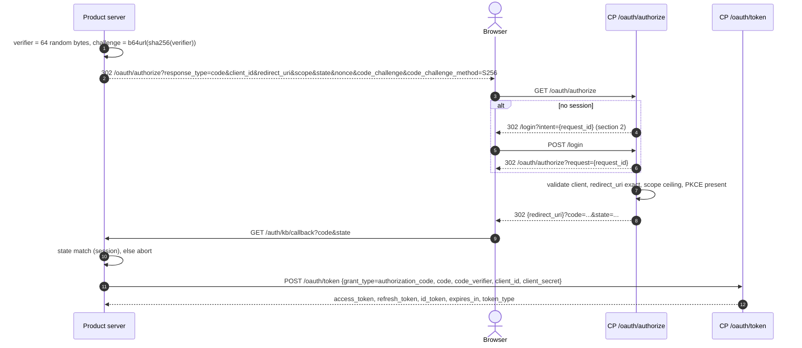
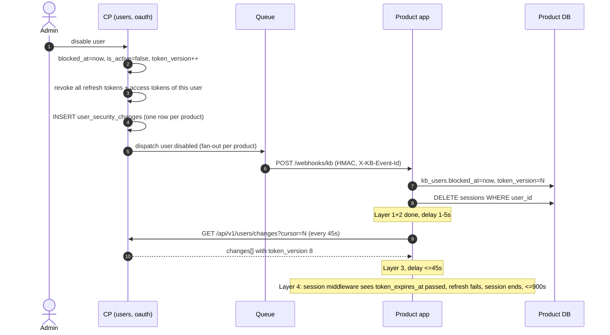

# 05 — Identity Hub Spec (OAuth2/OIDC, login interrupt, API contract, disable propagation)

**Date:** 13 Nov 2026 · **Revised:** 14 Nov 2026 (**v4** — `GET /api/v1/plans` contract, `tenant.provisioned` retired, `blocked_reason`/`blocked_at` in feed + `user.disabled`, CI gate for GET-route writes; v3 ne path-based tenancy sync kiya tha; changelog §10)  
**Repo:** `E:/LaraProjects/saas-starter` (branch `extract/package-skeleton`)  
**Depends on:** `docs/platform/04-CONTROL-PLANE-DESIGN.md` (§1.3 tables, §3.3 snapshot, §2.4 product contract), `docs/platform/02-ARCHITECTURE-DECISIONS.md` (§0 D1–D5, §5), `docs/platform/07-MULTI-TENANCY-DESIGN.md` (§3.6 SSO flow, §3.6.1 membership source of truth, §3.7 session model), `docs/platform/08-EXAMPLE-PRODUCT-INTEGRATION.md` (§6.1 `plans` contract ka source, §6.2 `tenant.provisioned` retirement, §2.12 `read_only` + CI gate) — `02` §5.4.1 ka handoff **13 Nov 2026 ko retire** ho gaya (path-based tenancy)  
**Inputs:** `khattakbits-core/src/Http/Controllers/AuthController.php`, `khattakbits-core/src/Http/Middleware/EnsureUserActive.php`, `khattakbits-ui/src/login3d/submitLogin.js`, `resources/js/Pages/Auth/Login.vue`, `config/auth.php`, `config/session.php`, `composer.json`, `.env`  
**Rule:** Design only. Koi migration, model ya controller nahi likha gaya.

**Table ownership:** `products`, `tenants_registry`, `subscriptions`, `product_oauth_clients`, `webhook_endpoints`, `webhook_deliveries`, `kb_user_product_access` — sab `04` §1.3 ke mutabiq. Yeh document unhein **reference** karta hai, dobara define nahi. Teen naye tables yahan aate hain (§1.7.2 `oauth_signing_keys`, §2.3 `oauth_auth_requests`, §3.5 `user_security_changes`) — total `04` ke 18 + 3 = **21**, plus Passport ke apne 5.

---

## 0. Verification — does Passport/Sanctum resolve on Laravel 13?

Command run (composer.json **nahi** badla, `diff` se confirm kiya):

```
composer require laravel/passport --dry-run
```

### 0.1 Result: **FAILED**

```
Your requirements could not be resolved to an installable set of packages.
```

Lekin wajah **Laravel 13 nahi** hai. Exact chain:

| Layer                                | Constraint                                       | Verdict                                                                  |
| ------------------------------------ | ------------------------------------------------ | ------------------------------------------------------------------------ |
| `laravel/passport v13.7.1–v13.10.0`  | `league/oauth2-server ^9.2`                      | ✅ Laravel 13 accept karta hai (koi `illuminate/auth` conflict nahi aaya) |
| `league/oauth2-server 9.2.0`         | `php ~8.1.0 \|\| ~8.2.0 \|\| ~8.3.0 \|\| ~8.4.0` | ❌ **PHP 8.5.12** bahar                                                   |
| `league/oauth2-server 9.3.0 / 9.4.x` | `lcobucci/jwt ^5.6`                              | ✅ PHP 8.5 theek                                                          |
| `lcobucci/jwt 5.6.0 / 5.6.1`         | `ext-sodium *`                                   | ❌ **extension load nahi hai**                                            |
| `laravel/passport v13.11.0`          | `phpseclib/phpseclib 4.0.1` (exact pin)          | ❌ advisory `PKSA-h7cz-q7zq-mdkt` ne block kiya                           |

Toh teen alag blockers hain, aur **teenon PHP 8.5 / extension side par hain**.

### 0.2 Fix — confirmed by second dry-run

`ext-sodium` sirf **commented out** hai, DLL maujood hai:

```
/c/php/php.ini:945   ;extension=sodium
/c/php/ext/php_sodium.dll            ← present
php -m | grep sodium → (khali)
```

```bash
# 1. php.ini line 945 se semicolon hatao
#    ;extension=sodium   ->   extension=sodium
php -m | grep sodium          # verify — khali output = abhi bhi off

# 2. phir install — EXACT pin, caret NAHI
composer require "laravel/passport:13.10.*"
```

```
composer require laravel/passport --dry-run --ignore-platform-req=ext-sodium
```

Result:

```
Package operations: 13 installs, 0 updates, 0 removals
  - Installing phpseclib/phpseclib (4.0.3)
  - Installing lcobucci/jwt (5.6.1)
  - Installing league/oauth2-server (9.4.1)
  - Installing firebase/php-jwt (v7.2.1)
  - Installing laravel/passport (v13.10.0)
Using version ^13.10 for laravel/passport
```

**Verdict: Passport `v13.10.0` Laravel 13.38.0 ke saath resolve hota hai — bas `ext-sodium` chahiye.**

### 0.2.1 Pin `13.10.*`, `^13.10` **nahi**

```json
// composer.json — yeh likho
"laravel/passport": "13.10.*"
```

| Constraint | Kyun nahi |
|---|---|
| `^13.10` | `13.11.x` allow karta hai. `v13.11.0` `phpseclib/phpseclib 4.0.1` ko **exact pin** karta hai, jo advisory `PKSA-h7cz-q7zq-mdkt` se blocked hai — install fail hota hai. Aur agar koi `policy.advisories.block=false` kar de to **vulnerable phpseclib** chupchap install ho jata hai. Yeh silent regression hai, is liye caret khatarnak hai |
| `13.10.*` | `13.10.0`–`13.10.9` tak patch updates milte hain, `13.11` kabhi nahi |

**Unpin kab karein:** jab `phpseclib` ka advisory resolve ho jaye **aur** `laravel/passport` ka koi `13.11.x` ya `13.12.x` `phpseclib ^4.0.3` (ya usse upar) allow kare. Check:

```bash
composer show laravel/passport --all | grep -A2 "phpseclib"
composer audit
```

`composer audit` clean ho tab `13.10.*` → `^13.10` (ya jo bhi latest safe ho). **Yeh pin temporary hai, permanent nahi** — calendar reminder lagayein.

### 0.2.2 CI + server prep

`.github/workflows/tests.yml` ki extensions list mein `sodium` add karein, warna CI Passport install par **wahi** fail karega jo local par hua:

```yaml
- name: Setup PHP
  uses: shivammathur/setup-php@v2
  with:
    php-version: ${{ matrix.php }}
    extensions: mbstring, pdo_sqlite, sqlite3, gd, zip, intl, sodium
    coverage: none
```

`shivammathur/setup-php` `sodium` ko `ext-sodium` se map karta hai aur Linux runners par already bundled hota hai — magar explicitly likhna lazmi hai, warna setup action apni default list use karta hai jismein `sodium` guaranteed nahi.

**Server prep checklist** — `09` §1.8 mein poora, verified (yeh summary hai):

```bash
# har server par, deploy se PEHLE
php -v                          # 8.3+ (8.5 recommended)
php -m | grep -E "sodium|openssl"   # dono ka output aana chahiye
php -r 'var_dump(function_exists("sodium_crypto_sign_verify_detached"));'  # true
composer check-platform-reqs    # deploy ke baad, vendor ke saath
```

Aakhri command sab se ahem hai: `composer check-platform-reqs` runtime par verify karta hai ke `composer.lock` ki saari platform requirements (including `ext-sodium`) actually maujood hain. Yeh deploy ko **fail** kar dega agar sodium gayab ho, bajaye iske ke pehli OAuth request par 500 aaye.

**`ext-sodium` optional nahi hai.** `lcobucci/jwt 5.6` ne sodium polyfill hata diya, is liye composer ise hard-require karta hai aur runtime par bhi chahiye. Agar host par sodium enable **nahi** ho sakta (shared hosting), tab hi alternative socho — aur woh alternative bura hai (§0.4).

### 0.3 Sanctum: **resolves cleanly**

```
composer require laravel/sanctum --dry-run
  - Locking laravel/sanctum (v4.4.0)
Using version ^4.4 for laravel/sanctum
```

Koi platform issue nahi, koi advisory nahi. `laravel/sanctum v4.4.0` Laravel 13 par theek hai.

### 0.4 Alternatives (agar sodium enable na ho sake)

| Option                                          | Verdict                                                                                                                                                                                                                                        |
| ----------------------------------------------- | ---------------------------------------------------------------------------------------------------------------------------------------------------------------------------------------------------------------------------------------------- |
| `paragonie/sodium_compat_ext_sodium` polyfill   | ✅ Composer khud suggest karta hai. Pure-PHP sodium. **Magar** yeh sirf composer ka platform check pass karta hai — `lcobucci/jwt` ka `sodium_crypto_*` runtime use bhi polyfill se chalta hai. Slow (RSA signing par asar nahi, EdDSA par hai) |
| `league/oauth2-server` pin `9.2.0`              | ❌ PHP 8.5 support nahi                                                                                                                                                                                                                         |
| Passport `v12.x`                                | ❌ `illuminate/auth ^9\|^10\|^11\|^12` — Laravel 13 nahi                                                                                                                                                                                        |
| **League OAuth2 server seedha (bina Passport)** | ❌ Wahi `league/oauth2-server 9.4.1` + `lcobucci/jwt` chain — **bilkul same sodium blocker**. Passport hataane se kuch nahi badalta                                                                                                             |
| **Khud ka OAuth2 (Laravel Socialite inverted)** | ❌ PKCE + rotation + revoke khud likhna ~15 din aur security risk. Sirf tab jab sodium bilkul na ho                                                                                                                                             |
| PHP 8.4 par shift                               | ✅ Sabse saaf fallback — `league/oauth2-server 9.2.0` sodium ke baghair chalta hai. Magar AGENTS.md PHP 8.5 kehta hai                                                                                                                           |

**Recommendation: `extension=sodium` uncomment karo.** Yeh 30-second ka kaam hai aur koi design compromise nahi.

### 0.5 Advisory note (honest)

Dry-run ne "7 security vulnerability advisories affecting 4 packages" dikhaya. Yeh **Passport ki wajah se nahi** — baseline already 7 hai (`composer audit --locked`):

| Package                   | Advisories          |
| ------------------------- | ------------------- |
| `symfony/http-foundation` | 4                   |
| `symfony/http-kernel`     | 1                   |
| `symfony/mime`            | 1                   |
| `symfony/routing`         | 1 (CVE-2026-118516) |

Passport install karne se yeh count **7 hi rehta hai** (dry-run ne bhi 7/4 hi dikhaya). Magar yeh pre-existing issue hai aur `symfony/*` patch bump se solve hota hai — **alag kaam hai, is spec ka nahi.** Ignore na karein.

---

## 1. OAuth2 / OIDC design

### 1.1 Architecture: Passport + thin OIDC layer

Passport OAuth2 deta hai (code+PKCE, token, revoke). Woh **OIDC nahi** deta — koi `id_token`, koi `/.well-known/openid-configuration`, koi JWKS nahi. Is liye do layers:

| Layer             | Kya                                                                                                         | Kahan                           |
| ----------------- | ----------------------------------------------------------------------------------------------------------- | ------------------------------- |
| **Passport**      | `/oauth/authorize`, `/oauth/token`, `/oauth/revoke` (RFC 7009), client registry, auth codes, refresh tokens | `laravel/passport` (vendor)     |
| **OIDC layer**    | `id_token` (RS256), `/oauth/jwks`, `/.well-known/openid-configuration`, `/oauth/userinfo`                   | CP app, `app/Modules/Identity/` |
| **Introspection** | `/oauth/introspect` (RFC 7662)                                                                              | CP app — Passport mein nahi hai |

Yeh split jaan boojh kar hai: Passport ka core (auth code, PKCE verify, token storage, revocation) **dobara likhna** ghalti hogi; sirf jo cheez Passport mein hai hi nahi woh upar se add hoti hai.

### 1.2 Endpoints

| Method | Path                                | Auth                          | Kaam                                                        |
| ------ | ----------------------------------- | ----------------------------- | ----------------------------------------------------------- |
| GET    | `/oauth/authorize`                  | session (login interrupt)     | Consent skip + code issue                                   |
| POST   | `/oauth/token`                      | client secret + PKCE verifier | `authorization_code`, `refresh_token`, `client_credentials` |
| POST   | `/oauth/revoke`                     | client secret                 | RFC 7009                                                    |
| POST   | `/oauth/introspect`                 | client secret                 | RFC 7662                                                    |
| GET    | `/oauth/userinfo`                   | user bearer                   | OIDC claims                                                 |
| GET    | `/oauth/jwks`                       | public                        | RS256 public keys                                           |
| GET    | `/.well-known/openid-configuration` | public                        | Discovery                                                   |
| GET    | `/api/v1/subscriptions/resolve`     | bearer (client or user)       | Snapshot                                                    |
| GET    | `/api/v1/entitlements`              | user bearer                   | Snapshot, tenant token se                                   |
| GET    | `/api/v1/users/tenants`             | user bearer                   | Caller ke tenants — `kb_user_tenant` ka **authoritative source** (§3.1.1) |
| GET    | `/api/v1/plans`                     | user bearer **ya** client creds | Plan catalog — **list only**, product ke upgrade/renew UI ke liye (§3.1.2) |
| POST   | `/api/v1/subscriptions/renew-link`  | bearer                        | Checkout URL                                                |

`/oauth/token`, `/oauth/authorize`, `/oauth/revoke` **Passport ke hain** — CP unhein override nahi karta. `02` §1.1 ki ghalti yahi thi ke woh inhein product ke andar dikha raha tha.

**`GET /api/v1/users/tenants` 13 Nov 2026 ko add hua** (`07` §3.6.1). Yeh `oauth/userinfo` ke `products[]` claim ka replacement **nahi** — `userinfo` *product-level* access batata hai, yeh endpoint *tenant-level* membership (`tenant_id`, `slug`, `role`, `status`) deta hai. Product iske baghair `kb_user_tenant` reconcile nahi kar sakta, aur URL slug se guess karna privilege escalation hai. Poora spec §3.1.1.

### 1.3 Client registration (product create par auto)

Admin `POST /platform/products` kare to **usi transaction mein**:

```
1. products row insert
2. Passport client create:
     name         = "{product.name} ({product.key})"
     redirect_uris= ["https://{products.domain}/auth/kb/callback"]
     // path-based (07 §1.2): {products.domain} = 'mizaanbitserp.com'.
     // Tenant slug URL mein aata hi NAHI — callback central hai.
     // Pehle bhi yahi tha, magar {domain} ka matlab ab explicitly
     // products.domain hai, koi tenant host nahi (04 v5: subdomain column gaya).
     confidential = true
     password_client = false
     personal_access_client = false
3. product_oauth_clients row (04 §1.3):
     product_id, oauth_client_id, name, redirect_uris,
     pkce_required = true, scopes = default set,
     is_first_party = true, status = 'active'
4. secret shown ONCE in the admin response, DB mein sirf secret_last4
```

**Secret rotation:** `POST /platform/oauth-clients/{client}/rotate` → naya secret, `status = 'rotated'`, purana secret **24h tak valid** (grace), `secret_last4` update, `Audit::log('oauth_client.rotated')`. Product ko naya secret deploy karna hoga — is liye grace window lazmi hai warna rotation = outage.

`oauth_client_id` ka type `04` §1.3 mein `string(64)` rakha gaya tha kyunke Passport v12+ UUID deta hai. **Ab verify ho gaya: v13.10 UUID use karta hai** — `string(64)` sahi hai, `unsignedBigInteger` nahi.

### 1.4 Redirect URI allowlist

Teen layer, teenon lazmi:

| Layer           | Check                                                                                                 | Fail              |
| --------------- | ----------------------------------------------------------------------------------------------------- | ----------------- |
| 1. Registration | `product_oauth_clients.redirect_uris` (JSON array) — exact string match, **koi prefix/wildcard nahi** | `invalid_request` |
| 2. Host binding | Redirect host === `products.domain` us product ka — **exact**, koi `{slug}.` prefix nahi (`07` §1.2). `tenants_registry.subdomain` column hi nahi raha (`04` v5) | `invalid_request` |
| 3. Scheme       | `https` lazmi (localhost exempt sirf `APP_ENV=local`)                                                 | `invalid_request` |

**Exact match kyun, prefix nahi:** `https://mizaanbitserp.com/auth/kb/callback` ko prefix-match karne se `https://mizaanbitserp.com/auth/kb/callback.evil.com` bhi pass ho jata. OAuth 2.1 (draft-ietf-oauth-v2-1) exact match recommend karta hai, aur RFC 9700 §2.1 bhi.

**Path:** har product ka callback **fixed** hai — `https://{products.domain}/auth/kb/callback`. Path-based tenancy ne isay **aur** simple kar diya: pehle `{domain}` par yeh sawal tha ke kaunsa host callback karega (tenant subdomain ya central), ab **ek hi host** hai — product ka central domain — aur tenant slug callback URL mein aata hi nahi (`07` §1.2, §3.6). Is liye `{domain}` interpolation bhi khatam: value `products.domain` hai, bas. Product `kb-product.json` mein apna callback path declare karta hai, admin usay confirm karta hai. Free-form redirect URI input **nahi** hoga.

### 1.5 Scopes

| Scope          | Kya deta hai                                                       | Kaun maangta hai             |
| -------------- | ------------------------------------------------------------------ | ---------------------------- |
| `openid`       | `id_token` issue ho                                                | Sab                          |
| `profile`      | `name`, `picture`, `locale` userinfo mein                          | Sab                          |
| `email`        | `email`, `email_verified`                                          | Sab                          |
| `subscription` | `/api/v1/subscriptions/resolve`, snapshot `status`/`plan`/`period` | Sab (billing UI ke liye)     |
| `entitlements` | `flags`/`limits`/`quotas`/`modules` snapshot mein                  | Sab (feature gating ke liye) |

Default set jo client create par lagta hai: `openid profile email subscription entitlements`.

**Scope rules:**

- `openid` ke baghair `id_token` nahi milta (OIDC spec).
- `subscription` ke baghair resolve `403 insufficient_scope` deta hai — `status`/`plan` fields **redact** nahi hote, poora call reject hota hai. Partial redaction confusing hai.
- Scope narrow karne ki ijazat hai (product kam maang sakta hai), barhane ki nahi — `product_oauth_clients.scopes` hard ceiling hai. Maanga hua scope ceiling se bahar → `invalid_scope`.


**`04` §1.3 correction:** wahan example `['openid','profile','email','subscriptions:read']` tha. Woh illustrative tha aur is scope set se match nahi karta. `04` ko update kar diya gaya hai (plural `subscriptions:read` → `subscription`, `entitlements` add).

### 1.6 Authorization code + PKCE



**PKCE lazmi (S256), `plain` reject.** `product_oauth_clients.pkce_required = true` default; `false` sirf tab jab koi legacy client ho — Phase 1 mein koi nahi. Confidential client hone ke bawajood PKCE lazmi hai (OAuth 2.1 requirement; auth code interception se bachata hai jab redirect URI registered ho magar attacker ke paas code aa jaye).

**Auth code TTL: 60s**, single-use (Passport default). Reuse attempt → **poora token family revoke** (RFC 9700 §4.1.1) — yeh Passport khud nahi karta, CP ko `TokenRevoked` event par family revoke karna hoga.

### 1.7 `id_token`

#### 1.7.1 Claims

| Claim | Value | Note |
|---|---|---|
| `iss` | `https://app.khattakbits.com` | `config('app.url')` — trailing slash nahi |
| `sub` | `users.id` (string) | **stable**, email nahi. Email badal sakti hai |
| `aud` | `product_oauth_clients.oauth_client_id` | string, array nahi (single audience) |
| `exp` | `iat + 300` | id_token chhota — 5 min. Access token alag |
| `iat` | now | |
| `auth_time` | session login time | Step-up auth ke liye |
| `nonce` | authorize request ka `nonce` | **echo, verify product par** |
| `email`, `email_verified` | user | `email` scope |
| `name` | user name | `profile` scope |
| `kb_token_version` | `users.token_version` | disable propagation (§5) |
| `kb_products` | user ke product keys | `kb_user_product_access` se |

**`sub` = `users.id` kyun, `uuid` kyun nahi:** `users.id` already stable hai aur `04` ke saare FKs usi par hain. Separate `sub` column add karna ek aur mapping layer hai bila faide. Magar `sub` **string** bhejna lazmi hai (OIDC spec: `sub` string hai) — `"47"`, `47` nahi. Warna strict clients reject karte hain.

#### 1.7.2 Signing keys — naya table

```php
// ── oauth_signing_keys ───────────────────────────────────────────────────
id              bigIncrements
kid             char(32)  unique        // key id, JWKS mein jata hai
alg             string(10) default 'RS256'
public_pem      text                    // public key (JWKS ke liye)
private_pem     text                    // 'encrypted' cast — kabhi log/expose nahi
status          string(10) index        // active|retiring|retired
activated_at    timestamp
retires_at      timestamp nullable      // is date ke baad JWKS se hatao
retired_at      timestamp nullable
created_at      timestamp
// exactly one row with status='active' — app-level invariant (no partial unique index, 04 §0)
```

**Rotation (90 din):**

```
1. naya key generate -> status='active'
2. purana -> status='retiring', retires_at = now + 30d
   (JWKS dono publish karta hai, is liye purane tokens verify hote rehte hain)
3. 30 din baad -> status='retired', JWKS se gayab
```

**Overlap 30 din kyun:** `id_token` TTL 5 min hai magar product apni `kb_snapshot` 72h tak rakhta hai — us snapshot mein purana `id_token` ho sakta hai. 30 din bohat zyada hai, magar sasta hai.

`GET /oauth/jwks` **sirf `active` + `retiring`** keys deta hai (`retired` nahi), `Cache-Control: public, max-age=3600`.

**RS256 kyun, ES256 nahi:** RS256 `ext-openssl` par chalta hai (verified present); ES256 ke liye sodium/ECDSA chahiye aur JWKS consumers mein kam support hai.

#### 1.7.3 JWKS + discovery

```json
GET /oauth/jwks
{ "keys": [ { "kty": "RSA", "use": "sig", "alg": "RS256", "kid": "kb-2026-11-a1b2c3",
              "n": "<base64url modulus>", "e": "AQAB" } ] }
```

```json
GET /.well-known/openid-configuration
{ "issuer": "https://app.khattakbits.com",
  "authorization_endpoint": "https://app.khattakbits.com/oauth/authorize",
  "token_endpoint": "https://app.khattakbits.com/oauth/token",
  "userinfo_endpoint": "https://app.khattakbits.com/oauth/userinfo",
  "jwks_uri": "https://app.khattakbits.com/oauth/jwks",
  "revocation_endpoint": "https://app.khattakbits.com/oauth/revoke",
  "introspection_endpoint": "https://app.khattakbits.com/oauth/introspect",
  "response_types_supported": ["code"],
  "grant_types_supported": ["authorization_code", "refresh_token", "client_credentials"],
  "subject_types_supported": ["public"],
  "id_token_signing_alg_values_supported": ["RS256"],
  "scopes_supported": ["openid", "profile", "email", "subscription", "entitlements"],
  "token_endpoint_auth_methods_supported": ["client_secret_basic", "client_secret_post"],
  "code_challenge_methods_supported": ["S256"] }
```

### 1.8 `/oauth/userinfo` claims

`Authorization: Bearer <access_token>`, scope `openid` lazmi.

```json
{
  "sub": "47",
  "email": "owner@acme.pk",
  "email_verified": true,
  "name": "Bilal Ahmed",
  "is_active": true,
  "kb_token_version": 7,
  "products": ["mizaan", "ledger"],
  "kb_tenant_id": "01JQ8Z3K7M4X2V9B5N1C6D0RTA",
  "roles": ["owner"],
  "subscription": { "status": "active", "plan": "growth", "period_end": "2026-12-01T00:00:00Z" }
}
```

| Claim | Source | Scope gate |
|---|---|---|
| `sub`, `is_active`, `kb_token_version`, `products` | `users` + `kb_user_product_access` | `openid` |
| `email`, `email_verified` | `users` | `email` |
| `name` | `users` | `profile` |
| `roles` | `tenants_registry` + `kb_user_tenant` (product side) — CP sirf product-level role deta hai | `profile` |
| `kb_tenant_id` | `tenants_registry.kb_tenant_id` — **sirf tab** jab token `X-KB-Tenant` ke saath bind ho | `subscription` |
| `subscription` | `subscriptions` snapshot (`status`, `plan.key`, `period.end`) | `subscription` |

**`kb_tenant_id` optional kyun:** user ke multiple tenants ho sakte hain (D1: ek insaan 2 tenants mein). Bina tenant context ke CP guess nahi karta — `null` deta hai aur product `resolve` se poochta hai.

|  |  |  |  |  |
| --- | --- | --- | --- | --- |
**`roles` honesty:** tenant-level roles product ki DB mein hain (`kb_user_tenant`), CP ke paas nahi. CP sirf `kb_user_product_access.role` (`owner|admin|member|billing|viewer`) deta hai. Doc mein `roles` rakha hai magar woh **product-level** role hai — product apne tenant roles khud lagata hai. Yeh `02` §5.1 ke `kb_user_tenant` design se consistent hai. **13 Nov 2026:** `07` §6.6.2 isay
`kb_user_tenant.role_hint` mein store karta hai — **authority tenant DB ke `model_has_roles` par hai**,
hint CP par. `Gate` `role_hint` ko padhta hi nahi; woh sirf UI badge, audit, aur "owner kaun hai" ke liye hai.

### 1.9 Refresh token policy

| Rule | Value | Kyun |
|---|---|---|
| TTL | 30 din absolute, 7 din idle | Chori hone par window chhoti |
| Rotation | **har refresh par naya** refresh token | Reuse detection possible |
| Reuse detection | purana refresh token dobara → **poora family revoke** + `security_events` (`oauth.refresh_reuse`) | RFC 9700 §4.14.2 |
| Family binding | refresh token `access_token_id` se bandha | Passport default |
| Revoke on disable | user disable → saare refresh tokens revoke | §5 |
| Revoke on password change | `token_version++` ke saath | Break-glass admin ka password badla to sessions mar jayein |
| `client_credentials` | refresh token **nahi** milta | RFC 6749 §4.4.3 |

`token_version` claim refresh par **dobara check** hota hai: refresh token ke saath `kb_token_version` DB se compare, mismatch → `invalid_grant` + family revoke. Isse disable ka asar refresh path par **foran** hota hai, access token expiry ka intezar nahi.

### 1.10 Consent screen — first-party skip

`product_oauth_clients.is_first_party = true` wale clients ke liye consent **skip**.

| Condition | Behaviour |
|---|---|
| `is_first_party = true` **aur** user ke paas `kb_user_product_access` row hai | **Skip** — seedha code issue |
| `is_first_party = true` magar access row **nahi** | **OAuth error redirect** — `302 {redirect_uri}?error=access_denied&state=...` (§1.10.1) |
| `is_first_party = false` (Phase 2 third-party) | Consent screen lazmi |

**Consent skip kyun safe hai:** first-party products KhattakBits ke apne hain, user ne already CP par login kiya hai, aur access `kb_user_product_access` se grant hota hai (admin-controlled). Consent screen yahan security nahi, friction hai — aur woh friction har login par repeat hoti.

`prompt=consent` param force kar sakta hai (testing ke liye); `prompt=none` par session na ho to `login_required` error.

#### 1.10.1 Access na ho to `403` nahi — error redirect

Pehle `403 access_denied` page render hota tha. Woh ghalat hai: user CP par pahunch kar **dead end** par ruk jata hai, aur product ko pata bhi nahi chalta ke kya hua — woh apna loading spinner dikhata rehta hai ya generic error.

RFC 6749 §4.1.2.1 kehta hai authorization errors `redirect_uri` par `error` + `state` ke saath wapas bhejo:

```
302 Location: https://mizaanbitserp.com/auth/kb/callback
                ?error=access_denied
                &error_description=No+access+to+this+product
                &state={original_state}
```

| Rule | Detail |
|---|---|
| `redirect_uri` **pehle** validate | Exact match (§1.4). Fail ho to **redirect nahi** — error page render karo. Warna yeh open redirect ban jata hai |
| `state` echo | Product ise verify karta hai; na ho to product request reject kare |
| `error` code | `access_denied` (user ke paas access nahi), `login_required` (`prompt=none` + no session), `invalid_scope`, `invalid_request` |
| `error_description` | Short, **PII-free**. Email ya user id **kabhi nahi** — woh URL mein, browser history mein, aur product ke logs mein chala jata hai |
| Product ka behaviour | `error=access_denied` par "Get this product" page — storefront link `https://app.khattakbits.com/products/{key}` |
| Audit | `security_events` mein `oauth.access_denied` (`kb_user_id`, `client_id`, `product_id`) |

**Yeh `02` §1.2 ke flow se consistent hai:** product `/auth/kb/callback` par `error` param handle karta hai, `code` ki tarah. Product ke callback handler ko dono cases chahiye — `code` **ya** `error`, dono nahi.

**Kyun `403` kabhi theek nahi:** OAuth mein authorization decision **product ko** wapas jana chahiye, kyunke wohi user ko agla qadam dikha sakta hai. CP ke paas product ka UI nahi hai — woh sirf ek generic error page dikha sakta hai, jahan se user ke paas wapas jane ka koi rasta nahi hota.

---

## 2. Login interrupt — 3D login ko `/oauth/authorize` se jodna

### 2.1 Aaj kya maujood hai

| Cheez | Halat |
|---|---|
| `POST /login` | `AuthController::store()` — `Auth::attempt` + `is_active` check, phir `redirect()->intended('/')` |
| `redirect_uri` / `return_to` | Query ya body se padha jata hai, `isSafeRedirect()` se validate |
| `isSafeRedirect()` | Relative paths allow; absolute sirf `ALLOWED_SSO_HOSTS` + `app.url` host. **Path-based mein relative-path allow karna hi kaafi hai** — product aur CP alag hosts hain, magar tenant switch **same host** par hota hai (`07` §3.6) |
| 3D login | `Login.vue` → `submitLogin({ url: '/login' + window.location.search })` |
| `/oauth/*` routes | **Koi nahi** — `php artisan route:list` khali |
| `users.token_version` | **Column maujood nahi** — zero references (`02` §2.4 ne plan kiya tha, implement nahi hua) |
| `users.blocked_at` | **Column maujood nahi** — sirf `is_active` |

### 2.2 3D login ko koi change nahi chahiye

`Login.vue` line 205:

```js
const currentQuery = window.location.search
const result = await submitLogin({ url: '/login' + currentQuery, ... })
```

Yeh **poora query string** forward karta hai. Is liye `/login?intent=01JQ...` khud se chala jayega — `submitLogin.js` ko chhune ki zaroorat nahi. Yeh design ka faida hai, accident nahi: `submitLogin` URL ko opaque treat karta hai.


`submitLogin` ka ek edge case jo yahan matter karta hai: woh `data.component === 'Auth/Login'` ko "redirect nahi hua" samajhta hai. OAuth flow mein success **hamesha** redirect karta hai (authorize par wapas), is liye yeh branch hit nahi hoti. ✅

### 2.3 Interrupt design — `oauth_auth_requests` table

`url.intended` (Laravel ka default) **use nahi karna**. Wajah: woh session mein **ek hi slot** hai. Do tabs mein do authorize requests kholo → doosri pehli ko overwrite kar deti hai → pehla tab ghalat client/state par wapas jata hai. Yeh silent cross-tenant bug hai.

Iske bajaye pending authorize request ko **row** banao:

```php
// ── oauth_auth_requests ──────────────────────────────────────────────────
id                  char(26)  primary      // ULID — URL mein jata hai
session_id          string(64)  index      // binding: sirf usi browser se continue ho
client_id           string(64)             // product_oauth_clients.oauth_client_id
product_id          foreignId  constrained('products') cascadeOnDelete
redirect_uri        string(190)
scopes              json                   // validated at creation
state               string(190) nullable   // product ka state — as-is echo
nonce               string(120) nullable
code_challenge      string(128)
code_challenge_method string(6) default 'S256'
response_type       string(10) default 'code'
prompt              string(20) nullable
expires_at          timestamp  index       // now + 600s
consumed_at         timestamp nullable
created_at          timestamp
// NO updated_at
```

Flow — **session id regeneration ko handle karna lazmi hai**:

```
GET /oauth/authorize?... (no session)
  -> validate client + redirect_uri + scopes + PKCE
  -> INSERT oauth_auth_requests (expires_at = now+600, session_id = current session id)
  -> 302 /login?intent={id}

POST /login?intent={id}   (3D login posts here — query already preserved)
  1. $preLoginSessionId = $request->session()->getId()      // auth se PEHLE, regenerate se PEHLE
  2. $authRequest = load(id, session_id = $preLoginSessionId,
                         consumed_at IS NULL, expires_at > now)     // READ ONLY — consume nahi
     (null -> intent ignore, normal redirect()->intended('/') flow)
  3. Auth::attempt(...)                                     // fail -> row untouched, session id wahi
  4. $request->session()->regenerate()                      // session id BADAL jata hai, data migrate hota hai
  5. DB::transaction:
       $affected = UPDATE oauth_auth_requests
                     SET session_id = {new session id}, consumed_at = now()
                   WHERE id = ? AND session_id = {preLoginSessionId} AND consumed_at IS NULL
       if ($affected !== 1) -> intent lost (parallel login jeet gaya)
                               fall through to redirect()->intended('/')
  6. 302 /oauth/authorize?request={id}

GET /oauth/authorize?request={id}
  -> load row (session_id = current, consumed_at NOT NULL, expires_at > now)
  -> access check (§1.10) -> Passport code issue -> 302 {redirect_uri}?code&state
```

**Problem jo pehle design mein thi:** `AuthController::store()` line 32 par `$request->session()->regenerate()` call karta hai — Laravel login par session id **badal deta hai** (session fixation se bachne ke liye). Purana design row ko `session_id = current` se match karta tha, magar woh match **regenerate ke baad** hota — is liye har successful login par binding toot jati thi aur intent hamesha "mismatch" hota. Yani OAuth login interrupt **kabhi** kaam nahi karta.

**Fix ke teen hisse:**

| # | Step | Kyun |
|---|---|---|
| A | Session id **auth se pehle** capture karo | `regenerate()` ke baad purana id gayaab ho jata hai; uske baad load karna namumkin hai |
| B | Row **read-only** load karo, consume nahi | Login fail ho to intent zinda rahe (rule 7). Consume sirf success par |
| C | `regenerate()` ke **baad**, usi transaction mein re-bind + consume | Naya session id sirf regenerate ke baad maujood hota hai |

**Re-bind ek hi transaction mein kyun:** agar re-bind aur consume alag hon, to beech mein crash ho to row naye session id ke saath `consumed_at = NULL` reh jati hai — dobara use ho sakti hai. Aik `UPDATE` dono karta hai, is liye atomic hai.

**`WHERE session_id = {preLoginSessionId}` update mein kyun:** do parallel logins (do tabs, ek hi intent) dono step 2 pass kar sakte hain. Dono `regenerate()` karte hain, dono alag naye ids lete hain. Pehla `UPDATE` jeet jata hai (`session_id` ab naya hai, `consumed_at` set hai); doosre ka `WHERE` fail hota hai (`affectedRows = 0`) aur woh normal redirect par gir jata hai. Bina is condition ke dono jeet jate aur do codes ban jate.

**Alternative (agar aap chaahein):** Laravel `regenerate()` **session data** ko naye id par migrate karta hai — sirf id badalti hai. Is liye `session_id` ki jagah session data mein ek random `intent_token` rakhna bhi kaam karta hai (row `intent_token` se match ho, id se nahi). Woh design simpler hai (koi re-bind nahi) magar session data par depend karta hai. Neeche wala design **session id** par hai kyunke woh DB mein visible hai aur debugging mein saaf hai.

**Rules:**

| # | Rule | Kyun |
|---|---|---|
| 1 | `session_id` binding **+ login par re-bind** | Request ID leak hone par bhi doosra browser continue nahi kar sakta; aur login ke baad binding zinda rehti hai |
| 2 | 600s expiry | Login form bhool jane par stale request na chale |
| 3 | Single use (`consumed_at`) | Replay se doosra code na bane |
| 4 | `state` **as-is** store + echo | CP state ko interpret nahi karta; product usay verify karta hai |
| 5 | `nonce` store + id_token mein daalo | Replay protection product side |
| 6 | Prune 24h | Forensics ke liye thoda rakho |
| 7 | Login fail | `intent` row **delete na karo**, `consumed_at` bhi set na karo — user dobara try kare to wahi row chahiye |
| 8 | Re-bind + consume **ek UPDATE** | Beech mein crash ho to half-bound row na bache |

**`?request=` do stage kyun (login ke baad phir authorize):** login ke waqt authorize dobara poora validate karna padta hai (client/redirect/scope). Row se validate karna sasta aur deterministic hai, aur user ne beech mein client change nahi kiya.

### 2.4 `isSafeRedirect()` ke gaps (aur fix)

Yeh function `redirect_uri`/`return_to` handle karta hai — OAuth ke bahar wale legacy cross-product redirects ke liye. Aaj ke code mein **paanch** gaps hain:

| # | Gap | Aaj ka behaviour | Fix |
|---|---|---|---|
| **G1** | **`ALLOWED_SSO_HOSTS` khaali hai** — `.env`, `.env.example`, `config/` mein maujood hi nahi | `array_filter(explode(',', ''))` = `[]`, sirf `app.url` host bachta hai. Cross-product redirect **chupchap** `redirect()->intended('/')` par gir jata hai | Static env **hatao**. Allowlist DB se: `products.domain` + `app.url` host — **exact match, https only**. **Wildcard ki zaroorat khatam**: path-based mein tenant ka apna host hota hi nahi (`07` §1.2). `04` ke `products` table ne yeh possible bana diya |
| **G2** | **Scheme check nahi** | `javascript://app.example.com/%0aalert(1)` → host `app.example.com` → **allowed**. `http://` downgrade bhi allowed | `parse_url()['scheme']` `https` hona lazmi (localhost exempt) |
| **G3** | **CR/LF check nahi** | `https://app.example.com/%0d%0aSet-Cookie:x=1` header injection | `preg_match('/[\r\n\0]/', $target)` → reject |
| **G4** | **`state`/`nonce` ka koi concept nahi** | Redirect target sirf URL hai; koi CSRF binding nahi | OAuth path `oauth_auth_requests` se chalta hai (§2.3) — `isSafeRedirect` sirf legacy path ke liye rahe |
| **G5** | **`\\` sirf prefix par check** | `/\evil.com` reject ✅ magar `/..//evil.com` allow | `ltrim` ke baad `str_starts_with($t, '//')` dobara check, aur `..` segment reject |

**G1 ka fix detail** (sab se bara):

```php
// PURANA — static, khaali, chupchap fail
$allowedHosts = array_filter(array_map('trim', explode(',', (string) env('ALLOWED_SSO_HOSTS', ''))));
$allowedHosts[] = $appHost;

// NAYA — DB se, per-product, EXACT match (koi wildcard nahi)
// 1. products.domain        ('mizaanbitserp.com')   — product ka central host
// 2. config('app.url') host ('app.khattakbits.com') — CP khud
// 3. host === candidate (strict) AUR scheme === 'https' (localhost exempt)
//
// Path-based hone se tenant host ka concept hi nahi raha:
// 'acme.mizaanbitserp.com' jaisa koi host exist nahi karta, is liye
// '.'.domain ends_with check BHI hat gaya — woh wildcard ka aakhri
// nishan tha (07 §1.2). Allowlist ab do exact strings hai.
// Cache: kb:sso:hosts, TTL 300s, product save par forget
```

`env()` ko **request path** par call karna khud ek bug hai: `config:cache` ke baad `env()` `null` deta hai. Yeh `G1` ko chhupa deta hai production mein (staging par chalta hai, prod par nahi) — classic.

### 2.5 `state` / `nonce` — kaun kya own karta hai

| Cheez | Owner | CP ka kaam |
|---|---|---|
| `state` | **Product** generate karta hai | Store + echo as-is. Interpret/validate **nahi** |
| `nonce` | **Product** | Store + `id_token` mein daalo |
| `code_verifier` | **Product** | Sirf `code_challenge` receive karta hai |
| `code` | **CP** | Issue, 60s TTL, single use |
| `auth_time` | **CP** | id_token mein |

**CP `state` ko validate nahi karta** kyunke `state` product ke CSRF token hai — CP usay sirf round-trip karta hai. Agar CP usay reject kare to product ka flow toot jata hai.

---

## 3. API contract

Base: `https://app.khattakbits.com`. Version URL path mein (`/api/v1/`), payload mein `schema`, response header `X-KB-API-Version: 1`.

### 3.1 Auth matrix

| Endpoint | Client credentials | User bearer | Note |
|---|---|---|---|
| `GET /api/v1/subscriptions/resolve` | ✅ koi bhi tenant of that product | ✅ sirf apne tenant | Server-to-server default |
| `GET /api/v1/entitlements` | ✅ | ✅ | User path `X-KB-Tenant` lazmi |
| `GET /api/v1/users/changes` | ✅ **sirf** | ❌ | Product-level feed — ek user ka nahi |
| `GET /api/v1/users/tenants` | ❌ | ✅ **sirf** | User ke tenants — `kb_user_tenant` ka source (§3.1.1) |
| `GET /api/v1/plans` | ✅ | ✅ | **List only.** `is_public=false` plans sirf first-party client + `include_hidden=true` par (§3.1.2) |
| `POST /api/v1/subscriptions/renew-link` | ✅ | ✅ | Client path `tenant_id` body mein |
| `POST /oauth/introspect` | ✅ **sirf** | ❌ | RFC 7662 |
| `POST /oauth/revoke` | ✅ **sirf** | ❌ | RFC 7009 |
| `GET /oauth/userinfo` | ❌ | ✅ **sirf** | `openid` scope |

**Client credentials token product-scoped hota hai:** `client_id` → `product_oauth_clients.product_id`. Woh **sirf usi product** ke tenants resolve kar sakta hai. Doosre product ka `tenant_id` bheja → `403 tenant_not_in_scope`. Yeh cross-product data leak rokta hai.

### 3.1.1 `GET /api/v1/users/tenants` — membership ka authoritative source

Yeh endpoint **13 Nov 2026 ko add hua** (`07` §3.6.1). Yeh `oauth/userinfo` ke `products[]` claim ka
replacement **nahi** — dono ka scope alag hai:

| Cheez | `userinfo.products[]` | `users/tenants` |
|---|---|---|
| Level | **product**-level access | **tenant**-level membership |
| Sawal | "is user ke paas is product ka access hai?" | "is user ka is tenant mein kya role hai?" |
| Source | `kb_user_product_access` | `tenants_registry` ⋈ `kb_user_product_access` |
| Kaun use karta hai | Entitlement gate | `kb_user_tenant` reconciliation (`07` §3.6.1) |

```
GET /api/v1/users/tenants
Authorization: Bearer <user access token>
Accept: application/json
If-None-Match: W/"a71c..."
```

```json
{
  "schema": 1,
  "tenants": [
    { "tenant_id": "01JQ8Z3K7M4X2V9B5N1C6D0RTA", "slug": "acme",
      "product_key": "mizaan", "role": "owner", "status": "active" },
    { "tenant_id": "01JQ8Z4N2P6R3T9V5W1X7Y0B2C", "slug": "beta",
      "product_key": "mizaan", "role": "member", "status": "read_only" }
  ],
  "etag": "W/\"a71c...\""
}
```

**Rules:**

| Rule | Detail |
|---|---|
| Scope | **sirf** user bearer. Client-credentials token → `403 invalid_token` — product ko ek user ke tenants nahi chahiye, woh `users/changes` se kaam karta hai |
| `product_key` filter | Optional `?product_key=mizaan`. Diya to sirf usi product ke tenants, aur client token ka product scope bhi lagta hai |
| `slug` | **Authoritative.** Product apne local `tenants.slug` se compare kare; mismatch par **alert**, chupchap overwrite nahi (`07` §3.6.1 step 2) |
| `role` | CP ka **product-level** role = `kb_user_tenant.role_hint`. Authority tenant DB ke `model_has_roles` par hai (§1.8) |
| `status` | `tenants_registry.status` — `provisioning`, `active`, `read_only`, `suspended`. **`archived` rows aate hi nahi** (query filter) |
| `etag` | `resolve` ki tarah — `If-None-Match` par `304`. Polling endpoint hai, is liye `Cache-Control: private, max-age=60` |
| Empty | `{"schema":1,"tenants":[]}` — `404` **nahi**. "Is user ka koi tenant nahi" ek valid jawab hai |

**Yeh endpoint `kb_user_tenant` ka pehla aur aakhri source hai.** URL ka `{tenant}` slug, `return_to` ka path,
`userinfo.products[]` akela, aur `resolve` ka `tenant_id` akela — inmein se **koi bhi** row banane ka jawaz
nahi (`07` §3.6.1 ka "source hain hi nahi" table). Wajah saaf hai: slug user ke control mein hai, `return_to`
bhi URL se aata hai, `products[]` product-level hai, aur `resolve` per-tenant call hai — membership **list**
nahi deta.

**Failure par fail-closed:** endpoint `5xx` de to product **purani `kb_user_tenant` rows waise hi rakhe**
(revoke na kare) aur user ko sirf usi tenant tak access de jiske liye `/{slug}` khula aur jiska `resolve` pass
hua. "CP down hai to sab kuch allow" ghalat hai; "CP down hai to kuch bhi **naya** na banao" sahi hai
(`07` §3.8).

### 3.1.2 `GET /api/v1/plans` — plan catalog (list only)

Yeh endpoint **14 Nov 2026 ko add hua** (v4; contract `08` §6.1 se). Wajah: product ke `Billing/Expired` aur `Billing/Return`
pages par upgrade options dikhane ke liye plan list chahiye, aur uske paas koi source nahi tha — `08` §2.15.2 ka
`plansForUi()` khali array return kar raha tha.

```
GET /api/v1/plans?product_key=mizaan&include_hidden=false
Authorization: Bearer <token>
Accept: application/vnd.kb.v1+json
```

**Auth:** do caller allowed hain — (a) user access token (product apne user ki taraf se poochta hai), (b)
`client_credentials` token. Anonymous **nahi**.

**Query:**

| Param | Type | Default | Rule |
|---|---|---|---|
| `product_key` | string, 60 | client ka bound product | Agar diya aur client ke product se match na kare → **403 `product_scope_mismatch`** |
| `include_hidden` | bool | `false` | `is_public = false` plans sirf `true` par. Aur **sirf** first-party client (`is_first_party = true`) — warna **403** |
| `currency` | string, 3 | product ka default | `PKR` |

**200 response:**

```json
// GET /api/v1/plans?product_key=mizaan
{
  "schema": 1,
  "product_key": "mizaan",
  "currency": "PKR",
  "data": [
    {
      "key": "starter",
      "name": "Starter",
      "tier": 1,
      "is_public": true,
      "description": "For a single accountant",
      "trial_days": 14,
      "prices": [
        { "interval": "month", "amount_minor": 350000 },
        { "interval": "year",  "amount_minor": 3500000 }
      ],
      "entitlements": {
        "flags": {
          "module.accounting": true,
          "module.reports": true,
          "module.inventory": false,
          "module.payroll": false,
          "accounting.invoices": true,
          "accounting.periods": true,
          "accounting.multi_currency": false,
          "inventory.warehouses": false,
          "reports.advanced": false,
          "audit_export": false,
          "custom_domain": false
        },
        "limits": { "seats": 3 },
        "quotas": { "storage_mb": 5120, "api.calls": 100000 },
        "modules": {
          "accounting": "core",
          "reports": "core",
          "inventory": "optional",
          "payroll": "optional"
        }
      },
      "updated_at": "2026-11-10T09:12:00Z"
    },
    {
      "key": "business",
      "name": "Business",
      "tier": 2,
      "is_public": true,
      "description": "For a growing team",
      "trial_days": 14,
      "prices": [
        { "interval": "month", "amount_minor": 950000 },
        { "interval": "year",  "amount_minor": 9500000 }
      ],
      "entitlements": {
        "flags": {
          "module.accounting": true,
          "module.reports": true,
          "module.inventory": true,
          "module.payroll": false,
          "accounting.invoices": true,
          "accounting.periods": true,
          "accounting.multi_currency": true,
          "inventory.warehouses": true,
          "reports.advanced": true,
          "audit_export": false,
          "custom_domain": false
        },
        "limits": { "seats": 15 },
        "quotas": { "storage_mb": 51200, "api.calls": 1000000 },
        "modules": {
          "accounting": "core",
          "reports": "core",
          "inventory": "optional",
          "payroll": "optional"
        }
      },
      "updated_at": "2026-11-10T09:12:00Z"
    }
  ],
  "etag": "W/\"b93e1f7c\""
}
```

`enterprise` upar **nahi** hai kyunke uska `is_public = false` hai (`08` §1.6). `include_hidden=true` + first-party
client par woh bhi aayega.

**Rules:**

| # | Rule | Kyun |
|---|---|---|
| 1 | **List only.** Koi `POST`/`PATCH`/`DELETE` nahi — plan create/edit CP ke admin UI se hota hai, API se nahi | Yeh read contract hai; write path ka audit/admin surface alag hai |
| 2 | `-1` limits mein **unlimited** hai, exactly `resolve` ki tarah. `null` **nahi** | Do endpoint, ek hi encoding — warna `Entitlement::limit()` do jagah do tarah handle karega |
| 3 | `limits`/`quotas` **hamesha** maujood, kabhi `null` nahi. Khali object `{}` valid hai | Client ko `??` chains se bachao |
| 4 | `entitlements` **plan ka template** hai, tenant ka live state **nahi** | Live state `resolve`/snapshot se aata hai. In dono ko mix karna `08` §2.11 ka fail-closed ladder tor dega |
| 5 | `deprecated_at` (nullable ISO-8601) — plan retire ho raha hai magar maujooda subscribers par hai | Product UI "yeh plan band ho raha hai" dikha sake, aur renew-link usay reject kar sake |
| 6 | **Khali list ≠ 404.** `200 {"data":[]}` ka matlab "is product ke koi plan nahi" | `404` ka matlab product nahi mila — do alag cheezein |
| 7 | `ETag` + `Cache-Control: max-age=300, private`. `If-None-Match` → **304** | Plans din mein shayad ek dafa badalte hain; product har page load par na poochhe |
| 8 | `plan_key` renew-link mein (`§3.4`) isi list ka key hona chahiye, warna **422 `plan_not_available`** | Warna product ek aisa plan bech sakta hai jo CP ne retire kar diya |
| 9 | `is_public = false` plan ka `key` **guessing** se bhi na mile — `include_hidden` ke baghair woh response mein nahi | Enterprise pricing confidential hoti hai |

**`is_first_party` kyun lazmi hai `include_hidden` ke liye:** `04` §1.3 ka `product_oauth_clients.is_first_party`
CP ke apne clients ke liye `true` hai (consent skip, `§1.10`). Ek third-party integration jo `include_hidden=true`
bheje, usay Enterprise pricing dikh jayegi — jo product ki apni commercial information hai, CP ki nahi. Yani
`include_hidden` **client-level** trust par hai, token-level par nahi. `403 hidden_plans_not_allowed` return karein,
aur `include_hidden=false` par chup chaap degrade **na** karein — warna client ko pata hi nahi chalega ke usay
kuch nahi mila.

**`entitlements` `plan_entitlements` se aata hai, `plan_entitlements_history` se nahi** (`04` §3.4). Product ko
**abhi** ka plan template chahiye, kisi bhi purana nahi. Yeh `resolve` ke `entitlements` se **alag** cheez hai:
`resolve` tenant ka **live frozen** set deta hai (jo `version` se guard hota hai), yeh endpoint **catalog** deta
hai. Dono ko ek samajhna `08` §2.14.4 ka bug hai (`plan.changed` par entitlements badalna).

**Failure par degrade, fail-closed nahi.** `08` §2.15.2 ka `plansForUi()` `5xx`/`404` par `[]` deta hai, exception
nahi — kyunke plan list ka na hona kisi **authorization** faisle ko nahi badalta; renew `plan_key = null` par
current plan par chalta rehta hai. Yeh `users/tenants` ke ulta hai (`§3.1.1`), jahan `5xx` par **throw** lazmi hai
warna membership evict ho jati hai. Farq jaan boojh kar: **jo data access ka faisla deta hai woh fail-closed, jo
sirf UI hai woh degrade ho sakta hai.**

### 3.2 `GET /api/v1/subscriptions/resolve`

```
GET /api/v1/subscriptions/resolve?tenant_id=01JQ8Z3K7M4X2V9B5N1C6D0RTA
Authorization: Bearer <token>
Accept: application/json
If-None-Match: W/"9f2c4a1e..."
```

**200** — body **exactly** `04` §3.3 ka snapshot:

```json
{
  "schema": 1,
  "product_key": "mizaan",
  "tenant_id": "01JQ8Z3K7M4X2V9B5N1C6D0RTA",
  "status": "active",
  "access_mode": "full",
  "plan": { "key": "growth", "tier": 2, "interval": "month", "amount_minor": 1500000, "currency": "PKR" },
  "period": { "start": "2026-11-01T00:00:00Z", "end": "2026-12-01T00:00:00Z",
              "grace_ends_at": null, "cancel_at_period_end": false },
  "flags":  { "accounting.invoices": true, "inventory.multi_warehouse": true },
  "limits": { "seats": 25, "warehouses": 3 },
  "quotas": { "api.calls": { "limit": 50000, "unit": "calls", "reset": "month" } },
  "modules": { "accounting": "active", "inventory": "active", "payroll": "removed" },
  "tenant": { "slug": "acme",
              "owner": { "kb_user_id": 47, "email": "owner@acme.pk", "name": "Ayesha Khan" } },
  "version": 7
}
```

```
ETag: W/"9f2c4a1e..."
Cache-Control: private, max-age=30
X-KB-API-Version: 1
X-KB-Entitlements-Version: 7
```

**`tenant.owner` 13 Nov 2026 ko add hua** (`07` §6.6.1). Product ko provisioning ke waqt owner ka
`kb_user_id` + `email` + `name` chahiye hota hai (tenant DB mein mirror user + `kb_user_tenant` row +
`owner` role). Teen cases mein `resolve` hi fallback hai: `subscription.created` webhook miss ho jaye,
tenant DB restore ho jaye, ya `owner_mapping` state fail ho kar retry ka intezar kare.

`owner` **`null` ho sakta hai** (`tenants_registry.owner_user_id` set na ho). Us case mein product ko **`tenants:provision`
re-run** karna hoga (`--owner-id` ke saath), ya agle `subscription.created` ka intezar karna hoga — apna guess
(email match, pehla user) **nahi** karna. Email se owner guess karna account takeover ka rasta hai (`07` §3.6.1).

> **`tenant.provisioned` ka intezar mat karein** — woh event 14 Nov 2026 ko **retire** ho gaya (`§4.1`, `08` §6.2).
> Pehle yeh line usi ka intezar karne ko kehti thi, jo ab kabhi nahi aayega. Owner ka recovery path `tenants:provision`
> re-run hai (`07` §6.6.2), aur woh idempotent hai (`07` §6.6.4).

**304** — `If-None-Match` match, **empty body**. Yeh `02` §1.2 step 9 ka mechanism hai.

**Errors:**

| Status | Code | Kab |
|---|---|---|
| 400 | `tenant_id_required` | `tenant_id` missing (client credentials path) |
| 401 | `invalid_token` | Token expired/revoked/`token_version` mismatch |
| 403 | `insufficient_scope` | `subscription` scope nahi |
| 403 | `tenant_not_in_scope` | Tenant doosre product ka, ya user ka membership nahi |
| 404 | `tenant_not_found` | `kb_tenant_id` maujood nahi |
| 409 | `tenant_not_active` | Registry `provisioning` ya `archived` |
| 429 | `rate_limited` | `Retry-After` header |

```json
{ "error": { "code": "tenant_not_in_scope", "message": "Tenant belongs to a different product." } }
```

### 3.3 `GET /api/v1/entitlements`

`resolve` se **do farq**: `tenant_id` query param nahi (token/header se), aur response se `plan`/`period.start` nikal jate hain (lighter, UI polling ke liye).

```
GET /api/v1/entitlements
Authorization: Bearer <user access token>
X-KB-Tenant: 01JQ8Z3K7M4X2V9B5N1C6D0RTA
If-None-Match: W/"9f2c4a1e..."
```

```json
{
  "schema": 1,
  "tenant_id": "01JQ8Z3K7M4X2V9B5N1C6D0RTA",
  "status": "grace",
  "access_mode": "read_only",
  "period": { "end": "2026-12-01T00:00:00Z", "grace_ends_at": "2026-12-08T00:00:00Z" },
  "flags":  { "accounting.invoices": true },
  "limits": { "seats": 25 },
  "quotas": { "api.calls": { "limit": 50000, "unit": "calls", "reset": "month" } },
  "modules": { "accounting": "active" },
  "version": 7,
  "hash": "9f2c4a1e..."
}
```

`X-KB-Tenant` membership check lazmi — user `kb_user_product_access` + product ke tenant ka owner/member ho. Mismatch → `403 tenant_not_in_scope`.

**`hash` field:** `resolve` ke `ETag` ka raw value. Product ise apne snapshot ke saath store karke compare kar sakta hai (ETag header parse karne ki zaroorat nahi).

### 3.4 `POST /api/v1/subscriptions/renew-link`

```
POST /api/v1/subscriptions/renew-link
Authorization: Bearer <token>
Content-Type: application/json

{ "tenant_id": "01JQ8Z3K7M4X2V9B5N1C6D0RTA",
  "return_url": "https://mizaanbitserp.com/acme/billing/return",
  "plan_key": "growth" }
```

```json
{
  "checkout_url": "https://app.khattakbits.com/checkout/INV-00124/pay?t=eyJ...",
  "invoice_number": "INV-00124",
  "expires_at": "2026-11-13T06:10:00Z",
  "amount_minor": 1500000,
  "currency": "PKR"
}
```


| Rule | Detail |
|---|---|
| `return_url` validation | **Host** = `products.domain`, exact, https only — path-based mein tenant ka apna host nahi (`07` §1.2). **Path** = `/{tenant_slug}/...` hona lazmi, aur slug usi tenant ka hona lazmi jo `tenant_id` mein aaya; warna user doosre tenant ke page par land kar jata hai. Free-form **nahi** |
| Token | Signed (`t=`), 30 min, single use, tenant-bound. Checkout controller verify karta hai |
| Idempotency | `return_url + tenant_id` 5 min ke andar dobara → **wahi** invoice (naya nahi). `invoices.idempotency_key` use hota hai |
| `plan_key` optional | Nahi diya to current plan. Diya to upgrade/downgrade — proration invoice item banti hai |
| Errors | `400 return_url_not_allowed`, `409 subscription_not_renewable` (`suspended`), `403 tenant_not_in_scope` |

### 3.5 `GET /api/v1/users/changes` — batched identity feed

Product-level feed. **Yeh per-session introspection ki jagah leta hai** (§5.2 layer 3) — kyunke per-session polling rate limit aur load math dono tor deta tha (§3.5.1).

```
GET /api/v1/users/changes?cursor=10482&limit=500
Authorization: Bearer <client_credentials token>
Accept: application/json
```

```json
{
  "schema": 1,
  "product_key": "mizaan",
  "changes": [
    { "id": 10483, "kb_user_id": 47, "kind": "blocked",
      "blocked_at": "2026-11-13T05:45:00Z", "blocked_reason": "payment_fraud",
      "token_version": 8, "changed_at": "2026-11-13T05:45:00Z" },
    { "id": 10484, "kb_user_id": 91, "kind": "access_revoked",
      "blocked_at": null, "blocked_reason": null,
      "token_version": 3, "changed_at": "2026-11-13T05:45:02Z" }
  ],
  "next_cursor": 10484,
  "has_more": false,
  "server_time": "2026-11-13T05:46:12Z"
}
```

| Rule | Detail |
|---|---|
| Auth | **Client credentials sirf** — user bearer nahi (yeh poore product ka feed hai, ek user ka nahi) |
| Scope | `subscription` (identity state billing ke saath aata hai). Phase 2 mein alag `identity` scope |
| Cursor | Monotonic `bigint` = `user_security_changes.id`. Integer hi rakha — PII nahi, debugging saaf |
| `limit` | Default 500, max 2000 |
| `has_more` | `true` → product foran agla page maange (backlog drain) |
| Poll interval | **45s** (30–60s range), per product — per session **nahi** |
| Filtering | Sirf us product ki rows (`product_id`) |
| `full=1` | Cursor ignore; poora **current blocked set** wapas (paginated). Recovery path |
| `409 cursor_expired` | Cursor retention window (30 din) se purana → product `full=1` se resync kare |
| `304` | `If-None-Match` supported, `ETag` = `next_cursor` ka hash. Steady state mein body zero |
| `blocked_reason` | Nullable string, max 120. **`null` jab block nahi hua** (ya `user.enabled` ke baad clear ho gaya). `blocked_at` ke saath consistent: `blocked_at != null` ⟺ `blocked_reason != null` (`§5.1.1`) |

**`blocked_reason` feed mein kyun hai:** `user.disabled` webhook akele kaafi nahi — woh ek delivery hai aur miss
ho sakti hai (product down, retry `dead`, auto-disable). Feed **recovery path** hai (`§5.2` layer 3), aur agar
recovery payload mein reason na ho to product ka `users.blocked_reason` column **stale** reh jata hai: block to
lag jata hai magar support ko reason nahi pata, aur `user.enabled` ke baad purana reason chipka reh jata hai.
Do sources, **ek hi shape** — warna product ko do parsing paths rakhne padte hain aur woh diverge karte hain.

**Naya table (CP):**

```php
// ── user_security_changes ────────────────────────────────────────────────
id              bigIncrements          // monotonic cursor — koi clock tie nahi
user_id         foreignId  index constrained('users') cascadeOnDelete
product_id      foreignId  index constrained('products') cascadeOnDelete
kind            string(20)             // blocked|unblocked|token_revoked|access_granted|access_revoked
blocked_at      timestamp nullable
blocked_reason  string(120) nullable   // users.blocked_reason ka mirror — §5.1.1
token_version   unsignedInteger
changed_at      timestamp
// cursor = id. Index (product_id, id) — feed query exactly isi par chalti hai.
// Retention 30 din (prune), cursor_expired se pehle.
// Fan-out precomputed: ek user disable = ek row per product jismein uska access hai.
```

**Kyun append-only table, `users.updated_at` nahi:** `users.updated_at` har profile edit par badalta hai (naam, last login) — feed bekaar ke rows se bhar jata hai. Aur `updated_at` par cursor banana clock-skew aur same-timestamp ties par tootta hai. Monotonic `id` dono masle khatam karta hai.

#### 3.5.1 Load math (corrected)

Purana design: **per-session introspection har 60s**. Yeh numbers galat thay — limit aur load dono.

Assume 300 products × 1,000 active sessions = **300,000 sessions**.

| Approach | Per product | Total | Rate limit | Verdict |
|---|---|---|---|---|
| **Per-session introspect @60s** (purana) | 1,000/min | 300,000/min = **5,000 req/s** | 300/min per client | ❌ **3.3× over** for *one* product. 300+ sessions wala koi bhi product apni limit tor deta hai |
| **Batched feed @45s** (naya) | 1.33/min | 400/min = **6.7 req/s** | 60/min per client | ✅ 45× headroom |

**~750× kam load**, aur limit ab per-product hai na ke per-session — yani limit sessions ke saath **scale nahi karti**.

Payload: steady state 0–5 rows per poll (koi change nahi to khali array). 500 users ka bulk disable = ek page of 500, `has_more: false`. Backlog (product 3 din offline) = 3 din ke changes, `has_more` loop se drain.

**Per-token introspect ab on-demand hai** — sirf jab *specific token* ki validity chahiye:

| Situation | Call |
|---|---|
| Sensitive write (payment, refund, role change, bulk export, password change, admin action) | `POST /oauth/introspect` |
| User ne "sign out everywhere" dabaya | introspect + revoke |
| Feed ne `token_version` badla dikhaya | **introspect nahi** — seedha session kill (feed kaafi hai) |
| Debugging / support | introspect |

**Feed introspect ki jagah nahi le sakta** jab sawal "yeh token zinda hai?" ho — feed user-level state deta hai, token-level validity nahi. Dono complementary hain, ek doosre ka replacement nahi.

### 3.6 `POST /oauth/introspect` (RFC 7662) — on demand

```
POST /oauth/introspect
Authorization: Basic base64(client_id:client_secret)
Content-Type: application/x-www-form-urlencoded

token=eyJ...&token_type_hint=access_token
```

**Active:**

```json
{
  "active": true,
  "scope": "openid profile email subscription entitlements",
  "client_id": "9f1c...",
  "sub": "47",
  "token_type": "Bearer",
  "exp": 1763013300,
  "iat": 1763012400,
  "nbf": 1763012400,
  "iss": "https://app.khattakbits.com",
  "aud": "mizaan",
  "kb_token_version": 7,
  "kb_products": ["mizaan"],
  "kb_tenant_id": null
}
```

**Inactive:** `{ "active": false }` — **HTTP 200**, error nahi (RFC 7662 §2.2). Unknown, expired, revoked, aur `token_version` mismatch — chaaron ke liye same jawab (token existence leak nahi hoti).

**Rate limit:** 300/min per client. Ab yeh **on-demand** endpoint hai (§3.5.1) — 1,000 sessions wala product bhi ise ~17/min hit karta hai (1 write per session per hour). Bulk polling ke liye `users/changes` hai, yeh nahi.

### 3.7 `POST /oauth/revoke` (RFC 7009)

```
POST /oauth/revoke
Authorization: Basic base64(client_id:client_secret)
Content-Type: application/x-www-form-urlencoded

token=eyJ...&token_type_hint=refresh_token
```

**200, empty body — hamesha.** Unknown token, already-revoked token, doosre client ka token: sab par 200 (RFC 7009 §2.2). Wajah: error return karne se attacker ko token validity ka oracle mil jata hai.

**Refresh token revoke → poora family revoke** (RFC 9700 §4.14.2). Access token revoke → sirf woh token (refresh zinda rehta hai — magar `token_version` bump par sab mar jate hain).

### 3.8 Rate limits

| Endpoint | Limit | Key | Note |
|---|---|---|---|
| `POST /oauth/token` | 30/min | `client_id` + IP | |
| `GET /oauth/authorize` | 60/min | session + IP | |
| `GET /api/v1/users/changes` | **60/min** | `client_id` | Actual ~1.3/min → 45× headroom |
| `POST /oauth/introspect` | 300/min | `client_id` | On-demand only (§3.5.1) |
| `POST /oauth/revoke` | 60/min | `client_id` | |
| `GET /oauth/userinfo` | 120/min | `sub` | |
| `GET /api/v1/subscriptions/resolve` | 600/min | `client_id` | |
| `GET /api/v1/entitlements` | 240/min | `sub` | |
| `GET /api/v1/plans` | **60/min** | `client_id` (client path) / `sub` (user path) | Product 5 min cache karta hai (§3.1.2 rule 7), is liye actual load ~0.2/min per product — 300× headroom. Limit is liye nahi ke load hai, is liye ke `include_hidden` guessing se na ho |
| `POST /api/v1/subscriptions/renew-link` | 10/min | `sub` | |
| `POST /login` | 5/min (already `throttle:login`) | email + IP | |

**Per-session limits kyun nahi:** purana design per-session introspection par tha, jismein limit per-client thi magar traffic per-session — dono **scale nahi karte**. 1,000 sessions wala product 300/min limit ko 3.3× tor deta tha. Ab `users/changes` **per product** poll hota hai, is liye limit aur traffic ka unit same hai (product), aur limit sessions ke saath nahi barhti.

`429` par `Retry-After` header lazmi. `submitLogin.js` already isay padhta hai (`retryAfterSeconds()`) — 3D login par countdown chal jayega, koi change nahi chahiye.

### 3.9 Versioning

| Cheez | Policy |
|---|---|
| URL | `/api/v1/` — breaking change par `/api/v2/` |
| Payload | `schema: 1` field (snapshot ka andar) |
| Header | `X-KB-API-Version: 1` response par |
| Additive changes | Kabhi version nahi barhate (naya field add karna safe hai) |
| Deprecation | 6 mahine overlap, `Sunset: <date>` + `Deprecation: true` headers, `CHANGELOG` + email |
| Minimum | `products.min_starter_version` se `khattakbits:doctor` outdated banner dikhata hai (`02` §4.2) |

---

## 4. Webhooks

### 4.1 Events

| Event | Trigger | `data` keys |
|---|---|---|
| `subscription.created` | `∅ → trialing\|active` | `subscription_id`, `status`, `plan_key`, `seats`, `period`, **`tenant.owner`** = `{kb_user_id, email, name}` — **lazmi** (`07` §6.6.1) |
| `subscription.renewed` | Payment verified, period shift | + `previous_period` |
| `subscription.grace` | `period_end`/`trial_ends_at` cross | + `grace_ends_at` |
| `subscription.expired` | `grace_ends_at` cross | + `expired_at` |
| `subscription.cancelled` | User/admin cancel | + `cancelled_at`, `effective_at`, `reason` |
| `subscription.suspended` | Admin suspend | + `suspended_at`, `reason` |
| `plan.changed` | Plan upgrade/downgrade | `from_plan`, `to_plan`, `effective_at`, `proration_minor` |
| `user.disabled` | Admin disables user | `kb_user_id`, `email`, `token_version`, `tenant_ids[]`, `blocked_reason` (§5.5) |
| `user.enabled` | Admin re-enables | same, `blocked_reason: null` |
| `subscription.entitlements_changed` | Plan entitlements edit (`04` §3.4) | `version`, `hash` |
| `invoice.paid` / `invoice.voided` | Invoice state | `invoice_number`, `total_minor` |
| `payment.verified` / `payment.rejected` | TRX queue | `payment_id`, `reference`, `amount_minor` |

`04` §1.3 ke `webhook_endpoints.events` JSON array inhein hold karta hai; `["*"]` sab. Unknown event name → endpoint save par `422` (typo se silent miss na ho).

**`tenant.provisioned` RETIRED (14 Nov 2026, `08` §6.2).** Yeh event v1 se is table mein tha, magar iska koi
consumer kabhi nahi tha:

| Direction | Consumer | Na hone par kya tootta |
|---|---|---|
| product → CP (ack) | koi nahi | Kuch nahi. CP tenant registry khud banata hai aur `subscription.created` mein `tenant_id` deta hai (`04` §3.2) |
| CP → product | koi nahi | Kuch nahi. Tenant row `tenants:provision` command se banti hai, owner mapping `subscription.created` se (`07` §6.6.1) |

Dono taraf consumer nahi tha, is liye event sirf **ambiguity** paida karta tha — aur ek aisa inbound handler
maintain karwata tha jo kabhi nahi chalta. `08` §1.8, `§2.2`, `§2.14.2` se bhi hata diya gaya.

**Recovery ka asli rasta (jo `tenant.provisioned` faraham karta tha, woh ab yahan hai):**

| Failure | Recovery |
|---|---|
| Provisioning ke dauraan `owner_mapping` fail | `php artisan tenants:provision {id} --owner-id=…` — idempotent, dobara chalana safe (`07` §6.6.4) |
| Owner CP par badal gaya | Agla `subscription.created` / `resolve` naya `tenant.owner` dega (`07` §6.6.1) |
| Membership drift | Agla SSO callback — `ReconcileMemberships` har login par chalta hai (`07` §3.6.1) |

**Yeh `webhook_endpoints.events` par asar karta hai:** agar kisi endpoint ki saved list mein `tenant.provisioned`
hai to woh entry ab **invalid** hai. Migration ya admin cleanup chahiye — warna endpoint save par naya `422`
validation usay reject karega. `04` §6.1 ka validator is liye retired names ki explicit denylist rakhe.

### 4.2 Payload envelope

```json
{
  "id": "01JQ8Z4N2P6R3T9V5W1X7Y0B2C",
  "type": "subscription.grace",
  "api_version": "1",
  "created_at": "2026-11-13T05:40:00Z",
  "product": { "key": "mizaan" },
  "data": {
    "tenant_id": "01JQ8Z3K7M4X2V9B5N1C6D0RTA",
    "subscription_id": "01JQ8Z3K7M4X2V9B5N1C6D0RTB",
    "status": "grace",
    "plan_key": "growth",
    "period": { "start": "2026-11-01T00:00:00Z", "end": "2026-12-01T00:00:00Z" },
    "grace_ends_at": "2026-12-08T00:00:00Z",
    "access_mode": "read_only"
  }
}
```

**Har `data` mein `tenant_id`** — warna product ko `subscription_id` se lookup karna padta hai jo uske paas nahi hota.

**`access_mode` har subscription event mein** — `04` §2.4 ka contract: product `status` parse nahi karta, `access_mode` padhta hai. Webhook mein bhejna lazmi hai, warna product webhook par bhi guess karega.

### 4.3 Signature + replay protection

```
POST https://mizaanbitserp.com/webhooks/kb
Content-Type: application/json
User-Agent: KhattakBits-Webhook/1
X-KB-Event-Id: 01JQ8Z4N2P6R3T9V5W1X7Y0B2C
X-KB-Event: subscription.grace
X-KB-Timestamp: 1763012400
X-KB-Signature: t=1763012400,v1=5f2a...c91b
```

```
signed_payload = "{timestamp}.{raw_request_body}"
signature      = hash_hmac('sha256', signed_payload, endpoint.secret)   // hex
```

| Rule | Value |
|---|---|
| Secret | `webhook_endpoints.secret` (`encrypted` cast), per-endpoint, product ke OAuth secret se **alag** |
| Timestamp window | **±300s**. Bahar → `401` |
| Body | **Raw bytes** sign hote hain, re-serialized JSON nahi (key order badal jata hai) |
| Compare | `hash_equals()` — timing-safe |
| Multiple sigs | `v1=...,v1=...` accept karo (rotation ke dauraan do secrets) |
| Rotation | `POST /platform/webhooks/{endpoint}/rotate-secret` — 24h dono valid |

**Replay protection do layer:**

1. **Timestamp** — 300s window. Attacker ko 5 min mein replay karna hoga.
2. **`X-KB-Event-Id` dedupe** — product `webhook_events` table (`02` §5.1) mein unique. Duplicate → `200` aur ignore. Yeh timestamp ke baghair bhi kaam karta hai (clock skew, retry).

Sirf timestamp kaafi nahi: retry legitimately 1 ghante baad aata hai, aur woh 300s window se bahar hoga. Is liye **retry ke liye timestamp window ka exception** nahi — balke har delivery apna **naya** `X-KB-Timestamp` leta hai (delivery time, event time nahi). Event time `created_at` body mein hai.

### 4.4 Retry / backoff

| Attempt | Delay | Cumulative |
|---|---|---|
| 1 | immediate | 0s |
| 2 | 5s | 5s |
| 3 | 30s | 35s |
| 4 | 2m | ~2.6m |
| 5 | 10m | ~12.6m |
| 6 | 1h | ~1h 13m |
| — | `dead` | — |

Jitter ±20% (thundering herd se bachne ke liye). Success = `2xx` **aur** body `{"ok":true}` optional (2xx kaafi hai).

| Rule | Detail |
|---|---|
| Timeout | 10s connect, 15s total |
| Auto-disable | 20 consecutive `dead` in 24h → `is_active = false`, `disabled_at` set, admin email |
| Dead letter | `status = 'dead'`, admin `/platform/webhooks/{endpoint}/deliveries` se manually replay |
| Ordering | **Guaranteed nahi** — `subscription.grace` `subscription.expired` se pehle aa sakta hai. Product `version` field se stale payload reject kare |
| Concurrency | Per endpoint 1 worker (queue `webhooks`, `->onQueue("webhooks-{$endpointId}")`) — order ke liye best-effort |

**Ordering ka honest jawab:** exactly-once + ordering dono ek saath nahi milte. Product `version` (monotonic) par stale check kare — `04` §3.3 snapshot ka `version` yahi kaam karta hai.

### 4.5 Delivery log

`webhook_deliveries` (`04` §1.3) — fields already defined, mapping:

| Column | Source |
|---|---|
| `public_id` | Envelope `id` = `X-KB-Event-Id` |
| `event` | Envelope `type` |
| `payload` | Full envelope JSON |
| `status` | `pending` → `delivered` / `failed` / `dead` |
| `attempts` | Retry counter |
| `response_code`, `response_body` | Product ka jawab (body 4KB truncate) |
| `duration_ms` | Connect + response |
| `next_retry_at` | Backoff table |
| `delivered_at` | Success time |

Retention 30 din (`04` §1.3). Admin screen `04` §4.1 #24.

---

## 5. Disable propagation

### 5.1 Aaj kya hai (aur kya nahi)

`EnsureUserActive` sirf `is_active === false` check karta hai — **product app ke andar**, session guard par. Yeh CP ke user ko disable karne par product mein **kuch nahi** karta.

`02` §5.2(a) ne `blocked_at` aur §2.4 ne `token_version` plan kiya tha. **Dono columns maujood nahi** (`grep token_version` → zero, `grep blocked_at` → zero). Is liye propagation design in do columns par khara hai — **pehle woh add karna hoga**:

```php
// khattakbits-core/database/migrations/2026_11_13_100000_add_security_columns_to_users_table.php
blocked_at      timestamp nullable  index   // D1: deactivate, delete nahi
blocked_reason  string(120) nullable         // enum-like code, prose nahi (§5.1.1 contract)
token_version   unsignedInteger default 0   // har revoke par ++
```

`is_active` **rakha jayega** (backward compat, `EnsureUserActive` usi par chalta hai) magar `blocked_at` authoritative hoga: `is_active = false` ⇔ `blocked_at IS NOT NULL`. Dono likhna ek transaction mein.

#### 5.1.1 Migration **`khattakbits-core` package mein** rehti hai, host mein nahi

`users` table package ki hai (`khattakbits-core/database/migrations/0001_01_01_000000_create_users_table.php`). Is liye yeh migration bhi **package repo mein** jayegi — host ke `database/migrations/` mein **nahi**.

| Kahan | Kya |
|---|---|
| ✅ `E:/LaraProjects/khattakbits-core/database/migrations/2026_11_13_100000_add_security_columns_to_users_table.php` | Migration file |
| ✅ `khattakbits-core/src/Models/User.php` | `$fillable` / `$casts` (`blocked_at` → datetime) |
| ❌ `E:/LaraProjects/saas-starter/database/migrations/` | Yahan **nahi** — host ki migrations sirf host-specific cheezein rakhti hain (`cache`, `jobs`, `permission_tables`) |

**Tagged release lazmi hai.** Host `dev-main` par path repository se chalta hai (local), magar **products `^1.x` VCS constraint** par hain — unhein yeh migration tabhi milegi jab package ka tag banega:

```bash
cd khattakbits-core
composer test                                   # testbench suite
git add -A && git commit -m "feat: security columns on users (blocked_at, blocked_reason, token_version)"
git tag v1.5.0                                  # MINOR — naye nullable columns + default, backward compatible (02 §4.1)
git push origin main --tags

# host
composer update khattakbits/core --with-dependencies
php artisan migrate

# har product
composer require "khattakbits/core:^1.5" --with-dependencies
php artisan migrate
```

**Version `1.5.0` kyun, `2.0.0` kyun nahi:** teenon columns additive hain — `blocked_at`/`blocked_reason` nullable, `token_version` ka default `0` (existing rows ke liye `0` hi sahi matlab hai: koi revoke nahi hua). Koi existing API break nahi hoti, is liye MAJOR nahi. `02` §4.1 ka MINOR rule lagta hai.

**Column contract — yeh teen columns do payloads mein surface hote hain, aur teenon jagah **ek hi shape** honi chahiye:**

| Column | Type | Null? | `users/changes` (§3.5) | `user.disabled` (§5.5) | Product ka `users` |
|---|---|---|---|---|---|
| `blocked_at` | `timestamp` | ✅ | `blocked_at` | `at` (block time) | `blocked_at` |
| `blocked_reason` | `string(120)` | ✅ | `blocked_reason` | `blocked_reason` | `blocked_reason` |
| `token_version` | `unsignedInteger` default `0` | ❌ | `token_version` | `token_version` | `token_version` |

**Invariant jo migration aur payloads dono par lagta hai:** `blocked_at IS NULL` ⟺ `blocked_reason IS NULL`. Reason
ke baghair block, ya block ke baghair reason — dono **invalid** state hain. `user.enabled` par dono `null` ho jate
hain (reason clear hota hai, `"kyun block hua tha"` ka record audit log mein rehta hai, `users` row mein nahi).

**`blocked_reason` ki values** (`04` §4.1 ka admin form, free-text nahi):

| Value | Matlab |
|---|---|
| `payment_fraud` | Payment dispute/fraud |
| `abuse` | ToS violation |
| `security_incident` | Account compromise |
| `admin_request` | Manual, reason admin note mein |
| `disabled_in_kb` | Product-side default jab CP reason na de (`08` §2.14.5) |

**`string(120)` kyun, `text` kyun nahi:** yeh **enum-like code** hai, prose nahi. Lambi free-text reason PII
le sakti hai aur feed/webhook payload mein woh har delivery mein jayegi. Admin ka asli note `audit_logs` mein
jata hai — `users.blocked_reason` sirf **machine-readable category** rakhta hai. `08` §2.6 ki migration bhi
`string(120)` hai; dono ko match rehna **lazmi** hai warna `MigrateCommand` par truncation ya `Data too long`
aayega.

**`blocked_reason` optional hai product ke liye — magar payload mein `null` **hona** lazmi hai.** Field **omit**
karna galat hai: product `??` se kaam chala lega, magar uske `users.blocked_reason` mein **purani value** chipki
rahegi (kyunke woh `null` set nahi kar paya). Yeh wohi bug hai jo `08` §2.9.1 ne email ke liye pakda tha —
"absent" aur "explicitly null" do alag cheezein hain, aur yahan farq **stale data** hai.

**Deploy order:** migration **pehle**, phir woh code jo `token_version` padhta hai. Warna `column not found` par 500 aayega. Package release mein dono ek saath aate hain, is liye `composer update` ke baad `php artisan migrate` **deploy se pehle** chalana lazmi hai.

**`tenants:migrate` isay nahi chalayega** — `users` central hai aur tenant DBs mein nahi (`02` §5.5). Package migrations `loadMigrationsFrom()` se aati hain, is liye tenancy ko is migration ko tenant runs se **exclude** karna hoga (`02` §B4 ka wahi mechanism). Iske baghair `tenants:migrate` har tenant DB mein `users` table banane ki koshish karega — jo `02` §5.5 ke poore design ko torta hai.

**`EnsureUserActive` bhi update hoga (same release):** ab `blocked_at` check karega, `is_active` ke saath:

```
if ($user->blocked_at !== null || $user->is_active === false) -> logout + 401
```

Yeh core package ka change hai, is liye products ko `composer update` se khud mil jayega — unhein apna middleware likhna nahi padega.

### 5.2 Chaar layers



| # | Layer | Mechanism | Delay |
|---|---|---|---|
| **1** | Token revoke | CP `oauth_access_tokens` + `oauth_refresh_tokens` delete; `token_version++`; `user_security_changes` rows | **0s** (CP-side) |
| **2** | Webhook fan-out | `user.disabled` → product `kb_users` block + session purge | **1–5s** |
| **3** | Batched feed poll | Product har **45s** `GET /api/v1/users/changes?cursor=`; `token_version` badla ya `blocked_at` set → session kill | **≤45s** (worst 60s) |
| **4** | Token expiry | Product session middleware `token_expires_at` check + failed refresh (§5.3.1) | **≤900s** |

**Layer 3 per-session introspection se badla gaya:** purana design har session ko har 60s introspect karata tha — 1,000 sessions wale product ka traffic 1,000/min tha jabke limit 300/min thi (§3.5.1). Ab **per product ek feed poll** hota hai (1.33/min), aur introspect sirf on-demand rehta hai.

### 5.3 Worst-case lockout delay

| Scenario | Delay |
|---|---|
| Webhook + feed healthy (normal) | **1–5s** |
| Webhook fails, feed healthy | **≤45s** (next poll) |
| Webhook + feed dono fail, product online | **≤900s** (token expiry) — magar §5.4 fail-closed lagu |
| Product CP tak pohoch nahi sakta (network partition) | **≤900s** (token expiry) — §5.4 fail-closed lagu |
| Refresh token misuse (product offline, refresh attempt) | **0s** — refresh par `token_version` DB check hota hai |

**Absolute worst case: 900 seconds (15 minutes).** Yeh access token TTL se aata hai, kisi aur cheez se nahi. Isay kam karna ho to `Passport::tokensExpireIn()` set karo — 900s default hai, 300s recommended (worst case 5 min).

#### 5.3.1 900s bound ka **lazmi** precondition

**Yeh bound khud se nahi milta.** Agar product session middleware sirf `auth` check kare aur token ki expiry na dekhe, to session **hamesha** zinda rehta hai aur worst case 900s ka nahi, **infinite** ka ho jata hai.

Product session middleware ko **har request** par yeh karna hoga:

```
1. session mein token_expires_at store hai (SSO callback ke waqt set hua, `07` §3.6)
2. if (now < token_expires_at - 30s)  -> aage barho
3. else:
     attempt refresh (POST /oauth/token, grant_type=refresh_token)
     a. refresh success -> naya access token + token_expires_at session mein update
     b. refresh fail (invalid_grant / 401)  -> session destroy + 302 SSO re-auth
     c. refresh unreachable (network/5xx)   -> session destroy + 503 (fail-closed, §5.4)
4. refresh fail ke baad request kabhi bhi continue na ho
```

| Rule | Kyun |
|---|---|
| `token_expires_at` **SSO callback ke waqt** set ho | Sirf `access_token` ka TTL product ko pata hona chahiye — JWT ka `exp` decode karna optional hai, session value authoritative |
| 30s **skew margin** | Request ke dauraan token expire na ho |
| Refresh fail → session **destroy**, sirf error nahi | Warna agla request phir wahi expire token use karega |
| Refresh fail → `302` SSO, `401` nahi | User ko dobara login ka rasta mile; `401` par woh atak jata hai |
| Refresh unreachable → **`503`**, session destroy | Fail-closed (§5.4). CP down hai to access nahi |

**Yeh `khattakbits/sso-client` (ya core) ka middleware hai**, product ka apna nahi — warna har product apna (galat) version likhega. Middleware ka naam: `EnsureTokenFresh` (proposed).

**900s se zyada kabhi nahi** — kyunke:
1. Access token 900s mein expire hota hai, aur `EnsureTokenFresh` expired token par refresh try karta hai.
2. Refresh fail ho to session **foran** khatam hota hai — token expiry ka intezar nahi.
3. Refresh par `token_version` live check hota hai, is liye refresh se naya 900s **nahi** milta.
4. Product apna local token mint nahi karta.

**Refresh token TTL (30 din) kabhi fallback nahi ban sakta** — warna disable 30 din tak effective na hota. Isi liye refresh path par `token_version` check lazmi hai.

### 5.4 Fail-closed rule

| Situation | Product ka behaviour |
|---|---|
| Feed ya introspect `active:false` / `blocked_at` set | **Foran** session kill, `401`. Koi grace nahi |
| Feed `token_version` > local | Session kill, `401` |
| Feed/introspect network fail, last result **< 300s purana** | Purana result use karo (bounded staleness) |
| Feed/introspect network fail, last result **> 300s purana** | **Writes deny (`403`), reads allow** — `read_only` mode |
| Feed/introspect 5xx lagataar 3 dafa | `read_only` + admin alert |
| Product ko CP ka koi jawab nahi (cold start) | **Deny** — token accept nahi, `503` "identity provider unavailable" |

**Fail-closed ka matlab yahan:** "CP se confirm na ho to access **na** do." Magar poora product band karna ghalat hai (CP outage = sab products down). Is liye **write-path fail-closed, read-path bounded-stale**:

- Mutation (create/update/delete/post) → CP confirmation lazmi. Na mile to `403`.
- Read → 300s stale introspection result tak allowed, uske baad `read_only` banner.

**Yeh `04` §2.4 se alag cheez hai:** wahan `access_mode` **subscription** ka tha (unknown → `read_only`). Yahan **identity** ka hai (unknown → deny writes). Dono ka rule same direction mein hai — unknown par kam access, zyada nahi.

**72h offline snapshot exception nahi hai:** `02` §5.1 ka `kb_snapshot` **subscription** state ke liye hai (CP down ho to product read-only chalta rahe). Woh **user disable** par lagu nahi hota — disable fail-closed hai, chahe snapshot 1 minute purana ho.

### 5.5 `user.disabled` payload

```json
{
  "id": "01JQ8Z5...",
  "type": "user.disabled",
  "api_version": "1",
  "created_at": "2026-11-13T05:45:00Z",
  "product": { "key": "mizaan" },
  "data": {
    "kb_user_id": 47,
    "email": "owner@acme.pk",
    "token_version": 8,
    "tenant_ids": ["01JQ8Z3K7M4X2V9B5N1C6D0RTA"],
    "blocked_at": "2026-11-13T05:45:00Z",
    "blocked_reason": "payment_fraud",
    "at": "2026-11-13T05:45:00Z"
  }
}
```

**`blocked_reason` (14 Nov 2026):** pehle yeh field `reason` kehlati thi. Naam badal kar `blocked_reason` kiya —
`users.blocked_reason` column se **byte-for-byte** match, taake product usay seedha assign kar sake
(`$user->blocked_reason = $data['blocked_reason']`) bina mapping table ke. `blocked_at` bhi add hui: `at` envelope
ka delivery time hai, `blocked_at` **block ka waqt** — dono alag ho sakte hain (retry, queued fan-out). Values
`§5.1.1` ke table se (`payment_fraud`, `abuse`, `security_incident`, `admin_request`).

`tenant_ids[]` — user sirf kuch tenants mein ho sakta hai; product ko pata hona chahiye kaunse sessions marne hain. Fan-out: ek delivery per `webhook_endpoint` (per product), `tenant_ids` us product ke filtered.

**Product ka required action (contract):**

```
1. kb_users WHERE id = kb_user_id
     blocked_at      = data.blocked_at        (NOT now() — retry par drift hota hai)
     blocked_reason  = data.blocked_reason    (null = clear)
     token_version   = data.token_version
2. DELETE FROM sessions WHERE user_id = kb_user_id          (host-only sessions, D4)
3. revoke local API tokens (Sanctum personal_access_tokens) if any
4. next request -> EnsureUserActive 401
```

**`blocked_at` payload se, `now()` se nahi:** webhook 6 retries ke baad 1 ghante baad bhi aa sakta hai (`§4.4`).
`now()` likhna matlab block ka waqt **delivery** ka waqt ban jata hai, aur product ke support logs CP ke audit
log se **1 ghanta** off ho jate hain. `user.enabled` par `blocked_reason = null` set karna **lazmi** hai — warna
purana reason row par chipka rehta hai (`§5.1.1` ka invariant).

Agar `kb_users` row maujood nahi (user ne kabhi us tenant mein login nahi kiya) → `200 ok`, kuch na karo. Retry se fayda nahi.

---

## 6. Sanctum vs Passport

### 6.1 Kahan kaun

| Surface | Guard | Kyun |
|---|---|---|
| CP Inertia app (admin, storefront logged-in) | `web` (session) | Same-origin, cookie, CSRF — Sanctum ki zaroorat nahi |
| Product apps → CP (`/oauth/*`, `/api/v1/*`) | `api` (**Passport**) | OAuth2 clients, per-product tokens, scopes |
| CP mobile app (Phase 2) | `sanctum` | Device tokens, no OAuth dance |
| CP CLI / automation | `sanctum` | Long-lived personal tokens |
| Product → CP webhooks (inbound) | **koi guard nahi** — HMAC | Shared secret, not identity |

**Honest note:** Phase 1 mein **Sanctum ki zaroorat nahi**. CP Inertia app session guard par chalti hai, aur products Passport use karte hain. Sanctum sirf tab chahiye jab CP ka mobile app ya CLI tokens aayein. Install karne se pehle yeh soch lein — do token systems ek hi `User` model par rakhna (§6.3) asal cost hai.

### 6.2 `config/auth.php`

```php
'guards' => [
    'web' => [
        'driver' => 'session',
        'provider' => 'users',
    ],

    // Products aur third-party clients — Passport OAuth2 tokens
    'api' => [
        'driver' => 'passport',
        'provider' => 'users',
    ],

    // CP mobile / CLI — first-party personal access tokens
    // Phase 1 mein comment rehta hai (Sanctum install nahi hai)
    'sanctum' => [
        'driver' => 'sanctum',
        'provider' => 'users',
    ],
],
```

Passport ka guard sirf `driver` + `provider` leta hai. `'hash' => false` yahan **nahi** aata — woh Sanctum ka option hai (Sanctum apne tokens hashed store karta hai, Passport `oauth_access_tokens` plain rakhta hai). Inhein mix karna silent auth failure deta hai: token milta hai magar `auth:api` usay kabhi match nahi karta.

**Client secret hashing:** Passport 12+ client secrets hashed store karta hai (`Passport::hashClientSecrets()` default). **NOT VERIFIED** — install ke baad `oauth_clients.secret` column dekhein: agar bcrypt hash dikhe to hashing on hai. Agar plain dikhe to `Passport::hashClientSecrets()` `AppServiceProvider::boot()` mein add karna hoga, warna `product_oauth_clients.secret_last4` ka premise (plain secret kabhi store nahi) toot jata hai.

### 6.3 `HasApiTokens` conflict (real trap)

`Laravel\Passport\HasApiTokens` aur `Laravel\Sanctum\HasApiTokens` **dono** yeh methods define karte hain:

```
tokens(), accessTokens(), createToken(), currentAccessToken(), withAccessToken(), tokenCan()
```

`App\Models\User` par dono traits `use` karne se **fatal error** aata hai (trait method collision), ya `insteadof` se ek ko shadow karna padta hai — aur phir `createToken()` ka return type galat hota hai (Passport `OauthAccessToken` vs Sanctum `NewAccessToken`).

**Rule:**

| Scenario | Solution |
|---|---|
| Phase 1 (Passport only) | `User` par sirf `Passport\HasApiTokens`. Sanctum install hi nahi |
| Phase 2 (dono chahiye) | `User` par `Passport\HasApiTokens`; Sanctum tokens `Laravel\Sanctum\PersonalAccessToken` model se **directly** issue karo (`PersonalAccessToken::create([...])`), `$user->createToken()` se nahi. Ya `Laravel\Sanctum\HasApiTokens` ko `insteadof` se alias karo aur alag `DeviceTokenService` banao |

Isi tarah dono ke migrations `personal_access_tokens` (Sanctum) aur `oauth_access_tokens` (Passport) alag tables banate hain — collision nahi, magar `currentAccessToken()` ka behaviour guard par depend karta hai. Confusion se bachne ke liye ek waqt par ek hi guard use karein.

### 6.4 Passport middleware

| Middleware | Kahan |
|---|---|
| `Laravel\Passport\Http\Middleware\CheckClientCredentials` | `/api/v1/subscriptions/resolve` ka client-credentials path |
| `Laravel\Passport\Http\Middleware\CheckScopes` | `/api/v1/*` par `subscription` scope |
| `Laravel\Passport\Http\Middleware\CheckCredentials` | `client` / `user` requirement |
| `auth:api` | Route group |

`/oauth/userinfo` par `auth:api` **nahi** — woh `auth:api` + custom `CheckUserBearer` (client-credentials token ko reject karna hai, kyunke uska `sub` nahi hota).

---

## 7. Test plan

Feature tests, `tests/Feature/Identity/`. ~56 tests.

**Numbering append-only hai:** IDs stable rehte hain (T20 ko text mein reference kiya gaya hai), is liye naye tests end par add hote hain, beech mein renumber nahi hote.

| # | Test | Kya prove karta hai |
|---|---|---|
| **OAuth core** |||
| T1 | authorize with unauthenticated user → redirect `/login?intent=` + row created | Login interrupt |
| T2 | login with valid `intent` → 302 back to authorize, `consumed_at` set | Round-trip |
| T3 | login with `intent` from a **different session** → ignored, normal redirect | `session_id` binding (row theft) |
| T4 | expired `intent` (601s) → ignored | TTL |
| T5 | `intent` consumed twice → second use rejected | Single use |
| T6 | authorize with wrong `redirect_uri` → `invalid_request`, no code | Exact match allowlist |
| T7 | `redirect_uri` prefix attack (`...callback.evil.com`) → rejected | Exact vs prefix |
| T8 | `code_challenge_method=plain` → rejected | S256 only |
| T9 | valid code + verifier → tokens; `id_token` has `nonce` echoed | PKCE + nonce |
| T10 | code reused → `invalid_grant` **aur** family revoked | RFC 9700 §4.1.1 |
| T11 | first-party client with access row → **no consent screen** | §1.10 |
| T12 | first-party client **without** access row → `302 ...?error=access_denied&state=` (not a 403 page) | §1.10.1 |
| **OIDC** |||
| T13 | `id_token` RS256 verify against JWKS | Signing |
| T14 | `sub` is a **string**, not int | OIDC spec |
| T15 | `aud` = client id, `iss` = app url | Claims |
| T16 | key rotation: old `kid` still in JWKS while `retiring` | 30-day overlap |
| T17 | `retired` key absent from JWKS | Rotation cleanup |
| T18 | userinfo without `openid` scope → `insufficient_scope` | Scope gate |
| T19 | userinfo with client-credentials token → `403` | No `sub` |
| **API** |||
| T20 | resolve with client credentials, own product tenant → 200 + snapshot matches `04` §3.3 **key-for-key** | Contract |
| T21 | resolve with client credentials, **other** product tenant → `403 tenant_not_in_scope` | Cross-product isolation |
| T22 | resolve with user bearer for non-member tenant → `403` | Membership |
| T23 | resolve `If-None-Match` match → `304`, empty body | ETag |
| T24 | entitlements without `X-KB-Tenant` → `400` | Header required |
| T25 | renew-link with foreign `return_url` → `400` | Redirect validation |
| T26 | renew-link twice in 5 min → same invoice (idempotent) | Idempotency |
| T27 | introspect expired token → `200 {"active":false}` (not 401) | RFC 7662 |
| T28 | revoke unknown token → `200` empty | RFC 7009 |
| T29 | revoke refresh token → family revoked | Family revoke |
| **Webhooks** |||
| T30 | signature valid, timestamp in window → `200` | HMAC |
| T31 | timestamp 301s old → `401` | Replay window |
| T32 | same `X-KB-Event-Id` twice → second `200` and no state change | Idempotency |
| T33 | retry backoff: attempt 2 scheduled at +5s | Backoff |
| **Disable** |||
| T34 | disable user → `token_version++`, all refresh tokens gone | Layer 1 |
| T35 | `user.disabled` webhook payload has `tenant_ids[]` filtered per product | Fan-out |
| T36 | disable user → `user_security_changes` row per product; feed returns it; introspect `active:false` | Layer 1 + 3 |
| T37 | refresh after disable → `invalid_grant` (not a new 900s token) | No refresh bypass |
| T38 | `EnsureUserActive` with `blocked_at` set but `is_active` true → 401 | Both columns consistent |
| **v2 regressions** |||
| T39 | session past `token_expires_at`, refresh returns `invalid_grant` → session **destroyed**, `302` to SSO (not 401, not a live session) | §5.3.1 — the 900s bound |
| T40 | login regenerates the session id, `intent` still resolves (row re-bound to the new id, `consumed_at` set) | §2.3 — `regenerate()` breaks the binding |
| T41 | feed: cursor returns only rows **after** it, and only for that product | §3.5 isolation |
| T42 | feed: cursor older than retention → `409 cursor_expired`; `full=1` returns the current blocked set | Recovery path |
| T43 | `users/tenants` with a client-credentials token → `403 invalid_token` (user bearer only) | §3.1.1 scope |
| T44 | `users/tenants` returns `slug` + `role` + `status`; an `archived` tenant is **absent** | §3.1.1 source |
| T45 | `users/tenants` for a tenant-less user → `200 {"tenants":[]}`, **not** `404` | §3.1.1 empty |
| T46 | `resolve` body carries `tenant.owner.{kb_user_id,email,name}`; when `owner_user_id` is null, `tenant.owner` is `null` (key present, not omitted) | `07` §6.6.1 |
| T47 | renew-link `return_url` right host but `/{slug}` of a **different** tenant → `400 return_url_not_allowed` | §3.4 path check |
| **v4 — plans, blocked_reason, CI gate** |||
| T48 | `GET /api/v1/plans` par `POST`/`PATCH`/`DELETE` → **`405`** (route hi maujood nahi) | §3.1.2 rule 1 — list only |
| T49 | `include_hidden=false` → `enterprise` (`is_public=false`) response mein **nahi**; `include_hidden=true` + first-party → **hai** | §3.1.2 rule 9 |
| T50 | `include_hidden=true` + **third-party** client → `403 hidden_plans_not_allowed` (chup chaap degrade nahi) | §3.1.2 `is_first_party` |
| T51 | `product_key` doosre product ka → `403 product_scope_mismatch` | §3.1.2 query rule |
| T52 | plans: `If-None-Match` match → `304`; product ke koi plan na hon → `200 {"data":[]}`, **`404` nahi** | §3.1.2 rules 6–7 |
| T53 | renew-link `plan_key` aisa key jo plans list mein nahi → `422 plan_not_available` | §3.1.2 rule 8 |
| T54 | feed payload mein `blocked_reason` hai; `kind=unblocked` par `blocked_reason: null` **present** (omitted nahi) | §3.5, §5.1.1 invariant |
| T55 | `user.disabled` payload mein `blocked_at` + `blocked_reason` dono; `user.enabled` par `blocked_reason: null` | §5.5 |
| T56 | **CI gate:** koi bhi `GET` route ka controller `Model::create/update/delete` ya side-effect job dispatch nahi karta | §7.1 (read_only bypass) |


**T20 ka detail:** snapshot `04` §3.3 se **key-for-key** compare karein (recursive `assertSame` on sorted keys). Yeh test contract drift pakadta hai — warna product aur CP chupchap diverge karte hain.

**T40 ka detail:** test mein `session()->getId()` ko login se pehle aur baad mein compare karein — dono **different** hone chahiye, aur `oauth_auth_requests.session_id` naye id ke barabar hona chahiye. Agar re-bind na ho to test fail hoga (purana design mein yahi hota tha). Saath mein parallel login ka case: ek hi intent par do requests, sirf ek `302 /oauth/authorize` paye, doosra normal redirect par jaye.

**T39 ka detail:** `token_expires_at` ko past mein set karein, refresh endpoint ko `invalid_grant` return karwayein, phir koi bhi protected route hit karein — expect: session `destroyed`, redirect SSO par, aur **agla** request bhi unauthenticated. Yeh test `EnsureTokenFresh` middleware ke baghair fail hoga — is liye yeh 900s claim ka guard hai.

### 7.1 CI gate — `GET` routes must not write

**Kyun:** `08` §2.12 ka `SubscriptionGuard` `read_only` mein `GET`/`HEAD`/`OPTIONS` allow karta hai. Yeh **design
par majboor** hai — read-only ka matlab yahi hai. Magar uska natija: agar koi naya module `GET /invoices/{id}/send`
jaisa route add kar de jo state badalta hai, to **grace period mein bhi woh chal jayega** aur `read_only` bypass
ho jayega — bina kisi guard mein tabdeeli ke. Guard ko nahi pakadna; **route ko pakadna** hai.

**Gate: har product app mein ek test jo fail ho jaye agar koi `GET` route data likhe.**

```php
// product app: tests/Feature/GetRoutesAreReadOnlyTest.php  (NEW)
namespace Tests\Feature;

use Illuminate\Routing\Route as RoutingRoute;
use Illuminate\Support\Facades\DB;
use Illuminate\Support\Facades\Queue;
use Illuminate\Support\Facades\Route;
use Tests\TenantTestCase;

final class GetRoutesAreReadOnlyTest extends TenantTestCase
{
    /**
     * Jaan boojh kar allowed — har ek ka comment lazmi hai.
     * Isay barhane se pehle sawal: "kya yeh grace mein chalna chahiye?"
     *
     * @var array<int, string>
     */
    private array $allow = [
        'logout',           // session delete — auth ka hissa, grace se pehle
        'kb.billing.return', // gateway se wapsi — read-only mein bhi chalti hai
    ];

    public function test_get_routes_do_not_write(): void
    {
        Queue::fake();

        $writes = [];

        // Dono connections — tenancy default ko `tenant` par switch karti hai
        foreach (['central', 'tenant'] as $connection) {
            DB::connection($connection)->listen(function ($query) use (&$writes, $connection) {
                if (preg_match('/^\s*(insert|update|delete|replace|alter|drop|truncate|create)\b/i', $query->sql)) {
                    $writes[] = $connection.': '.$query->sql;
                }
            });
        }

        $this->actingAs($this->ownerUser());

        $failures = [];

        foreach (Route::getRoutes()->getRoutes() as $route) {
            if (! in_array('GET', $route->methods(), true)) {
                continue;
            }
            if ($route->getName() !== null && in_array($route->getName(), $this->allow, true)) {
                continue;
            }

            $writes = [];

            try {
                $this->get('/'.ltrim($route->uri(), '/'));
            } catch (\Throwable) {
                // 403/404/500 bhi theek — hum sirf side effects dekh rahe hain
            }

            if ($writes !== []) {
                $failures[] = $route->uri().' -> '.$writes[0];
            }
        }

        $this->assertSame([], $failures, "GET routes ne data likha:\n".implode("\n", $failures));

        // Queue bhi: GET par side-effect job dispatch nahi hona chahiye
        $this->assertSame([], Queue::pushedJobs(), 'GET route ne job dispatch kiya');
    }

    private function ownerUser(): \App\Models\User
    {
        // ... owner role wala user, tenant context mein
    }
}
```

**`DB::listen` `Queue::fake` se behtar kyun:** static analysis (`Model::create` grep) `DB::table()->update()`,
raw SQL, `upsert()`, `firstOrCreate()` aur model events ke through hone wale writes **miss** karta hai. `DB::listen`
**actual queries** dekhta hai — jo bhi likha jaye, pakda jayega. Yeh slow hai (har GET route hit hota hai) magar
yeh **nightly** chalta hai, per-commit nahi.

**Is gate ki honest limits — isay "proof" na samjhein:**

| Limit | Asar |
|---|---|
| Ek hi user/role se hit hota hai | Jis route par sirf admin ja sakta hai, woh `403` par ruk jayega aur uska write **nahi** pakda jayega |
| Route params | `/{invoice}` par `1` jayega — `404` par ruk sakta hai |
| `Queue::fake()` sirf `dispatch` pakadta hai | Sync jobs, `Event::dispatch` ke listeners, aur `Mail::` (agar `Mail::fake` na ho) chhoot sakte hain |
| Destructive GETs | `GET /invoices/{id}/delete` — test use **chala** dega agar woh write karta hai... aur phir fail karega. Yani test khud data tor sakta hai |

**Aakhri limit ki wajah se:** yeh test **`RefreshDatabase` + `DatabaseTransactions`** ke andar chalein, taake
jo bhi likha jaye rollback ho jaye. Aur CI mein **alag database** par chalein, dev DB par kabhi nahi.

**Static pre-check (fast, per-commit):** controller files par ek grep gate jo `::create(`, `->update(`, `->delete(`,
`->save(`, `->forceDelete(`, `->dispatch(` ko `GET` route methods ke andar dhoondhe. Yeh runtime test ka **subset**
hai magar milliseconds mein chalta hai, is liye dono rakhein — static commit par, runtime nightly.

**Yeh gate `08` §2.12 ke us note ko enforce karta hai:** *"state badalne wala kuch bhi `POST`/`PUT`/`PATCH`/`DELETE`
ho"*. Bina gate ke woh note sirf ek **umeed** hai; gate ke saath woh **contract** hai.


---

## 8. Effort

| Sprint | Kaam | Effort |
|---|---|---|
| **I0** | `extension=sodium` + CI extensions + `composer require "laravel/passport:13.10.*"` + **core package migration** (`blocked_at`, `blocked_reason`, `token_version`) + **tag `v1.5.0`** + guards + Passport keys | 2d |
| **I1** | Passport wiring: clients auto-create on product create, redirect allowlist, scope ceiling, PKCE enforcement, secret rotation | 4d |
| **I2** | OIDC layer: `oauth_signing_keys`, RS256 signer, JWKS, discovery, userinfo, key rotation command | 3d |
| **I3** | Login interrupt: `oauth_auth_requests`, `/oauth/authorize` controller, **session re-bind after regenerate**, 5 `isSafeRedirect` fixes, host allowlist from DB | 3d |
| **I4** | API: resolve, entitlements, **users/changes feed**, renew-link, introspect, revoke + rate limits + versioning | 4.5d |
| **I5** | Webhooks: envelope, HMAC, retry/backoff, delivery log, replay, admin replay | 3d |
| **I6** | Disable propagation: `user_security_changes` fan-out, `EnsureTokenFresh` middleware in core, session purge | 3d |
| **I7** | Tests (T1–T56) + docs | 3d |
| **I8** | `GET /api/v1/users/tenants` — query, `product_key` filter, ETag, `Cache-Control`, fail-closed contract (`07` §3.6.1) | 1d |
| **I9** | `GET /api/v1/plans` — query, `include_hidden` + first-party gate, ETag/304, `deprecated_at`; `tenant.provisioned` retirement (event list + `webhook_endpoints.events` cleanup); `blocked_reason`/`blocked_at` in feed + `user.disabled` payload; **CI gate** (`§7.1`) | 1d |

**Total ≈ 27.5 days ≈ 5.5–6 hafte solo; 2 devs par ~3 hafte** (I2/I3 parallel, I5/I6 parallel; I1 → I4 sequential).

**Dependencies:** I0 blocking — aur I0 mein **package release** shamil hai, kyunke migration core package mein hai (§5.1.1). I1 CP ke `products` table par depend (S1 of `04`). I4 `subscriptions` par (S3 of `04`). I5 `webhook_endpoints` par (S7 of `04`). I6 `users` columns par (I0) aur `EnsureTokenFresh` par (I0 ka package release).

**Phase split:** I0–I4 = OAuth working end-to-end (Phase 1 MVP). I5–I7 = hardening + propagation. Agar `04` ka S6 (OAuth) pehle chahiye to I0–I4 us sprint mein merge ho jate hain.

**Effort badhne ki wajah (v1 → v2):** I3 +0.5d (session re-bind + parallel-login race), I4 +0.5d (naya feed endpoint + cursor handling), I0 +0.5d (CI + package release process). Kul +1.5d, magar do design bugs band hue jo production mein mehngay padte (login interrupt kabhi kaam na karna; feed ka rate limit tor dena).

**Effort badhne ki wajah (v2 → v3):** naya I8 +1d (`users/tenants`). Yeh endpoint **blocking** hai — `07` §6.6.3 ka `TenantOwnerMapper` aur §3.6.1 ka `ReconcileMemberships` dono iske baghair ship nahi ho sakte. Iske sath I1 ka host-binding check **simpler** hua (wildcard/ends_with logic gaya), magar uska bacha hua effort I8 mein chala gaya — net +1d.

**Effort badhne ki wajah (v3 → v4):** naya I9 +1d. Ismein `plans` endpoint (~0.4d), `tenant.provisioned` retirement + `webhook_endpoints.events` cleanup (~0.15d), `blocked_reason`/`blocked_at` payloads (~0.15d), aur CI gate `§7.1` (~0.3d). CI gate **defensive** hai — woh koi feature nahi deta, magar `read_only` bypass ka woh ek rasta band karta hai jo naye modules ke saath **khamoshi se** khul jata.

---

## 9. Still open

1. **Introspection caching store** — `cache` table ya Redis? Ab jab introspect **on-demand** hai (§3.5.1), load per-session polling wala nahi raha — peak ≈ sensitive writes/sec (100–200 req/s maan lein), na ke 5,000 req/s. Is liye Phase 1 mein `database` cache driver (`config/cache.php`) bilkul kaafi hai; Redis Phase 2 ki optimisation, blocking requirement nahi. **Yeh v2 mein downgrade hua** — pehle yeh Redis ka blocker tha, ab nahi.
2. **`prompt=none` silent SSO** — product ke central host par iframe se check kare? Third-party cookie blocking (Safari/Firefox) isay todta hai. Abhi `prompt=none` sirf top-level navigation ke liye support kiya hai.
3. **`auth_time` max age** — step-up auth (`max_age=300`) kabhi chahiye? Abhi sirf claim emit hota hai, enforce nahi hota.

---

## 10. Changelog

### 13 Nov 2026 — initial (v1)

| # | Cheez | Note |
|---|---|---|
| 1 | Passport verification | `composer require --dry-run` **fail** hua; wajah PHP 8.5 + `ext-sodium` nahi, Laravel 13 nahi. Fix: `extension=sodium` uncomment + `^13.10` (**v2 mein `13.10.*` exact pin — §0.2.1**) |
| 2 | Sanctum verification | `v4.4.0` clean resolve, koi blocker nahi |
| 3 | 2 naye tables | `oauth_auth_requests`, `oauth_signing_keys` — `04` ke 18 + 2 = 20 (**v2 mein teesra table `user_security_changes` add hua → 21**, §3.5) |
| 4 | 3 gaps existing code mein | `users.token_version` maujood nahi, `users.blocked_at` maujood nahi, `ALLOWED_SSO_HOSTS` khaali |
| 5 | `04` §1.3 scope example corrected | `subscriptions:read` → `subscription` + `entitlements` (is doc ka scope set authoritative) |

### 13 Nov 2026 — review fixes (v2)

| # | Kya badla | Kahan | Kyun |
|---|---|---|---|
| 1 | **Session re-bind after `regenerate()`** — pre-login session id capture, read-only load, phir ek atomic `UPDATE ... SET session_id = {new}, consumed_at = now() WHERE session_id = {preLoginSessionId}`, `$affected !== 1` par fallback | §2.3 (+ rules table 5→8 rows), §7 **T40** | v1 ka flow `regenerate()` ke **baad** `session_id` match karta tha — Laravel login par id badal deta hai, is liye login interrupt **kabhi** kaam nahi karta. Design-level bug, code se pakadna mushkil |
| 2 | **Per-session introspection → product-level batched feed** `GET /api/v1/users/changes?cursor=` + naya `user_security_changes` table (monotonic `id` cursor), poll 45s per product; introspect ab **on-demand** | §3.5 (naya), §3.5.1 (naya load math), §3.1, §3.8, §5.2, §5.4, §9 | 300 product × 1,000 sessions @60s = **5,000 req/s** vs 300/min per-client limit — ek product bhi apni limit tor deta. Batched feed: **6.7 req/s**, ~750× kam, aur limit sessions ke saath scale nahi karti |
| 3 | **`EnsureTokenFresh` middleware contract** — session mein `token_expires_at`, har request par check, 30s skew, refresh fail → session destroy + 302 SSO | §5.3.1 (naya), §5.3 table, §7 **T39** | 900s worst-case bound sirf tab sach hai jab product session middleware token freshness enforce kare. Warna bound **infinite** hai — v1 mein yeh assumption likha hi nahi tha |
| 4 | **Access-denied = OAuth error redirect**, CP-side 403 nahi: `302 {redirect_uri}?error=access_denied&error_description=...&state={original_state}` | §1.10, §1.10.1 (naya) | 403 CP ke page par user ko phansa deta tha — product "Get this product" page dikha hi nahi sakta. Aur `state` echo na karna CSRF-spec violation hai |
| 5 | **Passport pin `13.10.*`** (`^13.10` nahi) + CI `sodium` + server prep checklist | §0.2, §0.2.1, §0.2.2 | `^13.10` `13.11.x` allow karta hai jo `phpseclib 4.0.1` pin karta hai — advisory-blocked (`PKSA-h7cz-q7zq-mdkt`). Advisory policy disable karna chup-chaap vulnerable dep install karta |
| 6 | **Migration ownership** — `users.blocked_at/blocked_reason/token_version` **khattakbits-core** package repo mein, host mein nahi; `v1.5.0` tag (MINOR), deploy order, `tenants:migrate` exclusion | §5.1.1 (naya), §8 I0 | Host mein migration likhna 12 tenant DBs par drift banata hai, aur package update par column "gayab" ho jate hain. MINOR tag kyunke additive nullable + `default(0)` |

**Kul asar:** do design bugs band (login interrupt ka never-working flow, feed ka rate-limit breakage), ek silent-vulnerability path band (`^13.10`), ek spec-violation band (403 → error redirect), aur ek deployment trap documented (migration ownership). Effort +1.5d (§8).

---

### 13 Nov 2026 — path-based tenancy sync with `07` (v3)

`07-MULTI-TENANCY-DESIGN.md` ne tenancy ko **path-based** kar diya (`mizaanbitserp.com/{tenant_slug}/...`) aur
`02` ke D3/D4 supersede kar diye. Is doc mein jo cheez **host** ke baare mein thi woh simplify hui, aur jo
**membership** ke baare mein thi woh ek naye endpoint par depend karti hai.

| # | Kya badla | Kahan | Kyun |
|---|---|---|---|
| 1 | `redirect_uris` `https://{domain}/...` → `https://{products.domain}/...` (explicit) | §1.3 | Path-based mein `{domain}` ka matlab `products.domain` hai — tenant host exist hi nahi karta. Wording ambiguous thi; `04` v5 ne `subdomain` column hata diya, is liye `{domain}` ka koi doosra matlab bacha nahi |
| 2 | Host binding: `products.domain` **ya** `tenants_registry.subdomain` → sirf `products.domain`, exact | §1.4 layer 2 | Column hi nahi raha. Aur path-based mein callback central hai, is liye per-tenant host check ka sawal khatam |
| 3 | "har product ka callback fixed" paragraph → `https://{products.domain}/auth/kb/callback` + `{domain}` interpolation khatam | §1.4 | Same wajah; aur ab "kaunsa host" ka sawal hi nahi — ek host |
| 4 | **G1: wildcard-aware allowlist** → **exact match, https only** | §2.4 G1 + code snippet | `*.{products.domain}` wildcard ka **aakhri nishan** tha. Path-based mein koi subdomain nahi, is liye ends_with logic bhi gaya. Allowlist ab do exact strings: `products.domain` + `app.url` host |
| 5 | `isSafeRedirect()` row: "relative paths allow" → note ke path-based mein yeh **kaafi** hai | §2.1 | Pehle cross-host redirect ki zaroorat thi (subdomain → central). Ab tenant switch same host par hai, is liye relative path hi theek hai |
| 6 | **Naya endpoint `GET /api/v1/users/tenants`** — endpoints table, auth matrix, aur poora §3.1.1 | §1.2, §3.1, **§3.1.1 (naya)** | Yeh `kb_user_tenant` ka **authoritative source** hai (`07` §3.6.1). Iske baghair product membership slug se guess karta — jo privilege escalation hai. **Blocking dependency** |
| 7 | `resolve` response mein **`tenant.owner = {kb_user_id, email, name}`** + `null` case | §3.2 | Re-provision, DB restore, aur webhook-miss ka fallback (`07` §6.6.1). Owner `null` ho to product guess **na** kare — email match account takeover ka rasta hai |
| 8 | `subscription.created` ke `data` mein **`tenant.owner` lazmi** | §4.1 | Provisioning ka `owner_mapping` state iske baghair nahi chal sakta. Aaj sirf `subscription_id`, `status`, `plan_key`, `seats`, `period` thay |
| 9 | `tenant.provisioned`: `subdomain` → `product_url` | §4.1 | `04` v5 ne column rename kiya. Warna CP ek aisa field bhejta jo product ke paas hai hi nahi. **v4 mein yeh row poori tarah retire ho gayi** — event hi khatam |
| 10 | renew-link: `return_url` example `https://acme.mizaanbitserp.com/...` → `https://mizaanbitserp.com/acme/...`; validation mein **path check** add | §3.4 | Host-based example path-based mein ghalat URL sikhata hai. Aur host check akela kaafi nahi: `/beta/...` bhej kar user doosre tenant ke page par land kar sakta hai |
| 11 | `roles` honesty paragraph: `role_hint` vs `model_has_roles` | §1.8 | `07` §6.6.2 ne `kb_user_tenant.role_hint` add kiya — likhna zaroori tha ke authority tenant DB par hai, hint par nahi |
| 12 | `prompt=none` ka "product `app.`" → "product ke central host" | §9 item 2 | Path-based mein product ka host `app.` nahi, `mizaanbitserp.com` hai |
| 13 | Tests **T43–T47**, effort **I8 +1d**, total 25.5d → **26.5d** | §7, §8 | Naya endpoint + `tenant.owner` + path validation ke liye coverage |

**Kya nahi badla:** Passport/OIDC layer, `oauth_auth_requests`, `oauth_signing_keys`, `user_security_changes`,
PKCE, scope set, rate limits, webhook envelope/HMAC/retry, disable propagation ke 4 layers, `isSafeRedirect` ke
G2–G5. **Table count same** (21) — `users/tenants` koi naya table nahi maangta, woh `04` ke teen
existing tables ka JOIN hai.

**Naya cross-doc dependency (yeh doc `07` ko block karta hai):** §3.1.1 aur §4.1 ke `tenant.owner` ship
hone tak `07` ka `owner_mapping` state aur `ReconcileMemberships` **production mein nahi ja sakte**. `07` §11.3
ne yahi note kiya tha; ab dono taraf se reference band hai.

---

### 14 Nov 2026 — plans endpoint, event retirement, blocked_reason, CI gate (v4)

`08-EXAMPLE-PRODUCT-INTEGRATION.md` ke pass se aaye hue chaar gaps. Teeno **contract-level** hain — koi naya table
nahi, koi schema change nahi (`user_security_changes` mein ek nullable column ke ilawa).

| # | Kya badla | Kahan | Kyun |
|---|---|---|---|
| 1 | **Naya endpoint `GET /api/v1/plans`** — endpoints table, auth matrix, poora §3.1.2 (query params, 200 response, 9 rules), rate limit 60/min, tests T48–T53 | §1.2, §3.1, **§3.1.2 (naya)**, §3.8, §7 | `08` §2.15.2 ka `plansForUi()` khali array return kar raha tha — product ke `Billing/Expired` par upgrade options dikhane ka koi source nahi tha. Contract **`08` §6.1 se hoo-ba-hoo** (list-only, ETag/304, `-1` = unlimited, `is_public=false` sirf first-party + `include_hidden`, empty ≠ 404, `deprecated_at`) |
| 2 | **`tenant.provisioned` retired** — event table se hata, retirement rationale + recovery table + `webhook_endpoints.events` cleanup note add | §4.1 | Dono directions ka koi consumer nahi tha (product → CP ack: CP registry khud banata hai; CP → product: tenant row `tenants:provision` se banti hai). `08` §6.2 ne retire kiya; `05` ab match karta hai. **Recovery = `tenants:provision` re-run** |
| 3 | **`blocked_reason` + `blocked_at` payloads mein** — feed JSON + rules + `user_security_changes` column; `user.disabled` mein `reason` → `blocked_reason` + naya `blocked_at`; column contract table §5.1.1 mein | §3.5, §5.1.1, §5.5, §4.1 | `users.blocked_reason` migration mein hai (`08` §2.6, `string(120)`) magar **kisi payload mein nahi thi** — yani product ka column kabhi bharta hi nahi tha. Feed recovery path hai; agar usme reason na ho to product ka `blocked_reason` stale reh jata hai. **Migration `string(190)` → `string(120)`** corrected (`08` §2.6 se match) |
| 4 | **CI gate `§7.1`** — `GetRoutesAreReadOnlyTest`: har `GET` route hit karke `DB::listen` se writes pakro + `Queue::fake` se job dispatch; allowlist + limits + static pre-check | **§7.1 (naya)**, §7 **T56** | `08` §2.12 `read_only` mein `GET` allow karta hai — design par majboor. Naya module `GET /invoices/{id}/send` add kare to grace mein woh **chal jayega** aur `read_only` bypass ho jayega, bina guard chhue. Guard ko nahi, **route ko** pakadna hai |
| 5 | Tests **T48–T56**, effort **I9 +1d**, total 26.5d → **27.5d** | §7, §8 | Naya endpoint + payload fields + CI gate ke liye coverage |

**`blocked_reason` ka `reason` → rename ek breaking payload change hai** — magar Phase 1 mein `user.disabled`
kabhi ship nahi hua (`08` §2.14.5 abhi NEW hai), is liye koi product is par depend nahi karta. Agla koi aisa
rename **`api_version` bump** maangega (`§3.9`).

**Kya nahi badla:** Passport/OIDC layer, `oauth_auth_requests`, `oauth_signing_keys`, PKCE, scope set, webhook
envelope/HMAC/retry/backoff, disable propagation ke 4 layers, `isSafeRedirect` ke G2–G5, `users/tenants`
(`§3.1.1`), `resolve`/`entitlements`/`renew-link`. **Table count same (21)** — `plans` `04` ke
`plans`/`plan_entitlements` ka JOIN hai, `user_security_changes.blocked_reason` ek nullable column hai.

**Cross-doc asar:** `08` §2.15.2 ka `plansForUi()` ab **asli** hai (pehle `NOT VERIFIED` gap tha). `08` §6.1 ka
contract ab **canonical `05` §3.1.2** hai — `08` ne apni copy par banner laga diya hai ("pehle `05` mein badlein,
phir mirror karein"), taake dono diverge na karein. `08` §6.2/§6.3 ke decisions ab `05` mein reflected hain, aur
`08` §2.12 ke "GET par mutation na karein" note ko `§7.1` ka gate enforce karta hai.

---

*Yeh document design hai, implementation nahi. NOT VERIFIED: Passport ka actual install (sirf `--dry-run --ignore-platform-req=ext-sodium` tak, `v13.10.0` resolve hua), `oauth_clients.id` ka runtime type (v13.10 UUID expected), `oauth_signing_keys` ke saath Passport ka RS256 signer actually replace ho sakta hai ya fork chahiye, sodium enable hone ke baad `php -m` (host `php.ini` change chahiye), aur `phpseclib 4.0.3` par advisory khatam hone ki koi date nahi (is liye pin `13.10.*` — §0.2.1). `GET /api/v1/plans` ka payload `04` ke `plans`/`plan_entitlements` par depend karta hai — woh tables `04` ke 18 mein hain magar unka exact column set `04` §1.3 se confirm karna hai jab woh build hon.*
