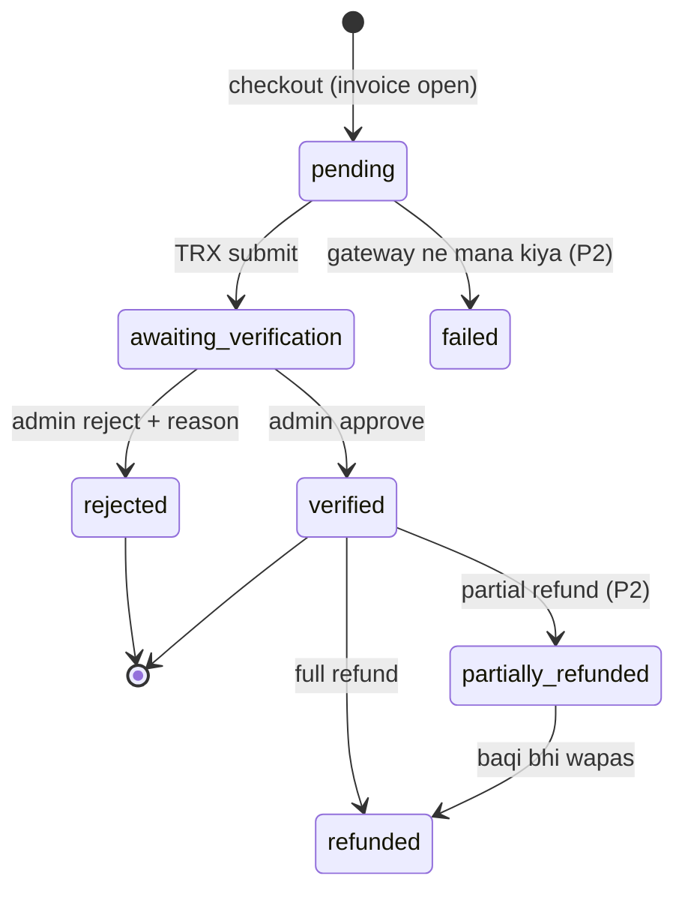
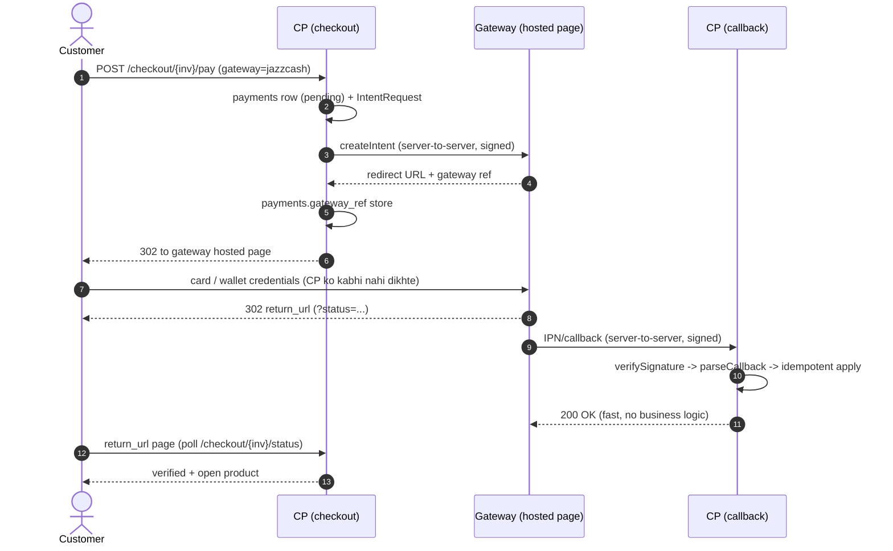
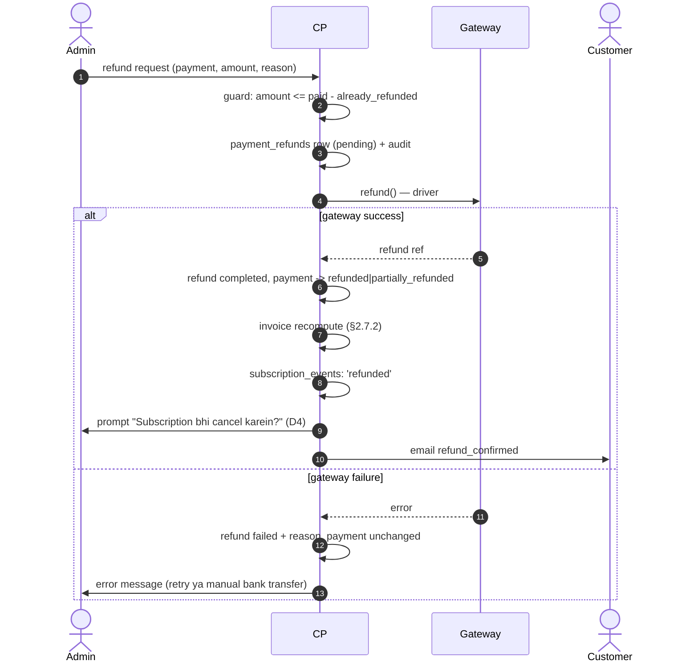
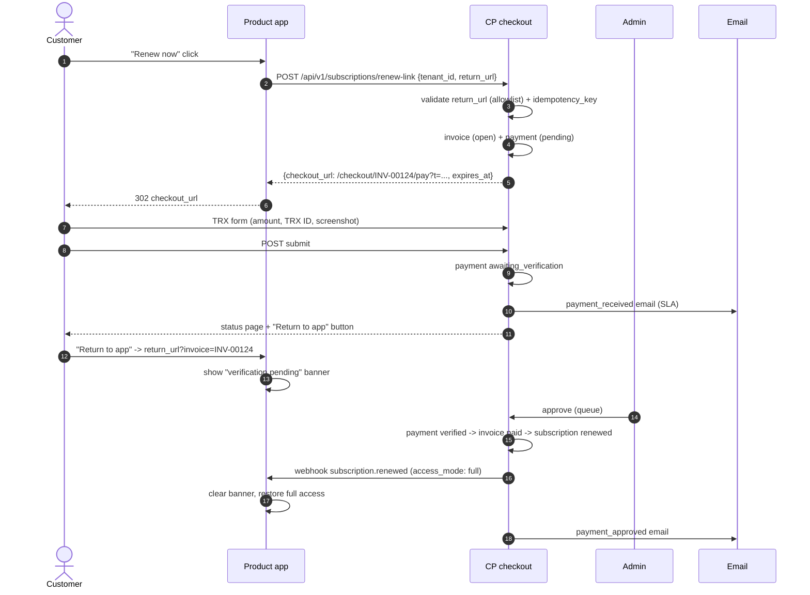

# 06 — Payments Design (Pakistan / PKR)

**Date:** 13 Nov 2026  
**Repo:** `E:/LaraProjects/saas-starter` (branch `extract/package-skeleton`)  
**Depends on:** `04-CONTROL-PLANE-DESIGN.md` (§1.3 `payments`/`invoices`, §2 state machine, §2.3 scheduler, §2.4 product contract, §5.3 checkout flow, §8 D3/D4), `05-IDENTITY-HUB-SPEC.md` (§3.4 renew-link, §4.1 webhook events, §5 disable propagation)  
**Inputs:** `khattakbits-core/src/{Support/Audit,Support/EmailTemplates,Support/Mailer,Support/Naming,Support/SettingsStore,Support/TableQuery,Http/Controllers/AttachmentController,Models/Attachment,Models/Setting}.php`, `saas-starter/{config/attachments.php,config/queue.php,routes/console.php,app/Modules/Settings/**}`, `khattakbits-ui/src/{ui/FileAttachments.vue,ui/ListView.vue,composables/useServerList.js}`  
**Rule:** Design + schema snippets only. Koi migration, model, gateway client ya job code nahi likha gaya — sirf interface aur base-class skeleton (jaisa maanga gaya). Har vendor-specific detail **VERIFY IN OFFICIAL DOCS** mark hai.

---

## 0. Scope, constraints aur aaj kya maujood hai

### 0.1 Inherited constraints (04 §0 se, dobara nahi likhein)

| Constraint | Payments par asar |
|---|---|
| MySQL 8.0+ target, tests SQLite `:memory:` | Koi partial/filtered unique index nahi, koi generated column nahi, koi `ENUM` nahi |
| Money = integer **minor units** (paisa) | `amount_minor unsignedBigInteger`; gateway jo `12.5` bhejta hai usay `minor()` se convert karo, float kabhi nahi |
| `ENUM` nahi | Status PHP backed enum + `string(20)` column |
| Koi generated column nahi | "Normalized reference" ka unique index app-level column par banega (§2.3), DB expression par nahi |

**Payments-specific teen naye constraints:**

1. **NULL unique index mein distinct hota hai** (MySQL aur SQLite dono). 04 ne yeh `payments.gateway` par seekha. Yahan dobara teen jagah aata hai: `reference_norm` (§2.3), `gateway_callbacks.event_id`, aur `payment_refunds.gateway_refund_ref`. Har case mein guard column **NOT NULL** rakha gaya hai.
2. **Timezone.** Sab timestamps **UTC** store honge (`config/app.php` default). PKT = UTC+5, koi DST nahi. Customer-facing har screen `Asia/Karachi` mein render karega, DB mein nahi. Wajah: TRX time tolerance (§2.5) do clocks compare karta hai — ek `now()` (UTC) aur ek user ka claimed time (PKT) — inhein mix karna silent off-by-5-hours bug hai.
3. **Paisa precision.** PKR ka minor unit paisa hai (2 dp) magar market mein prices round rupees mein hote hain. `1500000` = PKR 15,000.00. Gateway response mein amount **major units** (string ya float) aata hai — conversion sirf gateway driver ke andar, kabhi controller mein nahi.

### 0.2 Aaj kya maujood hai (verified)

| Cheez | File | Payments ke liye kaam ka kya hissa |
|---|---|---|
| Settings store | `khattakbits-core/src/Support/SettingsStore.php` | `all()`, `get(key, default)`, `setMany(array)`. Flat key/value, cache `settings.all`, `Cache::forget` on write |
| Settings table | `.../migrations/2026_10_27_070653_create_settings_table.php` | `key string(100)` PK, `value text nullable` — **plaintext, koi encryption nahi** |
| Settings admin | `app/Modules/Settings/Http/Controllers/SystemController.php` | `show`/`update` + `Audit::log('settings.updated', ...)` + changed-keys diff — copy karne layak pattern |
| Attachments | `AttachmentController`, `Models/Attachment`, `config/attachments.php`, `ui/FileAttachments.vue` | Polymorphic `attachable_type`/`attachable_id`, private disk `storage/app/private`, per-type permission keys, per-record `scope`, per-user daily quota |
| Audit | `Support/Audit.php` | `Audit::log(string $event, ?Model $subject, ?string $label, array $meta)` + `Audit::changes($before, $after)` |
| Audit event labels | `app/Modules/Settings/Http/Controllers/AuditLogController.php::EVENTS` | UI filter labels — naye events yahan add karne padenge |
| Email templates | `Support/EmailTemplates.php`, `Mailer.php`, `Jobs/SendEmailJob.php` | `{{ token }}` placeholders, DB overrides, admin editor maujood, `$tries=3` `$backoff=[60,300]` |
| Numbering | `Support/Naming.php` | `Naming::next(string $prefix, int $pad = 5)` → `PREFIX-00001`, `lockForUpdate` ke saath |
| List/filter/sort | `Support/TableQuery.php` + `useServerList.js` + `ListView.vue` | `?f[key]=`, `?q=`, `?sort=&dir=`, cursor paginate, `total` sirf pehle page par |
| Layout | `ListPage`, `FormPage`, `FormSection`, `FormGrid`, `Field`, `Input`, `Select`, `Modal`, `ConfirmDialog`, `StatusBadge`, `EmptyState`, `ReadField`, `ReportPage`, `ReportGrid` | Verification queue + checkout form inhi par banenge |
| Permissions | `Support/PermissionCatalog.php` + `menu.php` + `PermissionSeeder` | `platform.payments.{view,verify,refund}` already 04 §4.3 mein declare hain |
| Scheduler | `routes/console.php` (`Schedule::command('bin:purge')->dailyAt('03:00')`) | Naye commands yahan register honge |

### 0.3 Kya maujood **nahi** hai (aur yeh design kya maangta hai)

| Gap | Asar | Faisla |
|---|---|---|
| **Koi PDF library nahi** — `dompdf`/`snappy`/`browsershot` dono repos mein zero hits | Invoice PDF generate nahi ho sakti | §2.9 — `barryvdh/laravel-dompdf` recommend; Phase 1 mein printable HTML fallback |
| **`Mailer::send()` attachment support nahi** — signature `(string $to, string $subject, string $text, array $opts)`, `$opts` sirf `template_key`/`user_id` | PDF email mein attach nahi ho sakti | §2.9 — email mein **signed download link**, Mailer ko chhedna nahi |
| **`Setting.value` plaintext** — koi `encrypted` cast nahi (sirf `EmailAccount.password` encrypted hai) | Gateway secret `settings` mein daalna = DB dump mein leak | §2.2 — naya `payment_gateway_accounts` table with `encrypted:array` |
| **Attachment upload `update` permission maangta hai** (`AttachmentController::store` → `allow($cfg, 'update')`) | **Customer apni payment screenshot upload hi nahi kar sakta** — `platform.payments.verify` uske paas nahi | §2.1.2 — core mein optional `store` key (additive, back-compatible) |
| **`AttachmentController::show()` hamesha download** (comment: "Hamesha download (inline nahi): HTML/SVG XSS na kar sake") | Admin screenshot **inline preview nahi kar sakta** — `` `Content-Disposition: attachment` ko render nahi karta | §2.6.2 — `?inline=1` sirf safe mime allowlist par |
| **Koi virus/mime scan nahi** — sirf `extensions:` validation rule | Malicious file `storage/app/private` mein | §5.4 — mime cross-check + `nosniff` + safe-inline allowlist |
| **Koi outbound HTTP client abstraction nahi** — `Http::` ka zero usage | Gateway calls ad-hoc likhe jayenge, koi timeout/retry standard nahi | §1.5 — `AbstractGateway::http()` ek hi jagah timeout/retry/redaction |
| **`onOneServer()`/`withoutOverlapping()` kahin use nahi** | Do workers aik hi payment verify kar sakte hain | §2.7 — DB status guard (`WHERE status = ?`) primary defence; scheduler par `withoutOverlapping` additive |
| **`settings()` dot-notation helper nahi** — `SettingsStore::get()` literal key leta hai | `payments.manual.easypaisa_number` **literal key** hai, nesting nahi | §2.2 — keys flat likhi jayengi, dot sirf naming convention hai |
| **Koi Money value object nahi** — `useFormat().money()` sirf `en-US` 2dp, currency code nahi | PKR symbol/precision UI par hardcode hoga | §2.1.3 — `money_minor()` helper in `useFormat` (UI package, additive) |
| **`Naming::next()` mein year segment / reset nahi** | Fiscal-year sequence nahi ban sakta | §2.9 — prefix mein year daal do (`INV-2026`) — code change nahi chahiye |

### 0.4 Phase split

| | **Phase 1 — Manual TRX** | **Phase 2 — Direct APIs** |
|---|---|---|
| Gateways | `manual_easypaisa`, `manual_jazzcash` | `jazzcash`, `easypaisa`, `card` |
| Money movement | Customer wallet se merchant number par, **CP ke bahar** | Gateway ke through, CP redirect karta hai |
| Verification | Admin, queue se | Signature + callback + reconciliation |
| Effort | **~19 din** (§6.1) | **~17 din** (§6.2) |
| Risk | Fraud (fake TRX), admin bandwidth | Integration correctness, PCI scope, refunds |

### 0.5 Wiring checklist (naya feature = yeh 7 jagah)

Yeh codebase har feature ko **7 registration points** se jodta hai. Payments mein koi bhi miss = silent dead feature (permission 403, template nahi milta, attachment 404).

| # | Jagah | Kya add hoga |
|---|---|---|
| 1 | `app/Modules/Platform/menu.php` | `sections` items (TRX Queue), `permissions` array, `email_templates` block |
| 2 | `database/seeders/PermissionSeeder.php` | `php artisan db:seed --class=PermissionSeeder` (idempotent, naye keys super-admin ko mil jate hain) |
| 3 | `config/attachments.php` | `types.payment` entry |
| 4 | `config/payments.php` | **naya file** — drivers, tolerances, phase flag |
| 5 | `routes/console.php` | `Schedule::command('subscriptions:remind')`, `payments:prune-callbacks` |
| 6 | `AuditLogController::EVENTS` | `payment.*`, `invoice.*` labels |
| 7 | `CoreServiceProvider` (ya package `PaymentServiceProvider`) | Gateway registry binding, commands |

---

## 1. PaymentGateway contract

### 1.1 Interface kyun, `switch ($gateway)` nahi

Phase 1 mein sirf do manual drivers hain — `if/else` chalega. Phir bhi interface banaya ja raha hai kyunke:

1. **Phase 2 ka callback handler interface ka `parseCallback()` hi call karega.** Agar Phase 1 `if/else` se shuru hua to Phase 2 mein callback handler ko dobara likhna padega — yani Phase 1 ka verification code phenk dena.
2. **`payments.gateway` column already 5 values hold karta hai** (04 §1.3). Jis din `jazzcash` add hoga, `payments` table ka schema badalna nahi chahiye — sirf ek driver class.
3. **Testability.** Fraud/tolerance logic gateway se **alag** hai (§2.4–§2.5) — usay har gateway ke liye dobara test karne ki zaroorat nahi, kyunke woh `PaymentService` mein hai, driver mein nahi.

**Interface ka scope jaan boojh kar chhota hai:** sirf "paisa kaise aata hai aur wapas jata hai". Subscription, invoice, entitlement, notification — kuch bhi driver ke andar nahi.

### 1.2 Statuses (single enum, DB values 04 se match)

```php
enum PaymentStatus: string
{
    case Pending              = 'pending';               // checkout par row bani, TRX abhi nahi
    case AwaitingVerification = 'awaiting_verification'; // TRX submit hui, admin queue mein
    case Verified             = 'verified';              // paisa confirm
    case Rejected             = 'rejected';              // admin ne mana kiya
    case Failed               = 'failed';                // gateway ne mana kiya (Phase 2)
    case Refunded             = 'refunded';              // poora wapas
    case PartiallyRefunded    = 'partially_refunded';    // kuch wapas (Phase 2)
}
```

**`partially_refunded` par ek inconsistency jo 04 mein hai:** 04 §1.3 ka `payments.status` comment sirf `refunded` list karta hai, magar 04 §8 **D4** likhta hai "`payments.status = refunded` (ya `partially_refunded`)". Yeh design `partially_refunded` ko **include** karta hai aur saath `payment_refunds` table deta hai (§3.6) — kyunke ek payment par **multiple** partial refunds ho sakte hain aur unka amount kisi single status column mein nahi aa sakta. 04 §1.3 ke comment mein ek lafz add karna hai (`refunded|partially_refunded`) — **04 ka v4 note** (§7 D2).

**State graph (Phase 1 sirf solid lines, Phase 2 dashed):**



**`rejected` terminal hai, `pending` par wapas nahi jata.** Resubmission **naya** `payments` row banata hai (§2.4.3). Wajah: har attempt ek alag claim hai (alag TRX, alag screenshot, alag time). Ek row ko reuse karne se audit trail mein "kis attempt par kya reject hua" gum ho jata hai, aur `unique(gateway, reference_norm)` bhi same reference ko dobara allow nahi karta.

### 1.3 DTOs

`app/Modules/Platform/Payments/Data/` — sab `final readonly` classes (PHP 8.3), koi Eloquent model nahi. Wajah: driver ko DB ka pata nahi hona chahiye; usay sirf values milti hain aur values wapas karni hoti hain. Isse gateway driver ka unit test DB ke baghair chalta hai.

| DTO | Fields | Kaun banata hai |
|---|---|---|
| `IntentRequest` | `invoiceId:int`, `amountMinor:int`, `currency:string`, `description:string`, `returnUrl:string`, `cancelUrl:?string`, `metadata:array` | `PaymentService` (invoice se) |
| `PaymentIntent` | `gateway:string`, `gatewayRef:?string`, `redirectUrl:?string`, `expiresAt:?DateTimeImmutable`, `instructions:array`, `raw:array` | Driver |
| `CallbackEvent` | `gateway:string`, `eventId:?string`, `reference:string`, `amountMinor:int`, `currency:string`, `status:PaymentStatus`, `paidAt:?DateTimeImmutable`, `senderNumber:?string`, `raw:array` | Driver (`parseCallback`) |
| `RefundResult` | `gatewayRefundRef:?string`, `amountMinor:int`, `status:string`, `raw:array` | Driver |
| `SubmitTrxData` | `reference:string`, `amountMinor:int`, `senderNumber:?string`, `senderName:?string`, `claimedPaidAt:DateTimeImmutable` | Checkout controller (validated request) |

**`PaymentIntent.instructions` manual gateway ka poora point hai.** `ManualTrxGateway` ka `redirectUrl` `null` hota hai aur `instructions` mein woh array aata hai jo checkout screen render karta hai:

```php
[
    'number'        => '0300-1234567',
    'account_title' => 'KhattakBits (SMC-Pvt) Ltd',
    'wallet'        => 'Easypaisa',
    'note'          => 'Send the exact amount. Do not add a message.',
]
```

Yeh array **driver banata hai**, controller nahi — kyunke Phase 2 mein `jazzcash` ke liye `instructions` khali hoga aur `redirectUrl` bhara hua. Checkout screen dono cases ek hi Blade/Vue se handle karega: "redirectUrl hai to button, warna instructions".

### 1.4 The interface

```php
<?php

namespace App\Modules\Platform\Payments\Contracts;

use App\Modules\Platform\Models\Payment;
use App\Modules\Platform\Payments\Data\CallbackEvent;
use App\Modules\Platform\Payments\Data\IntentRequest;
use App\Modules\Platform\Payments\Data\PaymentIntent;
use App\Modules\Platform\Payments\Data\RefundResult;
use App\Modules\Platform\Payments\Enums\GatewayFeature;
use App\Modules\Platform\Payments\Enums\PaymentStatus;
use Illuminate\Http\Request;

interface PaymentGateway
{
    /** DB value — `payments.gateway` ka wohi string. Registry ki key bhi yahi. */
    public function key(): string;

    /** Admin UI / checkout par dikhne wala naam. */
    public function label(): string;

    /** Account configured + active + credentials maujood. Checkout isay gate karta hai. */
    public function isEnabled(): bool;

    /** Capability check — interface ko 4 optional methods se bachata hai. */
    public function supports(GatewayFeature $feature): bool;

    /** Offline: instructions + null redirect. Online: redirect URL. */
    public function createIntent(IntentRequest $request): PaymentIntent;

    /** Inbound IPN/callback body ko normalized event mein badalta hai. */
    public function parseCallback(Request $request): CallbackEvent;

    /** parseCallback se PEHLE chalta hai. False = 401, koi DB write nahi. */
    public function verifySignature(Request $request): bool;

    /** Reconciliation ke liye — gateway se poochho, apni DB se nahi. */
    public function queryStatus(string $gatewayRef): PaymentStatus;

    /** Full ya partial. AmountMinor gateway ke saath negotiate hota hai. */
    public function refund(Payment $payment, int $amountMinor, string $reason): RefundResult;
}
```

`GatewayFeature` enum (4 values, `Offline` sirf manual ke liye):

```php
enum GatewayFeature: string
{
    case Offline  = 'offline';   // instructions, koi redirect nahi
    case Redirect = 'redirect';  // hosted checkout page
    case Callback = 'callback';  // inbound IPN
    case Refund   = 'refund';    // programmatic refund
}
```

`queryStatus()` aur `refund()` **interface mein hain magar Phase 1 drivers `GatewayUnsupported` throw karte hain** — aur UI unhein `supports()` dekh kar chhupata hai. Interface se hatane ka nuqsan: Phase 2 mein `PaymentGateway` ka signature badalta, jo har driver ko chhuna padta.

### 1.5 Base class skeleton

```php
<?php

namespace App\Modules\Platform\Payments\Gateways;

use App\Modules\Platform\Models\Payment;
use App\Modules\Platform\Payments\Contracts\PaymentGateway;
use App\Modules\Platform\Payments\Data\CallbackEvent;
use App\Modules\Platform\Payments\Data\IntentRequest;
use App\Modules\Platform\Payments\Data\PaymentIntent;
use App\Modules\Platform\Payments\Data\RefundResult;
use App\Modules\Platform\Payments\Enums\GatewayFeature;
use App\Modules\Platform\Payments\Enums\PaymentStatus;
use App\Modules\Platform\Payments\Exceptions\GatewayUnsupported;
use Illuminate\Http\Client\PendingRequest;
use Illuminate\Http\Request;
use Illuminate\Support\Facades\Http;
use Illuminate\Support\Facades\Log;

abstract class AbstractGateway implements PaymentGateway
{
    /** Decrypted `payment_gateway_accounts` row — credentials + public_config merge. */
    public function __construct(protected array $config) {}

    abstract public function key(): string;

    abstract public function label(): string;

    /** Sirf subclasses jante hain — HMAC, RSA, ya plain hash. VERIFY IN OFFICIAL DOCS. */
    abstract protected function computeSignature(Request $request): string;

    /** @return GatewayFeature[] */
    protected function features(): array
    {
        return [GatewayFeature::Offline];
    }

    public function supports(GatewayFeature $feature): bool
    {
        return in_array($feature, $this->features(), true);
    }

    public function isEnabled(): bool
    {
        return (bool) ($this->config['is_active'] ?? false) && $this->credentialsReady();
    }

    /**
     * Template method. Subclass sirf `computeSignature()` deta hai.
     * hash_equals() lazmi — `===` timing attack deta hai.
     */
    public function verifySignature(Request $request): bool
    {
        $given = $this->signatureFrom($request);
        if ($given === '') {
            return false;
        }

        return hash_equals($this->computeSignature($request), $given);
    }

    public function createIntent(IntentRequest $request): PaymentIntent
    {
        throw new GatewayUnsupported('createIntent', $this->key());
    }

    public function parseCallback(Request $request): CallbackEvent
    {
        throw new GatewayUnsupported('parseCallback', $this->key());
    }

    public function queryStatus(string $gatewayRef): PaymentStatus
    {
        throw new GatewayUnsupported('queryStatus', $this->key());
    }

    public function refund(Payment $payment, int $amountMinor, string $reason): RefundResult
    {
        throw new GatewayUnsupported('refund', $this->key());
    }

    // ── shared plumbing ──────────────────────────────────────────────────

    /**
     * Har outbound gateway call isi se guzre: timeout, retry, aur URL logging
     * (URL mein credential ho sakta hai — is liye log mein sirf host).
     */
    protected function http(): PendingRequest
    {
        return Http::timeout((int) ($this->config['timeout'] ?? 15))
            ->connectTimeout(5)
            ->retry(2, 300, throw: false)
            ->withHeaders(['Accept' => 'application/json']);
    }

    /** Header naam gateway-specific hai. VERIFY IN OFFICIAL DOCS. */
    protected function signatureFrom(Request $request): string
    {
        return (string) $request->header($this->signatureHeader(), '');
    }

    /** @codeCoverageIgnore */
    protected function signatureHeader(): string
    {
        return 'X-Signature';
    }

    /** Credentials maujood hain? Kya lazmi hai woh subclass batata hai. */
    protected function credentialsReady(): bool
    {
        return true;
    }

    /** Gateway amount major units (string/float) bhejta hai — yahan convert. */
    protected function toMinor(string|int|float $amount): int
    {
        return (int) round(((float) $amount) * 100);
    }

    protected function fromMinor(int $amountMinor): string
    {
        return number_format($amountMinor / 100, 2, '.', '');
    }

    /**
     * Callback payload DB mein jaane se pehle redact hota hai.
     * Wajah: gateway apna secret/session token response mein echo karta hai.
     */
    protected function redact(array $payload): array
    {
        return array_diff_key($payload, array_flip($this->redactKeys()));
    }

    /** @return string[] */
    protected function redactKeys(): array
    {
        return ['password', 'secret', 'signature', 'hash', 'token', 'auth_token', 'pp_SecureHash'];
    }

    protected function logFailure(string $stage, array $context = []): void
    {
        Log::channel('payments')->warning('gateway.failed', [
            'gateway' => $this->key(),
            'stage'   => $stage,
        ] + $this->redact($context));
    }
}
```

**Base class jaan boojh kar "thin" hai.** Payment state, invoice totals, subscription, retry policy — kuch bhi yahan nahi. Woh `PaymentService` (§2.7) mein hai, jo drivers se **upar** hai. Agar base class mein `markVerified()` daal dete to har naya driver apni marzi se subscription activate kar sakta — yani ek bug 5 jagah.

### 1.6 Driver registry + config

```php
// config/payments.php  (naya)
use App\Modules\Platform\Payments\Gateways\{CardGateway, EasyPaisaGateway,
    JazzCashGateway, ManualTrxGateway};

return [
    'drivers' => [
        'manual_easypaisa' => ManualTrxGateway::class,
        'manual_jazzcash'  => ManualTrxGateway::class,   // same class, different account row
        'jazzcash'         => JazzCashGateway::class,
        'easypaisa'        => EasyPaisaGateway::class,
        'card'             => CardGateway::class,
    ],

    'phase' => (int) env('PAYMENTS_PHASE', 1),   // 1 = manual only, 2 = + direct APIs

    'manual' => [
        'trx_max_age_days'       => 7,    // is se purani TRX accept nahi
        'trx_future_skew_minutes' => 5,   // clock skew
        'invoice_pre_slack_minutes' => 15,
        'amount_tolerance_minor' => 0,    // exact match = 0
        'max_submissions_per_hour' => 5,
        'screenshot_required'    => false,
        'verification_sla_hours' => 12,   // sirf messaging + dashboard metric
    ],

    'callbacks' => [
        'retention_days' => 90,
        'ip_allowlist_enforced' => true,  // Phase 2
    ],
];
```

`ManualTrxGateway` **do** keys par registered hai magar ek hi class — account row se farq aata hai (`gateway` key constructor ko di jati hai). Isse do copy-paste classes nahi banti. `key()` `config['gateway']` return karta hai, hardcoded string nahi.

```php
final class GatewayRegistry
{
    /** @param array<string, class-string<PaymentGateway>> $drivers */
    public function __construct(private array $drivers) {}

    /** @return array<string, PaymentGateway> enabled drivers only */
    public function enabled(): array;

    /** @throws UnknownGateway */
    public function get(string $key): PaymentGateway;

    /** Phase 2: invoice ke currency/plan se choose. Phase 1: config default. */
    public function forInvoice(Invoice $invoice): PaymentGateway;
}
```

Binding `PaymentServiceProvider::register()` mein: `config('payments.drivers')` + `PaymentGatewayAccount::all()` (active rows) → `GatewayRegistry` singleton. **Account row na ho to driver `isEnabled()` false deta hai** — yani checkout usay dikhata hi nahi, aur agar koi direct POST kare to 422.

### 1.7 Drivers

| Driver | `key()` | `features()` | Phase | Notes |
|---|---|---|---|---|
| `ManualTrxGateway` | `manual_easypaisa` \| `manual_jazzcash` | `[Offline]` | **1** | `createIntent` → `instructions` array, `redirectUrl` null. `parseCallback`/`refund` → `GatewayUnsupported` |
| `JazzCashGateway` | `jazzcash` | `[Redirect, Callback, Refund]` | 2 | Signature: **VERIFY IN OFFICIAL DOCS** |
| `EasyPaisaGateway` | `easypaisa` | `[Redirect, Callback, Refund]` | 2 | Signature: **VERIFY IN OFFICIAL DOCS** |
| `CardGateway` | `card` | `[Redirect, Callback, Refund]` | 2 | Hosted page only — PAN kabhi hamare server par nahi (§5.1) |

**`ManualTrxGateway` Phase 2 mein bhi zinda rahega.** Wajah: direct API down ho, merchant account suspend ho, ya customer ka wallet limit hit ho — manual fallback hamesha chahiye. Is liye `payments.gateway` values `manual_*` ko **kabhi deprecate nahi** karna.

### 1.8 Interface jaan boojh kar kya **nahi** karta

| Cheez | Kyun interface mein nahi |
|---|---|
| Amount tolerance / fraud checks | Gateway-agnostic. `PaymentService` mein — 5 gateways par 5 baar test nahi karna padega |
| Invoice status update | Driver ko invoice ka pata hi nahi hona chahiye. Woh `PaymentService` ka kaam |
| Subscription activation | Wahi wajah — ek hi jagah (§2.7) |
| Notification/email | Side effect hai, driver ka contract nahi |
| Webhook dispatch | `PaymentService` commit ke baad karta hai (§2.7.3) |
| Idempotency | `gateway_callbacks` table + `PaymentService` ka status guard (§3.4) |
| Reconciliation | Separate command, `queryStatus()` ko call karta hai |

---

## 2. Phase 1 — Manual TRX

### 2.1 Checkout screen

#### 2.1.1 Screen + route

04 §5.2 mein routes already named hain: `checkout.show` (`/checkout/{invoice:number}`), `checkout.pay` (`/checkout/{invoice:number}/pay`), `checkout.status`. Yeh design unhein **bharta** hai, naye route nahi banata (ek exception: §2.1.2 ka inline preview).

| Screen | Route | Method | Component | Permission |
|---|---|---|---|---|
| Order summary | `/checkout/{invoice:number}` | GET | `FormPage` + `FormSection` + `ReadField` | invoice owner |
| TRX form | `/checkout/{invoice:number}/pay` | GET | `FormPage` + `FormSection` + `Field`/`Input` + `FileAttachments` | invoice owner |
| TRX submit | `/checkout/{invoice:number}/pay` | POST | — | invoice owner |
| Status / pending | `/checkout/{invoice:number}/status` | GET | `Page` + `StatusBadge` + `EmptyState` | invoice owner |

"invoice owner" = `invoices.user_id === auth()->id()`. **Koi permission key nahi** — yeh customer-facing screen hai, RBAC nahi. Route model binding `{invoice:number}` par, id par nahi (04 §5.2 ka rule).

#### 2.1.2 Screenshot upload — do core changes lazmi

`FileAttachments.vue` + `AttachmentController` reuse ho jate hain, magar **do blockers** hain jo aaj hi code mein maujood hain:

**Blocker 1 — customer upload kar hi nahi sakta.** `AttachmentController::store()`:

```php
$this->allow($request, $cfg, 'update');          // ← platform.payments.verify maangta hai
$this->authorizeRecord($request, $cfg, (int) $data['id'], 'update');
```

Customer ke paas `platform.payments.verify` nahi hai → 403. **Fix (core package, additive, back-compatible):**

```php
// AttachmentController::store()
$this->allow($request, $cfg, 'store');           // naya action key
$this->authorizeRecord($request, $cfg, (int) $data['id'], 'store');

// AttachmentController::allow()
// `store` key na ho to `update` par fallback — existing types (demo_entry) bilkul
// waise hi chalte rahenge, koi config change nahi.
```

Config entry:

```php
// config/attachments.php → types
'payment' => [
    'model'  => App\Modules\Platform\Models\Payment::class,
    // view aur store par NULL: permission ka faisla `authorize` callback karta hai,
    // warna customer `platform.payments.view` na hone se 403 ho jata (allow() pehle chalta hai).
    'view'   => null,
    'store'  => null,
    'update' => 'platform.payments.verify',
    'delete' => 'platform.payments.verify',
    // scope chhoda hua (default 'type'): record-level faisla callback karta hai.
    // AHEM: callable hone par `authorizeRecord()` ka return `true` hona LAZMI hai —
    // `abort_unless($authorize(...) === true, 403)`. `null` return karna = 403.
    'authorize' => function ($user, $payment, $action) {
        $isOwner = (int) $payment->invoice->user_id === (int) $user->getKey()
            || (int) $payment->submitted_by === (int) $user->getKey();
        $isStaff = $user->can('platform.payments.verify');

        return match ($action) {
            'store', 'view' => $isOwner || $isStaff,
            'delete'        => $isStaff,
            default         => false,
        };
    },
],
```

**Blocker 2 — inline preview nahi.** `show()` par comment hai: *"Hamesha download (inline nahi): HTML/SVG file browser mein chal kar XSS na kar sake"*. Admin ko screenshot dekhna hai; `` `Content-Disposition: attachment` render nahi karta. **Fix — narrow, safe:**

```php
// sirf safe mime + explicit ?inline=1 par inline
$inlineSafe = ['image/jpeg', 'image/png', 'image/webp', 'application/pdf'];

if ($request->boolean('inline') && in_array($attachment->mime, $inlineSafe, true)) {
    return Storage::response($attachment->path, $attachment->name, [
        'Content-Type'           => $attachment->mime,
        'X-Content-Type-Options' => 'nosniff',
        'Content-Security-Policy'=> "default-src 'none'; img-src 'self'",
        'Content-Disposition'    => 'inline; filename="'.addslashes($attachment->name).'"',
    ]);
}
```

HTML/SVG **kabhi** inline nahi (`$inlineSafe` mein nahi hain) — original comment ka XSS concern barqarar rehta hai. `Content-Security-Policy: default-src 'none'` doosra guard hai.

**Yeh dono core package changes hain** → `khattakbits-core` mein tagged release (`v1.6.0`, MINOR — additive optional config key + optional query param). 05 §5.1.1 ka wohi deploy pattern: `migrate` pehle (yahan migration nahi), phir code.

#### 2.1.3 Screen content

TRX form ke fields (sab `Field` + `Input`, `FormSection` mein grouped):

| Field | Input | Validation | Note |
|---|---|---|---|
| Payment method | `Select` — sirf enabled manual drivers | `required, in:manual_easypaisa,manual_jazzcash` | Disabled driver list mein nahi aata |
| TRX ID | `Input` text | `required, string, max:120` | Uppercase + whitespace-strip normalize hota hai (§2.4.1) |
| Amount sent | `Input` text, `inputmode=decimal` | `required, numeric, min:1` | **PKR major units** user se, `minor` DB mein. `12.5` accept, `12.555` reject |
| Sender number | `Input` tel | `required, regex:/^03\d{2}-?\d{7}$/` | Normalize `03001234567` → `0300-1234567` |
| Sender name | `Input` text | `nullable, max:120` | Wallet account title |
| Paid at (date + time) | `DatePicker` + `Input type=time` | `required, date, before_or_equal:now` | PKT label, UTC store |
| Screenshot | `FileAttachments` `type="payment"` `:id="payment.id"` | `nullable`, mime/size attachment config se | `screenshot_required` setting se required ho sakta hai |

**Instructions block** (driver se, `PaymentIntent.instructions`):

```
EasyPaisa  ·  0300-1234567
KhattakBits (SMC-Pvt) Ltd
Exact amount: PKR 15,000.00
```

Agar configured number khali ho (`SettingsStore::get('payments.manual.easypaisa_number')` → `null`) to **checkout block ho jata hai**:

```
EmptyState variant="error"
title="Manual payments are temporarily unavailable"
description="Please contact support@khattakbits.com"
```

Yeh check zaroori hai. Warna customer ko khali number dikhta hai, woh paisa kisi aur ko bhej deta hai, aur support ko refund karna padta hai. `isEnabled()` isi check ka driver-level version hai — dono chahiye (UI gate + driver gate).

**Amount display ka rule:** screen par amount **`invoices.total_minor` se** aata hai, kabhi plan price se nahi. Wajah: plan price baad mein badal sakta hai; invoice freeze ho chuki hai. Agar `total_minor === 0` (trial ya 100% discount) to TRX form **render hi nahi hota** — subscription foran activate ho jati hai (`∅ → trialing|active`, 04 §2.2).

#### 2.1.4 `useFormat` mein PKR helper (UI package, additive)

Aaj `money()` = `Number(n).toLocaleString('en-US', {minimumFractionDigits:2})` — koi currency symbol nahi. Payments screen par `PKR 15,000.00` chahiye:

```js
// composables/useFormat.js — additive, existing money() untouched
const moneyMinor = (minor, currency = 'PKR') =>
    `${currency} ${(Number(minor ?? 0) / 100).toLocaleString('en-PK', {
        minimumFractionDigits: 2, maximumFractionDigits: 2,
    })}`
```

`en-PK` grouping `en-US` jaisi hai (1,500,000), is liye purane screens affect nahi hote. Minor units se divide **frontend par** hota hai — API minor units hi bhejti hai (04 §1.3 ka rule).

### 2.2 Settings + secrets

#### 2.2.1 Non-secret: `settings` table (flat keys)

`SettingsStore::get()` **literal key** leta hai, dot-notation nahi. Dot sirf naming convention hai:

| Key | Type | Kya | Kahan dikhta |
|---|---|---|---|
| `payments.manual.easypaisa_number` | string | `0300-1234567` | Checkout instructions |
| `payments.manual.easypaisa_title` | string | Account title | Checkout instructions |
| `payments.manual.jazzcash_number` | string | `0321-7654321` | Checkout instructions |
| `payments.manual.jazzcash_title` | string | Account title | Checkout instructions |
| `payments.manual.instructions` | text | Free text note | Checkout instructions footer |
| `payments.support_whatsapp` | string | Number for "payment nahi hua?" link | Status page |
| `payments.invoice_company_name` | string | Invoice header | PDF |
| `payments.invoice_ntn` | string | Tax number | PDF |

**Yeh sab plaintext hain aur plaintext rehne chahiye** — yeh woh numbers hain jo **public** hain (customer ko dikhane hain). Inhein encrypt karna bekaar hai.

#### 2.2.2 Secret: naya `payment_gateway_accounts` table

`Setting.value` plaintext hai (verified, koi `encrypted` cast nahi). Gateway passwords/salt usme daalna = DB dump ya backup leak hone par merchant account hijack. Is liye `email_accounts` ka pattern copy:

```php
// ── payment_gateway_accounts (CP) — naya table ───────────────────────────
id                  bigIncrements
gateway             string(30)  unique          // manual_easypaisa|manual_jazzcash|jazzcash|easypaisa|card
label               string(80)                  // 'Easypaisa — Main'
mode                string(10)  default 'sandbox'  // sandbox|live
is_active           boolean default false
merchant_id         string(120) nullable        // gateway ka merchant/Store ID
merchant_number     string(30)  nullable        // manual: customer ko dikhne wala number
account_title       string(120) nullable
credentials         json        nullable        // 'encrypted:array' cast — password, integrity salt, api key
public_config       json        nullable        // non-secret: return/cancel URLs, style, logo
ip_allowlist        json        nullable        // Phase 2: callback source IPs
callback_url        string(190) nullable        // gateway dashboard mein register hone wali URL
secret_last4        string(4)   nullable        // support: "kaunsa secret laga hua hai"
last_tested_at      timestamp   nullable        // "Test connection" button
last_test_ok        boolean     nullable
created_by          foreignId   nullable constrained('users') nullOnDelete
updated_by          foreignId   nullable constrained('users') nullOnDelete
// credentials par 'encrypted:array' cast — Laravel native, koi package nahi.
// public_config mein secret kabhi nahi: woh admin UI mein plain dikhta hai.
```

**`credentials` vs `public_config` ka farq ahem hai:** `public_config` admin UI mein **plain** render hota hai (URLs, style), `credentials` kabhi render nahi hota — sirf `secret_last4` dikhta hai. Ek hi JSON mein dono rakhna = ek din koi `dd()` kar dega aur salt logs mein chala jayega.

**Admin screen:** `/platform/payments/accounts` (`platform.payments.view|verify`), `FormPage` + `FormSection`. Credentials field `type="password"` + "unchanged" placeholder — khali chhodne par purani value rehti hai (email account ka wohi pattern).

#### 2.2.3 Env mein kya rahega

Sirf **infrastructure** secrets env mein: `APP_KEY` (jo `encrypted` cast ko chalata hai), DB, mail. **Gateway credentials env mein nahi** — wajah: env change karne ke liye deploy chahiye, aur admin ko rotate karna hai bina deploy. `payment_gateway_accounts` DB mein hai to admin UI se rotate ho jata hai (audited).

Trade-off honestly: DB mein encrypted secret ka matlab `APP_KEY` compromise = sab secrets. Env mein rakhne ka matlab har rotation par deploy. Payments ke liye rotation bina deploy zyada important hai (gateway suspend kar de to foran badalna padta hai), is liye DB + `encrypted` cast chuna.

### 2.3 Schema: `04` §1.3 ka extension (replacement nahi)

`payments` table 04 mein maujood hai. Yeh **additive columns** hain jo manual TRX ko chahiye:

```php
// ── payments — ADDITIVE columns (04 §1.3 ke upar) ────────────────────────
sender_number        string(20)  nullable  index   // user-claimed sender wallet
sender_name          string(120) nullable
claimed_paid_at      timestamp   nullable          // user ne jo time bataya (UTC)
submitted_at         timestamp   nullable          // TRX submit ka waqt (created_at = row bana)
reference_norm       string(120) nullable          // normalized TRX — unique guard
amount_expected_minor unsignedBigInteger           // invoice.total_minor at submit (frozen)
amount_delta_minor   bigInteger  nullable          // claimed - expected (signed)
fraud_flags          json        nullable          // computed flags (§2.4.2)
review_notes         text        nullable          // admin ke notes (reject ke ilawa)
gateway_txn_at       timestamp   nullable          // Phase 2: gateway ka apna timestamp

unique (gateway, reference_norm)                   // asli duplicate guard
// 04 ka unique(gateway, reference) hata dena chahiye — neeche wajah.
```

#### 2.3.1 `reference_norm` kyun — `unique(gateway, reference)` ek hole hai

04 ka index **exact string** compare karta hai. Manual TRX mein user TRX ID paste karta hai, type karta hai, ya copy karta hai — teeno se different string banti hai:

| User ne daala | DB mein | Duplicate? |
|---|---|---|
| `12345678901` | `12345678901` | — |
| `12345678901 ` (trailing space) | `12345678901 ` | **Nahi — alag row** |
| ` 12345678901` | ` 12345678901` | **Nahi** |
| `12345 678901` | `12345 678901` | **Nahi** |

Yani same TRX ID 4 dafa insert ho sakti hai aur **char payments 4 invoices par** "verified" ho sakte hain. Yeh exactly woh fraud vector hai jise `unique(gateway, reference)` rokne ke liye banaya gaya tha.

**Fix:** normalize karke ek dedicated column par unique:

```php
// PaymentService::normalizeReference()
$norm = strtoupper(preg_replace('/\s+/u', '', trim($reference)));
// '12345 678901 ' → '12345678901'
```

- **Uppercase** — `tx123` aur `TX123` ek hain (JazzCash TRX alphanumeric ho sakti hai, **VERIFY IN OFFICIAL DOCS**)
- **Whitespace strip** — copy-paste artifacts
- **Punctuation strip NAHI** — `TX-123` aur `TX123` ko merge karna do genuinely different IDs ko ek bana sakta hai. Normalization aggressive nahi, sirf obvious.

`reference` (raw) display ke liye rehti hai — admin ko wohi dikhana chahiye jo user ne bheja. `reference_norm` sirf guard hai.

**`reference_norm` nullable kyun:** payment row checkout par banti hai, TRX baad mein aati hai. NULL unique index mein distinct hota hai → multiple `pending` rows allowed (04 ka wohi reasoning). App invariant: `status >= awaiting_verification` par `reference_norm` NOT NULL.

**04 mein one-line change chahiye:** `unique(gateway, reference)` → `unique(gateway, reference_norm)` (§7 D1).

#### 2.3.2 `amount_expected_minor` kyun (frozen copy)

`amount_delta_minor` ko `invoice.total_minor` se live compare karna tempting hai, magar invoice ka total **baad mein badal sakta hai** (proration item, manual credit, void + reissue). Us surat mein purana payment "mismatch" dikhne lagega jabke us waqt sahi tha.

Is liye submit ke waqt expected amount freeze hoti hai. Admin ko dikhta hai: `expected 1,500,000 · claimed 1,500,000 · delta 0`. Audit mein bhi wohi number rehta hai.

### 2.4 TRX submission: validation, normalization, fraud checks

#### 2.4.1 Submit flow (ek transaction)

```php
POST /checkout/{invoice:number}/pay

1. Guard: invoice.status === 'open' && invoice.user_id === auth()->id()
   warna 409 invoice_not_payable
2. Guard: invoice.total_minor > 0                warna 409 (trial/zero invoice)
3. Payment row dhoondo: WHERE invoice_id = ? AND status = 'pending' ORDER BY id DESC LIMIT 1
   na mile to naya 'pending' row banao (resume path)
4. Normalize: reference_norm = upper(no-whitespace(reference))
5. Duplicate pre-check (friendly 422):
   SELECT 1 FROM payments WHERE gateway = ? AND reference_norm = ?
   → mila to 422 duplicate_reference (DB unique ka friendly version)
6. Fraud flags compute karo (§2.4.2) — hard block ya flag
7. DB::transaction:
     UPDATE payments SET
        status = 'awaiting_verification',
        reference = ?, reference_norm = ?,
        amount_minor = ?, amount_expected_minor = invoice.total_minor,
        amount_delta_minor = ?, sender_number = ?, sender_name = ?,
        claimed_paid_at = ?, submitted_at = now(),
        fraud_flags = ?, submitted_by = auth()->id()
     WHERE id = ? AND status = 'pending'      ← status guard, double-submit
8. DB::afterCommit: Audit::log('payment.submitted', ...), email payment_received
9. 302 /checkout/{number}/status
```

**Step 7 ka `WHERE status = 'pending'` guard** double-submit rokta hai: do tabs se do submit → sirf ek `UPDATE` affect karta hai (affected = 1), doosre ko 409. `lockForUpdate` ki zaroorat nahi kyunke conditional `UPDATE` atomic hai.

**Step 5 friendly check kyun jab DB unique hai:** DB `1062` exception user ko `SQLSTATE[23000]` dikhata hai. Pre-check 422 deta hai, magar **race mein DB hi final guard hai** — pre-check ko security control na samjhein, sirf UX.

#### 2.4.2 Fraud checks

Do categories: **hard block** (submit hi nahi hota) aur **flag** (submit hota hai, admin ko badge dikhta hai, queue mein upar aata hai).

| # | Check | Severity | Implementation | Test |
|---|---|---|---|---|
| F1 | Duplicate `reference_norm` (kisi bhi invoice par) | **Block** 422 | Step 5 pre-check + DB unique | T1 |
| F2 | `reference_norm` already `verified`/`refunded` | **Block** 409 | Wahi query, status filter | T2 |
| F3 | Invoice already paid / void | **Block** 409 | Step 1 | T3 |
| F4 | `amount_minor <= 0` | **Block** 422 | Validation | T4 |
| F5 | `claimed_paid_at > now + 5 min` | **Block** 422 | Validation `before_or_equal` | T5 |
| F6 | `claimed_paid_at < invoice.issued_at - 15 min` | **Block** 422 | "TRX invoice se pehle ki nahi ho sakti" | T6 |
| F7 | `claimed_paid_at < now - 7 din` | **Block** 422 | `trx_max_age_days` | T7 |
| F8 | `abs(amount_delta_minor) > tolerance` | **Flag** `amount_mismatch` | §2.5 | T8 |
| F9 | `sender_number === merchant_number` | **Flag** `self_payment` | Wallet se khud ko | T9 |
| F10 | `sender_number` ne 24h mein 3+ different invoices pay kiye | **Flag** `sender_reuse` | `COUNT(DISTINCT invoice_id)` | T10 |
| F11 | Same `submitted_by` ne 1h mein 5+ submissions | **Block** 429 | `max_submissions_per_hour` | T11 |
| F12 | Screenshot missing (jab `screenshot_required`) | **Block** 422 | Attachment count check | T12 |
| F13 | `reference_norm` length/format gateway pattern se match nahi | **Flag** `format_suspect` | Regex per gateway — **VERIFY IN OFFICIAL DOCS** | T13 |
| F14 | `claimed_paid_at` invoice ke `paid_at` ke baad (agar already paid) | **Block** 409 | Step 1 cover karta hai | T14 |
| F15 | Same IP ne 1h mein 5+ submissions | **Flag** `ip_velocity` | `payments` par IP column nahi → `audit_logs` se | T15 |

**F10 ka detail:** ek wallet (ya ek stolen wallet) se kai invoices pay karna normal nahi hai — yeh "reselling" ya "money laundering via SaaS" ka pattern hai. Flag, block nahi: koi agency legitimately 3 clients ke liye pay kar sakti hai.

**F15 ka honest note:** `payments` mein `ip` column nahi hai (04 mein nahi tha). IP `audit_logs.ip` mein hai (jahan `Audit::log('payment.submitted')` likhta hai). Is liye F15 `audit_logs` par query karta hai — cross-table query, index `(event, id)` maujood hai magar `ip` par index nahi. **Yeh slow ho sakta hai.** Phase 1 mein acceptable (volume kam), Phase 2 mein `payments.submitted_ip` column add karna behtar — abhi jaan boojh kar nahi daal rahe (kam column, kam surface).

**Kya yeh checks "fraud detection" hain?** Nahi — yeh **deterministic invariants + velocity heuristics** hain. Koi ML, koi score, koi third-party. Wajah: Phase 1 ka volume (din ke 5–20 payments) ML ke liye bahut chhota hai, aur galat flag ka cost (legit customer block) zyada hai. Admin ka faisla hi final hai.

#### 2.4.3 Resubmission (reject ke baad)

Rejected payment ke baad customer wahi invoice dobara pay kar sakta hai:

- **Naya** `payments` row (`status = pending`) — purana `rejected` rehta hai, apne reason ke saath
- Naya TRX ID chahiye (purani `reference_norm` unique mein phansi hui hai — **yeh jaan boojh kar hai**: same TRX dobara submit karna bhi fraud ka signal hai)
- Screenshot naye payment row par attach hoga (attachment `attachable_id` badalta hai)
- Invoice `open` rehti hai (`rejected` payment invoice ko nahi chhoota)

04 §5.3 ka "TRX reject → payment rejected + reason email + invoice open rehta hai (dobara submit ho sakta hai)" — yeh design usay exactly implement karta hai.

### 2.5 Amount + time tolerance

#### 2.5.1 Amount

```php
$delta = $claimedMinor - $invoice->total_minor;
$tolerance = (int) config('payments.manual.amount_tolerance_minor'); // 0

if ($delta === 0)                    { /* exact — clean approve */ }
elseif (abs($delta) <= $tolerance)   { /* within tolerance — approve, no flag */ }
elseif ($delta > 0)                  { /* OVERPAY  — flag overpaid  */ }
else                                 { /* UNDERPAY — flag underpaid */ }
```

**Default tolerance `0` kyun:** manual TRX mein customer **exact** amount bhej sakta hai — wallet koi fee nahi kaatta sender se (receiver se kaatta hai, aur woh bhi alag se dikhta hai). Yani `14,990` bhejna ek choice hai, majboori nahi. Tolerance daalne se sirf "kitna kam chalega" ka faisla aata hai, aur woh faisla admin ka hona chahiye, config ka nahi.

**Overpayment (delta > 0):**
- Approve karo, invoice `paid`, `amount_paid_minor` = claimed
- `amount_due_minor` = `max(0, total - paid)` → 0
- Zyada paisa `review_notes` + `gateway_payload` mein note hota hai + audit
- Credit note (negative invoice) **Phase 2** — abhi nahi. Wajah: credit note ka apna numbering + FBR treatment hai, aur ek 500 rupay ki overpayment ke liye woh machinery nahi uthani

**Underpayment (delta < 0):**
- **Default UI action = Reject** (reason `underpaid`)
- Magar admin **approve kar sakta hai** — extra confirm ke saath (`ConfirmDialog` + wajah likhna lazmi), audited as `payment.verified_underpaid`
- Approve par: invoice `paid`, `amount_paid_minor` = claimed, `amount_due_minor` = `total - paid` (**0 se zyada rehta hai** — yani invoice paid hai magar balance dikhta hai)
- Subscription activate hoti hai (admin override)

**Underpayment ko hard-block kyun nahi kiya:** customer ne `14,990` bheja `15,000` ke bajaye. Hard block ka matlab: paisa aa chuka hai, customer ke paas kuch nahi, aur admin ko phir bhi manually kuch karna padega. Same admin touch, worse outcome. Flag + admin decision behtar hai.

#### 2.5.2 Time

Valid window:

```
invoice.issued_at - 15 min   <=   claimed_paid_at   <=   now + 5 min
                                 AND
                     claimed_paid_at   >=   now - 7 days
```

| Boundary | Value | Kyun |
|---|---|---|
| Lower (invoice se pehle) | `issued_at - 15 min` | User invoice dekhne se pehle pay nahi kar sakta. 15 min slack clock skew + "admin ne invoice 10:00 par banayi, user ne 09:58 par TRX ki" edge case ke liye |
| Upper (future) | `now + 5 min` | PKT/UTC confusion, phone clock galat. 5 min se zyada future = fabrication |
| Age | `now - 7 days` | 3 mahine purani TRX kisi **doosre** customer ki ho sakti hai. 7 din = invoice ke unpaid window ke barabar (04 §5.3 ka uncollectible rule) |

**Yeh window "payment time" verify nahi karta** — user jo time batata hai woh **claim** hai, proof nahi. Asli proof screenshot + bank statement hai, jo admin dekhta hai. Window sirf obvious fabrication (kal ki TRX, ya agle hafte ki) pakadta hai.

**Timezone handling:** `claimed_paid_at` form se PKT mein aata hai → controller `Carbon::parse($input, 'Asia/Karachi')->utc()` karta hai → DB UTC. Comparison `now()` (UTC) se. Mixed comparison = 5 ghante ka silent bug (PKT customer ki 23:00 TRX "future" lag kar reject ho jati).

### 2.6 Admin verification queue

#### 2.6.1 Screen

`/platform/payments/queue`, permission `platform.payments.verify`. 04 §4.1 #18 mein already planned.

| Cheez | Detail |
|---|---|
| Query | `WHERE status = 'awaiting_verification'` |
| Default sort | `submitted_at ASC` — **purani pehle** (FIFO fairness) |
| `TableQuery` config | `sortable: submitted_at, amount_minor`, `filters: gateway, flagged, age_bucket`, `search: reference, sender_number, invoice.number` |
| Columns | Invoice # · Gateway · Amount · Delta · Sender · Paid at · Age · Flags · Actions |
| Row end | `RowAction` — "Review" → detail screen |
| Filters | `f.gateway=manual_easypaisa`, `f.flagged=1`, `f.age_bucket=over_24h` |
| Badge | `StatusBadge tone="warning"` jab `age > 24h` — SLA breach |
| Empty | `EmptyState variant="records"` "Queue clear" |

**Sort `submitted_at ASC` kyun, `DESC` nahi:** nayi payments upar rakhna tempting hai magar purani rows ko neeche dhakel deta hai — 3 din purani payment kabhi verify hi nahi hoti. FIFO + age badge dono chahiye.

#### 2.6.2 Detail screen

`/platform/payments/{payment}`, `FormPage` + `FormSection` × 3:

**Section 1 — Submitted (user ne kya bheja)** — `ReadField` grid
TRX ID (raw), amount claimed, sender number, sender name, paid at (PKT), submitted at, submitted by, attempts count.

**Section 2 — Expected (system ke paas kya hai)** — `ReadField` grid
Invoice number, invoice total, period, plan, tenant, subscription status, delta (`+0` / `-10,000` PKR, red/green).

**Section 3 — Evidence** — `FileAttachments` `readonly` + inline image preview (§2.1.2 ka `?inline=1`).

**Flags panel** — `fraud_flags` array ke badges (`amount_mismatch`, `sender_reuse`, `self_payment`, `format_suspect`, `ip_velocity`), har badge ke saath human label + tooltip (kyun flag hua).

**Actions** — `RowAction` / buttons:
- **Approve** (`ConfirmDialog`, `danger=false`) — summary: "INV-00124 ko PKR 15,000 paid mark karein aur subscription activate karein?"
- **Reject** (`Modal` with reason) — reason **required**, enum + free text
- **Approve with adjustment** (underpayment case) — `ConfirmDialog danger=true` + wajah lazmi
- **View invoice** — link
- **View customer** — link

**Bulk approve jaan boojh kar nahi (Phase 1).** Wajah: 20 rows ek click par approve karna ka matlab 20 screenshots kabhi dekhe hi nahi gaye. Fraud control ka poora point admin ka individual faisla hai. Bulk **reject** bhi nahi (galat reject = paying customer lost). Phase 2 mein "bulk approve sirf zero-flag + exact-amount rows, max 10, with per-row screenshot thumbnail grid" consider ho sakta hai.

#### 2.6.3 Reject reasons (enum)

| Code | Label | Kab |
|---|---|---|
| `not_received` | Payment not received | Merchant account mein paisa nahi aaya |
| `reference_invalid` | Invalid TRX ID | TRX ID exist nahi karti |
| `amount_mismatch` | Amount does not match | Bahut kam/zyada |
| `underpaid` | Underpaid | Kam amount, admin ne reject chuna |
| `duplicate` | Duplicate payment | Yeh TRX pehle use ho chuki hai |
| `suspected_fraud` | Suspected fraud | Screenshot manipulated, sender reuse |
| `other` | Other | Free text lazmi |

`rejection_reason` column `string(190)` hai (04) — enum code + free text: `"underpaid: expected 15000, received 14990"`. Admin UI enum se select karta hai aur text auto-fill hota hai, edit ho sakta hai.

### 2.7 Approve / reject — atomic, idempotent, audited

#### 2.7.1 Approve

```php
DB::transaction(function () use ($payment, $admin) {
    // 1. Lock + status guard — do admins ek saath? sirf ek jeetega
    $locked = Payment::whereKey($payment->id)
        ->where('status', 'awaiting_verification')
        ->lockForUpdate()
        ->first();

    if ($locked === null) {
        throw new PaymentAlreadyHandled();     // 409 — doosre admin ne kar diya
    }

    $before = $locked->only(['status', 'verified_by', 'verified_at']);

    // 2. Payment verified
    $locked->update([
        'status'      => 'verified',
        'verified_by' => $admin->id,
        'verified_at' => now(),
        'paid_at'     => $locked->claimed_paid_at ?? now(),
    ]);

    // 3. Invoice recompute (§2.7.2) — payment rows se, na ke delta se
    $invoice = $locked->invoice;
    $invoice->recalculateTotals();          // paid_minor, due_minor, status
    $invoice->save();

    // 4. Subscription transition — 04 §2.2 ka single entry point
    app(SubscriptionStateMachine::class)->onPaymentVerified($invoice, $locked);

    // 5. Entitlements — 04 §3
    app(EntitlementResolver::class)->bump($invoice->subscription);

    // 6. Audit
    Audit::log('payment.verified', $locked, $locked->reference, [
        'changes' => Audit::changes($before, $locked->only(['status', 'verified_by', 'verified_at'])),
        'invoice' => $invoice->number,
        'amount_minor' => $locked->amount_minor,
        'delta_minor'  => $locked->amount_delta_minor,
    ]);
});
```

#### 2.7.2 Invoice totals ka canonical recompute

04 §1.3 ne `invoice_items` se totals derive karne ka rule diya. **Payments us rule ko replace nahi karte — usme `amount_paid` ki layer add karte hain:**

```
received_minor  = SUM(payments.amount_minor
                      WHERE invoice_id = ? AND status IN ('verified','partially_refunded','refunded'))
refunded_minor  = SUM(payment_refunds.amount_minor
                      WHERE payment_id IN (...) AND status = 'completed')
net_minor       = received_minor - refunded_minor

amount_paid_minor = net_minor
amount_due_minor  = max(0, total_minor - net_minor)

status:
  net == 0 && received > 0        -> refunded
  0 < net < received              -> partially_refunded
  net >= total_minor              -> paid
  else                            -> open
```

**Phase 1 mein `payment_refunds` khali hai** → formula simple ho jata hai: `paid = SUM(verified)`.

**`refunded` payments ko `received` mein kyun ginte hain:** kyunke paisa aaya tha. Unhein `refunded_minor` se minus karke `net = 0` aata hai. Agar `refunded` ko `received` se nikaal dein to `refunded_minor` double-count ho jayega aur `net` negative chala jayega. Ek hi jagah se minus hota hai.

**Assertion (04 ka wohi discipline):**
```
total_minor === SUM(invoice_items.amount_minor)
total_minor >= 0
amount_paid_minor >= 0
amount_due_minor === max(0, total_minor - amount_paid_minor)
```
Violation par `LogicException` — transaction rollback. Silent wrong totals se behtar loud crash.

#### 2.7.3 Side effects: transaction ke andar vs baad

| Side effect | Kahan | Kyun |
|---|---|---|
| `payments` update | **Andar** | Core state |
| `invoices` recompute | **Andar** | Core state, same transaction |
| `subscription` transition + `subscription_events` | **Andar** | Core state; event row ke baghair state change invariant tootta (04 §2.2) |
| `entitlements_hash` bump | **Andar** | Product `resolve` isi par ETag deta hai — stale hash = stale access |
| `Audit::log` | **Andar** | Rollback hone par audit bhi na likhe — warna "verified" ka jhoota record |
| Webhook dispatch (`payment.verified`, `invoice.paid`, `subscription.created/renewed`) | **`DB::afterCommit`** | Rollback par webhook jaana = product ko jhooti khushi |
| Email (`payment_approved`) | **`DB::afterCommit`** | Wahi wajah |
| Tenant provisioning (`POST provision`, 04 §5.3) | **`DB::afterCommit` + queued job** | HTTP call transaction ke andar = lock hold + rollback par orphan tenant |

Laravel mein `DB::afterCommit(fn () => ...)` ya `->afterCommit()` on queued jobs. **`QUEUE_CONNECTION=sync` locally hai** (verified) — yani `afterCommit` job foran chalega, magar sirf commit ke baad. Production mein `database` queue chahiye warna provisioning HTTP call request ke andar hi ho jayegi aur admin ka approve button 3 second late respond karega.

#### 2.7.4 Reject

```php
DB::transaction(function () use ($payment, $admin, $reason) {
    $locked = Payment::whereKey($payment->id)
        ->where('status', 'awaiting_verification')
        ->lockForUpdate()->first();

    if ($locked === null) throw new PaymentAlreadyHandled();

    $locked->update([
        'status'           => 'rejected',
        'verified_by'      => $admin->id,
        'verified_at'      => now(),
        'rejection_reason' => $reason,        // 'underpaid: expected 15000, received 14990'
    ]);

    Audit::log('payment.rejected', $locked, $locked->reference, [
        'reason' => $reason,
        'flags'  => $locked->fraud_flags,
    ]);
});
// afterCommit: email payment_rejected (reason + resubmit link)
```

**Reject invoice ko nahi chhoota** — invoice `open` rehti hai, `amount_due` wahi. Is liye resubmission path (§2.4.3) kaam karta hai.

**Reject par `security_events`:** sirf jab `suspected_fraud` reason ho. Wajah: 04 §8 D2 `security_events` ko fraud investigation ke liye rakhta hai; "TRX ID galat thi" security event nahi hai. `suspected_fraud` par ek row (`payment.fraud_rejected`) → user ka disable review trigger ho sakta hai (05 §5).

#### 2.7.5 Audit events (AuditLogController::EVENTS mein add)

| Event | Subject | Meta |
|---|---|---|
| `payment.submitted` | `Payment` | `reference`, `amount_minor`, `delta_minor`, `flags` |
| `payment.verified` | `Payment` | `changes`, `invoice`, `amount_minor`, `delta_minor` |
| `payment.verified_underpaid` | `Payment` | + `override_reason` |
| `payment.rejected` | `Payment` | `reason`, `flags` |
| `payment.refunded` | `Payment` | `amount_minor`, `scope: full\|partial` (Phase 2) |
| `payment.account_updated` | `PaymentGatewayAccount` | `changes` (credentials **kabhi** meta mein nahi — sirf `secret_last4`) |

`Audit::log()` actor/IP/user-agent khud current request se uthata hai — koi extra parameter nahi (verified). `Audit::changes($before, $after)` diff shape deta hai.

### 2.8 Subscription activation: pending verification behaviour

#### 2.8.1 Recommendation

**Koi naya state nahi. Koi provisional access nahi. Trial hi sanctioned fast path hai.**

| Case | Subscription row | `access_mode` | Customer dekhta hai | Kyun |
|---|---|---|---|---|
| **Naya purchase**, payment `awaiting_verification` | **Koi row nahi banti** | — | Status page + SLA ("12 ghante") | 04 §5.3 ka sequence: provision **verify ke baad**. Tenant DB/subdomain/OAuth client pehle banana aur reject par rollback karna mehnga hai |
| **Renewal**, pending, period ke andar | `active` (unchanged) | `full` | Kuch nahi — kaam chalta rehta hai | `current_period_end` tak waqt hai; verify hote hi `renewed` |
| **Renewal**, pending, `grace` mein | `grace` (unchanged) | `read_only` | Renew banner | 04 §2.3 grace already buffer hai |
| **Renewal**, pending, `expired` | `expired` (unchanged) | `locked` | "Renew" CTA | Verify hote hi `reactivated` |
| **Trial** (`plan.trial_days > 0`) | `trialing` | `full` | Trial banner | Trial checkout par shuru hota hai, payment trial end par. Yahan koi wait nahi |

**Naya purchase par subscription row kyun nahi banati:** 04 §2.2 ke transitions `∅ → trialing` aur `∅ → active` hain — dono payment/checkout ke baad. Ek teesra `∅ → pending_verification` add karna 04 ki state machine, scheduler (`subscriptions:tick`), `access_mode` contract, aur webhook events — chaaron ko chhuna hota. Iska fayda sirf itna hota ke customer 12 ghante pehle **khali** product dekh leta, jismein uska koi data nahi hota. Cost/fayda ratio kharab hai.

**Provisioning verify ke baad kyun (na ke checkout par):** `POST provision` tenant DB banata hai, subdomain allocate karta hai, `kb_user_product_access` rows likhta hai, OAuth client banata hai. Reject hone par yeh sab undo karna padta — aur DB drop reversible nahi. 04 §5.3 ka sequence (`payment verified -> invoice paid -> subscription active -> registry row (provisioning)`) exactly yeh kehta hai.

#### 2.8.2 Rejected alternative (aur kyun reject hui)

**"24 ghante ka provisional full access"** — attractive lagta hai (customer foran andar), magar:

| Problem | Detail |
|---|---|
| **Free ERP for anyone** | Koi bhi fake 11-digit number daal kar 24 ghante ka full access le lega. Har fake attempt = ek tenant DB + subdomain + cleanup job |
| **Rollback garbage** | 24h baad reject → tenant DB, subdomain, uploaded files, user data — sab orphan. Cleanup job likhna padega jo khud buggy hoga |
| **`access_mode` semantics** | Provisional access ka matlab `full` hai magar customer ne pay nahi kiya. Product ko "yeh full hai magar sach mein nahi" batana naye field ka taqaza karta hai (`provisional: true`) — 5 products ko usay handle karna padta |
| **04 se conflict** | 04 §5.3 ka flow explicit hai: provision verify ke baad. Deviation cross-doc inconsistency banati hai |
| **Trial already exists** | Jise foran access chahiye uske liye `plan.trial_days > 0` hai. Woh **sanctioned** fast path hai — no payment, no wait, time-boxed, aur expire par normal `grace` flow |

**Trial hi kyun kaafi hai:** trial ka maqsad hi "pehle use karo, phir paisa do" hai. Usay plan-level feature banane se ek hi mechanism do kaam karta hai (acquisition + payment deferral), aur `trialing → grace → expired` ka poora machinery already 04 mein hai.

**Agar phir bhi provisional chahiye** (business decision), to sab se kam nuqsan wala rasta: `plan.trial_days` ko `payment_pending_days` ki tarah reuse karna — yani checkout par `∅ → trialing` with `trial_ends_at = now + 24h`, `subscription_events.data.reason = 'payment_pending'`. Isse **koi naya state nahi** aata, scheduler already handle karta hai, aur verify hote hi `trialing → active`. Magar yeh tenant provision **pehle** karta hai — yani rollback ka masla wapas. Is liye recommend nahi.

#### 2.8.3 Edge case: payment 7 din baad verify hua

04 §5.3: "7 din tak unpaid → invoice `uncollectible`, registry `archived`, slug release."

Agar day 8 par payment verify ho jaye:

1. Invoice `uncollectible` → `paid` (allowed — `uncollectible` terminal nahi hai, woh "humne umeed chhod di" ka marker hai)
2. Slug **already release ho chuka hai** — koi doosra le sakta hai
3. Provisioning **naya** slug suggest karega (`-2` suffix ya user se poochhe)
4. Customer ko email: "aapki payment verify ho gayi, magar aapka preferred address ab available nahi — yeh naya address hai"

Yeh flow Phase 1 mein **manual** hai (admin verify karte waqt slug conflict dekhta hai). Automated slug re-negotiation Phase 2.

### 2.9 Invoice generation (PDF) + numbering

#### 2.9.1 Numbering — `Naming::next()` jaisa hai waise hi

`Naming::next(string $prefix, int $pad = 5)` → `PREFIX-00001`, `DB::transaction` + `lockForUpdate` ke saath. Koi year segment nahi, koi reset nahi.

**Trick: prefix mein year daal do — code change zero.**

```php
$number = Naming::next('INV-'.now()->format('Y'));   // → INV-2026-00001
```

`invoices.number string(30)` mein fit ho jata hai (`INV-2026-00001` = 14 chars). Naya saal = naya prefix = naya counter automatically. `document_sequences` ki row `INV-2026` apne aap ban jati hai (`insertOrIgnore`). Koi `reset` policy likhne ki zaroorat nahi.

**Yeh fiscal-year numbering ke liye kaafi hai** (Pakistan ka fiscal year 1 July – 30 June hai, calendar year nahi). Agar fiscal year chahiye:

```php
$fy = now()->month >= 7 ? now()->year : now()->year - 1;
$number = Naming::next('INV-'.$fy);      // INV-2026-00001 (FY 2026-27)
```

**Yeh ek config flag hona chahiye** (`payments.invoice.numbering: calendar|fiscal`), hardcoded nahi.

#### 2.9.2 Gap problem (aur faisla)

`Naming::next` **sequential** number deta hai. 04 §5.3 kehta hai checkout par invoice `open` banti hai — yani number checkout par consume hota hai. Customer checkout abandon kare → **gap**.

| Approach | Gap | Cost |
|---|---|---|
| **A. Number at checkout (04 ka current)** | Haan, abandoned checkouts se | Zero extra code. Recommend |
| **B. Draft number `TMP-{ulid}`, real number at TRX submit** | Nahi (sirf submit ki hui invoices number lein) | `number` column update karna padta, aur `unique` par reassignment. ~1 din extra |
| **C. Number at `paid` (verify ke baad)** | Nahi, magar invoice bina number ke rehti hai | `number` nullable karna padta — 04 se deviation |

**Recommend A + documented gaps.** Wajah: gap ka matlab sirf yeh hai ke kuch numbers "issued magar void/abandoned" hain. Legal requirement gap-free hona **sirf** registered sales-tax invoices par hota hai. KhattakBits ka Phase 1 volume aur registration status **VERIFY IN OFFICIAL DOCS** (FBR sales tax registration threshold aur invoice serial requirements — tax rules change hote hain, aur yeh legal/tax advisor ka sawal hai, is design ka nahi).

**Agar gap-free lazmi ho:** Approach B. `invoices.number` ko checkout par `TMP-{ULID}` do, aur `PaymentService::submitTrx()` ke andar usi transaction mein `Naming::next()` se replace karo. Abandoned checkouts `TMP-` hi rehte hain (jo `uncollectible` par prune ho jate hain). Yeh **§7 D3** hai — Phase 1 ke liye A, B documented fallback.

**Void invoices number retain karte hain.** 04 §1.3: "invoice void hota hai, delete nahi (legal record)". Void register (`/platform/invoices?status=void`) un gaps ka explanation hai.

#### 2.9.3 PDF

**Koi PDF library install nahi hai** (verified — `dompdf`/`snappy`/`browsershot` zero hits dono repos mein).

| Option | Verdict |
|---|---|
| **`barryvdh/laravel-dompdf`** | **Recommend.** Pure PHP, koi binary dependency nahi, shared hosting par chalta hai (Pakistani hosting aksar shared/VPS hoti hai jahan `wkhtmltopdf` install karna mushkil) |
| `spatie/browsershot` | Nahi — Node + headless Chrome server par chahiye. Deploy complexity barh jati hai |
| `knplabs/knp-snappy` | Nahi — `wkhtmltopdf` binary chahiye, woh bhi purana/abandoned |
| Print-to-PDF (browser) | Fallback — admin/customer browser se print. Zero dependency, magar automated email attachment nahi |

**Phase 1 plan:**

1. `resources/views/invoices/pdf.blade.php` — **table-based layout only** (dompdf flexbox/grid support nahi karta)
2. `GET /platform/invoices/{invoice}/pdf` — `platform.invoices.view`
3. `GET /checkout/{invoice:number}/pdf` — invoice owner (customer apni invoice download kar sake)
4. On-demand generate, **store nahi** — har baar fresh. Wajah: stored PDF purane totals dikha sakti hai agar invoice badle; regeneration ka cost ~200ms
5. `@media print` version bhi (`/print`) — PDF se pehle ka fallback, aur admin ke liye fast

**Urdu text ka honest caveat:** agar invoice par Urdu (company name, terms) chahiye to dompdf ko Urdu font embed karna padta hai (Noto Nastaliq ya Jameel Noori). RTL shaping dompdf mein kamzor hai. **NOT VERIFIED** — Phase 1 mein invoice **English only** rakhein, Urdu Phase 2 (ya `browsershot` par switch). Yeh design decision hai, technical limitation nahi.

#### 2.9.4 Invoice email — attachment nahi, link

`Mailer::send(string $to, string $subject, string $text, array $opts)` — `$opts` sirf `template_key` aur `user_id` leta hai. **Attachment support nahi hai.**

Do raste:
- **A. Signed link** (recommend) — email body mein `https://app.khattakbits.com/checkout/INV-00124/pdf?expires=...&signature=...`. `URL::temporarySignedRoute('invoice.pdf', now()->addDays(30), [...])`. Zero core change
- **B. `Mailer` extend karo** — `$opts['attachments']`, `SendEmailJob` mein `->attach()`. Core change + queue payload mein file path

**A kyun:** invoice 30 din tak downloadable rehni chahiye (customer tax filing ke liye maangega), jabke attachment ek dafa ka hota hai aur inbox mein gum ho jata hai. Aur link se "invoice dobara bhejo" ka support ticket bhi khatam hota hai — customer khud download kar leta hai.

### 2.10 Email templates (3 naye keys)

`EmailTemplates` ka `{{ token }}` syntax, `[a-z_]+` only. Keys `app/Modules/Platform/menu.php` ke `email_templates` block mein declare hongi (core keys hijack nahi hotin).

```php
'email_templates' => [
    'payment_received' => [
        'name'    => 'Payment submitted (received)',
        'subject' => '{{ app_name }}: we received your payment details ({{ invoice_number }})',
        'body'    => "Hi {{ user_name }},\n\n"
                   . "We have received your payment details for {{ invoice_number }}.\n\n"
                   . "TRX ID: {{ reference }}\n"
                   . "Amount: {{ amount }}\n"
                   . "Status: awaiting verification\n\n"
                   . "Our team usually verifies manual payments within {{ sla_hours }} hours. "
                   . "You will get another email as soon as it is verified.\n\n"
                   . "View status: {{ status_url }}\n\n"
                   . "If you think something is wrong, reply to this email.\n\n"
                   . "{{ app_name }}",
        'placeholders' => [
            'app_name'       => 'Workspace name from settings',
            'user_name'      => 'Customer name',
            'invoice_number' => 'Invoice number, e.g. INV-2026-00124',
            'reference'      => 'TRX ID submitted by the customer',
            'amount'         => 'Amount in PKR, e.g. PKR 15,000.00',
            'sla_hours'      => 'Verification SLA in hours from settings',
            'status_url'     => 'Checkout status page URL',
        ],
        'required' => ['invoice_number', 'reference'],
        'samples'  => [
            'user_name' => 'Ayesha Khan', 'invoice_number' => 'INV-2026-00124',
            'reference' => '12345678901', 'amount' => 'PKR 15,000.00',
            'sla_hours' => '12', 'status_url' => 'https://app.khattakbits.com/checkout/INV-2026-00124/status',
        ],
    ],

    'payment_approved' => [
        'name'    => 'Payment approved',
        'subject' => '{{ app_name }}: payment confirmed - {{ invoice_number }}',
        'body'    => "Hi {{ user_name }},\n\n"
                   . "Your payment has been verified. {{ product_name }} is ready.\n\n"
                   . "Invoice: {{ invoice_number }}\n"
                   . "Amount: {{ amount }}\n"
                   . "Valid until: {{ period_end }}\n\n"
                   . "Open {{ product_name }}: {{ open_url }}\n"
                   . "Download invoice: {{ invoice_url }}\n\n"
                   . "{{ app_name }}",
        'placeholders' => [ /* ... */ ],
        'required' => ['invoice_number', 'open_url'],
        'samples'  => [ /* ... */ ],
    ],

    'payment_rejected' => [
        'name'    => 'Payment rejected',
        'subject' => '{{ app_name }}: we could not verify your payment ({{ invoice_number }})',
        'body'    => "Hi {{ user_name }},\n\n"
                   . "We could not verify the payment details you submitted for {{ invoice_number }}.\n\n"
                   . "Reason: {{ reason }}\n\n"
                   . "You can submit the correct details again here: {{ pay_url }}\n\n"
                   . "If your money was deducted and you believe this is a mistake, "
                   . "reply to this email with your bank or wallet statement.\n\n"
                   . "{{ app_name }}",
        'placeholders' => [ /* ... */ ],
        'required' => ['invoice_number', 'reason', 'pay_url'],
        'samples'  => [ /* ... */ ],
    ],
],
```

| Template | Trigger | To |
|---|---|---|
| `payment_received` | TRX submit (`afterCommit`) | Customer |
| `payment_approved` | Admin approve (`afterCommit`) | Customer |
| `payment_rejected` | Admin reject (`afterCommit`) | Customer |

**`payment_rejected` ka tone:** "hum verify nahi kar sake" — "aap ne fraud kiya" nahi. Wajah: 90% rejects galti hoti hai (galat TRX, kam amount), fraud nahi. Blaming tone support ticket barhati hai.

**Admin ko bhi notify?** `payment_received` par admin email **nahi** — queue screen + dashboard badge kaafi hai. Wajah: din ke 20 emails admin ke inbox ko bekaar karte hain; queue ek jagah hai jahan woh dekhta hai. Magar **SLA breach alert** (24h+ pending) admin ko jata hai — `subscriptions:remind` ka bhai command (§4.2).

### 2.11 Customer status page

`/checkout/{invoice:number}/status` — `Page` + `StatusBadge` + `EmptyState`.

| Payment state | Badge | Message | Actions |
|---|---|---|---|
| `pending` | neutral "Not submitted" | "Enter your payment details" | "Pay now" |
| `awaiting_verification` | warning "Verifying" | "Usually within {{ sla }} hours" + submitted values | "Update details" (agar `rejected` nahi hua), "Contact support" |
| `verified` | success "Confirmed" | "Open {{ product }}" | "Open product", "Download invoice" |
| `rejected` | danger "Needs attention" | Reason + "submit correct details" | "Try again" |
| `refunded` | neutral "Refunded" | Amount + date | — |

**Polling:** status page `useServerList` jaisa polling nahi karta. Ek chhota `setInterval` 30s par `GET /checkout/{number}/status.json` (JSON, `no-store`). **Yeh polling chhoti hai** — ek customer, 30s, sirf jab tab khula ho. Phase 2 mein SSE/websocket consider ho sakta hai, magar 30s polling ka cost negligible hai aur implementation 5 line ki.

**"Update details" ka matlab:** TRX submit karne se pehle (`pending`) user values badal sakta hai. Submit ke baad (`awaiting_verification`) **nahi** — warna admin jo dekh raha hai woh badal jayega uske haath ke neeche. Change chahiye to admin reject kare, phir resubmit. Yeh **jaan boojh kar** strict hai: evidence immutable hona chahiye jab tak faisla pending hai.

---

## 3. Phase 2 — Direct APIs

### 3.1 Generic flow (hosted redirect + IPN)

Teeno providers (JazzCash, EasyPaisa, Card) ke liye **generic shape** same hai — sirf field names, hash algorithm, aur endpoints alag. Isi liye ek hi flow likha ja raha hai aur specifics **VERIFY IN OFFICIAL DOCS** hain.



**Do raste hamesha:** customer ka browser return (`return_url`) aur gateway ka server callback (IPN). **Faisla sirf IPN par hota hai** — return URL user ke browser se aata hai, usay forge kiya ja sakta hai. Return URL sirf UX hai ("aap wapas aa gaye, intezaar karein").

### 3.2 Kya implement karna hoga (6 concerns)

| # | Concern | Phase 2 mein kya | Kyun lazmi |
|---|---|---|---|
| 1 | **Signature verification** | Har callback par, DB write se pehle | Bina iske koi bhi `POST` kar ke invoice paid kar sakta hai |
| 2 | **Idempotent callback handler** | `gateway_callbacks` unique + status guard | Gateway 3 dafa callback bhejta hai (retry). Teen dafa subscription activate nahi honi chahiye |
| 3 | **Reconciliation job** | Roz gateway se settle report, apni DB se compare | Callback **kabhi na aaye** (network, gateway bug, deploy window) — bina reconciliation ke paisa aata hai magar subscription active nahi hoti |
| 4 | **Refunds** | `payment_refunds` + `refund()` driver + admin UI | Customer dispute, double charge, cancellation |
| 5 | **Failure states** | `failed` + reason + retry policy | Timeout, insufficient funds, 3DS fail — har ek ka alag message |
| 6 | **Replay / IP guard** | `gateway_callbacks.payload_hash` unique + IP allowlist | Replay attack, spoofed callback |

### 3.3 Signature verification

**Template (base class mein already hai, §1.5):**

```php
public function verifySignature(Request $request): bool
{
    $given = $this->signatureFrom($request);
    if ($given === '') return false;
    return hash_equals($this->computeSignature($request), $given);
}
```

**Per-provider `computeSignature()` — sab VERIFY IN OFFICIAL DOCS:**

| Provider | Kya verify karna hai | Kya confirm karna hai |
|---|---|---|
| **JazzCash** | Callback/response ka hash field | **VERIFY IN OFFICIAL DOCS** — hash algorithm (MD5/SHA-256?), salt position (pehle ya aakhir?), field ordering, kaunse fields shaamil hote hain, field ka exact naam (`pp_SecureHash`?) |
| **EasyPaisa** | Callback signature | **VERIFY IN OFFICIAL DOCS** — HMAC ya plain hash, key kya (merchant secret? API key?), header mein ya body field mein |
| **Card** | Provider-specific (hosted page) | **VERIFY IN OFFICIAL DOCS** — hosted page hone ki wajah se usually webhook signing secret (HMAC-SHA256 over raw body) hota hai, magar exact header/format provider par depend karta hai |

**Rules jo provider se independent hain (yeh design enforce karta hai):**

1. **Raw body par sign karo, parsed array par nahi.** `$request->getContent()` — PHP ka `parse_str()` `+` ko space bana deta hai, aur re-serialization field order badal deta hai. Dono se signature toot jati hai.
2. **`hash_equals()`, `===` nahi.** Timing attack.
3. **Signature fail = `401` + `gateway_callbacks` row (`signature_ok = false`) + `security_events` entry.** Koi business logic nahi chalti. Row is liye ke attack attempt ka record rahe.
4. **Signature **pehle**, payload parse **baad mein**. Parse karne se pehle hi reject ho jaye to parsing vulnerability ka surface nahi khulta.
5. **Secret rotation:** `payment_gateway_accounts.credentials` badalne par purane callbacks fail honge. Is liye rotation ke waqt **dono** secrets accept karne ka window (`credentials.previous_secret`, 24h) — warna gateway ke retry queue mein phansi hui callbacks permanently fail ho jayengi.

### 3.4 Idempotent callback handler

```php
// POST /payments/callback/{gateway}   (route: public, no auth middleware)
public function callback(Request $request, string $gateway)
{
    $driver = $this->registry->get($gateway);

    // 1. Signature — fail par 401, business logic nahi
    if (! $driver->verifySignature($request)) {
        $this->recordCallback($gateway, $request, signatureOk: false, status: 'rejected');
        return response()->noContent(401);
    }

    // 2. Raw body ka hash — replay guard (event_id na ho to yahi bachata hai)
    $raw  = $request->getContent();
    $hash = hash('sha256', $raw);

    $row = GatewayCallback::firstOrCreate(
        ['gateway' => $gateway, 'payload_hash' => $hash],
        ['event_id' => $eventId, 'payload_raw' => $driver->redact($request->all()),
         'ip' => $request->ip(), 'received_at' => now(), 'signature_ok' => true]
    );

    if (! $row->wasRecentlyCreated) {
        return response()->noContent(200);      // duplicate — pehle process ho chuka
    }

    // 3. Normalized event
    $event = $driver->parseCallback($request);

    // 4. Payment dhoondo — gateway ref se, na ke invoice se
    $payment = Payment::where('gateway', $gateway)
        ->where('gateway_ref', $event->gatewayRef)
        ->first();

    if ($payment === null) {
        $row->update(['processing_status' => 'ignored', 'processing_note' => 'unknown gateway_ref']);
        return response()->noContent(200);      // 200 lazmi — warna gateway retry karta rehta hai
    }

    // 5. Idempotent apply — status guard
    app(PaymentService::class)->applyGatewayEvent($payment, $event, $row);

    return response()->noContent(200);
}
```

**Teen rules jo non-negotiable hain:**

| Rule | Kyun |
|---|---|
| **Duplicate par `200` return karo, `409` nahi** | `409` par gateway retry karta rehta hai. Duplicate ka matlab "already done" hai — woh success hai |
| **Unknown ref par bhi `200`** | `404` par gateway retry karega hamesha ke liye. Row `ignored` mark karo, alert bhejo, `200` do |
| **Handler 200ms se tez ho** | Gateway ka timeout 5–10s hota hai. Slow handler = gateway timeout = retry storm. Business logic (email, webhook, provisioning) `afterCommit` queued |

**`payload_hash` unique kyun, `event_id` nahi:** `event_id` nullable hai — provider usay hamesha nahi bhejta (ya field ka naam `VERIFY IN OFFICIAL DOCS` hai). NULL unique index mein distinct hai, is liye `event_id` alone replay nahi rokta. `payload_hash` **NOT NULL** hai (raw body ka sha256) → woh asli guard hai. Yeh 04 ka wohi `gateway NOT NULL` sabak, teen jagah apply kiya gaya.

**Signature verify ke baad hi hash store:** unsigned callbacks ko `payload_hash` unique mein daalna attack surface banata hai (attacker arbitrary rows create kar ke legit callback ka hash "pehle se maujood" bana sakta hai → legit callback ignored). Is liye `signature_ok = false` rows alag se, hash guard se pehle.

### 3.5 Reconciliation job

```php
// payments:reconcile {--date=} {--gateway=}
// Daily 04:00 Asia/Karachi
```

| Step | Detail |
|---|---|
| 1 | Gateway se settle/settlement report fetch (API ya merchant portal CSV — **VERIFY IN OFFICIAL DOCS**) |
| 2 | Har row ko `payments.gateway_ref` se match karo |
| 3 | **Teen mismatch classes:** (a) gateway par hai, DB mein nahi → orphan payment; (b) DB mein `pending` hai, gateway par settled → missed callback; (c) amount/status farq |
| 4 | (b) class **auto-heal** — `applyGatewayEvent()` se verified karo, note `source: reconciliation` |
| 5 | (a) aur (c) **alert** — admin dashboard + email, koi auto-fix nahi |
| 6 | Run record: `reconciliation_runs` — nahi, Phase 2 mein `gateway_callbacks` ke `processing_note` se kaam chal jata hai. Alag table Phase 3 |

**Auto-heal sirf missed-callback par kyun:** woh safe hai — gateway kehta hai paisa aaya, hamari DB mein row pending hai, koi ambiguity nahi. Orphan payment (DB mein nahi) ka matlab hamari invoice matching fail hui — usay insaan dekhe.

**Reconciliation "nice to have" nahi hai.** Manual TRX mein admin insaan hai (woh dekhta hai). Phase 2 mein callback hi insaan ki jagah leta hai — agar woh na aaye to koi nahi dekhta. Bina reconciliation ke, Phase 2 manual se **kam** reliable hai.

### 3.6 Refunds

```php
// ── payment_refunds (CP) — naya table ────────────────────────────────────
id                  bigIncrements
payment_id          foreignId  index constrained('payments') cascadeOnDelete
invoice_id          foreignId  nullable index constrained('invoices') nullOnDelete
amount_minor        unsignedBigInteger          // partial refunds: multiple rows
currency            char(3) default 'PKR'
status              string(20) default 'pending' // pending|completed|failed
reason              string(190)
gateway_refund_ref  string(120) nullable         // gateway ka refund id
requested_by        foreignId  nullable constrained('users') nullOnDelete
approved_by         foreignId  nullable constrained('users') nullOnDelete
processed_at        timestamp  nullable
gateway_payload     json       nullable
// App invariant: SUM(amount_minor WHERE status='completed') <= payments.amount_minor
// Partial refund ke liye alag row — status column mein amount nahi aa sakta.
// Refund ka apna reference gateway deta hai; unique(gateway_refund_ref) NULL-safe hai
// magar Phase 2 mein jab gateway_refund_ref NOT NULL ho tabhi kaam karega (VERIFY IN OFFICIAL DOCS).
```

**Flow (04 §8 D4 ka implementation):**



**04 §8 D4 ka exact behaviour:** full refund → admin prompt (default haan); partial → koi state change nahi; purane period ka refund → koi state change nahi. Har refund par `subscription_events` row (`type = 'refunded'`) lazmi.

**Phase 1 mein refunds kaise:** admin gateway portal se manual refund karta hai (bahar), phir CP mein `payments.status = refunded` set karta hai + reason. Koi `payment_refunds` row nahi (kyunke amount/ref gateway ne diya, humne nahi). Audit + `subscription_events` phir bhi likhe jate hain. Yeh manual path Phase 2 mein bhi fallback rahega (gateway API down ho to).

### 3.7 Failure states

| Gateway outcome | `payments.status` | Customer message | Retry? |
|---|---|---|---|
| Insufficient funds | `failed` | "Aapke wallet/account mein balance kam hai" | Haan — naya attempt |
| Card declined (bank) | `failed` | "Bank ne decline kiya. Doosra card try karein" | Haan |
| 3DS fail / timeout | `failed` | "Verification complete nahi hui" | Haan |
| Gateway timeout (hamari taraf) | `pending` | "Confirm ho raha hai..." | Poll; reconciliation fix karega |
| Gateway error 5xx | `pending` | Wahi | Reconciliation |
| Signature invalid | **Kuch nahi** (401) | — | Nahi — attack ya misconfiguration |
| Amount mismatch | `failed` + flag | "Amount match nahi hua" | Nahi — support |

**`failed` vs `pending` ka farq ahem hai:** `failed` = gateway ne **faisla** de diya (decline). `pending` = hamein **pata nahi**. `pending` ko `failed` banana galat hai — customer dobara pay karega aur double charge ho jayega. `pending` sirf reconciliation ya timeout (24h) resolve karta hai.

### 3.8 VERIFY IN OFFICIAL DOCS — register

Yeh sab cheezein design mein **jaan boojh kar** khali chhodi gayi hain. Main inhein invent nahi karunga.

| # | Kya | Kahan se milega |
|---|---|---|
| V1 | JazzCash: purchase API endpoint, HTTP method, content type | JazzCash merchant integration guide |
| V2 | JazzCash: required request fields (merchant id, password, amount format, bill reference, return URL) aur unke exact naam | Wahi |
| V3 | JazzCash: hash/signature algorithm — kaunse fields, kis tarteeb mein, salt kahan, MD5 ya SHA | Wahi |
| V4 | JazzCash: response code table (success vs failure codes) | Wahi |
| V5 | JazzCash: IPN/callback payload shape aur verification method | Wahi |
| V6 | JazzCash: refund API availability aur endpoint | Wahi (ho sakta hai na ho) |
| V7 | EasyPaisa: API endpoint(s), request/response shape | EasyPaisa merchant API docs |
| V8 | EasyPaisa: signature/HMAC algorithm aur key | Wahi |
| V9 | EasyPaisa: callback format aur verification | Wahi |
| V10 | EasyPaisa: refund support | Wahi |
| V11 | Card: hosted page provider ka naam (kya woh aggregator hai, direct acquirer?) | Provider docs |
| V12 | Card: webhook signature header + algorithm | Wahi |
| V13 | Card: 3DS flow — kya CP ko redirect karna hai ya hosted page khud karta hai | Wahi |
| V14 | Card: refund + partial refund API | Wahi |
| V15 | Teeno: sandbox credentials aur sandbox endpoints | Provider onboarding |
| V16 | Teeno: amount format (major units decimal? integer paisa? string?) | Provider docs |
| V17 | Teeno: TRX ID / reference ka format aur length (F13 ke liye) | Provider docs + sample transactions |
| V18 | Teeno: IP allowlist ranges (callback source) | Provider docs/support |
| V19 | Teeno: rate limits aur idempotency key support | Provider docs |
| V20 | Teeno: settlement/reconciliation report format | Merchant portal |

### 3.9 Merchant onboarding — documents to request

Har provider se yeh maangein. **Naam provider-specific ho sakte hain** — "in cheezon ka equivalent" maangein.

#### JazzCash (mobile wallet)

| # | Document / cheez | Kyun chahiye |
|---|---|---|
| J1 | **Merchant ID + Merchant Password** (sandbox aur production alag) | API authentication |
| J2 | **Integrity Salt** (ya jo bhi secret hash mein use hota hai) | Signature computation — **V3** |
| J3 | **Merchant integration guide / API specification PDF** (latest version, version number ke saath) | V1–V6 |
| J4 | **Sandbox environment access** (URLs + test wallet numbers) | Integration testing |
| J5 | **Return URL / callback URL whitelisting process** | Hamari URLs register karwani hongi |
| J6 | **IP whitelisting process** (agar hai) | Callback source verify |
| J7 | **Response code table** (documented) | Failure state mapping (§3.7) |
| J8 | **Refund policy + API availability** | §3.6 — ho sakta hai manual ho |
| J9 | **Settlement cycle** (T+1? T+2?) aur report format | Reconciliation (§3.5) |
| J10 | **Support/escalation contact** (technical) | Integration blockers |
| J11 | **Transaction fee structure** (customer pays ya merchant?) | Amount tolerance (§2.5) — agar customer se fee katti hai to amount mismatch hamesha hoga |
| J12 | **Onboarding requirements:** business registration, NTN, bank account letter | Account approval |

#### EasyPaisa (mobile wallet)

| # | Document | Kyun |
|---|---|---|
| E1 | **Store ID / Merchant ID** | API auth |
| E2 | **Hash key / API key** | Signature — **V8** |
| E3 | **Merchant API documentation** (version ke saath) | V7–V10 |
| E4 | **Sandbox access + test credentials** | Testing |
| E5 | **Callback URL registration process** | Callback delivery |
| E6 | **Response/error code list** | §3.7 |
| E7 | **Refund process** (API ya portal) | §3.6 |
| E8 | **Settlement cycle + report format** | §3.5 |
| E9 | **Fee structure** (kaun bear karta hai) | §2.5 |
| E10 | **Technical support contact** | — |
| E11 | **Onboarding documents:** SECP/business registration, NTN, bank account maintenance letter | Approval |

#### Card (Visa/Mastercard)

| # | Document | Kyun |
|---|---|---|
| C1 | **Provider ka naam + product** (aggregator vs direct acquirer vs PSP) | Architecture decide karta hai |
| C2 | **Merchant account ID / API keys** (public + secret) | Auth |
| C3 | **Hosted checkout / payment page documentation** | PCI scope (§5.1) — hosted chahiye |
| C4 | **Webhook signing secret + algorithm** | V12 |
| C5 | **Sandbox/test cards + test scenarios** (3DS success, fail, timeout) | §3.7 testing |
| C6 | **PCI DSS attestation** (provider ka AOC) | **Lazmi** — warna hum scope mein aa jate hain |
| C7 | **3DS / SCA flow documentation** | V13 |
| C8 | **Refund + partial refund API** | V14 |
| C9 | **Chargeback/dispute process** | Phase 3 — magar abhi pata hona chahiye |
| C10 | **Settlement + payout schedule** | §3.5 |
| C11 | **Fee structure:** MDR %, per-transaction, monthly, chargeback fee | Pricing |
| C12 | **Onboarding:** SECP registration, NTN, bank statement, business proof, website requirements (terms/privacy/refund policy pages) | Approval — **yeh wajah hai ke 04 §5.2 mein `/terms`, `/privacy`, `/refund-policy` storefront pages lazmi hain** |

**C12 ka cross-doc asar:** card onboarding ke liye website par refund policy, terms, privacy **public** hone chahiye. 04 §5.2 mein teeno routes planned hain (`storefront.legal.*`) — yani woh pages sirf legal requirement nahi, **card onboarding ka blocker** hain. Phase 2 se pehle live hone chahiye.

---

## 4. Renewal and dunning

### 4.1 Reminder schedule

| Kab | Template key | Channel | Kya kehta hai |
|---|---|---|---|
| **T-7** (expiry se 7 din pehle) | `subscription_expiring` | Email | "Aapki subscription {{ date }} ko khatam ho rahi hai" + renew link |
| **T-3** | `subscription_expiring` (same, `days_left=3`) | Email | Wahi, urgency barh kar |
| **T-1** | `subscription_expiring` (`days_left=1`) | Email | Wahi |
| **T-0** (expiry) | `subscription_grace_started` | Email | "Read-only mode. {{ grace_days }} din baad band ho jayegi" + renew link |
| **Grace +3** | `subscription_grace_started` (reminder) | Email | "{{ days_left }} din baqi" |
| **Expired** | `subscription_expired` | Email | "Subscription band. Data safe hai. Renew karein" + renew link |
| **Expired +7** | `subscription_expired` (final) | Email | Aakhri reminder. Phir koi email nahi |

**Sirf email, SMS/WhatsApp nahi (Phase 1).** Wajah: koi SMS gateway integrated nahi hai, aur WhatsApp Business API ka onboarding alag project hai. `payments.support_whatsapp` setting customer ko **humse** rabta karne deta hai (outbound nahi).

**Reminder fatigue ka control:** max **5 emails** per subscription per cycle. T-7/T-3/T-1/T-0/expired. Grace+3 aur expired+7 optional hain (`reminders.extra` setting) — inhein default **on** rakha ja raha hai kyunke grace mein customer ka product read-only hai, aur woh email sab se zyada kaam ka hai.

**Idempotency:** `subscription_events` mein `type = 'reminder_sent'` row (`data.kind = 't-7'`) — dobara mat bhejo. `subscriptions:remind` do dafa chale (manual + cron) to duplicate email na jaye. Yeh **zaroori** hai kyunke reminder job ke paas koi "bhej diya" flag nahi hota warna.

### 4.2 Jobs — aur `subscriptions:expire` ka naming conflict

**Aap ne `subscriptions:expire` aur `subscriptions:remind` maanga. `subscriptions:remind` bilkul theek hai. `subscriptions:expire` ke saath ek masla hai jo main flag karna chahta hoon.**

04 §2.3 ne `subscriptions:tick` ko **"single source of truth"** declare kiya hai, aur uske andar **order** critical hai:

```
1. CANCELLATIONS   (pehle — warna cancel kiya hua row grace mein chala jata hai)
2. ACTIVE -> GRACE
3. TRIAL  -> GRACE
4. GRACE  -> EXPIRED
5. WEBHOOK RETRIES
```

Yeh order **isi liye** hai ke 04 ke v2 review mein ek bug fix hua tha (cancel kiya hua subscription grace mein baith kar renew banner dikha raha tha). Agar ab `subscriptions:expire` naam se ek **alag command** bane jo sirf step 4 kare, to:

- Do commands, do schedules → **order ki guarantee khatam**
- `subscriptions:expire` `subscriptions:tick` ke saath race karega
- Wohi bug wapas aa sakta hai jo v2 mein fix hua

**Recommendation:**

| Command | Kya karta hai | Schedule | State change? |
|---|---|---|---|
| `subscriptions:tick` | 04 §2.3 ke steps 1–5 (cancel, grace, expire, webhook retries) | **har 10 min** | **Haan** — single source of truth |
| `subscriptions:remind` | Reminder emails (§4.1) — `subscription_events` mein `reminder_sent` likhta hai, **subscription status ko chhoota nahi** | **daily 09:00 Asia/Karachi** | Nahi (sirf event row) |
| `payments:sla-alert` | 24h+ pending payments ka admin alert | daily 10:00 | Nahi |
| `payments:reconcile` | Phase 2 — §3.5 | daily 04:00 | Haan (auto-heal) |
| `payments:prune-callbacks` | `gateway_callbacks` 90 din se purane | daily 03:15 | Nahi (delete) |

**Agar aap `expire` naam hi chahte hain:** `subscriptions:tick` ko rename kar dein `subscriptions:expire` par — magar **poora** command, sirf step 4 nahi. Yani naam badalta hai, ordering invariant nahi tootta. Main rename recommend nahi karta kyunke `tick` batata hai ke woh "sab kuch ek cycle mein" karta hai; `expire` sun kar koi samjhega ke woh sirf expire karta hai aur usay `grace` ke liye alag command dhoondhega — jo bilkul wohi ghalti hai jise rokna hai.

**Scheduler registration (`routes/console.php`):**

```php
Schedule::command('subscriptions:tick')
    ->everyTenMinutes()
    ->withoutOverlapping(15)
    ->onOneServer();

Schedule::command('subscriptions:remind')
    ->dailyAt('09:00')
    ->timezone('Asia/Karachi')
    ->withoutOverlapping(60)
    ->onOneServer();

Schedule::command('payments:sla-alert')
    ->dailyAt('10:00')
    ->timezone('Asia/Karachi')
    ->onOneServer();
```

`withoutOverlapping` aur `onOneServer` **aaj kahin use nahi ho rahe** (verified) — yeh naye hain. `onOneServer` ke liye cache lock chahiye (database cache chalega, `cache` table maujood hai). `timezone('Asia/Karachi')` lazmi hai warna `dailyAt('09:00')` UTC mein chalega = PKT 14:00, aur reminder dopahar mein aayega.

### 4.3 Product app grace/expired par kya dikhaye

04 §2.4 ka contract: product `access_mode` par chalta hai, `status` string par nahi.

| `access_mode` | Product ka behaviour | Banner | Actions |
|---|---|---|---|
| `full` | Sab allowed | — | — |
| `read_only` | Naye records block, edits block. Read + export + billing allowed | Amber: "Aapki subscription expire ho gayi hai. **Renew now**" | Renew CTA (top-right + banner) |
| `locked` | Sirf billing + data export | Red: "Subscription inactive. Data safe hai" | Renew CTA (poora page) |
| `blocked` | Handoff refuse, session terminate | — (login hi nahi) | — |
| **missing/unknown** | `read_only` treat karo | Wahi amber | + "Status verify nahi ho saka" |

**Product-side enforcement ka exact shape** (05 §5.3.1 ke `EnsureTokenFresh` ke saath):

```php
// product app ka middleware
if ($snapshot['access_mode'] === 'read_only' && $request->isMethod('POST', 'PUT', 'PATCH', 'DELETE')) {
    abort(403, 'Subscription expired. Renew to continue.');
}
```

**"Export allowed" ka matlab:** read-only mein customer apna data nikal sakta hai. Yeh **jaan boojh kar** hai — jab hum unka kaam rok rahe hain, data ka hostage lena galat hai (aur Pakistan mein consumer protection ke lehaz se bhi risky). Product apne export endpoints ko `read_only` mein bhi khula rakhega.

### 4.4 renew-link with manual TRX — poora flow

05 §3.4 ne `POST /api/v1/subscriptions/renew-link` define kiya. Manual TRX ke saath uska poora safar:



**Paanch details jo is flow mein tay hue:**

| Detail | Faisla |
|---|---|
| **`return_url` kahan store hoti hai** | `invoices.checkout_return_url string(190) nullable` — naya column. 04 mein nahi tha. Wajah: status page ko "Return to app" button ke liye woh URL chahiye, aur usay **request se** nahi lena (open redirect) — usi waqt validate kar ke store karo jab `renew-link` call hui |
| **`return_url` validation** | 05 §3.4: host `tenants_registry.subdomain` ya `products.domain` ke against **exact match**. Free-form nahi. Wohi rule yahan bhi, `invoices` mein store karne se **pehle** |
| **Token (`?t=`) expiry 30 min, single use** | Token sirf **checkout kholne** ke liye hai. Submit ke baad token ki zaroorat nahi — status page invoice number se chalta hai. Yani user 2 ghante baad bhi wapas aa sakta hai |
| **Product ko verification kaise pata chale** | **Teen channels, sab chahiye:** (1) `subscription.renewed` webhook (primary), (2) `resolve` poll 5 min TTL (fallback), (3) `GET /api/v1/users/changes` feed (identity changes, 05 §3.5). Sirf webhook par bharosa nahi — woh miss ho sakta hai |
| **Customer ne tab band kar diya** | Email `payment_approved` mein "Open product" link hai. Product app khud `resolve` par naya `access_mode` dekh lega (5 min TTL). Koi data loss nahi |
| **Idempotency** | `return_url + tenant_id` 5 min ke andar → wahi invoice (05 §3.4). `invoices.idempotency_key` use hota hai. Yeh double-click ko rokta hai, magar **legit doosri renewal** ko nahi (5 min window) |

**`renew-link` ka manual-TRX-specific twist:** Phase 2 mein `renew-link` seedha gateway redirect de sakta hai (`checkout_url` → gateway). Phase 1 mein woh CP ka checkout page hai. **API contract nahi badalta** — `checkout_url` ka matlab "yahan jao" hai, chahe woh CP ho ya gateway. Yeh achha hai: Phase 2 mein product ko koi change nahi karna.

---

## 5. Security

### 5.1 PCI scope statement

**KhattakBits card data ka custodian nahi hai.**

| Cheez | Status |
|---|---|
| PAN (card number) | **Kabhi hamare server par nahi** — hosted page / hosted fields |
| CVV | **Kabhi nahi** — store karna har haalat mein mana hai (PCI DSS 3.2) |
| Expiry, cardholder name | **Nahi** — gateway ke paas |
| Jo hum store karte hain | `gateway_ref`, last4 (agar gateway de), brand, `gateway_payload` (redacted) |
| Scope | **SAQ A** — hosted checkout use karne wale merchants ke liye sab se halka |
| SAQ D (full) | **Kabhi nahi** — uske liye card data hamare form se guzarna padta, jo yeh design **mana** karta hai |

**Yeh design decision nahi, hard rule hai:** card form **hamari** UI mein nahi banega. Agar kabhi "better UX" ke liye custom card form chahiye ho, to woh **hosted fields** (iframe) se hoga — tab bhi PAN hamare DOM se nahi guzarta. Direct API se card data hamare server par bhejna = SAQ D = audit, penetration test, quarterly scan — aur woh cost Phase 2 ke budget se zyada hai.

**Agar aap SAQ A se bhi bachna chahein:** poora redirect (customer gateway ki site par jata hai). Hosted fields (iframe) bhi SAQ A hai magar usmein iframe management aata hai. **Phase 2 ke liye redirect recommend** — sab se kam scope.

**Manual TRX ka PCI asar zero hai** — woh bank/wallet transfer hai, card nahi.

### 5.2 Secrets storage

| Secret | Kahan | Encryption | Rotation |
|---|---|---|---|
| Gateway password / integrity salt / API secret | `payment_gateway_accounts.credentials` JSON | **`encrypted:array` cast** (Laravel native, `APP_KEY` par) | Admin UI, bina deploy. Purana secret 24h tak accept (§3.3 rule 5) |
| Webhook signing secret (outbound, 04 §1.3) | `webhook_endpoints.secret` | `encrypted` cast (already documented in 04) | Rotate + 24h dual-sign |
| Merchant wallet number (public) | `settings` table | **Plaintext — sahi hai** | Admin UI |
| `APP_KEY` | `.env` | — | Rotate = sab `encrypted` columns re-encrypt karna padega. Documented, rarely done |
| HMAC secrets for renew-link tokens | `APP_KEY`-derived (`URL::signedRoute`) | — | `APP_KEY` ke saath |

**Teen rules:**

1. **Secret kabhi `settings` table mein nahi.** `Setting.value` plaintext hai (verified) — DB dump, backup, ya `mysqldump` output mein secret nikal jayega.
2. **Secret kabhi `gateway_payload` / `gateway_callbacks.payload_raw` mein nahi.** Gateway apna session token response mein echo karta hai. Is liye `AbstractGateway::redact()` **har** DB write se pehle chalta hai (§1.5). Redaction list: `password`, `secret`, `signature`, `hash`, `token`, `auth_token`, `pp_SecureHash`.
3. **Secret kabhi `Audit::log` meta mein nahi.** Account update par sirf `secret_last4` + changed keys. `Audit::changes()` automatic diff leta hai — is liye controller `credentials` ko diff se **exclude** karega.

**Logs:** `Log::channel('payments')` — alag channel, `daily` driver, 14 din retention. Gateway URLs log mein sirf **host** (path mein credential ho sakta hai).

### 5.3 Webhook IP + signature checks (Phase 2)

| Layer | Kya | Kyun alone kaafi nahi |
|---|---|---|
| **1. Signature** | HMAC/hash verification, `hash_equals` | **Primary.** Cryptographic proof |
| **2. IP allowlist** | `payment_gateway_accounts.ip_allowlist` (CIDR array) | Gateway cloud egress badalta hai; aur shared NAT par doosre bhi ho sakte hain. **Secondary only** |
| **3. Replay guard** | `gateway_callbacks.payload_hash` unique | Signature valid ho sakti hai replay par (same body). Hash unique rokta hai |
| **4. Timestamp window** | 300s (05 §4.3 ka wohi rule, inbound par) | Purani valid callback replay. **VERIFY IN OFFICIAL DOCS** — kya provider timestamp bhejta hai |
| **5. HTTPS only** | `callback_url` https lazmi, app-level validate | Plain HTTP = signature interception |
| **6. Rate limit** | `throttle:120,1` on callback route | Flood se DB bharna |

**IP allowlist fail-open ya fail-closed?** **Fail-open** — agar IP match na ho magar signature valid ho, accept karo + `security_events` entry (`callback.ip_mismatch`). Wajah: gateway IP range change hone par fail-closed = **saari payments ruk jayengi** aur koi alert bhi nahi. Signature cryptographic proof hai; IP heuristic hai. Heuristic ko proof se zyada weight dena galat trade hai.

**Yeh 05 §5.4 ke fail-closed rule se conflict nahi karta.** Woh rule *access* ke liye hai (user disable). Yeh *ingestion* ke liye hai. Access par fail-closed, ingestion par fail-open + alert — dono sahi hain apni jagah.

### 5.4 Upload hardening (screenshot)

| Risk | Mitigation |
|---|---|
| Malicious file (executable, HTML) | `extensions:` allowlist (config) + **`mime` cross-check** server-side. Aaj sirf `extensions:` hai — `mime` add karna hoga |
| Path traversal | `$file->store()` random naam deta hai — original naam sirf `name` column mein. Safe |
| Public exposure | Private disk `storage/app/private`, auth'd route. **Koi public URL nahi** |
| XSS via inline | `?inline=1` sirf `image/jpeg`, `image/png`, `image/webp`, `application/pdf` (§2.1.2) + `nosniff` + `CSP: default-src 'none'` |
| Screenshot mein sensitive info | Bank statement screenshot mein account number ho sakta hai. **Retention: 1 saal** (`payments:prune-proofs` — Phase 2), phir delete. Customer ko batana: privacy policy mein |
| Quota abuse | Per-record 50 files, per-user 200 MB/day (already enforced) |
| Virus | **Nahi** — koi scanner nahi. Honest gap: Phase 1 mein accept karo (sirf admin dekhta hai, private disk, download-only), Phase 2 mein ClamAV ya `clamd` integration. **Yeh accept kiya hua risk hai, solve nahi** |

**`mime` cross-check kaise (aaj nahi hai):**

```php
$file = $request->file('file');
$real = $file->getMimeType();                  // content-based (finfo)
$ext  = strtolower($file->getClientOriginalExtension());
abort_unless(in_array($real, config('attachments.mime_for.'.$ext, []), true), 422);
```

`extensions:` rule `getClientOriginalExtension()` par chalta hai — **user-controlled**. Ek `.jpg` naam ki PHP file pass ho sakti hai (magar `store()` use serve nahi karta, is liye RCE nahi — defence in depth phir bhi chahiye).

### 5.5 Test plan

Phase 1 tests (T1–T28), Phase 2 (T29–T40). Sab feature tests, SQLite `:memory:` par.

| # | Test | Kya prove karta hai |
|---|---|---|
| **T1** | Same `gateway` + `reference_norm`, different whitespace (`12345 678901` vs `12345678901`) | DB unique 1062 → 409; **normalization kaam karti hai** |
| **T2** | Same TRX, different gateway (`manual_easypaisa` vs `manual_jazzcash`) | Allowed — do alag rails |
| **T3** | Two `pending` payments, `reference_norm` NULL | Dono insert (NULL distinct) |
| **T4** | Submit par `reference_norm` NOT NULL ho jati hai | App invariant |
| **T5** | Rejected payment → resubmit same TRX | 409 — same reference dobara nahi |
| **T6** | Rejected payment → resubmit **naya** TRX | Naya row, invoice `open`, kaam karta hai |
| **T7** | `claimed_paid_at` = kal (8 din purani) | 422 `trx_too_old` |
| **T8** | `claimed_paid_at` = +1 ghanta future | 422 |
| **T9** | `claimed_paid_at` = invoice se 1 ghanta pehle | 422 |
| **T10** | `claimed_paid_at` = invoice se 10 min pehle | **Pass** (15 min slack) |
| **T11** | PKT 23:30 ki TRX (UTC 18:30) | Accept — timezone conversion sahi |
| **T12** | Underpayment `-10000` | Flag `amount_mismatch`, submit hota hai |
| **T13** | Underpayment approve with reason | Invoice `paid`, `amount_due > 0`, audit `verified_underpaid` |
| **T14** | Overpayment `+50000` approve | Invoice `paid`, `amount_due = 0`, no credit note |
| **T15** | Tolerance `10000` config + `-5000` delta | Koi flag nahi, clean approve |
| **T16** | Sender number == merchant number | Flag `self_payment` |
| **T17** | Same sender 4 different invoices 24h | Flag `sender_reuse` |
| **T18** | 6 submissions 1h mein same user | 429 on 6th |
| **T19** | Approve → invoice `paid`, subscription `active`, event row | Poora happy path |
| **T20** | Do admins ek saath approve | Ek 200, doosra 409; **ek hi** `payment.verified` audit |
| **T21** | Approve → webhook `payment.verified` + `invoice.paid` | afterCommit se jaate hain |
| **T22** | Approve rollback (entitlement resolver throws) | **Koi** webhook nahi, koi email nahi, payment `awaiting_verification` |
| **T23** | Reject → invoice `open` rehti hai | Resubmission path khula |
| **T24** | Reject `suspected_fraud` | `security_events` row banti hai |
| **T25** | Reject `reference_invalid` | **Koi** `security_events` row nahi |
| **T26** | Customer A invoice par customer B ka submit | 403 |
| **T27** | Customer screenshot upload kare | 201 (naya `store` key kaam karta hai) |
| **T28** | Admin `?inline=1` par PNG | `Content-Disposition: inline`, `nosniff` |
| **T29** | `?inline=1` par HTML file | **Download** hota hai, inline nahi (XSS guard) |
| **T30** | Invoice totals: verified + rejected payments | Sirf verified ginne mein aate hain |
| **T31** | `Naming::next('INV-2026')` do dafa | `INV-2026-00001`, `INV-2026-00002` |
| **T32** | Saal badla → naya prefix | `INV-2027-00001` (counter reset) |
| **T33** | Void invoice number reuse | Nahi — number retain |
| **T34** | `subscriptions:remind` do dafa | Ek hi email (idempotent `reminder_sent` event) |
| **T35** | `subscriptions:remind` grace mein | `grace_started` template, `expiring` nahi |
| **T36** | `subscriptions:tick` cancel + period end | `cancelled`, **grace nahi** (04 T5 regression) |
| **T37** | Payment pending + period end cross | Subscription `grace` mein jati hai (payment ka intezaar nahi) |
| **T38** | Payment verified in grace | `grace → active`, naya period |
| **T39** | `renew-link` `return_url` evil host | 400 `return_url_not_allowed` |
| **T40** | `renew-link` 2 dafa 5 min mein | Wahi invoice (idempotency) |
| **T41** | Phase 2: callback invalid signature | 401, koi payment change nahi, `gateway_callbacks` row `signature_ok=false` |
| **T42** | Phase 2: same callback 3 dafa | Ek process, teeno 200 |
| **T43** | Phase 2: callback unknown `gateway_ref` | 200, `processing_status=ignored`, alert |
| **T44** | Phase 2: callback amount mismatch | Payment `failed` + flag, invoice untouched |
| **T45** | Phase 2: replay (same body, naya timestamp) | `payload_hash` unique → duplicate |
| **T46** | Phase 2: reconcile missed callback | Payment auto-verify, note `source: reconciliation` |
| **T47** | Phase 2: partial refund 2 dafa | `partially_refunded`, `SUM(refunds) <= amount` |
| **T48** | Phase 2: refund > paid | 422, koi gateway call nahi |
| **T49** | Phase 2: full refund → subscription prompt | D4 ka default behaviour |

---

## 6. Sprint plan

### 6.1 Phase 1 — Manual TRX (~19 din)

| Sprint | Kaam | Effort |
|---|---|---|
| **P1.0** | Foundation: `config/payments.php`, `PaymentStatus`/`GatewayFeature` enums, DTOs, `PaymentGateway` interface, `AbstractGateway`, `GatewayRegistry` + provider binding, `payment_gateway_accounts` migration + model (`encrypted:array`), admin accounts screen, `secret_last4` handling | **4d** |
| **P1.1** | Core package changes (tag `v1.6.0`): `attachments.types[].store` key + `update` fallback, `?inline=1` safe-mime path, `mime` cross-check. Plus `config/attachments.php` `payment` entry with `authorize` callback | **2d** |
| **P1.2** | Checkout: pay screen (instructions from driver), TRX form + validation, `PaymentService::submitTrx()` with normalization + F1–F15 checks + `amount_expected_minor` freeze, `payments` additive migration, status page + polling | **4d** |
| **P1.3** | Verification queue: `/platform/payments/queue` (TableQuery + filters + age badge), detail screen (3 sections + flags + inline screenshot), approve/reject with status guard + `afterCommit` side effects, reject reason enum, audit events + `AuditLogController::EVENTS` | **4d** |
| **P1.4** | Invoice: PDF view + dompdf install + routes (platform + customer signed), `useFormat().moneyMinor()`, 3 email templates + `menu.php` registration, signed download link | **2.5d** |
| **P1.5** | Reminders + SLA: `subscriptions:remind` (5 templates, idempotent via `reminder_sent`), `payments:sla-alert`, scheduler registration with `withoutOverlapping`/`onOneServer`/timezone | **1.5d** |
| **P1.6** | Tests T1–T40 + docs | **3d** |

**Total ≈ 21 din** (19 working days + buffer). Solo dev ~4.5 hafte; 2 devs par ~2.5 hafte (P1.2/P1.3 parallel, P1.0 blocking).

**Dependencies:** P1.0 blocking sab. P1.1 blocking P1.2 (attachment upload) — aur **package release** chahiye (05 §5.1.1 ka wohi deploy pattern). P1.3 depends P1.2 (payment rows). P1.4 independent (P1.0 ke baad shuru ho sakta hai).

### 6.2 Phase 2 — Direct APIs (~17 din)

| Sprint | Kaam | Effort |
|---|---|---|
| **P2.0** | Onboarding: credentials collect karna (§3.9), sandbox access, V1–V20 verify karna, `gateway_callbacks` migration, callback route + middleware, `gateway_ref`/`gateway_txn_at` columns | **3d** (isme 1–2 hafte **waiting** shamil nahi — woh calendar time hai, effort nahi) |
| **P2.1** | JazzCash driver: `createIntent` (server-to-server), `computeSignature`, `parseCallback`, `queryStatus`. **Sab V1–V6 par depend** | **3d** |
| **P2.2** | EasyPaisa driver: wahi shape, V7–V10 | **2.5d** |
| **P2.3** | Card driver (hosted redirect): `createIntent` + webhook signature + 3DS handling, V11–V14 | **3d** |
| **P2.4** | Callback handler: idempotency (`payload_hash`), replay window, IP allowlist, `applyGatewayEvent()`, redaction, alerting | **2d** |
| **P2.5** | Reconciliation: `payments:reconcile`, 3 mismatch classes, auto-heal + alerts, settlement report parsing | **2d** |
| **P2.6** | Refunds: `payment_refunds` table, admin UI, driver `refund()`, D4 prompt flow, invoice recompute with refunds | **2.5d** |
| **P2.7** | Tests T41–T49 + sandbox end-to-end | **2d** |

**Total ≈ 20 din** effort, magar **calendar time ~6–8 hafte** — kyunke merchant onboarding (J1–J12, E1–E11, C1–C12) approval ka intezaar shamil hai. Card onboarding sab se lamba (SECP docs, website requirements, PCI attestation review).

**Phase 2 ka sab se bara risk:** provider documentation. Is liye P2.0 mein **V1–V20 pehle** — agar hash algorithm ka pata na ho to P2.1 shuru hi nahi ho sakta. Yeh sprint plan ka pehla kaam hai, aakhri nahi.

### 6.3 Cross-cutting (dono phases)

| Kaam | Phase 1 | Phase 2 |
|---|---|---|
| Audit events | 5 events | +2 (`payment.refunded`, `callback.rejected`) |
| `security_events` | `payment.fraud_rejected` | +`callback.ip_mismatch`, `callback.signature_failed` |
| Permissions | `platform.payments.{view,verify}` | +`platform.payments.refund` (04 §4.3 mein already) |
| Email templates | 3 | +`refund_confirmed`, `refund_failed` |
| Tests | T1–T40 | T41–T49 |
| Dashboard | Queue count + SLA metric | + reconciliation mismatches, gateway success rate |

---

## 7. Decisions (resolved)

### D1 — `reference_norm` unique, `reference` raw

04 §1.3 ka `unique(gateway, reference)` **replace** hoga `unique(gateway, reference_norm)` se. `reference` display ke liye raw rehti hai.

**Wajah:** exact-string unique index whitespace/case variants se bypass ho jata hai — same TRX 4 dafa insert ho sakti hai aur 4 invoices "paid" ho sakte hain. Normalization app-level hai (uppercase + whitespace strip, punctuation nahi).

**04 mein change:** §1.3 ke `payments` block mein ek line — `unique (gateway, reference)` → `unique (gateway, reference_norm)` + `reference_norm string(120) nullable` column. **04 ka v4 changelog row** chahiye.

### D2 — `payments.status` mein `partially_refunded` shamil

04 §1.3 ka comment `refunded` tak mehdood hai magar §8 D4 `partially_refunded` ka zikr karta hai. Yeh design **include** karta hai, saath `payment_refunds` table (multiple partial refunds ke liye).

**04 mein change:** status comment `refunded|partially_refunded`.

### D3 — Invoice numbering: gap-accepting (Phase 1)

Number checkout par assign hota hai (`Naming::next('INV-'.year)`), abandoned checkouts se gaps aate hain. Gap-free chahiye to draft-then-assign pattern (§2.9.2 B) — 1 din extra, Phase 2 mein.

**Wajah:** gap ka matlab sirf "issued magar abandoned" hai; void register explanation hai. Gap-free ki legal zaroorat **VERIFY IN OFFICIAL DOCS** (FBR rules) — tax advisor ka sawal.

### D4 — Pending verification: koi provisional access nahi

Naya purchase par subscription row banti hi nahi jab tak payment verify na ho. Renewal par existing state (`active`/`grace`/`expired`) unchanged rehti hai — grace already buffer hai. Trial (`plan.trial_days > 0`) hi sanctioned fast path hai.

**Rejected alternative:** 24h provisional full access — free ERP for fake TRX, provisioning rollback garbage, `access_mode` semantics tootti, aur 04 §5.3 ke sequence se conflict.

### D5 — Manual TRX Phase 2 mein bhi zinda

`manual_easypaisa`/`manual_jazzcash` kabhi deprecate nahi. Direct API down ho, merchant account suspend ho, ya customer ka wallet limit hit ho — fallback chahiye.

### D6 — Gateway secrets DB mein, env mein nahi

`payment_gateway_accounts.credentials` with `encrypted:array` cast. Trade-off: `APP_KEY` compromise = sab secrets. Fayda: rotation bina deploy (gateway suspend ho to foran badalna padta hai).

### D7 — Reminders email-only, max 5 per cycle

SMS/WhatsApp Phase 1 mein nahi (koi gateway integrated nahi). Idempotency `subscription_events` mein `reminder_sent` row se — koi naya flag column nahi.

### D8 — `subscriptions:tick` hi rahega, `subscriptions:expire` nahi

04 §2.3 ka ordering invariant (cancel pehle, grace baad) ek hi command par depend karta hai. Alag `expire` command order ki guarantee torta hai aur wohi bug wapas la sakta hai jo 04 v2 mein fix hua. `subscriptions:remind` alag hai kyunke woh **state change nahi karta**.

### D9 — Refund Phase 1 manual, `payment_refunds` Phase 2

Phase 1: admin gateway portal se refund karta hai, CP mein `payments.status = refunded` + audit + `subscription_events`. Phase 2: `payment_refunds` table + driver `refund()` + D4 prompt.

**Wajah:** Phase 1 mein koi gateway API hi nahi hai (manual TRX), is liye programmatic refund possible nahi.

### D10 — Card: hosted redirect only, SAQ A

Custom card form kabhi nahi. Hosted fields bhi acceptable (iframe), magar Phase 2 mein plain redirect recommend — sab se kam scope. PAN hamare server par = SAQ D = audit + pentest + quarterly scan, jo budget se bahar hai.

---

## 8. Changelog

### 13 Nov 2026 — initial (v1)

| # | Cheez | Note |
|---|---|---|
| 1 | `PaymentGateway` interface + `AbstractGateway` skeleton | 9 methods, 4 `GatewayFeature` values, 5 DTOs. Manual driver `createIntent` se instructions deta hai (redirect null) |
| 2 | `payments` additive columns | `reference_norm` (unique guard), `sender_number/name`, `claimed_paid_at`, `submitted_at`, `amount_expected_minor`, `amount_delta_minor`, `fraud_flags`, `review_notes`, `gateway_txn_at` |
| 3 | 3 naye tables | `payment_gateway_accounts`, `payment_refunds`, `gateway_callbacks` → 04 ke 18 + 05 ke 3 + 3 = **24** |
| 4 | Fraud checks F1–F15 | 8 hard block, 7 flag. Koi ML/score nahi — deterministic invariants + velocity heuristics |
| 5 | Pending verification: koi provisional access | D4. Renewal par existing state unchanged; trial hi fast path |
| 6 | Invoice numbering `INV-{year}` | `Naming::next()` ka prefix trick — zero code change, fiscal/calendar flag |
| 7 | **2 core package blockers** | Attachment upload `update` permission maangta hai (customer 403), `show()` hamesha download (no inline preview). Dono fixes + `v1.6.0` tag |
| 8 | `subscriptions:expire` naming conflict | D8 — `tick` hi rahega (04 §2.3 ordering invariant). `remind` alag, state change nahi karta |
| 9 | PCI scope SAQ A | Hosted redirect only, PAN kabhi nahi. SAQ D explicitly rejected |
| 10 | V1–V20 VERIFY register + J1–J12/E1–E11/C1–C12 onboarding checklists | Koi vendor endpoint/hash algorithm invent nahi kiya |

**Kya nahi badla:** `04` ka `payments`/`invoices` schema structure, subscription state machine, `access_mode` contract, webhook envelope (05 §4.2), renew-link API contract (05 §3.4). Sab extend hue, replace nahi.

---

*Yeh document design hai, implementation nahi. NOT VERIFIED: har gateway ka endpoint/field/hash algorithm (V1–V20 — sab official docs se confirm karna hai), `payment_gateway_accounts.credentials` par `encrypted:array` cast ka runtime behaviour (Laravel native hai magar is codebase mein pehli dafa use hoga), dompdf ka Urdu/RTL support, `Storage::response()` ka inline behaviour private disk par, FBR invoice serial requirements, JazzCash TRX ID ka format/length (F13 ke liye), aur merchant onboarding ke actual requirements (providers badalte rehte hain).*
