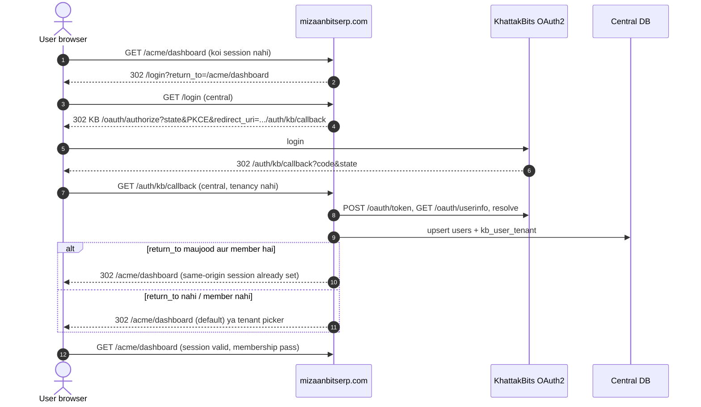

# 07 — Multi-Tenancy Design (Path-Based)

**Date:** 13 Nov 2026
**Repo:** `E:/LaraProjects/saas-starter` (branch `master`)
**Depends on:** `02-ARCHITECTURE-DECISIONS.md` (D1 mirror users, D2 audit split, §5.1 central tables, §5.3 tenant tables, §5.5 Step 0 cross-DB FK fix), `04-CONTROL-PLANE-DESIGN.md` (§3 `tenants_registry`, §7 slug rules), `05-IDENTITY-HUB-SPEC.md` (§1.4 redirect URI allowlist, §3.4 renew-link, §4 webhooks, §5 disable propagation), `06-PAYMENTS-DESIGN.md` (§2.9 invoice numbering per tenant)
**Inputs:** `vendor/khattakbits/core/**`, `app/Modules/**/routes.php`, `app/Modules/**/menu.php`, `routes/{web,console}.php`, `config/{database,session,cache,queue,filesystems,auth,permission}.php`, `resources/js/**`, `khattakbits-ui/src/**`, `phpunit.xml`
**Verified package source:** `stancl/tenancy` **v3.10.1** (installed into `/tmp/kb-tenancy` from Packagist, read directly — every claim in §1 cites a file)
**Rule:** Design only. Koi migration, model, middleware ya job **implement** nahi kiya gaya — sirf skeleton jahan maanga gaya. Jo cheez package source se verify nahi hui woh **NOT VERIFIED** mark hai.

---

## 0. Decision change — D3 aur D4 superseded

Yeh document `02` ke **do decisions badal deta hai**. Baaki sab (`D1`, `D2`, `D5`, §5.5 Step 0) **jaisa hai waisa** hai.

| Decision | Purana (02) | Naya (07) | Wajah |
| --- | --- | --- | --- |
| **D3** tenant identification | Subdomain-only `{slug}.mizaanbitserp.com` + wildcard TLS (DNS-01) | **Path-based** `mizaanbitserp.com/{tenant_slug}/...` | Product domain hi central host hai — koi `app.` subdomain nahi, koi wildcard DNS nahi, koi wildcard cert nahi. Ek origin, ek cert, ek deploy |
| **D4** SSO session | Host-only cookie + one-time `sso_handoffs` token | **Handoff khatam** — same origin par session already maujood hai | Path-based mein subdomain boundary nahi hai, is liye cookie boundary bhi nahi. `sso_handoffs` table **Phase 1 mein nahi banegi** |

**Naya URL shape:**

```
https://mizaanbitserp.com/                     → marketing / "Open app" (central)
https://mizaanbitserp.com/login                → SSO entry (central)
https://mizaanbitserp.com/auth/kb/callback     → OAuth callback (central)
https://mizaanbitserp.com/acme/dashboard       → tenant app (path)
https://mizaanbitserp.com/acme/settings/users  → tenant app (path)
https://mizaanbitserp.com/profile              → identity (central)
```

**Custom domains** (`erp.customer.com`) Phase 2 hain — design-ready (§13), implement nahi. Magar ek shart: URL generation **aaj se** ek hi helper (`tenantUrl()`) se honi chahiye, warna Phase 2 refactor ban jayega, config change nahi.

**Is document ka aakhri hukum:** `02` §5.4, §5.4.1 aur §0 ke D3/D4 rows **ab galat hain**. §11 mein exact list hai — magar woh files is turn mein **edit nahi ki gayin**.

---

## 1. Verification — `stancl/tenancy` Laravel 13 + PHP 8.3/8.5 par

### 1.1 Composer resolution (dono PHP versions)

| Probe | Command | Result |
| --- | --- | --- |
| **PHP 8.5.12**, repo ke andar (locked deps ke saath) | `composer require "stancl/tenancy:^3.10" --dry-run` | ✅ Resolves. `Locking stancl/tenancy (v3.10.1)`, `stancl/jobpipeline (v1.9.0)`, `stancl/virtualcolumn (v1.5.0)`, `facade/ignition-contracts (1.0.2)` — **4 installs, 0 updates, 0 removals** |
| **PHP 8.3.27**, isolated probe (`/tmp/kb-php83`, `config.platform.php = 8.3.27`, no lock file) | `composer require stancl/tenancy:^3.10 inertiajs/inertia-laravel:^3.5 ...` | ✅ Resolves. `stancl/tenancy (v3.10.1)` ke saath `laravel/framework (v13.42.0)`, `inertiajs/inertia-laravel (v3.7.0)` |

**Do honest caveats:**

1. `composer require --dry-run` **`composer.json` ko likh deta hai** (`./composer.json has been updated`) chahe dry-run ho. Pehle probe mein yeh hua; `git checkout -- composer.json` se revert kiya, md5 `72a0cc2d6580a6d6d536e1a9115ece3f` pehle aur baad mein same. **Isi wajah se 8.3 probe throwaway project mein `config.platform.php` ke saath chalaya gaya**, real repo ko chhue baghair.
2. 8.3 probe ne `laravel/framework v13.42.0` pick kiya jabke repo `13.38.0` par locked hai — kyunke probe fresh `composer update` tha, lock file nahi thi. Iska matlab: **"stancl Laravel 13.x ke kisi bhi patch par chalta hai"** verified hai, "exactly 13.38.0 par" nahi. Real repo par actual install phir bhi karna hoga (first step of Phase 1).

`composer.json` constraint jo package khud declare karta hai: `illuminate/support: ^10.0|^11.0|^12.0|^13.0` — is liye `02` §5 ka "metadata se hai, install se NOT VERIFIED" ab **closed** hai.

### 1.2 Path identification — maujood hai, magar teen shartein

Haan, package mein path identification **first-class** hai:

| File | Kya karta hai |
| --- | --- |
| `src/Middleware/InitializeTenancyByPath.php` | Route ke pehle parameter se tenant resolve karta hai |
| `src/Resolvers/PathTenantResolver.php` | `$route->parameter('tenant')` padh kar `tenancy()->find($id)` |
| `src/Exceptions/RouteIsMissingTenantParameterException.php` | Agar pehla parameter `tenant` na ho |

**Exact behaviour (source se, lines ke saath):**

```php
// src/Middleware/InitializeTenancyByPath.php
if ($route->parameterNames()[0] === PathTenantResolver::$tenantParameterName) {
    return $this->initializeTenancy($request, $next, $route);
}
throw new RouteIsMissingTenantParameterException;
```

Teen shartein jo isse aati hain:

1. **Tenant parameter pehla hona chahiye.** `/{tenant}/settings/users` ✅. `/{tenant}` ✅ (ek hi parameter). `/settings/{tenant}/users` ❌. `/settings/users` (koi parameter nahi) ❌ — `parameterNames()[0]` undefined rehta hai aur exception phainkta hai. Matlab: **central routes is middleware ke group mein nahi aa sakte**, aur tenant group ke har route mein `{tenant}` pehla parameter hona lazmi hai. Yeh ek test se enforce hoga (§10.5).
2. **Lookup `id` se hota hai, `slug` se nahi.** `PathTenantResolver::resolveWithoutCache()` → `tenancy()->find($id)` → `src/Tenancy.php:101-104`:
   ```php
   public function find($id): ?Tenant {
       return $this->model()->where($this->model()->getTenantKeyName(), $id)->first();
   }
   ```
   `getTenantKeyName()` hard-coded `'id'` return karta hai (`src/Database/Models/Tenant.php:37-40`). Hum path mein **slug** chahte hain, ULID nahi. → custom resolver lazmi (§1.5).
3. **Parameter route se hata diya jata hai.** `PathTenantResolver::resolved()` aur `resolveWithoutCache()` dono `$route->forgetParameter('tenant')` call karte hain. Iska matlab: controller methods mein `$tenant` inject **nahi** hoga, aur baaki route parameters (`{entry}`, `{user}`) apni jagah intact rehte hain. Yeh acha behaviour hai — warna `EntryController::show($entry)` ko `($tenant, $entry)` ban jata.

### 1.3 `URL::defaults` aur route caching

- **`URL::defaults` package use nahi karta.** `PathTenantResolver` sirf route parameter padhta hai. `URL::defaults(['tenant' => $slug])` **hum khud** lagayenge (§3.2) taake `route('examples.entries.index')` bina parameter `/{slug}/examples/entries` bane.
- **Route caching se koi conflict nahi.** `php artisan route:cache` route *definitions* serialize karta hai, `URL::defaults` runtime state hai — cache mein nahi jata. Magar do shartein:
  - Koi **closure route** nahi ho sakta. Aaj `routes/web.php` mein closures nahi hain (`Route::inertia()` use hota hai jo controller action banta hai), magar `Examples/routes.php:18` mein `Route::get('forbidden', fn () => abort(403))` hai — woh **`local`/`testing` only** hai, is liye production route cache par asar nahi. ✅
  - `routes/web.php` module route files ko `require` karta hai — route cache banne se pehle woh chal chuki hoti hain. ✅
- **`URL::defaults` Octane mein leak karta hai.** `UrlGenerator` singleton hai; long-running worker mein defaults request se request tak reh jate hain. Hum **php-fpm** par hain (no Octane dependency in `composer.json`), is liye theek — magar agar kabhi Octane aaya to per-request reset lazmi. `NOT VERIFIED` for Octane.

### 1.4 Domain + path ek saath — package support **nahi** karta

Phase 2 (custom domains) ke liye yeh sawal critical tha. Source se jawab:

- `InitializeTenancyByDomain` sirf `$request->getHost()` dekhta hai.
- `InitializeTenancyByPath` sirf route ka pehla parameter dekhta hai.
- **Koi combined middleware maujood nahi.** `src/Features/UniversalRoutes.php` ka `$identificationMiddlewares` sirf `ByDomain` + `BySubdomain` list karta hai — path include nahi.

To Phase 2 mein combined identification **custom code** hoga (§13.2), package se nahi milega. Yeh design mein aaj se maan kar chalein.

### 1.5 Kya override karna padega (4 cheezein, sab verified)

| # | Kya | Kyun | Kahan |
| --- | --- | --- | --- |
| **O1** | `SlugPathTenantResolver extends PathTenantResolver` | `find()` `id` se dhoondta hai; humein `slug` chahiye | Container binding: `$this->app->bind(PathTenantResolver::class, SlugPathTenantResolver::class)` — `InitializeTenancyByPath` constructor `PathTenantResolver` type-hint karta hai, is liye subclass inject ho jayega |
| **O2** | `CacheTenancyBootstrapper` **band** | `CACHE_STORE=file` hai; `stancl\Tenancy\CacheManager::__call()` har cache call par `$this->store()->tags(...)` karta hai, aur `Repository::tags()` (`Repository.php:847-851`) non-taggable store par `BadMethodCallException: This cache store does not support tagging` phainkta hai. **Tests mein `CACHE_STORE=array` hai (taggable), production mein `file` (nahi)** — classic "tests pass, prod 500" trap | `config/tenancy.php` `bootstrappers` se hata dein. Cache scoping manually (§8.2) |
| **O3** | `FilesystemTenancyBootstrapper` ka `root_override` **khali**, `suffix_storage_path` **false**, `asset_helper_tenancy` **false** | Neeche detail | `config/tenancy.php` |
| **O4** | `tenancy.routes` **false** | `stancl.tenancy.asset` route `/tenancy/assets/{path?}` hai aur uske controller ka default middleware `InitializeTenancyByDomain` hai (`TenantAssetsController::$tenancyMiddleware`). Path mode mein us route par `{tenant}` parameter hi nahi, is liye `InitializeTenancyByPath` laga bhi nahi sakte. Asset route ka koi matlab nahi bacha | `config/tenancy.php` |

**O3 ki tafseel — yeh repo-specific hai aur ghalat config se attachments toot jate hain:**

`config/filesystems.php` mein `local` disk ka root `storage_path('app/private')` hai (`app/private`, `app` **nahi**). Package ka default `root_override.local` `%storage_path%/app/` hai — usay use karne se attachments `storage/app/` mein chale jayenge aur purani files gayab ho jayengi.

Package ka **fallback** (`FilesystemTenancyBootstrapper.php:62-70`) exactly woh karta hai jo humein chahiye: agar `root_override` set **na** ho to `$finalPrefix = rtrim($originalRoot,'/').'/'.$suffix`. Is liye:

```php
// config/tenancy.php — recommended
'filesystem' => [
    'suffix_base' => 'tenant',
    'disks' => ['local', 'public'],
    'root_override' => [],          // jaan boojh kar khali — fallback original root + /tenant{id}
    'suffix_storage_path' => false, // logs/views/cache central rahein
    'asset_helper_tenancy' => false,// asset()/@vite global rahein
],
```

Nateeja (verified, `$originalRoot` config-load time par resolve ho chuka hota hai):

| Disk | Central root | Tenant ke andar |
| --- | --- | --- |
| `local` | `storage/app/private` | `storage/app/private/tenant{id}` |
| `public` | `storage/app/public` | `storage/app/public/tenant{id}` |
| `storage_path()` | `storage/` | `storage/` (**badla nahi**) |

Aur `config/filesystems.php:16` `default` = `local` hai, is liye `AttachmentController` ka `Storage::store()`/`download()`/`exists()` — jo default disk use karta hai — **bina code change** tenant-scoped ho jata hai. Yeh is design ka sab se bara free win hai.

`suffix_storage_path = false` jaan boojh kar: `true` hota to `storage/logs`, `storage/framework/views` (compiled), `storage/framework/cache` sab per-tenant ho jate — log shipping tootti, `bin:purge`/`emails:prune` har tenant ke liye alag chalte, aur har tenant ka apna compiled-view cache banta.

### 1.6 Verdict

**`stancl/tenancy` v3.10.1 rakhein.** Wajah:

- Path identification built-in hai, sirf slug lookup ke liye ek chhota resolver override chahiye (~25 lines).
- Database switching (`DatabaseTenancyBootstrapper`) woh hissa hai jo sach mein mehnga hai — `DatabaseManager::connectToTenant()` `database.default` ko `tenant` par switch karta hai aur `reconnectToCentral()` wapas. Yeh khud likhne ka matlab ~300 lines + woh saare edge cases jo package 3 major versions se jhel raha hai.
- Alternatives (`tenancyforlaravel` ke ilawa `archtechx` same cheez hai; custom implementation) ka koi faida nahi — hum path mode mein package ka **kam** hissa use kar rahe hain, zyada nahi.

**Magar:** 4 overrides (§1.5) ke baghair yeh package is repo par **kaam nahi karega** — teen tootenge (cache, assets, slug), ek sirf bekaar hai.

---

## 2. Kaunsi table kahan

### 2.1 Central DB (`admin_core` — product ka central, CP ka nahi)

| Table | Kyun central | Aaj maujood? |
| --- | --- | --- |
| `tenants` | stancl ka core; `id` = ULID = `04` ka `kb_tenant_id` | ❌ naya |
| `domains` | stancl ka core; Phase 1 mein **istemal nahi** hoga (path-based), Phase 2 mein custom domains | ❌ naya (package ship karta hai) |
| `users` | **D1** — mirror users central. `App\Models\User extends CoreUser` seam already maujood hai | ✅ `0001_01_01_000000_create_users_table.php` |
| `password_reset_tokens` | `users` ke saath | ✅ same migration |
| `kb_user_tenant` | Kaun user kis tenant ka member hai + local role hint | ❌ naya |
| `kb_snapshot` | Last good `resolve` response (JSON + etag + fetched_at) | ❌ naya |
| `kb_oauth_state` | PKCE verifier + `state` | ❌ naya |
| `webhook_events` | `X-KB-Event-Id` idempotency — tenant resolve se **pehle** dedupe chahiye | ❌ naya |
| `security_events` | **D2** — login/logout/failed/password/disable | ❌ naya |
| `sessions` | Ek origin, ek session — path boundary session ko todta nahi | ✅ `0001_01_01_000001_create_cache_table.php` ke saath (Laravel default) |
| `cache`, `cache_locks` | Cache central (dekhein §8.2 — scoping manual) | ✅ |
| `jobs`, `job_batches`, `failed_jobs` | Worker central context mein chalta hai; payload mein `tenant_id` | ✅ `0001_01_01_000002_create_jobs_table.php` |
| `personal_access_tokens` | Sanctum — **aaj install nahi hai** (dekhein §8.7) | ❌ n/a |

**`sso_handoffs` yahan nahi hai.** D4 supersede ho gaya — path-based mein handoff ki zaroorat nahi (§3.5).

### 2.2 Tenant DB (`tenant{ulid}` — ek per tenant)

| Table | Kyun tenant-level |
| --- | --- |
| `settings` | Har tenant ke apne `app_name`, timezone, page size, mail settings |
| `audit_logs` | **D2** — doc.*/role.*/settings.*/email_* tenant ke data hain |
| `attachments` | Tenant ka data (files bhi per-tenant disk par, §1.5) |
| `deleted_documents` | Recycle bin — tenant ka |
| `document_views` | View counters — tenant ka |
| `document_sequences` | **Har tenant apni `INV-00001` series** (`06` §2.9 isi par bana hai) |
| `email_accounts` | Har tenant ka apna SMTP |
| `email_logs` | Tenant ka bheja hua mail |
| `email_templates` | Tenant ke overrides |
| `roles`, `permissions`, `model_has_roles`, `model_has_permissions`, `role_has_permissions` | Har tenant ke apne roles — warna sab tenants ek doosre ke roles dekh lete |
| `demo_entries` (aur baaki module data) | Product data |

### 2.3 Har maujooda core table ka faisla (aik aik)

| Table (aaj) | Kahan jayegi | Kya badalna hai | Note |
| --- | --- | --- | --- |
| `users` | **Central** | `App\Models\User` par `protected $connection = 'central';` explicitly | `config/auth.php` provider `users` already `App\Models\User` |
| `password_reset_tokens` | **Central** | — | Identity central hai, is liye reset bhi central (`D5`: tenant user ka reset KB par hota hai) |
| `settings` | **Tenant** | `SettingsStore` ka cache key per-tenant (§8.2) | Aaj `Cache::forget('settings.all')` — shared cache mein yeh cross-tenant leak tha |
| `audit_logs` | **Tenant** | `user_id` FK hatana (Step 0), `user_name`/`user_email` snapshot rakhna | `02` §5.5 line 1 |
| `attachments` | **Tenant** | `uploaded_by` FK hatana | `02` §5.5 line 2. **File** per-tenant disk par |
| `deleted_documents` | **Tenant** | `deleted_by` FK hatana | `02` §5.5 line 3 |
| `document_views` | **Tenant** | `user_id` FK hatana | `02` §5.5 line 4 |
| `document_sequences` | **Tenant** | — | `Naming::next()` `lockForUpdate` tenant connection par chalega |
| `email_accounts` | **Tenant** | — | `MailHostGuard` bhi tenant-scoped |
| `email_logs` | **Tenant** | `user_id` FK hatana | `02` §5.5 line 5 |
| `email_templates` | **Tenant** | — | `EmailTemplates` cache key per-tenant (§8.2) |
| `roles`/`permissions`/`model_has_*`/`role_has_permissions` | **Tenant** | `Role`/`Permission` models par `$connection = 'tenant'` **aur** spatie ka cache key per-tenant | Neeche §2.3.1 — yeh design ka sab se nazuk hissa hai |
| `jobs`/`failed_jobs`/`job_batches` | **Central** | `queue.connections.database.connection = 'central'` pin | Warna tenant request se dispatch hua job tenant DB ke `jobs` table mein jayega jahan koi worker nahi sun raha |
| `cache`/`cache_locks` | **Central** | `CACHE_STORE` = `redis` recommend (ya `file` + manual prefix) | Tags nahi chahiye (§8.2) |
| `sessions` | **Central** | `session.connection = 'central'` pin | Neeche §2.4 |
| `tenants`/`domains` | **Central** | package ki migrations publish | `stancl/tenancy` ship karta hai |

#### 2.3.1 Permissions — do bugs jo default config mein chhupe hain

**(a) Cache key cross-tenant leak — privilege escalation.**

`spatie/laravel-permission` poora permission collection cache karta hai `PermissionRegistrar.php:225-227`:

```php
$this->permissions = $this->cache->remember(
    $this->cacheKey, $this->cacheExpirationTime, fn () => $this->getSerializedPermissionsForCache()
);
```

`cacheKey` = `config('permission.cache.key')` = `'spatie.permission.cache'` — **ek hi key, sab tenants ke liye**. `CACHE_STORE=file` aur `suffix_storage_path=false` ke saath yeh key sab tenants ke liye same file hai. Matlab: **tenant A ka permission set tenant B ko serve hoga**. Yeh `Gate::before` ke saath mil kar seedha privilege escalation hai.

Fix: `PermissionRegistrar::$cacheKey` **public property** hai (`PermissionRegistrar.php:44`), is liye tenancy initialize hote hi set karein:

```php
// Listener: TenancyInitialized par
app(PermissionRegistrar::class)->cacheKey = 'spatie.permission.cache.'.tenant()->getTenantKey();
```

Aur `TenancyEnded` par wapas default. Yeh `TenancyServiceProvider` ke event listeners mein 6 lines hain.

**(b) `User` central hai magar `model_has_roles` tenant DB mein — kaise chalega?**

`HasRoles::roles()` `morphToMany(Role::class, 'model', 'model_has_roles', ...)` hai. `BelongsToMany` ka pivot query **related model** ki connection use karta hai. To agar `Role`/`Permission` par `protected $connection = 'tenant';` laga dein, to pivot query tenant connection par jayegi jabke `$user` central se aaya. `model_id` mein central `users.id` hoga — koi FK nahi, is liye kaam karta hai.

`02` §5.3 ne sirf **migration** ka masla dekha tha ("morph columns hain, FK nahi, is liye `users` table ke baghair chalta hai") — runtime connection ka masla nahi dekha. Woh yahan close ho raha hai.

**`config/permission.php:151` `teams => false` hi rahega** — tenant DB khud boundary hai, teams add karna duplicate isolation hai.

### 2.4 Connection pinning matrix — yeh table na ho to silent data corruption

`DatabaseTenancyBootstrapper` `database.default` ko `tenant` par switch karta hai (`DatabaseManager.php:41-49`). Jo bhi subsystem **tenancy init ke baad** apna connection resolve karega, woh tenant DB pakdega. Is liye har central subsystem ka connection **explicit pin** hoga:

| Config | Aaj | Hona chahiye | Kyun |
| --- | --- | --- | --- |
| `database.default` | `mysql` | `central` (alias of `mysql`) | Bootstrapper isay switch karta hai — template connection `central` hona chahiye |
| `session.connection` | `null` | `'central'` | `SessionManager::getDatabaseConnection()` `db->connection(null)` → default. `StartSession` tenancy se pehle chalta hai is liye aaj theek hai — magar `null` ka bharosa mat karein, koi bhi resolve-order change session ko tenant DB mein le jayega |
| `queue.connections.database.connection` | `null` | `'central'` | Warna tenant request ka job tenant DB mein |
| `cache.stores.database.connection` | `null` | `'central'` | (Agar database cache use ho) |
| `permission.cache.store` | `'default'` | `'default'` + per-tenant **key** | §2.3.1(a) |

`SESSION_DRIVER=file` aur `CACHE_STORE=file` aaj hain — in par `connection` ka sawal nahi aata, magar `storage_path()` central hai (`suffix_storage_path=false`) is liye file store bhi central hai. ✅

**Yeh pinning ek test se enforce hogi** (§10.5): tenant context mein `config('session.connection')` aur `config('queue.connections.database.connection')` non-null hone chahiye.

---

## 3. Path-based identification

### 3.1 Route structure

```php
// routes/web.php — naya shape
use Illuminate\Support\Facades\Route;
use KhattakBits\Core\Http\Middleware\EnsureUserActive;
use KhattakBits\Core\Support\ModuleRegistry;
use Stancl\Tenancy\Middleware\InitializeTenancyByPath;

/*
 * 1) CENTRAL routes — pehle register, taake /login jaisa path
 *    /{tenant}/... se pehle match ho. Core package yeh khud karta hai
 *    (loadRoutesFrom), is liye yahan sirf product ke central routes.
 */
Route::middleware('web')->group(function () {
    // SSO callback, billing return, webhook receiver — §3.2
});

/*
 * 2) TENANT routes — {tenant} pehla parameter lazmi.
 */
Route::prefix('{tenant}')
    ->middleware(['web', 'auth', EnsureUserActive::class, InitializeTenancyByPath::class, EnsureTenantMembership::class])
    ->group(function () {
        foreach (app(ModuleRegistry::class)->all() as $module) {
            if (is_file($file = $module['path'].'/routes.php')) {
                require $file;
            }
        }
    });
```

**Do baatein jo aasan lagti hain magar nahi hain:**

1. **`{tenant}` pehla parameter hai — `prefix('{tenant}')` isi liye.** `Route::prefix()` leading slash trim karta hai, is liye `AccountingDemo/routes.php` ka `Route::inertia('/accounting-demo/...')` bhi `{tenant}/accounting-demo/...` ban jata hai — **route registration mein koi change nahi**. Sirf **menu hrefs** badalne hain (§5).
2. **`auth` tenancy se pehle hai.** Users central hain (D1), is liye auth ko tenant ki zaroorat nahi. `EnsureTenantMembership` tenancy ke **baad** hai kyunke usay `tenant()` chahiye.

**Registration order ka asar:** Laravel routes ko register order mein match karta hai. Central `/login` pehle register hota hai, is liye `/{tenant}/...` usay hijack nahi karta. Ulta: tenant slug `login` ho to `/{tenant}` wala route `mizaanbitserp.com/login` par kabhi nahi pahunchega — isi liye reserved slug list hai (§3.3).

### 3.2 Middleware order (exact)

| # | Middleware | Kahan se | Kya karta hai | Kyun is jagah |
| --- | --- | --- | --- | --- |
| 1 | `EncryptCookies`, `AddQueuedCookiesToResponse` | `web` group | cookie encrypt/decrypt | Sab se pehle |
| 2 | `StartSession` | `web` group | session load (central DB/file) | Auth se pehle |
| 3 | `ShareErrorsFromSession`, `ValidateCsrfToken` | `web` group | CSRF | — |
| 4 | `SubstituteBindings` | `web` group | route model binding | `{tenant}` ka koi binding nahi, is liye string reh jata hai ✅ |
| 5 | `auth` | route group | session guard → `$request->user()` | Central user, tenancy ki zaroorat nahi |
| 6 | `EnsureUserActive` | route group | disabled user → logout | Auth ke foran baad |
| 7 | **`InitializeTenancyByPath`** | route group | `{tenant}` → slug lookup → DB switch → `URL::defaults` | Session + auth ke baad (audit/security events ke liye user chahiye) |
| 8 | **`EnsureTenantMembership`** | route group | `kb_user_tenant` check | `tenant()` chahiye, is liye 7 ke baad |
| 9 | route middleware (`can:...`) | routes | permissions | Tenant DB ke roles chahiye, is liye 7 ke baad |

**`ShareErrorsFromSession` se pehle kuch nahi.** Aur **`InitializeTenancyByPath` `SubstituteBindings` ke baad** hai — yeh deliberate hai: agar pehle hota to `forgetParameter` ke baad `SubstituteBindings` kuch na karta, farq nahi padta, magar baad mein rakhne se `{tenant}` binding agar kabhi add ho to tootega nahi.

**SSO callback ka order:** `/auth/kb/callback` **central** route hai (step 1-6 tak, tenancy nahi). Woh token exchange karta hai, `users` + `kb_user_tenant` upsert karta hai, phir `redirect()->to(tenantUrl($slug, '/dashboard'))`. Tenancy initialize **nahi** hoti — kyunke callback ko tenant DB ki zaroorat nahi.

### 3.3 Reserved slugs — actual routes se derive kiye gaye

`02` §5.4 ki list (`www, app, admin, api, auth, status, docs, mail, assets, cdn, assets-static`) **guess thi**. Yeh list `routes/*.php` + core package routes se nikali gayi hai:

**Central root segments (aaj ke actual routes):**

| Segment | Source | Note |
| --- | --- | --- |
| `login` | `core/routes/web.php:32` | `name('login')` |
| `forgot-password` | `core/routes/web.php:35` | |
| `reset-password` | `core/routes/web.php:41` | |
| `logout` | `core/routes/web.php:48` | |
| `profile` | `core/routes/web.php:50-51` | |
| `attachments` | `core/routes/web.php:53-56` | **Tenant-scoped hona chahiye** — §3.4 dekhein |
| `documents` | `core/routes/web.php:59-63` | **Tenant-scoped hona chahiye** |

**Framework/runtime segments:**

| Segment | Source |
| --- | --- |
| `up` | Laravel health check |
| `storage` | `php artisan storage:link` (agar serve ho) |
| `build` | Vite build output (`public/build`) |
| `_ignition` | `local` only |
| `livewire`, `horizon`, `telescope`, `pulse`, `sanctum`, `api` | agar kabhi install hon |

**Product/module prefixes (tenant group ke andar, magar slug ke saath collide karte hain):**

| Segment | Source |
| --- | --- |
| `examples` | `app/Modules/Examples/routes.php:7,24` |
| `settings` | `app/Modules/Settings/routes.php:16` |
| `accounting-demo` | `app/Modules/AccountingDemo/menu.php:42` |

**Policy blocklist (routes nahi, magar brand/ops ke liye):**

`www, app, admin, api, auth, status, docs, mail, assets, cdn, static, blog, help, support, legal, terms, privacy, billing, webhooks, sso, oauth, health, metrics`

**`billing` aur `webhooks` is list mein hain kyunke `02` §1.2 step 8 aur `05` §4 unhein central maangte hain** (`/billing/renew`, `POST /webhooks/kb`).

**Drift se bachne ka tareeqa (yeh lazmi hai):** config mein static list rakhna kaafi nahi — koi naya central route add karega aur list update bhool jayega. Is liye ek **test**:

```php
// tests/Feature/Tenancy/ReservedSlugCoverageTest.php
public function test_every_central_route_root_segment_is_reserved(): void
{
    $reserved = config('tenancy.reserved_slugs');
    $missing = [];

    foreach (Route::getRoutes() as $route) {
        $uri = $route->uri();

        if (str_starts_with($uri, '{tenant}')) {
            continue;                      // tenant route, slug se collide nahi
        }

        $segment = explode('/', ltrim($uri, '/'))[0];
        if ($segment === '' || str_contains($segment, '{')) {
            continue;                      // root `/` ya dynamic pehla segment
        }

        if (! in_array($segment, $reserved, true)) {
            $missing[] = $segment.'  ('.$route->getName().'  '.$uri.')';
        }
    }

    $this->assertSame([], array_values(array_unique($missing)), 'Reserved slug list mein yeh segments missing hain');
}
```

Yeh test **naya central route** add karte hi fail hoga — exactly woh signal jo chahiye.

### 3.4 Core routes ka split — kaun `{tenant}` ke andar jayega

Yeh decision `02` mein nahi tha aur yeh important hai: **attachments aur document activity tenant data hain**, is liye unhein tenant prefix ke andar jana **lazmi** hai — warna `Storage::download()` central disk (`storage/app/private`, bina tenant suffix) par dekhega aur file 404 degi.

| Core route | Kahan | Wajah |
| --- | --- | --- |
| `GET /login`, `POST /login` | **Central** | SSO entry |
| `GET /forgot-password`, `POST /forgot-password` | **Central** | Break-glass only (D5) |
| `GET/POST /reset-password` | **Central** | Identity central |
| `POST /logout` | **Central** | Session central |
| `GET /profile`, `PUT /profile/password` | **Central** | Identity central — tenant shell se link `/profile` par jayega |
| `GET/POST /attachments`, `GET/DELETE /attachments/{id}` | **`/{tenant}` ke andar** | File per-tenant disk par hai |
| `POST /documents/{type}/{id}/views`, `GET .../activity` | **`/{tenant}` ke andar** | `document_views` tenant table hai |

Iska matlab `khattakbits/core` ke `routes/web.php` ko **do groups** mein todna hoga. Yeh package ka **breaking change** hai (`v2.0.0`) — `03-EXTRACTION-PLAN.md` ke version policy ke mutabiq `UPGRADE.md` + MAJOR bump.

**Alternative jo hum nahi le rahe:** attachments ko central rakhna aur tenant ko `attachment.tenant_id` se filter karna. Wajah reject: file storage central reh jata, tenant delete/export par files orphan reh jatin, aur `Storage::download()` par har baar authorization check lazmi hota — jo aaj `AttachmentAccessTest` mein already nazuk hai.

### 3.5 Slug rules, immutability, rename

| Rule | Value |
| --- | --- |
| Format | `^[a-z0-9](?:[a-z0-9-]{1,28}[a-z0-9])?$` — 3 se 30 chars |
| Allowed | lowercase `a-z`, `0-9`, `-` (beech mein) |
| Forbidden | leading/trailing `-`, `--` (double), underscore, dot, koi bhi non-ASCII |
| Reserved | §3.3 list + `config('tenancy.reserved_slugs')` |
| Uniqueness | `tenants.slug` **unique** (DB level) + case-insensitive check app level |
| Creation | `04` §7 ka `slug-check` endpoint CP se — product bhi apna `GET /api/tenants/slug-check` de (provisioning ke liye) |

**Immutability:** slug **create ke baad badalta nahi** — Phase 1 mein.

Wajah concrete hai: slug URL ka hissa hai. Badalne ka matlab:
- har bookmarked URL, har emailed link, har invoice PDF ka link toot jaye
- `URL::defaults` par bani purani links 404 dein
- SSO `return_to` / `redirect_uri` path-based hai to woh bhi badle
- search engines ke liye 301 redirect map chahiye

**Agar business majboor kare (Phase 2 mein `tenant.slug_change` entitlement ke saath):**

```sql
-- naya table, Phase 2
tenant_slug_history (
    id, tenant_id, old_slug, new_slug, changed_by, changed_at,
    UNIQUE(old_slug)            -- purana slug dobara kisi ko na mile
)
```

Aur `ResolveTenantByPath` middleware ka order: pehle `tenants.slug`, na mile to `tenant_slug_history.old_slug` → **301 permanent redirect** naye slug par. `tenant_slug_history` rows kabhi delete nahi, warna purana link hijack ho sakta hai (attacker purana slug le kar phishing page bana le).

**Phase 1 ka faisla:** sirf create, koi rename nahi. `04` §7 line 814 already kehta hai "slug ek dafa confirm ho to lock" — woh lock **hamesha** ke liye hai, sirf provisioning tak nahi.

### 3.6 Post-SSO redirect — koi handoff token nahi

`02` §1.2 step 6 aur §5.4.1 poora handoff flow `sso_handoffs` table ke saath **retire** ho gaya. Naya flow:



**Kya badla `02` se:**

| Cheez | `02` (subdomain) | `07` (path) |
| --- | --- | --- |
| `sso_handoffs` table | lazmi | **nahi chahiye** |
| Handoff token (60s, single-use) | lazmi | **nahi** |
| `target_host` binding | lazmi | **nahi** (ek hi host) |
| Tenant switch | naya session + handoff | **bas URL badlo** — session same |
| `SESSION_DOMAIN` | khali (host-only) | khali (ek hi host, koi farq nahi) |
| Cross-tenant blast radius | ek tenant | **poora product** — yeh qeemat hai (§4) |

**`return_to` validation:** `AuthController::isSafeRedirect()` (`core/src/Http/Controllers/AuthController.php:47-64`) aaj relative paths allow karta hai (`str_starts_with($target, '/')` → `true`). Path-based mein yeh **kaafi hai**, magar ek shart add karni hogi: `return_to` ka pehla segment **reserved slug na ho** aur **valid tenant slug ho**, warna user `/login` par redirect loop mein phans sakta hai (`return_to=/login` → login → `/login` → ...). Fix: `return_to` ko `/login`, `/forgot-password`, `/reset-password`, `/logout` reject karna.

**`redirect()->intended('/')`** (`AuthController.php:43`) — yeh default hai jab `return_to` na ho. Path-based mein `/` central marketing page hai, is liye yeh **theek hai** (user wahan se workspace chunega). Magar agar user ka sirf **ek** tenant hai to seedha `/{slug}/dashboard` bhejna behtar UX hai — `AuthController` mein ek line.

### 3.7 Session cookie jab ek user kai tenants ka member ho

Yeh path-based ka **sab se bara faida** hai aur isay saaf samajhna zaroori hai:

- **Ek session, ek cookie, ek host.** `mizaanbitserp.com` par `laravel_session` cookie hai (host-only, `SESSION_DOMAIN` khali).
- User `acme` aur `beta` dono ka member hai → `/acme/dashboard` aur `/beta/dashboard` **dono** usi session se chalte hain. Koi re-login nahi, koi handoff nahi, ~0ms switch.
- **Tenant boundary session mein nahi, request mein hai.** Har request par `EnsureTenantMembership` `kb_user_tenant` se check karta hai ke `$request->user()->id` is `tenant()` ka member hai ya nahi.
- **Session fixation:** login par `$request->session()->regenerate()` already hota hai (`AuthController.php:39`). ✅
- **`ScopeSessions` middleware use nahi karenge.** Woh `_tenant_id` session key set karta hai aur mismatch par `abort(403)` — path-based multi-tenant user ke liye **galat**, kyunke woh user legitimately do tenants ke beech switch karta hai. Ek hi session mein `_tenant_id` badalna padega, jo middleware nahi karta.

**Nateeja:** session ka tenant se koi taalluq nahi. Sirf `kb_user_tenant` ka. Yeh simpler bhi hai aur safer bhi (session mein tenant id hone ka matlab hota ke woh stale ho sakti hai).

### 3.8 Per-request membership check

```php
// khattakbits/core/src/Http/Middleware/EnsureTenantMembership.php
final class EnsureTenantMembership
{
    public function handle(Request $request, Closure $next)
    {
        $user = $request->user();
        $tenant = tenant();

        if (! $user || ! $tenant) {
            abort(404);
        }

        $isMember = DB::connection('central')
            ->table('kb_user_tenant')
            ->where('kb_user_id', $user->id)
            ->where('tenant_id', $tenant->getTenantKey())
            ->exists();

        if (! $isMember) {
            // 404, 403 nahi — tenant ka wajood leak na ho
            abort(404);
        }

        // super-admin bypass SIRF tab jab platform admin flag ho (D5)
        // aur woh bhi audit ke saath — Phase 1 mein nahi.

        return $next($request);
    }
}
```

**`404` kyun, `403` nahi:** `403` ka matlab "resource maujood hai magar aap ko haq nahi" — yeh tenant ke existence ka confirmation hai. `404` se attacker ko pata nahi chalta ke `/beta` exist karta hai ya nahi.

**Ek query per request.** `kb_user_tenant` par `UNIQUE(kb_user_id, tenant_id)` index hoga, is liye yeh primary-key lookup hai. Cache nahi karenge — Phase 1 mein simplicity > micro-optimization, aur cache invalidate karna (membership revoke) security-sensitive hai.

**`tenant()` `null` kab hota hai:** `InitializeTenancyByPath` fail ho jaye (`onFail`) to. Us case mein hum `404` chahte hain, exception nahi:

```php
InitializeTenancyByPath::$onFail = function ($e, $request, $next) {
    abort(404);
};
```

Yeh `TenancyServiceProvider::boot()` mein set hoga.

---

## 4. Single origin ke security consequences (honest)

Path-based ka poora faida (ek deploy, ek cert, ek session) **ek hi qeemat** par aata hai: **browser ke liye sab kuch ek origin hai**. Yeh section usay chhupata nahi.

### 4.1 Jo cheezein share hoti hain

| Cheez | Subdomain (purana D3) | Path (naya) | Asar |
| --- | --- | --- | --- |
| **Cookies** | Host-only, per-subdomain | **Ek cookie, sab tenants** | XSS se cookie chori → **har tenant** |
| **`localStorage` / `sessionStorage`** | Per-origin, alag | **Shared** | Tenant A ka draft/staged data tenant B ke code ko dikh sakta hai |
| **`IndexedDB` / Cache API** | Alag | **Shared** | Same |
| **Service worker scope** | Alag | **Shared** (root se register ho to poora product) | Ek tenant ka SW doosre ko intercept kar sakta hai |
| **Same-origin policy** | Cross-origin → fetch blocked | **Same-origin → fetch allowed** | Tenant A ka JS `/beta/api/...` call kar sakta hai (magar cookie same hai, is liye **authorized** bhi hai) |
| **CSP** | Per-host | **Ek policy, sab tenants** | Koi per-tenant CSP relaxation nahi |
| **`window.opener` / `postMessage`** | Cross-origin checks kaam karte | **`targetOrigin` '*' ka matlab ab real risk** | Message spoofing |

### 4.2 Mitigations (jo Phase 1 mein lazmi hain)

| # | Mitigation | Kya rokta hai |
| --- | --- | --- |
| **M1** | **CSP enforce mode** (`CSP_MODE=enforce`) — `script-src 'self'`, koi third-party script nahi | XSS → cookie chori. Yeh single-origin ka **sab se important** defense hai. **Aaj default `report-only` hai** (`config/security.php:7`, `env('CSP_MODE', 'report-only')`) aur CSP `local` ke ilawa hi set hota hai (`SecurityHeaders.php:28-34`) — path tenancy se **pehle** `enforce` karna hoga. Note: policy mein `style-src 'unsafe-inline'` hai (Tailwind ke liye) — woh chalti hai, `script-src` par `unsafe-inline` **kabhi nahi** |
| **M2** | **Per-request membership + `kb_user_tenant`** (§3.8) | Same-origin fetch se cross-tenant data access. Authorization **hamesha** server par |
| **M3** | **Kabhi raw HTML render nahi** — koi `v-html`, koi `{!! !!}`, koi user-controlled `innerHTML` | Stored XSS. Aaj `resources/js` + `khattakbits-ui/src` mein `v-html` **zero** hits hain (verified) — yeh gate banaye rakhein |
| **M4** | `SameSite=Lax` (default) + `Secure` + `HttpOnly` | CSRF + cookie theft via network |
| **M5** | **Koi tenant-controlled `<script>` / custom JS injection nahi** — koi "custom branding JS" feature nahi | Tenant A apna code inject kar ke tenant B ko attack kare |
| **M6** | `localStorage` mein **koi secret nahi** — sirf UI prefs, aur unke keys `t:{tenant_id}:` prefixed | Cross-tenant data leak via storage |
| **M7** | Service worker **nahi** (Phase 1) — agar kabhi, scope `/{tenant}/` | Cross-tenant interception |
| **M8** | Tests: tenant A ka session le kar `/beta/...` hit karo → `404` (§10.4) | URL tampering |

### 4.3 Jo hum jaan boojh kar accept kar rahe hain

1. **Ek XSS = poora product.** Subdomain design mein ek XSS ek tenant tak mehdood thi. Ab nahi. Is liye M1 + M3 **non-negotiable** hain — yeh "achha hoga" nahi, yeh design ki shart hai.
2. **Tenant A ka JS tenant B ke endpoints call kar sakta hai** (same-origin, same cookie). Bachao sirf M2 hai — server-side authorization. Is liye **koi bhi endpoint sirf "same origin hai" par bharosa nahi kar sakta**.
3. **`Referer` header cross-tenant path leak** — cross-origin requests par full URL jata hai. `SecurityHeaders.php:20` `Referrer-Policy: strict-origin-when-cross-origin` set karta hai, jo cross-origin par **sirf origin** bhejta hai (path nahi) — is liye third-party resources ko tenant ka path leak **nahi** hota. ✅ Same-origin requests par poora path jata hai, magar same-origin JS ko woh URL pehle se maloom hai. **Koi action nahi chahiye** — bas yeh policy hatayein nahi.
4. **Ek tenant ka slow page doosre ko affect nahi karta** (alag requests), magar **ek tenant ka heavy query shared DB pool khata hai** — yeh subdomain mein bhi tha, path ki wajah se nahi.

**Bottom line:** path-based ka blast radius subdomain se **bara** hai. Yeh design ka accepted trade-off hai — badle mein infra dramatically simple hai (ek cert, ek DNS, ek vhost, ek session). Agar kabhi yeh trade-off galat lage, to switch **ek config change** hai (`tenantUrl()` helper ki wajah se, §5.2) — magar **data model same rahega**, sirf URL shape badlega.

---

## 5. Frontend / URL impact — grep counts

### 5.1 Hard-coded absolute paths (verified counts)

Grep pattern: `(href|to|visit|action|url|push|replace|location.href|location.assign)\s*[=(:]\s*['"]/...`

| Folder | Files | Hits | Central (badalna **nahi**) | Tenant (badalna hai) |
| --- | --- | --- | --- | --- |
| `resources/js/**` | 31 | **19** | 6 | **13** |
| `khattakbits-ui/src/**` | 51 | **6** | 6 | **0** |
| `app/Modules/*/menu.php` | 4 | **18** | 1 (`Home` → `/`) | **17** |
| `app/Modules/*/Http/Controllers` | 4 | **3** | 0 | **3** |
| `vendor/khattakbits/core/src` | 39 | **5** | 5 | 0 |
| `routes/*.php` | 2 | **0** | — | — |
| **Total** | | **51** | **18** | **33** |

**Detail — `resources/js` ke 19 hits:**

| File:line | Path | Class |
| --- | --- | --- |
| `Pages/Auth/ForgotPassword.vue:37` | `/login` | central |
| `Pages/Auth/Login.vue:207` | `/login` (form action) | central |
| `Pages/Auth/Login.vue:327` | `/forgot-password` | central |
| `Pages/Auth/ResetPassword.vue:49` | `/login` | central |
| `Pages/Settings/EmailAccounts/Form.vue:79` | `/login` (`location.href`) | central |
| `Pages/Settings/EmailTemplates/Form.vue:78` | `/login` (`location.href`) | central |
| `Pages/Examples/Empty.vue:23,24` | `/examples/forbidden`, `/examples/does-not-exist` | **tenant** |
| `Pages/Examples/Entries/Index.vue:56,92` | `/examples/entries/create` | **tenant** |
| `Pages/Examples/List.vue:88,131` | `/examples/new-form` | **tenant** |
| `Pages/Examples/List.vue:97` | `/examples/submitted` (`router.visit`) | **tenant** |
| `Pages/Settings/EmailAccounts/Index.vue:49,96` | `/settings/email-accounts/create` | **tenant** |
| `Pages/Settings/Roles/Index.vue:41,66` | `/settings/roles/create` | **tenant** |
| `Pages/Settings/Users/Index.vue:62,104` | `/settings/users/create` | **tenant** |

**`khattakbits-ui` ke 6 hits — sab central:** `useServerList.js:37`, `ui/DocumentActivity.vue:32`, `ui/FileAttachments.vue:33`, `ui/Select.vue:64` (`/login` — 401 par redirect), `layouts/UserMenu.vue:40` (`/profile`), `:45` (`/logout`). **UI package mein zero tenant paths** — is package ko codemod ki zaroorat **nahi**, sirf `tenantUrl()` helper export karna hai.

**`menu.php` ke 18 hits:** `AccountingDemo:30` (1), `Examples:43,49-54` (7), `Home:14` (1, `/`), `Settings:28-32,38-39,45-46` (9). Home ka `/` central hi rahega magar **tenant ke andar** `/{slug}` banna chahiye — dekhein §5.3.

**PHP controllers ke 3 tenant hits:** `EntryController.php:108` (`redirect('/examples/entries')`), `EmailAccountController.php:163` (`redirect('/settings/email-accounts')`), `RoleController.php:116` (`redirect('/settings/roles')`).

**Core ke 5 central hits:** `AuthController.php:43` (`redirect()->intended('/')`), `:78` (`redirect('/login')`), `PasswordResetController.php:76` (`redirect('/login')`), `EnsureUserActive.php:24` (`redirect('/login')`), `Models/User.php:78` (`url('/reset-password/...')`).

### 5.2 `tenantUrl()` — ek helper, teen jagah

**PHP helper (package mein, `KhattakBits\Core\Support\TenantUrl`):**

```php
namespace KhattakBits\Core\Support;

final class TenantUrl
{
    /**
     * Tenant path banao. $path root-relative hai ('/dashboard'), slug nahi.
     * Custom domain aane par sirf YEH function badlega.
     */
    public static function to(?string $slug, string $path = '/', bool $absolute = false): string
    {
        $slug = $slug ?? tenant()?->slug;

        if ($slug === null) {
            // central context — tenant URL bana hi nahi sakta
            throw new \RuntimeException('tenantUrl() called without tenant context or slug.');
        }

        $path = '/'.ltrim($path, '/');
        $path = $path === '/' ? '' : $path;

        // Phase 2: agar tenant ka primary custom domain ho to host badal jayega
        // (config('tenancy.custom_domains') on + tenant_domains lookup)
        $base = self::baseFor($slug);

        return $absolute
            ? rtrim($base, '/').$path
            : '/'.$slug.$path;
    }

    private static function baseFor(string $slug): string
    {
        return rtrim((string) config('app.url'), '/');
    }
}

// global helper
function tenant_url(?string $slug, string $path = '/', bool $absolute = false): string
{
    return TenantUrl::to($slug, $path, $absolute);
}
```

**Phase 2 ke liye signature already ready hai:** `baseFor()` mein sirf ek `tenant_domains` lookup add hoga aur `to()` ka `$absolute` path badlega. **Koi caller badlega nahi.**

**Inertia shared prop (`HandleInertiaRequests::share`):**

```php
'tenant' => fn () => tenant() ? [
    'id' => tenant()->getTenantKey(),
    'slug' => tenant()->slug,
    'name' => tenant()->name,
    'base' => '/'.tenant()->slug,          // '/acme'
] : null,
```

**JS helper (`khattakbits-ui/src/composables/useTenantUrl.js`):**

```js
import { usePage } from '@inertiajs/vue3'

export function useTenantUrl() {
    const page = usePage()
    const base = () => page.props.tenant?.base ?? ''

    // tenantPath('/settings/users') → '/acme/settings/users'
    const tenantPath = (path = '/') => base() + (path === '/' ? '' : '/' + path.replace(/^\/+/, ''))

    // centralPath('/profile') → '/profile' (tenant prefix NAHI)
    const centralPath = (path) => '/' + path.replace(/^\/+/, '')

    return { tenantPath, centralPath, base }
}
```

**Design rule jo code review mein enforce hoga:**

| Cheez | Helper |
| --- | --- |
| Tenant page ka link, `router.visit`, form action, redirect | `tenantPath()` / `tenant_url()` |
| `/login`, `/logout`, `/profile`, `/forgot-password` | `centralPath()` / plain string |
| API endpoint (tenant-scoped) | `tenantPath('/api/...')` |
| External URL | plain string (koi helper nahi) |

### 5.3 Menu — ek hi choke point (aur ek trap)

`MenuBuilder::for()` (`core/src/Support/MenuBuilder.php:31`) `href` ko **verbatim** pass karta hai. Is liye prefixing wahin hogi:

```php
// MenuBuilder::for() ke andar, item map mein
'items' => array_map(fn ($i) => [
    'label' => $i['label'],
    'href'  => tenant_url(null, $i['href']),   // '/settings/users' → '/acme/settings/users'
    'group' => $i['group'] ?? null,
], $items),
```

Aur module ka `href` (jo pehle item ka href hai) automatically sahi ho jata hai. `prefix` bhi prefix karna hoga:

```php
'prefix' => $def['prefix'] === '/' ? '/'.tenant()->slug : '/'.tenant()->slug.$def['prefix'],
```

**TRAP — `AccountingDemo/routes.php:8` menu href ko **route URI** ki tarah use karta hai:**

```php
foreach ($accountingDemoMenu['sections'] as $section) {
    foreach ($section['items'] as $item) {
        Route::inertia($item['href'], 'Examples/List');   // '/accounting-demo/doctypes/sales-invoice'
    }
}
```

Agar `menu.php` ke `href` ko `/{slug}/...` bana diya jaye to **route registration bhi** slug ke saath ho jayega — jo boot par slug maloom nahi hota, aur route cache mein bhi jama ho jayega. **Fix:** `menu.php` mein do alag keys:

```php
// menu.php — naya contract
[
    'label' => 'Sales Invoice',
    'path'  => '/accounting-demo/doctypes/sales-invoice',  // route URI ke liye (slug-less)
    'href'  => null,                                        // MenuBuilder bharega
    ...
]
```

Aur `AccountingDemo/routes.php` `$item['path']` use kare. Yeh **`khattakbits/core` ka breaking change** hai (menu contract), is liye package MAJOR bump ke saath jayega.

### 5.4 `useActiveModule` ka bug — verified

`khattakbits-ui/src/composables/useActiveModule.js:5`:

```js
const matches = (path, prefix) =>
    prefix === '/' ? path === '/' : path === prefix || path.startsWith(prefix + '/')
```

`Home/menu.php` ka `prefix` `'/'` hai. Path-based mein `page.url` = `/acme` ya `/acme/dashboard` hai:

- `matches('/acme/dashboard', '/')` → `'/acme/dashboard' === '/'` → **false**
- `'/acme/dashboard'.startsWith('//')` → **false**
- **Nateeja: Home module kabhi active nahi hoga**, sidebar mein Dashboard highlight nahi hoga, `active` module `undefined` rahega.

Fix (`useActiveModule.js`):

```js
const matches = (path, prefix) => {
    if (prefix === '/') return path === '/'          // central root
    return path === prefix || path.startsWith(prefix + '/')
}
```

Aur `MenuBuilder` `prefix` ko `/{slug}` (root module ke liye) banaye — phir `prefix === '/'` branch **kabhi** hit nahi hogi tenant context mein. Dono mil kar theek karte hain.

### 5.5 Codemod plan

| Step | Kya | Files | Verification |
| --- | --- | --- | --- |
| **C1** | `khattakbits-ui` mein `useTenantUrl.js` add + export | 2 (new + `index.js`) | `npm run build` |
| **C2** | `resources/js` ke **13 tenant hits** ko `tenantPath()` par shift | 7 Vue files | Manual click-through + `grep` count zero |
| **C3** | PHP ke **3 tenant redirects** → `to_route()` ya `tenant_url()` | 3 controllers | `php artisan route:list` diff |
| **C4** | `menu.php` ke **17 tenant hrefs** → `path` key, `href` null | 3 files | Sidebar ke saare links click |
| **C5** | `AccountingDemo/routes.php` `$item['href']` → `$item['path']` | 1 file | `route:list` mein `/{tenant}/accounting-demo/*` |
| **C6** | `MenuBuilder` mein prefixing + `useActiveModule` fix | 2 files | Home + Settings dono highlight |
| **C7** | `useServerList.js` / `UserMenu.vue` — **koi change nahi** (sab central) | 0 | — |

**C2 kaise safe hoga:** har change ke baad `php artisan route:list --json` ka diff lein. Agar koi `tenantPath()` galat jagah laga to route resolve **nahi** hoga (Inertia 404) — test mein pakda jayega. Aur ek **CI grep gate**:

```bash
# tools/ci/no-hardcoded-tenant-paths.sh
# Fail karo agar resources/js ya khattakbits-ui/src mein naya tenant path literal aaye
set -euo pipefail

ALLOWLIST='^(/login|/logout|/profile|/forgot-password|/reset-password)$'

HITS=$(grep -rnoE "(href|to|visit|action|url|push|replace|location\.href)\s*[=(:]\s*[\"']/[A-Za-z0-9_-][^\"']*" \
    resources/js ../khattakbits-ui/src --include=*.vue --include=*.js \
  | grep -vE "[\"']${ALLOWLIST#^}" || true)

if [ -n "$HITS" ]; then
    echo "Hard-coded path mila — tenantPath() ya centralPath() use karein:"
    echo "$HITS"
    exit 1
fi
```

**Allowlist central paths tak mehdood hai.** Naya `/settings/...` literal aaya → CI red. Yeh gate `06` §5.5 ke test plan ki tarah hi philosophy hai: convention ko insaan par nahi, CI par chhorein.

**Ek aur gate — route level:**

```bash
# Har tenant route ka pehla parameter {tenant} hona chahiye
php artisan route:list --json | jq -r '.[] | select(.uri | startswith("{tenant}") | not) | .uri' 
```
Yeh list **sirf** central routes dikhani chahiye. Koi `settings/users` bina `{tenant}` ke aaya → ghalti.
---

## 6. Tenant provisioning — queued, idempotent, rollback-safe

### 6.1 State machine (column: `tenants.provisioning_state`)

```
pending ──▶ creating_db ──▶ migrating ──▶ seeding ──▶ ready
   │             │              │            │
   └─────────────┴──────────────┴────────────┴──▶ failed
```

| State | Matlab | Dobara chalne par |
| --- | --- | --- |
| `pending` | Row bani, DB nahi | `createDatabase` |
| `creating_db` | DB ban rahi hai | `databaseExists()` check → skip ya create |
| `migrating` | Migrations chal rahi hain | `tenants:migrate` idempotent hai (migrations table) |
| `seeding` | Seeders chal rahe hain | Seeder idempotent hona chahiye (`updateOrCreate`) |
| `ready` | Done | No-op |
| `failed` | Kuch toota | Manual `tenants:provision --retry` |

`provisioning_state` `string(20)` hai, `ENUM` nahi (MySQL/SQLite portability, `06` §0.1 ka wohi rule).

### 6.2 Job skeleton

```php
namespace App\Jobs\Tenancy;

use Illuminate\Bus\Queueable;
use Illuminate\Contracts\Queue\ShouldQueue;
use Illuminate\Foundation\Bus\Dispatchable;
use Illuminate\Queue\InteractsWithQueue;
use Illuminate\Queue\SerializesModels;
use App\Support\Tenancy\TenantProvisioner;
use Stancl\Tenancy\Database\Models\Tenant;

final class ProvisionTenant implements ShouldQueue
{
    use Dispatchable, InteractsWithQueue, Queueable, SerializesModels;

    public int $tries = 1;          // retry nahi — state machine khud resume karta hai
    public int $timeout = 300;      // migrations + seeders
    public bool $failOnTimeout = true;
    public bool $deleteWhenMissingModels = true;

    public function __construct(
        public string $tenantId,
        public string $slug,
    ) {
        // provisioning queue CENTRAL hai — payload mein tenant_id na jaye
        $this->onConnection('central')->onQueue('provisioning');
    }

    public function handle(TenantProvisioner $provisioner): void
    {
        $tenant = Tenant::query()->find($this->tenantId);

        if (! $tenant) {
            return;                 // delete ho chuka — kuch nahi karna
        }

        if ($tenant->provisioning_state === 'ready') {
            return;                 // idempotent
        }

        $provisioner->run($tenant);
    }

    public function failed(\Throwable $e): void
    {
        Tenant::query()->whereKey($this->tenantId)->update([
            'provisioning_state' => 'failed',
            'provisioning_error' => mb_substr($e->getMessage(), 0, 500),
        ]);

        // admin alert — 06 §2.8.4 wala pattern (email template `tenant_provision_failed`)
    }
}
```

**`onConnection('central')` kyun:** `QueueTenancyBootstrapper::getPayload()` `config("queue.connections.$connection.central")` check karta hai (`QueueTenancyBootstrapper.php:150-153`) — `true` hone par `tenant_id` payload mein **nahi** dalta. Provisioning job central context mein chalti hai, is liye yeh lazmi hai. `config/queue.php` ke `database` connection mein `'central' => true` add karna hoga **sirf** provisioning ke liye — ya alag connection `provisioning` banayein jo `database` ko mirror kare aur `'central' => true` rakhe. **Behtar doosra:** kyunke tenant jobs bhi database connection use karte hain aur unhein `central` flag nahi chahiye.

### 6.3 Provisioner skeleton

```php
namespace App\Support\Tenancy;

use Illuminate\Support\Facades\Artisan;
use Stancl\Tenancy\Database\Models\Tenant;
use Throwable;

final class TenantProvisioner
{
    public function run(Tenant $tenant): void
    {
        try {
            if (in_array($tenant->provisioning_state, ['pending', 'creating_db'], true)) {
                $tenant->update(['provisioning_state' => 'creating_db']);

                $manager = $tenant->database()->manager();
                if (! $manager->databaseExists($name = $tenant->database()->getName())) {
                    $manager->createDatabase($tenant);
                }

                $tenant->update(['provisioning_state' => 'migrating']);
            }

            if ($tenant->provisioning_state === 'migrating') {
                $exit = Artisan::call('tenants:migrate', [
                    '--tenants' => [$tenant->getTenantKey()],
                    '--force'   => true,
                ]);

                if ($exit !== 0) {
                    throw new \RuntimeException("tenants:migrate failed (exit {$exit}): ".Artisan::output());
                }

                $tenant->update(['provisioning_state' => 'seeding']);
            }

            if ($tenant->provisioning_state === 'seeding') {
                $exit = Artisan::call('tenants:seed', [
                    '--tenants' => [$tenant->getTenantKey()],
                    '--class'   => \Database\Seeders\TenantSeeder::class,
                    '--force'   => true,
                ]);

                if ($exit !== 0) {
                    throw new \RuntimeException("tenants:seed failed (exit {$exit}): ".Artisan::output());
                }

                $tenant->update([
                    'provisioning_state' => 'ready',
                    'provisioned_at' => now(),
                ]);
            }
        } catch (Throwable $e) {
            $tenant->update([
                'provisioning_state' => 'failed',
                'provisioning_error' => mb_substr($e->getMessage(), 0, 500),
            ]);

            throw $e;
        }
    }
}
```

### 6.4 Rollback — kya **nahi** karna

| Ghalat | Sahi | Wajah |
| --- | --- | --- |
| Fail par `dropDatabase()` | **DB chhoro**, `failed` mark karo | Migrations aadhi chal chuki hain, seeders ne data dala ho sakta hai. Drop karne se debugging impossible ho jati hai — aur agar provisioning dobara chali to fresh start ho jayega, jo theek hai |
| Automatic retry (`$tries = 3`) | `$tries = 1` + manual `--retry` | Retry 3 dafa wohi fail karega; 3 dafa aadhi-migrated DB banayega. State machine resume karta hai, blind retry nahi |
| `tenants:migrate` fail par rollback | `tenants:rollback` **nahi** | Rollback bhi fail ho sakta hai; failure surface bara hota hai. `failed` state + admin ka faisla |
| Tenant ko `active` mark karna `ready` se pehle | `ready` ke baad hi `subscription`/`active` | Warna user aisi tenant mein login karega jahan tables nahi hain |

**`tenants:destroy` (explicit command, admin only):**

```bash
php artisan tenants:destroy {tenant} --drop-db --confirm={slug}
```

`--confirm={slug}` lazmi — typo se poora tenant udne se bachata hai. `--drop-db` ke baghair sirf row soft-delete hoti hai (`tenants.deleted_at`), DB rehti hai (recovery ke liye 30 din, `04` ke retention pattern par).

### 6.5 Trigger points

| Kab | Kya |
| --- | --- |
| CP webhook `subscription.created` (signed) | `ProvisionTenant::dispatch($tenantId, $slug)` — **idempotent**, dobara aaye to no-op |
| CP webhook `subscription.renewed` | Kuch nahi (tenant already `ready`) |
| Pehla successful SSO login jahan `kb_user_tenant` row na ho | **Nahi** — provisioning sirf webhook se, warna login race mein do jobs ban jate hain |
| Admin manual | `php artisan tenants:provision {tenant}` |

**Idempotency key:** `webhook_events` (`X-KB-Event-Id`) already dedupe karta hai (`02` §5.1), is liye same webhook do dafa aane par doosri dafa job dispatch hi nahi hogi. Uske baghair bhi state machine `ready` par no-op karta hai — **double protection**.

---

## 7. Module migration convention

### 7.1 Naya layout

```
vendor/khattakbits/core/database/migrations/
├── central/          ← aaj ki 12 migrations yahan shift
│   ├── 0001_01_01_000000_create_users_table.php
│   ├── 2026_10_26_113043_create_attachments_table.php
│   └── ...
└── tenant/           ← naya, khaali shuru
    └── (core ki koi tenant table abhi nahi — sab module mein)

app/Modules/Examples/Database/Migrations/
├── central/          ← agar module ki koi central table ho
└── tenant/           ← demo_entries yahan
```

**Convention:** `app/Modules/{Module}/Database/Migrations/{central,tenant}`. Do hi valid folders — koi teesra nahi.

### 7.2 `ModuleRegistry` mein exact change

```php
// vendor/khattakbits/core/src/Support/ModuleRegistry.php — add karein

/**
 * Module migration paths, context ke hisaab se.
 *
 * @param  'central'|'tenant'  $context
 * @return array<string,string>  module key => absolute path
 */
public function migrationPaths(string $context): array
{
    if (! in_array($context, ['central', 'tenant'], true)) {
        throw new \InvalidArgumentException("Unknown migration context [{$context}].");
    }

    $paths = [];

    foreach ($this->all() as $key => $module) {
        $dir = $module['path'].'/Database/Migrations/'.$context;
        if (is_dir($dir)) {
            $paths[$key] = $dir;
        }
    }

    return $paths;
}
```

### 7.3 `CoreServiceProvider::boot()` mein exact change

**Aaj (`CoreServiceProvider.php:53-61`):**

```php
$this->loadMigrationsFrom($this->packagePath('database/migrations'));

foreach ($this->app->make(ModuleRegistry::class)->all() as $module) {
    $migrations = $module['path'].'/Database/Migrations';
    if (is_dir($migrations)) {
        $this->loadMigrationsFrom($migrations);
    }
}
```

**Naya:**

```php
$registry = $this->app->make(ModuleRegistry::class);

// 1) CENTRAL — `php artisan migrate` inhi ko chalata hai
$this->loadMigrationsFrom($this->packagePath('database/migrations/central'));

foreach ($registry->migrationPaths('central') as $path) {
    $this->loadMigrationsFrom($path);
}

// 2) TENANT — `loadMigrationsFrom` se register NAHI karenge, warna
//    `php artisan migrate` unhein bhi central DB par chala dega.
//    Inhein `tenants:migrate` ke --path mein daalte hain.
if (class_exists(\Stancl\Tenancy\Tenancy::class)) {
    $params = config('tenancy.migration_parameters');

    $params['--path'] = array_values(array_filter(
        array_merge(
            [$this->packagePath('database/migrations/tenant')],
            array_values($registry->migrationPaths('tenant')),
        ),
        'is_dir',
    ));

    config(['tenancy.migration_parameters' => $params]);
}
```

**Teen bareek baatein:**

1. **`config(['tenancy.migration_parameters.--path' => ...])` nahi chalega.** `--path` mein dot hai, aur `Arr::set()` dot ko nesting samajhta hai — `'--path'` do level ban jata hai. Poora array replace karna hoga, jaisa upar hai.
2. **`class_exists` guard lazmi.** `khattakbits/core` ko pata nahi hona chahiye ke product multi-tenant hai ya nahi. Tenancy na ho to yeh block skip ho jata hai aur starter kit single-tenant chalta rehta hai.
3. **`--path` array hai, string nahi.** `config/tenancy.php` ka default `['--path' => [database_path('migrations/tenant')]]` hai aur `--path` option `VALUE_IS_ARRAY` hai. `MigrateCommand` `--path` milne par **sirf** wohi paths use karta hai (`BaseCommand::getMigrationPaths()`), `migrator->paths()` ignore karta hai — is liye core + saare modules ki tenant migrations isi array mein aani chahiye.

### 7.4 `tenants:migrate` ka verified behaviour

`stancl\Tenancy\Commands\Migrate::handle()`:

```php
foreach (config('tenancy.migration_parameters') as $parameter => $value) {
    if (! $this->input->hasParameterOption($parameter)) {
        $this->input->setOption(ltrim($parameter, '-'), $value);
    }
}
```

Matlab: `--path` config se aata hai **jab tak** command line par explicitly na diya jaye. Aur `DealsWithMigrations::getMigrationPaths()`:

```php
if ($this->input->hasOption('path') && $this->input->getOption('path')) {
    return parent::getMigrationPaths();
}
return database_path('migrations/tenant');
```

`--path` set hai (config se), is liye `parent::getMigrationPaths()` chalta hai → `--path` ki array. ✅

`--realpath` config mein `true` hai, is liye absolute paths theek hain. ✅

### 7.5 Verification (definition of done)

1. `php artisan migrate` → sirf central tables, **koi** `demo_entries`/`settings` nahi.
2. `php artisan tenants:migrate --tenants={ulid}` → tenant DB mein `settings`, `audit_logs`, `demo_entries`, permission tables — sab.
3. `php artisan tenants:migrate --path=database/migrations/tenant --tenants=...` → sirf woh path.
4. `php artisan migrate:status` central par sirf central dikhaye.
5. Naya module add karo, `Database/Migrations/tenant/` banao → `tenants:migrate` usay pick kare **bina** kisi config edit ke.

---

## 8. Per-tenant everything

### 8.1 Database

| Cheez | Setting |
| --- | --- |
| Naming | `tenancy.database.prefix = 'tenant'`, `suffix = ''` → `tenant01HX...` (32 chars, MySQL limit 64) ✅ |
| Template | `template_tenant_connection = null` → `central_connection` (`DB_CONNECTION=mysql`) |
| Manager | `mysql => MySQLDatabaseManager` |
| Per-tenant DB user | **Phase 1 mein nahi.** `PermissionControlledMySQLDatabaseManager` har tenant ke liye user + GRANT banata hai — isolation behtar, ops mehnga. Phase 2 (§10.2) |
| `database.default` | `central` (alias of `mysql`) |

### 8.2 Cache — tags nahi, manual prefix

`CacheTenancyBootstrapper` **band** hai (§1.5 O2), is liye `cache()` global rahega. Tenant-scoped cache ki zaroorat sirf **teen** jagah hai, aur woh teen explicitly handle hongi:

| Cache key (aaj) | Kahan | Naya key |
| --- | --- | --- |
| `settings.all` | `SettingsStore` | `t:{tenant_id}:settings.all` |
| `spatie.permission.cache` | `PermissionRegistrar` | `spatie.permission.cache.{tenant_id}` — §2.3.1 |
| email templates | `EmailTemplates` | `t:{tenant_id}:email.templates` |

Helper:

```php
// khattakbits/core/src/Support/TenantCache.php
final class TenantCache
{
    public static function key(string $key): string
    {
        $id = tenant()?->getTenantKey();

        return $id === null ? 'central:'.$key : 't:'.$id.':'.$key;
    }

    public static function forget(string $key): void
    {
        Cache::forget(self::key($key));
    }
}
```

**`Cache::tags()` kabhi nahi** — file/database store par exception. Agar kabhi Redis par jayein to bhi manual prefix hi rakhein (consistent, aur bootstrapper band rakhne se surprise nahi).

**Tests mein `CACHE_STORE=array`** hai — array store taggable hai, is liye agar ghalti se `tags()` aa gaya to **tests pass honge aur production fail**. Isi liye §10.5 mein ek test hai jo `file` store par `Cache::put/get` karta hai.

### 8.3 Storage

§1.5 O3 mein tafseel. Summary:

| Path | Central | Tenant |
| --- | --- | --- |
| `storage/app/private` (attachments) | ✅ | `storage/app/private/tenant{id}` |
| `storage/app/public` | ✅ | `storage/app/public/tenant{id}` |
| `storage/logs` | ✅ | ✅ (same) |
| `storage/framework/{cache,views,sessions}` | ✅ | ✅ (same) |
| `public/storage` symlink | `storage/app/public` | — |

`php artisan storage:link` ek hi symlink, `public/storage` → `storage/app/public`. Tenant files `public/storage/tenant{id}/...` par serve hongi. **Yeh public hai** — agar attachments public nahi hone chahiye (aaj `local` disk par hain, `public` par nahi), to `public` disk ka istemal **na** karein.

### 8.4 Mailer

`Mailer` + `email_accounts` tenant table hai, is liye:

| Cheez | Kya |
| --- | --- |
| SMTP config | Tenant ke `email_accounts` se, runtime par `config(['mail.mailers.tenant' => ...])` |
| `MailHostGuard` | Tenant-scoped (already per-tenant data) |
| `email_logs` | Tenant DB |
| Queue | Central (`SendEmailJob` payload mein `tenant_id`) — worker job ke andar tenancy initialize karta hai ✅ |
| From address | Tenant ka, `SettingsStore` se |

**Ek gotcha:** `SendEmailJob` agar tenant context mein dispatch hota hai to `QueueTenancyBootstrapper` `tenant_id` payload mein dal deta hai, aur worker `tenancy()->initialize(tenancy()->find($tenantId))` karta hai (`QueueTenancyBootstrapper.php:84-94`) — `find()` `id` se, jo ULID hai. ✅ Kaam karega. Magar agar job **central** context se dispatch ho (jaise provisioning ka alert) to `tenant_id` nahi hoga aur worker central rahega — us job mein `tenant()` **null** hoga. Is liye koi bhi job jo tenant data touch kare, **tenant context se dispatch honi chahiye**.

### 8.5 Scheduler — sab tenants

`routes/console.php` mein aaj:

```php
Schedule::command('bin:purge')->dailyAt('03:00');
Schedule::command('emails:prune')->dailyAt('03:30');
```

Yeh **central** context mein chalte hain. Tenant data purge karne ke liye:

```php
Schedule::command('tenants:run bin:purge --tenants=all')->dailyAt('03:00');
Schedule::command('tenants:run emails:prune --tenants=all')->dailyAt('03:30');
```

`tenants:run` package ka command hai (`src/Commands/Run.php`) jo har tenant par command chalata hai. **Magar:** `bin:purge`/`emails:prune` ko `TenantAwareCommand` banana hoga (`src/Concerns/TenantAwareCommand.php`) warna woh `tenancy()->initialized` check par fail karenge ya central DB par chalenge.

**Scheduler overlap:** `tenants:run ... --tenants=all` ke saath `withoutOverlapping()` **na** lagayein (ek tenant fail ho to sab block). Behtar: `Schedule::command('tenants:run ...')->dailyAt('03:00')->onOneServer()` — magar `onOneServer` ke liye shared cache lock chahiye (`file` cache par **kaam nahi karta**, `database`/`redis` par karta hai). `06` §0.3 mein yeh gap already noted hai.

**`06` §2.3 ke dunning commands** (`subscriptions:expire`, `subscriptions:remind`) **CP ke hain**, product ke nahi — woh yahan nahi aate.

### 8.6 Redis keys

`REDIS` aaj install nahi hai (`composer.json` mein `predis`/`phpredis` nahi). Agar Phase 2 mein aaye:

| Cheez | Prefix |
| --- | --- |
| Cache | `t:{tenant_id}:` (manual, §8.2) |
| Queue | `queues:default` central; tenant jobs payload se identify |
| Session | `laravel_session:*` central |
| Locks | `t:{tenant_id}:lock:...` |

`RedisTenancyBootstrapper` **band** rakhein (jaisa package default mein commented hai) — manual prefix simpler aur debuggable hai.

### 8.7 Passport / Sanctum guards multi-DB setup mein

Sawal: `05` §6 Passport (CP) + Sanctum (product device tokens) ka mix maangta hai. Product mein kya hoga?

| Package | Product mein install? | Tables | Multi-DB asar |
| --- | --- | --- | --- |
| **Passport** | ❌ **Nahi.** OAuth tables CP-only hain (`05` §6.1) | `oauth_*`, `oauth_clients`, `oauth_access_tokens` — sab **CP** DB mein | Product inhein **kabhi** nahi padhta. Product sirf HTTP client hai (`POST /oauth/token`, `GET /oauth/userinfo`). Is liye product ke multi-DB setup mein Passport ka **koi role nahi** — na central, na tenant |
| **Sanctum** | ⏸ **Phase 2** (device tokens ke liye) | `personal_access_tokens` | Agar aaya: table **central** hoga aur `Sanctum::guard` central user par chalega. **Tenant scope token mein hoga**, table mein nahi: `personal_access_tokens.abilities` mein `['tenant:01HX...']` ya alag `token_tenant` column. Wajah: ek device token se user kai tenants ke beech switch kare, dobara token na le |
| **Session guard** | ✅ **Yahi hai.** `config/auth.php:41-44` `web => session/users` | `sessions` central | Tenancy se **pehle** resolve hota hai (§2.4), is liye `users` central padhta hai. Koi change nahi |

**Agar kabhi Sanctum aaye to yeh pinning lazmi:**

```php
// config/sanctum.php
'guard' => ['web'],   // session guard hi, alag guard nahi

// App\Models\PersonalAccessToken (custom, extends Sanctum's)
protected $connection = 'central';
```

Aur **`Sanctum::actingAs()` tests mein `tenant` context set karne ke baad hi** chalayein, warna token ka tenant scope galat hoga.

**Ek trap:** Sanctum ka `EnsureFrontendRequestsAreStateful` agar `api` middleware group mein ho to woh session cookie se authenticate karta hai — path-based mein session **ek** hai, is liye `api` routes bhi tenant-aware hone chahiye (`/{tenant}/api/...`) warna token ka tenant scope aur URL ka tenant mismatch ho sakta hai.

---

## 9. Plan limits per tenant (entitlements)

`05` §3.3 `GET /api/v1/entitlements` deta hai. Product usay `kb_snapshot` mein snapshot karta hai. Check helper:

```php
// khattakbits/core/src/Support/Entitlements.php
final class Entitlements
{
    /** @var array<string,mixed>|null */
    private static ?array $cache = null;

    public static function all(): array
    {
        return self::$cache ??= (array) (tenant()?->entitlements ?? []);
    }

    /** Boolean feature flag: 'custom_domain', 'api_access', 'audit_export' */
    public static function feature(string $key): bool
    {
        return (bool) (self::all()[$key] ?? false);
    }

    /** Numeric limit: 'seats', 'storage_mb', 'documents'. null = unlimited */
    public static function limit(string $key): ?int
    {
        $v = self::all()[$key] ?? null;

        return $v === null || $v === 'unlimited' ? null : (int) $v;
    }

    /** Limit check — $current = abhi kitne hain */
    public static function allows(string $key, int $current = 0): bool
    {
        $limit = self::limit($key);

        return $limit === null || $current < $limit;
    }

    public static function flush(): void
    {
        self::$cache = null;
    }
}
```

`tenants.entitlements` JSON column hoga (ya `kb_snapshot` se merge). **`tenant()` ke `data` column se nahi** — `HasDataColumn` `data` JSON mein sab kuch rakhta hai, magar entitlements ka alag column query-able hona chahiye (plan report ke liye).

### 9.1 Call sites (Phase 1 mein sirf yeh)

| # | Jagah | Check | Behaviour |
| --- | --- | --- | --- |
| **L1** | `UserController::store` | `Entitlements::allows('seats', $tenant->usersCount())` | `422` + message "Seat limit (N) reached — upgrade karein" |
| **L2** | `AttachmentController::store` | `Entitlements::allows('storage_mb', $usedMb)` | `422` + used/limit |
| **L3** | Module enable/disable | `Entitlements::feature('module.'.$key)` | `menu.php` ka module filter + route group skip |
| **L4** | Audit export | `Entitlements::feature('audit_export')` | Button hidden + `403` server side |
| **L5** | Custom domain (Phase 2) | `Entitlements::feature('custom_domain')` | Admin screen hidden |

**Server-side lazmi, UI sirf chhupata hai.** `L1`/`L2` par `403`/`422` **hamesha** check hoga — UI se button chhupana security nahi hai.

### 9.2 Entitlement cache invalidation

`kb_snapshot` refresh (webhook ya `resolve` poll) par `Entitlements::flush()`. **Request ke andar cache static hai** — ek request mein ek hi snapshot. ✅

**Ghalat design jo hum nahi le rahe:** entitlements ko session mein rakhna. Session central hai, is liye plan upgrade ke baad purana session stale rahega jab tak re-login na ho.

---

## 10. Operations

### 10.1 Saare tenant DBs migrate karna

```bash
# Saare
php artisan tenants:migrate --force

# Ek
php artisan tenants:migrate --tenants=01HX... --force

# Dry run (pehle dekhein kaunsi migrations pending hain)
php artisan tenants:migrate --tenants=01HX... --pretend
```

**Deploy sequence (lazmi order):**

```bash
php artisan down --render="errors::503"     # maintenance ON
php artisan migrate --force                  # central pehle
php artisan tenants:migrate --force          # phir tenants
php artisan up
```

**Ulta order ghalat hai:** agar tenant migrations pehle chalein aur central `tenants.slug` column abhi na ho, to `SlugPathTenantResolver` fail karega aur **saare tenants 500** denge. Central pehle, hamesha.

**Rolling deploy ke saath:** agar naya code purani schema par chalta hai (backward compatible migration) to `down` ki zaroorat nahi — migrations additive rakhein (`06` §2.3 ka wohi rule).

**Failure handling:** `tenants:migrate` beech mein fail ho to baaki tenants nahi chalte. Is liye `--tenants=` se batch mein chalayein, ya ek script:

```bash
for t in $(php artisan tenants:list --json | jq -r '.[].id'); do
  php artisan tenants:migrate --tenants="$t" --force || echo "FAILED: $t" >> storage/logs/migrate-failures.log
done
```

### 10.2 DB user privileges

**Phase 1 — ek MySQL user, sab DBs:**

```sql
-- App user: saare tenant DBs par DML/DDL
GRANT ALL PRIVILEGES ON `tenant%`.* TO 'kb_app'@'%';
GRANT ALL PRIVILEGES ON `admin_core`.* TO 'kb_app'@'%';

-- CREATE DATABASE / DROP DATABASE ke liye
GRANT CREATE ON *.* TO 'kb_app'@'%';
GRANT DROP   ON *.* TO 'kb_app'@'%';   -- sirf tenants:destroy ke liye
```

**Risk (honest):** ek SQL injection ya compromised app = **saare tenants**. Yeh subdomain design mein bhi tha, path se koi farq nahi.

**Phase 2 — per-tenant user** (`PermissionControlledMySQLDatabaseManager`):

```sql
-- har tenant ke liye
CREATE USER 'tenant_01HX...'@'%' IDENTIFIED BY '<random>';
GRANT ALL PRIVILEGES ON `tenant01HX...`.* TO 'tenant_01HX...'@'%';
```

Credentials `tenants.data` ke `tenancy_db_username`/`tenancy_db_password` mein (encrypted — `06` §5.2 ka `APP_KEY` rule yahan bhi lagta hai). Faida: ek tenant ka leak doosre tak nahi. Qeemat: N users manage karne padenge, `mysql.user` table bhaari hoti hai, aur connection pooling mushkil.

**Phase 1 mein per-tenant user nahi le rahe** — kyunke `DatabaseTenancyBootstrapper` har request par connection banata hai aur 100+ tenants par user creation/rotation ops overhead hai. Yeh Phase 2 ka decision hai.

### 10.3 N tenant DBs ka backup

`docs/02-DEPLOYMENT-GUIDE.md` §11 ka `backup.sh` **ek** DB ka dump leta hai. Naya:

```bash
#!/usr/bin/env bash
set -euo pipefail

STAMP=$(date -u +%Y%m%dT%H%M%SZ)
OUT="/var/backups/kb/${STAMP}"
mkdir -p "$OUT"

# 1) Central
mysqldump --single-transaction --quick --routines --triggers \
  admin_core | gzip > "$OUT/central.sql.gz"

# 2) Saare tenant DBs
mysql -N -B -e "SHOW DATABASES LIKE 'tenant%'" | while read -r db; do
  mysqldump --single-transaction --quick --routines --triggers "$db" \
    | gzip > "$OUT/${db}.sql.gz"
done

# 3) Manifest — kaunsi DBs, kitni rows (restore verification ke liye)
mysql -N -B -e "SHOW DATABASES LIKE 'tenant%'" > "$OUT/manifest.txt"

# 4) Encrypt (06 §5.2.1 — APP_KEY same bucket mein NAHI jayega)
tar -czf - -C "$OUT" . | age -r "$BACKUP_PUBKEY" > "${OUT}.tar.age"

# 5) Off-site
aws s3 cp "${OUT}.tar.age" "s3://kb-backups/${STAMP}.tar.age"
```

**Teen cheezein jo `06` §5.2.1 ne already flag ki thin aur yahan dobara aati hain:**

1. **`APP_KEY` backup ke saath same bucket mein nahi jayega.** `06` §5.2.1 ne yeh gap pakda tha — multi-tenant mein yeh **zyada** khatarnak hai kyunke `tenants.data` mein per-tenant DB passwords honge (Phase 2).
2. **`--single-transaction`** har dump par — warna InnoDB tables inconsistent honge.
3. **Restore drill:** har 6 mahine ek tenant ko staging par restore karke verify karein ke `tenants` row + DB dono match karte hain. Sirf DB restore karna kaafi nahi — `tenants.id` (ULID) ke baghair woh DB orphan hai.

**Backup size:** 100 tenants × 50MB = 5GB per backup. Retention: 7 daily + 4 weekly + 12 monthly. `06` §5.2 ki retention policy yahan bhi lagti hai.

### 10.4 Suspend / delete / export

| Operation | Steps | Kya **nahi** karna |
| --- | --- | --- |
| **Suspend** | `tenants.suspended_at = now()` + `provisioning_state` chhoro | DB ko touch **na** karein. Suspend reversible hai; DB drop nahi |
| Suspend ka asar | `SlugPathTenantResolver` suspended tenant ko `404` de (ya `403` with "account suspended" page — product ka faisla) | Resolver mein hi check karein, middleware mein nahi — warna suspended tenant par `tenant()` set ho jayega aur data leak ka rasta bane |
| **Export** | `mysqldump` tenant DB + `attachments` files + `tenants` row JSON + `kb_user_tenant` rows | Export **bina** `users` ke (central hai) — sirf `user_id`/`user_name`/`user_email` snapshots jo already tables mein hain |
| Export format | `tar.gz` mein `db.sql`, `files/`, `manifest.json` | `manifest.json` mein row counts + checksums — verification ke liye |
| **Delete (soft)** | `tenants.deleted_at = now()`, DB 30 din rakhein | Turant drop nahi |
| **Delete (hard)** | `tenants:destroy {tenant} --drop-db --confirm={slug}` | `--confirm` ke baghair kabhi nahi |
| **GDPR erasure** | `users` row hard-delete → **har** tenant DB par `audit_logs`/`attachments` ke `user_id` detach | `02` §5.2(a) ka `deleted` hook `tenants()->runForEach()` karna hoga — aaj woh sirf central detach karta hai |

**Export ka security:** export file mein tenant ka poora data hai. Download link **signed + 1 hour** expiry, aur `security_events` mein `tenant.exported` log ho.

### 10.5 Tests — isolation prove karna (URL tampering ke saath)

**Base test case:**

```php
namespace Tests\Tenancy;

use Illuminate\Foundation\Testing\RefreshDatabase;
use Stancl\Tenancy\Database\Models\Tenant;
use Tests\TestCase;

abstract class TenantTestCase extends TestCase
{
    use RefreshDatabase;

    protected Tenant $tenantA;
    protected Tenant $tenantB;

    protected function setUp(): void
    {
        parent::setUp();

        // SQLite :memory: tenant DBs ke liye kaam nahi karta (file-based hain)
        // is liye tests file-based SQLite use karte hain
        config(['tenancy.database.managers.sqlite' => \Stancl\Tenancy\TenantDatabaseManagers\SQLiteDatabaseManager::class]);

        $this->tenantA = $this->createTenant('acme');
        $this->tenantB = $this->createTenant('beta');
    }

    protected function createTenant(string $slug): Tenant
    {
        $tenant = Tenant::create(['id' => (string) \Illuminate\Support\Str::ulid(), 'slug' => $slug]);

        $tenant->database()->manager()->createDatabase($tenant);
        tenancy()->initialize($tenant);
        $this->artisan('migrate', ['--path' => config('tenancy.migration_parameters.--path'), '--realpath' => true]);
        tenancy()->end();

        return $tenant;
    }

    protected function tearDown(): void
    {
        foreach ([$this->tenantA, $this->tenantB] as $t) {
            $t->database()->manager()->deleteDatabase($t);
        }
        parent::tearDown();
    }
}
```

**Test matrix:**

| # | Test | Kya prove karta hai |
| --- | --- | --- |
| **T1** | `test_tenant_a_cannot_see_tenant_b_data` | `demo_entries` A mein 3, B mein 5 — A ke context mein `count()` = 3 |
| **T2** | **`test_url_tampering_with_tenant_a_session_returns_404`** | A ka session le kar `GET /beta/dashboard` → **404**, na ke 403, na ke 200. **Yeh sab se important test hai** |
| **T3** | `test_url_tampering_on_a_tenant_resource_returns_404` | A ka session, `GET /beta/examples/entries/1` → 404 |
| **T4** | `test_non_member_gets_404_not_403` | User jo kisi tenant ka member nahi → `/acme/dashboard` → 404 (existence leak nahi) |
| **T5** | `test_unknown_slug_returns_404` | `/nonexistent/dashboard` → 404, koi 500 nahi |
| **T6** | `test_reserved_slug_never_resolves_as_tenant` | Slug `settings` banane ki koshish → validation error; `/settings/users` central route hi rahe |
| **T7** | `test_permission_cache_is_not_shared_between_tenants` | A mein role `x`, B mein nahi — B ke context mein `$user->can('x')` = **false** (yeh §2.3.1(a) ka regression test) |
| **T8** | `test_role_model_uses_tenant_connection` | `Role::query()->getConnectionName()` = `tenant` |
| **T9** | `test_attachments_are_stored_per_tenant` | A ka upload → `storage/app/private/tenant{idA}/...`; B ka context mein `Storage::exists()` = false |
| **T10** | `test_settings_are_per_tenant` | A ka `app_name` ≠ B ka |
| **T11** | `test_document_sequence_is_per_tenant` | A ka pehla invoice `INV-00001`, B ka bhi `INV-00001` |
| **T12** | `test_queued_job_runs_in_dispatching_tenant_context` | A se job dispatch → `tenant()->id` = A (payload `tenant_id` se) |
| **T13** | `test_central_job_has_no_tenant_context` | Provisioning job → `tenant()` = null |
| **T14** | `test_every_tenant_route_has_tenant_as_first_parameter` | `Route::getRoutes()` iterate — `/{tenant}` prefix ke har route ka `parameterNames()[0] === 'tenant'` |
| **T15** | `test_reserved_slug_coverage` | §3.3 ka test |
| **T16** | `test_cache_store_supports_no_tags` | `file` store par `Cache::put/get` chale, `Cache::tags()` **na** ho (production trap ka guard) |
| **T17** | `test_session_and_queue_connections_are_pinned` | `config('session.connection')` aur `config('queue.connections.database.connection')` non-null |
| **T18** | `test_suspended_tenant_returns_404` | Suspend ke baad `/acme/dashboard` → 404 |
| **T19** | `test_provisioning_is_idempotent` | Job do dafa chalao — `ready` par no-op, DB dobara create nahi |
| **T20** | `test_provisioning_failure_sets_failed_state_and_keeps_db` | Migration fail → `provisioning_state = failed`, DB **maujood** |

**T2 kyun sab se important:** yeh woh test hai jo single-origin design ka poora risk cover karta hai. Subdomain design mein `/beta/...` A ke session se **cross-origin** hota (cookie nahi jati). Path design mein cookie **jati** hai — sirf `EnsureTenantMembership` rokta hai. Agar woh middleware kisi route par bhool jaye, **yeh test fail karega**, warna data leak chupchaap ho jayega.

**Test infra ka aakri note:** `phpunit.xml` mein `DB_CONNECTION=sqlite`, `DB_DATABASE=:memory:` hai. Tenant DBs **file-based** SQLite hongi (`SQLiteDatabaseManager::createDatabase()` `database_path($name)` par file banata hai — `:memory:` nahi). Is liye:
- `RefreshDatabase` central `:memory:` par ✅
- Tenant DBs `database/tenant{ulid}` files par — har test ke baad delete (tearDown) ✅
- `.gitignore` mein `database/tenant*` add karein

---

## 11. Cross-doc impact — sirf list, files **edit nahi ki gayin**

### 11.1 `02-ARCHITECTURE-DECISIONS.md`

| Line / Section | Kya badalna hai |
| --- | --- |
| **§0 D3 row** (~line 26) | "Subdomain-only `{slug}.<product-domain>`" → **path-based**; TLS wildcard/DNS-01 ka poora hissa hat jayega |
| **§0 D4 row** (~line 27) | "host-only cookies + one-time handoff token" → **same origin, koi handoff nahi** |
| **§1.2 mermaid steps 5-6** (~line 100-115) | `P-->>U: 302 https://acme.mizaanbitserp.com/auth/handoff?token=...` step **hatana**; `app.` par login ke baad seedha `/{slug}/dashboard` |
| **§5.1 table — `sso_handoffs` row** (~line 296) | **Delete** |
| **§5.1 table — `tenants`, `domains` row** (~line 294) | `domains` Phase 1 mein **unused** (path-based); Phase 2 ke liye rakhein |
| **§5.1 table — `sessions` row** (~line 300) | Comment "Login `app.` par hota hai, phir handoff" → "ek session, ek origin" |
| **§5.4 poora section** (~line 366-388) | Verdict **palat jata hai**: "Path ❌ Reject" row **delete**; subdomain design ko "Phase 2 alternative" mein move karein |
| **§5.4 reserved slugs** (~line 385) | `www, app, admin, api, auth, status, docs, mail, assets, cdn, assets-static` → **`07` §3.3 ki derived list** |
| **§5.4 TLS paragraph** (~line 387) | Wildcard cert / DNS-01 poora hat jayega — ek single-domain cert, HTTP-01 |
| **§5.4.1 poora section** (~line 389-425) | **Retire.** `sso_handoffs` schema + 9 rules sab `07` §3.6 se replace |
| **§6 "Decisions — Resolved"** rows 3 & 4 (~line 470-471) | Subdomain → path; wildcard cookie → same-origin |
| **§6 "Still open"** item 1 (~line 481) | Custom domain TLS question — `07` §13.6 mein jawab aa gaya |

### 11.2 `04-CONTROL-PLANE-DESIGN.md`

| Line | Kya badalna hai |
| --- | --- |
| **93** | `domain string(190) ... // 'mizaanbitserp.com' (D3 subdomain base)` → comment: "path-based; sirf display/branding, URL generation `tenantUrl()` se" |
| **208** | `slug string(60) // 'acme' — subdomain label` → `// 'acme' — path segment` |
| **209** | `subdomain string(190) unique // 'acme.mizaanbitserp.com' (handoff target_host, D4)` → **`product_url string(190)`** ya sirf `slug` + product domain se derive. `handoff target_host` ka reference hat jayega |
| **464** | `active → suspended` row ka "handoff refuse" → "resolver suspended tenant ko 404 de" |
| **514** | Grace paragraph ka "handoff refuse hota hai (`02` §5.4.1 rule 5)" → `07` §3.6 / §10.4 |
| **814** | Slug rules: "reserved list (D3)" → `07` §3.3; "lock provisioning tak" → **hamesha** (07 §3.5) |
| **983** | "2 subdomains" → "2 slugs (2 paths)" |

### 11.3 `05-IDENTITY-HUB-SPEC.md`

| Line | Kya badalna hai |
| --- | --- |
| **203** | `redirect_uris = ["https://{domain}/auth/kb/callback"]` → path-based mein `https://mizaanbitserp.com/auth/kb/callback` **fixed** (tenant slug URL mein nahi, kyunke callback central hai) |
| **224-230** | Exact match rule **waisa hi** rahega, magar "har product ka callback fixed" ab **aur bhi** simple hai — ek hi callback path, koi `{domain}` interpolation nahi |
| **459** | `isSafeRedirect()` relative paths allow — path-based mein yeh **kaafi** hai, magar `/login`, `/forgot-password`, `/reset-password`, `/logout` ko `return_to` se reject karna hoga (`07` §3.6) |
| **570 (G1)** | "Allowlist DB se: `products.domain` + `tenants_registry.subdomain`, wildcard-aware (`*.{products.domain}`)" → **path-based mein wildcard ki zaroorat khatam**. Allowlist = `products.domain` + `app.url` host, **exact match**, https only |
| **580** | Code snippet `env('ALLOWED_SSO_HOSTS')` → DB se (G1 ka fix) |
| **734** | `return_url` validation "Host `tenants_registry.subdomain` ya `products.domain`" → `products.domain` + `app.url` host |
| **§3.4 renew-link** | `return_url` path-based mein `/{slug}/billing/...` hoga — host validation same, path validation add |

### 11.4 `06-PAYMENTS-DESIGN.md`

| Line / Section | Kya badalna hai |
| --- | --- |
| **§2.9.2 invoice numbering** | `document_sequences` tenant-level hai — **koi change nahi**, magar confirm karein ke `Naming::next()` tenant connection par chalta hai (woh `lockForUpdate` karta hai, jo tenant DB par hoga) |
| **§2.9.4 invoice link 7d** | Signed URL ka path `/{tenant}/invoices/{id}` hoga — `URL::defaults` ke baghair `route()` tenant param miss karega. `tenant_url()` use karein |
| **§5.2.1 `APP_KEY`** | Per-tenant DB passwords (`tenants.data`, Phase 2) bhi `APP_KEY` se encrypt honge — `APP_KEY` ka blast radius barha |

### 11.5 `03-EXTRACTION-PLAN.md`

| Kya | Kyun |
| --- | --- |
| **Step 0** (cross-DB FK fix) | `02` §5.5 ki 5 migrations — **pehle** hona chahiye, package extraction se pehle |
| **Naya step: migration folder split** | `core/database/migrations` → `{central,tenant}` (§7.1) — yeh **breaking change** hai, is liye extraction se **pehle** |
| **Package MAJOR bump** | `khattakbits/core` v2.0.0: core routes ka split (§3.4) + `menu.php` contract (`path` key, §5.3) |
| **`UPGRADE.md`** | Menu contract + route split ke liye codemod instructions |

---

## 12. Effort estimate aur risks

### 12.1 Phase 1 — path-based tenancy

| # | Kaam | Din |
| --- | --- | --- |
| 1 | Package install, `config/tenancy.php`, 4 overrides (O1-O4), `SlugPathTenantResolver` | 1.5 |
| 2 | Step 0 cross-DB FK fix (5 migrations) + central/tenant folder split | 2.5 |
| 3 | Path identification: route restructure, middleware order, `EnsureTenantMembership`, `onFail` | 2.0 |
| 4 | Reserved slug list + coverage test + slug validation + create flow | 1.0 |
| 5 | `tenantUrl()` (PHP + shared prop + JS) + codemod C1-C6 + CI gate | 2.0 |
| 6 | Provisioning job + provisioner + `tenants:provision`/`destroy` commands + rollback | 2.0 |
| 7 | `ModuleRegistry::migrationPaths()` + `CoreServiceProvider` change + module layout | 1.0 |
| 8 | Per-tenant: cache prefix, storage config, mailer, scheduler, queue pinning | 1.5 |
| 9 | Permissions: `Role`/`Permission` connection + `PermissionRegistrar` cache key | 0.5 |
| 10 | Ops: backup script, export, suspend, DB privileges, deploy runbook | 1.5 |
| 11 | Tests T1-T20 + `TenantTestCase` | 2.0 |
| 12 | Documentation + `02`/`04`/`05` corrections (§11) | 1.0 |
| | **Total** | **18.5 din** |

**Package work (`khattakbits/core` v2.0.0):** ~3 din ismein shamil hain (#5, #7, #9) — magar woh package repo mein honge, alag release.

### 12.2 Risks — path-based vs purana subdomain design

| # | Risk | Path | Subdomain | Mitigation |
| --- | --- | --- | --- | --- |
| **R1** | **XSS ka blast radius** | Poora product | Ek tenant | **M1 + M3** (§4.2) — CSP enforce + zero `v-html`. Yeh non-negotiable |
| **R2** | Cross-tenant data access via URL tampering | **Real risk** (cookie jati hai) | Nahi (cookie nahi jati) | `EnsureTenantMembership` + **T2** test |
| **R3** | Shared `localStorage` | **Real** | Nahi | M6 — koi secret nahi, keys `t:{id}:` prefixed |
| **R4** | Slug collision with central routes | **Real** | Nahi (subdomain) | Derived reserved list + coverage test (§3.3) |
| **R5** | Route caching + `{tenant}` parameter | Manageable | Nahi | Verified — closures nahi, `URL::defaults` runtime |
| **R6** | Cache tags package dependency | **Blocker** (file store) | Same | Bootstrapper band + manual prefix |
| **R7** | Permission cache cross-tenant leak | **Real** (naya finding) | Same | §2.3.1(a) |
| **R8** | Asset URL rewrite (`asset_helper_tenancy`) | **Blocker** agar on | Same | O3 — off |
| **R9** | Attachment disk root mismatch | **Blocker** agar `root_override` default | Same | O3 — khali `root_override` |
| **R10** | Ops complexity | **Kam** — ek cert, ek DNS, ek vhost, ek deploy | Zyada — wildcard cert, DNS-01, wildcard DNS | Path jeetta hai |
| **R11** | Tenant switch speed | ~0ms | ~100ms (handoff) | Path jeetta hai |
| **R12** | Per-tenant TLS (custom domain, Phase 2) | Same dono mein | Same | §13.6 |
| **R13** | SEO — tenant content ek domain par | Ek domain, sab paths | Alag subdomains | Neutral (SaaS ke liye path theek hai) |
| **R14** | Ek tenant ka custom branding | Sirf colors/logo (JS injection nahi) | Same | M5 |
| **R15** | `URL::defaults` Octane leak | **Real agar Octane** | Nahi | `NOT VERIFIED` — Octane use na karein |

**Net:** path-based infra mein **bahut** simple hai (R10, R11), magar security surface **bara** hai (R1, R2, R3). R1 ka ilaaj CSP + no-`v-html` hai — jo aaj already true hai (`v-html` zero hits). R2 ka ilaaj ek middleware + ek test hai. Yeh qeemat acceptable hai **sirf agar** CSP enforce mode mein rahe.

**Agar kabhi switch karna pade:** `tenantUrl()` ki wajah se sirf `baseFor()` badlega + middleware swap. Data model, tables, provisioning — sab same. **Yeh design ka deliberate hedge hai.**
---

## 13. Custom domains (Phase 2 — design-ready, implement nahi)

Yeh section **abhi implement nahi** ho raha. Magar Phase 1 ke faisle aise hone chahiye ke Phase 2 **additive** rahe, refactor na bane.

### 13.1 `tenant_domains` table

```sql
CREATE TABLE tenant_domains (
    id                CHAR(26)      NOT NULL PRIMARY KEY,        -- ULID
    tenant_id         CHAR(26)      NOT NULL,                    -- tenants.id (ULID)
    host              VARCHAR(190)  NOT NULL,                    -- 'erp.customer.com' (lowercase, punycode)
    is_primary        TINYINT(1)    NOT NULL DEFAULT 0,          -- ek tenant ka ek primary
    verification_token VARCHAR(64)  NOT NULL,                    -- 'kb-verify=<random>'
    verified_at       TIMESTAMP     NULL,
    last_checked_at   TIMESTAMP     NULL,
    status            VARCHAR(20)   NOT NULL DEFAULT 'pending',   -- pending|verifying|verified|failed|revoked
    failure_reason    VARCHAR(190)  NULL,
    tls_status        VARCHAR(20)   NOT NULL DEFAULT 'none',     -- none|issuing|active|failed
    tls_issued_at     TIMESTAMP     NULL,
    tls_expires_at    TIMESTAMP     NULL,
    created_by        BIGINT UNSIGNED NULL,
    created_at        TIMESTAMP     NULL,
    updated_at        TIMESTAMP     NULL,
    deleted_at        TIMESTAMP     NULL,

    UNIQUE KEY uq_tenant_domains_host (host),                    -- ek host, ek hi tenant
    KEY idx_tenant_domains_tenant (tenant_id, is_primary)
);
```

**`UNIQUE(host)` global hai, per-tenant nahi.** Wajah: do tenants ek hi host claim na kar sakein. `deleted_at` ke saath unique index ka masla (MySQL mein soft-deleted row bhi unique block karti hai) — is liye revoke par `host` ko `host.'#revoked#'.ulid` mein badal dein, ya `deleted_at` ke bajaye `status='revoked'` + partial index (jo MySQL/SQLite portability rule ki wajah se nahi kar sakte, `06` §0.1). **Faisla:** revoke par `host` mutate karein (`erp.customer.com` → `erp.customer.com.revoked.01HX...`), taake asli host foran available ho jaye.

### 13.2 Slug/path ka kya hota hai jab primary custom domain ho

| Sawal | Jawab |
| --- | --- |
| Kya `mizaanbitserp.com/acme/dashboard` band ho jata hai? | **Nahi.** Dono chalte rehte hain. Slug wala URL **canonical fallback** hai (support, emails mein backup link) |
| Kya slug URL redirect karta hai? | **Nahi** by default. `tenants.force_custom_domain` flag ho to `301` karein — magar Phase 2 mein default off (users ke bookmarks na tootein) |
| `tenantUrl()` kya banata hai? | Primary custom domain verified ho to `https://erp.customer.com/dashboard` — **path se slug nikal jata hai** |
| Custom domain par path shape | `https://erp.customer.com/dashboard` (koi slug nahi) — **root se shuru** |
| Custom domain par `/login`? | Central `/login` **nahi** hoga (woh `mizaanbitserp.com` par hai). Custom domain par login SSO redirect se hoga (§13.4) |

**Yeh sab se bara architectural asar hai:** jab custom domain primary ho, to URL mein **slug hota hi nahi**. Matlab path-based identification ka `{tenant}` parameter **host se** aana chahiye. Do options:

| Option | Path shape | Middleware |
| --- | --- | --- |
| **A** — slug hamesha | `erp.customer.com/acme/dashboard` | Path identification waisi hi, host ignore |
| **B** — slug nahi (recommended) | `erp.customer.com/dashboard` | **Host-first**, path fallback (§13.2.1) |

**Option B recommended** — kyunke custom domain ka poora maqsad branding hai; URL mein `acme` dekhna woh maqsad khatam kar deta hai. Aur Option A mein ek tenant ke do URL shapes ban jate hain jo SEO/canonical ka masla hai.

#### 13.2.1 Combined identification — package support nahi karta (§1.4 verified)

```php
// Custom: InitializeTenancyByHostOrPath
final class InitializeTenancyByHostOrPath
{
    public function __construct(
        private Tenancy $tenancy,
        private HostTenantResolver $hostResolver,
        private SlugPathTenantResolver $pathResolver,
    ) {}

    public function handle(Request $request, Closure $next)
    {
        $host = strtolower($request->getHost());

        // 1) Custom domain? (tenant_domains lookup, verified only)
        if ($tenant = $this->hostResolver->resolve($host)) {
            $this->tenancy->initialize($tenant);
            URL::defaults(['tenant' => $tenant->slug]);   // slug-less routes ke liye bhi

            return $next($request);
        }

        // 2) Central host → path identification
        if (in_array($host, config('tenancy.central_domains'), true)) {
            return app(InitializeTenancyByPath::class)->handle($request, $next);
        }

        // 3) Unknown host → 404 (koi default tenant nahi — warna hijack)
        abort(404);
    }
}
```

**Routes ek dafa register hote hain — dono shapes ke liye.** Do route sets nahi banenge. Wajah:

- `/{tenant}/...` routes **slug-less** shape ko bhi serve karte hain? Nahi — `/{tenant}` parameter lazmi hai.
- Is liye Phase 2 mein route definition **do variants** nahi ho sakti; ek hi group, magar parameter **optional** nahi ho sakta (`InitializeTenancyByPath` pehla parameter maangta hai).

**Hal:** custom domain ke liye alag route group jo **same** module routes ko bina prefix ke register kare:

```php
// Phase 2 route shape
$registerModules = function () {
    foreach (app(ModuleRegistry::class)->all() as $module) {
        if (is_file($file = $module['path'].'/routes.php')) {
            require $file;
        }
    }
};

// (a) slug-based (central host)
Route::prefix('{tenant}')->middleware([...path stack...])->group($registerModules);

// (b) custom domain (root, koi prefix nahi)
Route::middleware([...host stack...])->group($registerModules);
```

**Masla:** `Route::inertia('/examples/list')` do dafa register hoga — route **names** collide karenge. Hal: `name()` prefix ya `->name("host.{$name}")`. Aaj ke module routes mein koi `->name()` nahi hai (verified — `grep '->name(' app/Modules` zero), is liye **Phase 1 mein naam rakhna shuru karein** taake Phase 2 mein collision control ho. Yeh Phase 1 ka must-build item hai (§13.8).

### 13.3 `tenantUrl()` — poora signature

Phase 1 ka `tenantUrl(?string $slug, string $path, bool $absolute)` Phase 2 mein **badlega nahi** — sirf `baseFor()` ka andar badlega. Magar emails, webhooks, signed URLs, redirects ke liye zyada control chahiye:

```php
final class TenantUrl
{
    /**
     * @param  string|null  $slug      null = current tenant
     * @param  string       $path      '/dashboard' (root-relative, slug ke baghair)
     * @param  bool         $absolute  true = poora URL (emails, webhooks)
     * @param  string       $prefer    'primary' (custom domain) | 'slug' (canonical)
     */
    public static function to(
        ?string $slug = null,
        string $path = '/',
        bool $absolute = false,
        string $prefer = 'primary',
    ): string;

    /** Signed URL — emails, invoice download (06 §2.9.4) */
    public static function signed(
        ?string $slug,
        string $routeName,
        array $params = [],
        \DateTimeInterface|\DateInterval|int $expires,
    ): string;

    /** Webhook / API callback URL jo product CP ko deta hai */
    public static function callback(?string $slug, string $path): string;
}
```

**Char use case, char jawab:**

| Use case | Call | Nateeja (custom domain `erp.customer.com` primary) |
| --- | --- | --- |
| Email mein link | `tenant_url($slug, '/billing/renew', absolute: true)` | `https://erp.customer.com/billing/renew` |
| Invoice signed URL (`06` §2.9.4, 7 din) | `TenantUrl::signed($slug, 'invoices.show', [$id], now()->addDays(7))` | `https://erp.customer.com/invoices/01HX...?signature=...` |
| CP ko webhook callback | `TenantUrl::callback($slug, '/webhooks/kb')` | **Hamesha** slug wala: `https://mizaanbitserp.com/acme/webhooks/kb` — kyunke CP ke allowlist mein sirf `products.domain` hai (`05` G1) |
| Redirect after login | `tenant_url($slug, '/dashboard')` | relative `/dashboard` — same host par rehta hai |

**Webhook ke liye `callback()` alag kyun:** webhook URL CP ke `redirect_uris`/allowlist ke against validate hota hai. Agar custom domain se webhook jaye to CP ko har tenant ka domain allowlist mein chahiye — jo `05` G1 ke "exact match, DB se" rule ko todta hai. Is liye **webhooks hamesha central host se**, custom domain se kabhi nahi. Yeh ek **security decision** hai, convenience nahi.

**Signed URLs aur custom domain:** Laravel ka `URL::signedRoute()` `app.url` ka host use karta hai. Custom domain ke liye `URL::forceRootUrl('https://erp.customer.com')` karke sign karna hoga, **aur** verify karte waqt bhi wohi root — warna signature mismatch. Is liye `TenantUrl::signed()` andar `forceRootUrl` set/restore karega. `NOT VERIFIED` for Laravel 13 exact behaviour — Phase 2 mein test karna hoga.

### 13.4 Custom domain par SSO — do options

| # | Option | Flow | Faide | Nuqsan |
| --- | --- | --- | --- | --- |
| **A** | **Per-domain redirect URI** | `erp.customer.com/auth/kb/callback` ko CP ke `product_oauth_clients.redirect_uris` mein register karo (har custom domain ke liye ek entry) | Koi handoff nahi, koi extra table nahi, seedha OAuth | (1) `redirect_uris` unbounded barhta hai — 100 tenants = 100 entries; (2) har naye domain par **CP admin action** chahiye (product khud register nahi kar sakta — warna open redirect); (3) `05` §1.4 ka exact-match rule har entry par lagta hai; (4) **har domain par `/auth/kb/callback` route chahiye** — matlab custom domain par bhi central routes expose |
| **B** | **Central login + handoff token** (`02` D4 ka wapas aana) | `erp.customer.com/dashboard` → `302 https://mizaanbitserp.com/login?return_to=...` → SSO → `sso_handoffs` token → `302 https://erp.customer.com/auth/handoff?token=...` → session | `redirect_uris` mein **ek** entry; naya domain = zero CP change; callback sirf central host par | `sso_handoffs` table wapas; 60s token; ek extra redirect (~100ms); **do origins** ka session (custom domain ka apna cookie) |

**Recommendation: Option B.** Wajah:

1. **Option A product ko CP admin par dependant banata hai.** Har customer ka domain manually register karna — SaaS scale par yeh ops nightmare hai.
2. **Option A ka security surface bara hai:** `redirect_uris` mein 100 entries = 100 jagah jahan ghalti ho sakti hai. Ek ghalat entry = open redirect.
3. **Option B mein `ALLOWED_SSO_HOSTS` ka masla hal ho jata hai:** custom domain par koi OAuth callback nahi, is liye allowlist mein custom domain daalne ki zaroorat **nahi**. `return_to` sirf `mizaanbitserp.com` ke relative path hoga.
4. **Qeemat:** `sso_handoffs` table (jo humne Phase 1 se hataya) wapas aayegi — magar **sirf custom-domain tenants ke liye**. Phase 1 ke path-based tenants ko uski zaroorat nahi.

**`ALLOWED_SSO_HOSTS` par asar (dono options):**

| Cheez | Phase 1 (path) | Phase 2 Option A | Phase 2 Option B |
| --- | --- | --- | --- |
| Allowlist source | `products.domain` + `app.url` host (**DB se**, `05` G1) | + har custom domain (DB se) | `products.domain` + `app.url` host (custom domain **nahi**) |
| Match | Exact, https only | Exact, https only | Exact, https only |
| Wildcard | Nahi | Nahi | Nahi |
| Static env `ALLOWED_SSO_HOSTS` | **Hata dein** (`05` G1) | Hata dein | Hata dein |

**`ALLOWED_SSO_HOSTS` hamesha DB se, exact match, https only** — teeno phases mein. `env()` se padhna `05` G1 ka verified gap hai.

### 13.5 DNS TXT verification, takeover, blocklist

**Verification flow:**

```
1. Tenant admin `erp.customer.com` add karta hai (admin screen, §13.7)
2. Product token banata hai:  kb-verify=<32 hex chars>
3. Screen dikhati hai:  TXT  _kb-verify.erp.customer.com  =  kb-verify=<token>
4. "Verify" button → job `VerifyTenantDomain` (queued)
5. Job DNS lookup karta hai (dns_get_record / DOH API)
6. Token match → verified_at = now(), status = 'verified', TLS issue shuru
7. Mismatch → status = 'failed', failure_reason, retry backoff (1m, 5m, 30m, 2h, 6h)
```

**Takeover risks aur unke ilawa:**

| Risk | Kya hota hai | Rok |
| --- | --- | --- |
| **Subdomain takeover** | Tenant `erp.customer.com` claim karta hai, phir DNS record hata deta hai, attacker woh host le leta hai magar `tenant_domains` row abhi verified hai → attacker ka content product ke under serve hota hai | **Periodic re-verification** (daily job, `last_checked_at`). DNS TXT gayab → `status = 'failed'`, traffic band |
| **Claim before ownership** | Koi tenant kisi aur ka domain claim kar le (verification ke baghair kuch nahi hota, magar UI mein "pending" dikhta hai) | Verification ke baghair koi traffic nahi; pending rows 30 din baad auto-expire |
| **Two tenants, one host** | Do rows same host | `UNIQUE(host)` DB level |
| **Wildcard claim** | Tenant `*.customer.com` daal de | Host validation: koi `*` nahi, koi leading `.` nahi, valid FQDN regex, **public suffix** check (`*.co.uk` jaisa claim block) |
| **Platform domain claim** | Tenant `mizaanbitserp.com` ya `kb.mizaanbitserp.com` claim kar le | Reserved host list: `config('tenancy.central_domains')` + `products.domain` + reserved (§3.3) |
| **IP / localhost** | Tenant `127.0.0.1` ya `localhost` claim kar le | Host must be a valid domain with ≥2 labels aur public suffix |
| **Punycode homograph** | `xn--...` se dekhne mein same domain | Punycode **normalize** karo store se pehle, aur agar punycode aur unicode dono same dikhein to reject (confusable check) |

**Blocklist:** ek `blocked_domains` table (ya config) — abuse report par host block. `tenant_domains` insert se pehle check. Phase 2 mein manual admin action, koi automatic reputation feed nahi.

**Verification TTL:** verified domain har 24h re-check. `last_checked_at` stale (7 din se zyada) → `status = 'failed'` aur traffic band. Yeh **fail-closed** hai — `05` §5.4 ke fail-closed rule ki tarah.

### 13.6 TLS automation

| Option | Kaise | Faide | Nuqsan |
| --- | --- | --- | --- |
| **certbot per domain** | `certbot certonly --nginx -d erp.customer.com` (HTTP-01), cron renewal | Standard, well understood | Har domain ke liye naya cert + naya Nginx `server` block + reload. 100 domains = 100 certs, 100 reload cycles |
| **Caddy on-demand TLS** | Caddy `on_demand_tls { ask http://127.0.0.1:8000/internal/tls-ask }` | Nginx se pehle Caddy, certs khud manage, ek hi config | Naya component (Caddy) stack mein; Nginx ka role badal jata hai; `ask` endpoint product mein banana padega |

**Recommendation: Caddy on-demand TLS.** Wajah: on-demand TLS ka `ask` endpoint exactly wohi kaam karta hai jo humein chahiye — "kya yeh host verified hai?" Product ek internal endpoint de:

```php
// routes/internal.php — sirf 127.0.0.1 se accessible
Route::get('/internal/tls-ask', function (Request $request) {
    abort_unless($request->ip() === '127.0.0.1', 403);

    $ok = TenantDomain::query()
        ->where('host', $request->query('domain'))
        ->where('status', 'verified')
        ->exists();

    return $ok ? response('ok', 200) : response('no', 404);
});
```

**Nginx impact:**

- **Path-based (Phase 1):** ek `server` block, ek cert. Koi change nahi.
- **Custom domain (Phase 2):** Caddy front par (TLS + proxy to Nginx), Nginx sirf app serve kare. Nginx ka `server_name` `_` (catch-all) ho jayega kyunke host Caddy handle kar raha hai. **Yeh bara infra change hai** — deployment guide ka §2/§3 dobara likhna padega.
- **Alternative (kam change):** certbot + ek `server` block per domain, ek `map $host $tenant_root` — magar 100+ domains par `nginx -s reload` har naye cert par.

**Renewal aur Let's Encrypt limits — NOT VERIFIED:**

- Let's Encrypt rate limits (exact numbers change karte rehte hain): ~50 certs per registered domain per week, ~300 new orders per 3 hours per account. **Exact values official docs se verify karein** (`letsencrypt.org/docs/rate-limits`).
- 100+ custom domains ek hi registered domain ke under nahi aate (har customer ka apna registered domain hai), is liye per-registered-domain limit ka masla nahi — magar **per-account** limit lag sakti hai.
- Renewal: 30 din pehle. Caddy khud karta hai. certbot ke liye cron.
- `NOT VERIFIED`: kya Caddy ka on-demand TLS Let's Encrypt ke saath production mein 100+ domains par scale karta hai — official Caddy docs se confirm karein.

### 13.7 Entitlement + admin screens + webhooks

**Plan flag:**

```json
// plans.entitlements
{
  "custom_domain": false,
  "custom_domain_limit": 0
}
```

| Plan | `custom_domain` | `custom_domain_limit` |
| --- | --- | --- |
| Starter | `false` | `0` |
| Growth | `true` | `1` |
| Enterprise | `true` | `5` (ya `null` = unlimited) |

`Entitlements::feature('custom_domain')` (§9) + `Entitlements::limit('custom_domain_limit')` — dono checks admin screen par **aur** API par.

**Admin screens (product side):**

| Screen | Kya |
| --- | --- |
| `Settings → Domains` (`/{tenant}/settings/domains`) | List, "Add domain", verification instructions, status badge, "Verify now", "Make primary", "Remove" |
| Add domain form | Host input + validation (§13.5) + entitlement check + immediate `pending` row + TXT instructions |
| Verification panel | Token, copy button, "Verify" (throttled 5/min), last checked, failure reason |
| Danger zone | "Remove domain" → `status = 'revoked'`, host mutate, TLS revoke |

**Permission:** `settings.domains.{view,create,delete}` — `PermissionCatalog` mein add.

**Webhooks (CP ko):**

| Event | Kab | Payload |
| --- | --- | --- |
| `tenant.domain_added` | Row bani (`pending`) | `{ tenant_id, host, status: 'pending' }` |
| `tenant.domain_verified` | DNS verify hui | `{ tenant_id, host, verified_at }` |
| `tenant.domain_failed` | Verification fail ya re-check fail | `{ tenant_id, host, reason }` |
| `tenant.domain_removed` | Revoke | `{ tenant_id, host }` |

`05` §4 ka envelope + HMAC + `X-KB-Event-Id` idempotency — same pattern. CP inhein `tenants_registry` mein mirror karega taake CP ko pata ho kaunsa tenant kis domain par hai (billing/support ke liye).

**Audit:** `domain.added`, `domain.verified`, `domain.removed`, `domain.primary_changed` — `audit_logs` (tenant-level, D2 ke mutabiq).

### 13.8 Phase 2 effort + Phase 1 mein abhi kya banana hai

**Phase 2 effort:**

| # | Kaam | Din |
| --- | --- | --- |
| 1 | `tenant_domains` table + model + repository | 1.0 |
| 2 | DNS TXT verification job + re-verification cron + blocklist | 1.5 |
| 3 | `InitializeTenancyByHostOrPath` + host resolver + route group duplication + name collision fix | 2.0 |
| 4 | `tenantUrl()` extension (`prefer`, `signed()`, `callback()`) + `forceRootUrl` handling | 1.5 |
| 5 | `sso_handoffs` wapas (table, consume, rules) — sirf custom domain ke liye | 1.5 |
| 6 | Admin screens (list, add, verify, primary, remove) + permissions + audit | 2.0 |
| 7 | TLS: Caddy on-demand + `/internal/tls-ask` + Nginx restructure + deployment guide rewrite | 2.5 |
| 8 | Entitlement wiring + CP webhooks + `tenants_registry` mirror | 1.0 |
| 9 | Tests: host resolution, takeover, re-verification, TLS ask, SSO on custom domain | 2.0 |
| | **Total** | **15.0 din** |

**Phase 1 mein abhi kya lazmi hai (warna Phase 2 refactor ban jayega):**

| # | Ab karo | Kyun |
| --- | --- | --- |
| **P1-1** | **`tenantUrl()` helper ab banao** — `baseFor()` ke saath, chahe woh abhi `app.url` hi return kare | Phase 2 mein sirf `baseFor()` badlega. Warna 33 call sites refactor |
| **P1-2** | **Route names ab do** (`->name('examples.entries.index')`) | Phase 2 mein do route groups (slug + host) same URI register karenge — bina naam ke collision detect nahi hoga |
| **P1-3** | **`tenants.slug` immutable** — koi rename feature nahi | Phase 2 mein `tenant_domains` slug par depend karta hai; rename se domain mapping tootegi |
| **P1-4** | **`Entitlements` helper ab banao** — `feature('custom_domain')` abhi `false` return kare | Phase 2 mein sirf plan data badlega |
| **P1-5** | **`SecurityHeaders` mein CSP enforce** | Custom domain par bhi same CSP chahiye; Phase 2 mein naya origin add karna aasan hoga |
| **P1-6** | **Webhooks hamesha central host se** — abhi se convention | Phase 2 mein custom domain se webhook bhejna allowlist tod dega |
| **P1-7** | **`tenant_domains` ka migration ab likh do magar `migrate` na karo** — ya `docs` mein schema freeze karo | Phase 2 mein schema change se data migration likhni padegi |
| **P1-8** | **`tenants_registry` mein `product_url` column** (`04` §209 ka `subdomain` replace) | CP ko abhi se pata ho ke tenant kis URL par hai — Phase 2 mein custom domain wohi column update karega |

**Yeh aath items Phase 1 ke 18.5 din mein ~1.5 din add karte hain** (P1-1, P1-2, P1-4 mostly already planned hain). Baqi Phase 2 ka 15 din bachata hai.

---

## 14. Decisions (is document ke)

| # | Decision | Wajah | Reversible? |
| --- | --- | --- | --- |
| **T1** | Path-based identification, `{tenant}` pehla route parameter | Ek origin, ek cert, ek deploy, ~0ms tenant switch | Haan — `tenantUrl()` ki wajah se config change |
| **T2** | `stancl/tenancy` v3.10.1 + 4 overrides | Path support built-in, DB switching mehnga hissa free | Haan |
| **T3** | `CacheTenancyBootstrapper` **band**, manual prefix | `CACHE_STORE=file` taggable nahi — verified blocker | Haan (Redis par jaane par bhi manual hi rakhein) |
| **T4** | `FilesystemTenancyBootstrapper` bina `root_override`, `suffix_storage_path=false`, `asset_helper_tenancy=false` | `local` disk root `app/private` hai; default override usay tod deta | Haan |
| **T5** | Attachments + document activity **tenant prefix ke andar** | File per-tenant disk par hai | Nahi (URL shape) |
| **T6** | `EnsureTenantMembership` per request, `kb_user_tenant` se | Single-origin ka **waahid** authorization gate | Nahi |
| **T7** | `ScopeSessions` **nahi** | Multi-tenant user ek session mein switch karta hai | Nahi |
| **T8** | Reserved slugs **routes se derive** + coverage test | Static list drift karti hai | Nahi |
| **T9** | Slug **immutable** Phase 1 | URL ka hissa hai; rename = 301 map + history table | Phase 2 mein `tenant_slug_history` ke saath |
| **T10** | `Role`/`Permission` `$connection = 'tenant'` + per-tenant cache key | Warna permission leak = privilege escalation | Nahi |
| **T11** | `session.connection` aur `queue.connections.database.connection` **pinned** | `database.default` switch hota hai | Nahi |
| **T12** | Provisioning: queued, `$tries=1`, state machine, fail par DB **rakho** | Blind retry aadhi-migrated DB banata hai | Nahi |
| **T13** | Module migrations `{central,tenant}`, `tenants:migrate` ke `--path` se | `loadMigrationsFrom` tenant paths ko `migrate` mein le aata | Nahi |
| **T14** | Custom domains = **Phase 2**, SSO **Option B** (central login + handoff) | Option A CP admin par dependant + 100 redirect_uris | Haan |
| **T15** | Webhooks hamesha central host se | `05` G1 allowlist exact match | Nahi |

---

## 15. Changelog

| v | Date | Kya |
| --- | --- | --- |
| **v1** | 13 Nov 2026 | Initial design. `stancl/tenancy` v3.10.1 verified on PHP 8.5.12 + 8.3.27. Path-based identification (D3/D4 superseded). 12 sections + custom domains Phase 2. |


