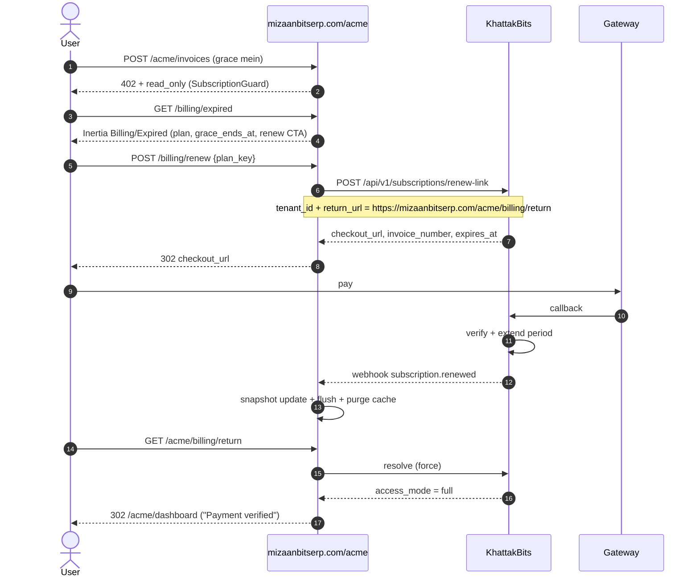

# 08 — Example Product Integration (MizaanbitsERP)

**Date:** 13 Nov 2026
**Repo:** `E:/LaraProjects/saas-starter` (branch `extract/package-skeleton`)
**Depends on:** `04-CONTROL-PLANE-DESIGN.md` (§1.3 catalog tables, §3.3 snapshot, §5.3 purchase flow, §6.1 manifest), `05-IDENTITY-HUB-SPEC.md` (§1.2 endpoints, §1.3 client registration, §1.4 redirect allowlist, §1.9 refresh tokens, §3.2 `resolve`, §3.4 renew-link, §3.5 `users/changes`, §4.1–4.3 webhooks, §5.2–5.3.1 disable propagation), `07-MULTI-TENANCY-DESIGN.md` (§2 table split, §3.1 route structure, §3.6 SSO flow, §3.6.1 membership source, §3.8 membership check, §5.2 `tenantUrl()`, §6.6 owner mapping, §9 entitlements)
**Scope:** design + reference implementation. Yeh document **example product** ke tor par `MizaanbitsERP` use karta hai (`key = mizaan`, domain `mizaanbitserp.com`) aur ek **naya package** `khattakbits/sso-client` define karta hai.
**Rule:** Har code block ka file path diya gaya hai. Jo cheez repo mein **maujood nahi** woh **`NEW`** mark hai. Jo cheez verify nahi ho saki woh **`NOT VERIFIED`** mark hai.

---

## 0. Yeh document kya hai (aur kya nahi)

| Cheez | Status | Kahan |
|---|---|---|
| `khattakbits/core` (audit, mailer, documents, RBAC, settings, modules) | ✅ **Maujood** — `vendor/khattakbits/core` | `03` Part C |
| `@khattakbits/ui` (layouts, ui, composables, login3d) | ✅ **Maujood** | `03` Part C |
| `stancl/tenancy` | ❌ **Install nahi hua** — `composer.json` mein nahi hai | `07` §1 (resolve verified, install pending) |
| `khattakbits/sso-client` | ❌ **NEW** — poora package | Yeh doc §2 |
| `products` / `plans` / `plan_entitlements` / … (CP side) | ❌ **NEW** — `04` §1.3 ka data model, migrations nahi | `04` |
| `GET /api/v1/users/tenants` | ❌ **NEW** — CP endpoint | `05` §3.1.1 |
| `tenant.owner` in `resolve` / `subscription.created` | ❌ **NEW** — CP payload | `05` §3.2, §4.1 |
| `users.kb_user_id`, `users.blocked_at`, `users.token_version`, `users.password` nullable | ❌ **NEW** — core package migration (`v1.5.0`) | `05` §5.1.1, `07` §2.1 |

**Yeh doc do cheezein nahi karta:** (a) CP ka implementation (woh `04`/`05` ka kaam hai), (b) product ka poora ERP (sirf integration surface). Jo code hai woh **copy-paste-able reference** hai — magar `NOT VERIFIED` wale hisse (jaise CP ka exact JSON) CP ship hone par confirm karne honge.

**Naam ki ek gair-muttafiqi jo pehle theek karni hai:** `07` §6.6.1 illustrative code mein `config('khattakbits.cp_url')` likhta hai. Yeh doc `config('kb.cp_url')` use karta hai, kyunke sso-client ka apna config namespace hai (`config/kb.php`). **`config('khattakbits.cp_url')` ko superseded samjhein** — sso-client publish hone ke baad wohi key `kb.cp_url` hai. `khattakbits.user_model` (core) waisa hi rehta hai.

---

## 1. Product registration — KhattakBits admin

Registration **order** matter karta hai, kyunke har step pichle par FK rakhta hai. Admin UI (`04` §4.1) yahi order enforce karega; seeder bhi yahi order follow karta hai.

```
products ──┬── product_modules ──┬── product_features
           │                     ├── product_doctypes
           │                     └── product_reports
           ├── plans ──┬── plan_prices
           │           └── plan_entitlements ── (FK product_features, nullable)
           ├── product_oauth_clients
           └── webhook_endpoints
```

`plan_entitlements.product_feature_id` **nullable** hai — yani entitlement ka `key` feature row ke baghair bhi ban sakta hai. Yeh jaan boojh kar hai (04 §1.3): feature row CP ka catalog hai, entitlement us plan ka faisla. Magar **recommend** yeh hai ke dono ho, warna `plan_entitlements.type` par bharosa karna padega jo fallback hai.

### 1.1 Step 1 — product

```php
// database/seeders/KhattakBits/MizaanProductSeeder.php  (NEW — CP repo mein, product repo mein nahi)
// Yeh seeder CP ki DB par chalta hai. Product repo mein NAHI.

$product = Product::updateOrCreate(
    ['key' => 'mizaan'],
    [
        'name'               => 'Mizaan ERP',
        'tagline'            => 'Accounting, inventory aur payroll — ek jagah',
        'description'        => 'Pakistan ke liye bana ERP: sales tax invoices, multi-warehouse stock, aur payroll.',
        'domain'             => 'mizaanbitserp.com',   // path-based: tenantUrl() ka base, resolution isse nahi (07 §5.2)
        'docs_url'           => 'https://docs.mizaanbitserp.com',
        'support_email'      => 'support@mizaanbitserp.com',
        'status'             => 'active',
        'min_starter_version'=> '2.0.0',               // 07 §5.3 ka menu `path` key + route split
        'metadata'           => [
            'locale'       => 'en-PK',
            'timezone'     => 'Asia/Karachi',
            'currency'     => 'PKR',
            'support_hours'=> 'Mon–Sat 10:00–19:00 PKT',
        ],
    ],
);
```

**`min_starter_version = '2.0.0'` kyun:** `07` §5.3 ne `menu.php` mein `path` key aur core routes ka `{tenant}` split introduce kiya — dono **breaking** hain. `03` Part D ne isay `khattakbits/core` **v2.0.0** (MAJOR) karar diya. Agar yahan `1.x` likha ho to `khattakbits:doctor` purane product ko outdated nahi batayega, aur woh `href`-as-route-URI wala bug le kar chalega (`07` §5.3).

### 1.2 Step 2 — modules

```php
// database/seeders/KhattakBits/MizaanProductSeeder.php  (NEW)
$modules = [
    ['key' => 'accounting', 'name' => 'Accounting', 'is_core' => true,  'sort_order' => 10,
     'description' => 'Chart of accounts, invoices, bills, journals'],
    ['key' => 'inventory',  'name' => 'Inventory',  'is_core' => false, 'sort_order' => 20,
     'description' => 'Items, warehouses, stock ledger'],
    ['key' => 'payroll',    'name' => 'Payroll',    'is_core' => false, 'sort_order' => 30,
     'description' => 'Employees, salary runs, tax slabs'],
    ['key' => 'reports',    'name' => 'Reports',    'is_core' => true,  'sort_order' => 40,
     'description' => 'Trial balance, P&L, stock ledger'],
];

foreach ($modules as $m) {
    $product->modules()->updateOrCreate(['key' => $m['key']], $m);
}
```

**`is_core = true` ka matlab:** module disable **nahi** ho sakta (04 §1.3). `accounting` aur `reports` core hain kyunke invoice ke baghair ERP bekaar hai. `inventory`/`payroll` optional hain — aur `module.*` entitlement unhein gate karta hai (§2.11).

**`removed_at` abhi set nahi hota.** Woh `04` §6.4 ke grandfather rule ke liye hai: module catalog se hat jaye magar active subscriptions usay reference karte hon. Registration ke waqt `status = 'active'`.

### 1.3 Step 3 — features

`product_features.type` **authoritative** hai (04 §1.3): `flag | limit | quota`. `plan_entitlements.type` sirf fallback hai jab feature row na ho.

```php
// database/seeders/KhattakBits/MizaanProductSeeder.php  (NEW)
// key => [module, name, type, default_value, unit, reset_period]
$features = [
    // ── module gates — 07 §9.1 L3 inhi par chalta hai ──────────────────
    'module.accounting'          => ['accounting', 'Accounting module',      'flag',  '0',  null,        null],
    'module.inventory'           => ['inventory',  'Inventory module',       'flag',  '0',  null,        null],
    'module.payroll'             => ['payroll',    'Payroll module',         'flag',  '0',  null,        null],
    'module.reports'             => ['reports',    'Reports module',         'flag',  '0',  null,        null],

    // ── accounting ─────────────────────────────────────────────────────
    'accounting.invoices'        => ['accounting', 'Sales invoices',         'flag',  '1',  null,        null],
    'accounting.periods'         => ['accounting', 'Open fiscal periods',    'limit', '2',  'count',     null],
    'accounting.multi_currency'  => ['accounting', 'Multi-currency',         'flag',  '0',  null,        null],

    // ── inventory ──────────────────────────────────────────────────────
    'inventory.warehouses'       => ['inventory',  'Warehouses',             'limit', '0',  'warehouses', null],

    // ── reports ────────────────────────────────────────────────────────
    'reports.advanced'           => ['reports',    'Advanced reports',       'flag',  '0',  null,        null],
    'audit_export'               => [null,         'Audit log export',       'flag',  '0',  null,        null],

    // ── limits — 04 §3.3 ka snapshot `limits` map inhi se banta hai ────
    // Key `seats` hai, `users` nahi: 04 §3.3 aur 07 §9.1 L1 dono `seats` kehte hain.
    // `Entitlement::limit('users')` alias se chalta hai (§2.11.1).
    'seats'                      => [null,         'Users (seats)',          'limit', '3',  'users',     null],
    'storage_mb'                 => [null,         'Storage',                'limit', '2048', 'mb',      null],

    // ── quotas — 04 §3.3 ka snapshot `quotas` map ──────────────────────
    'api.calls'                  => [null,         'API calls',              'quota', '10000', 'calls',   'month'],

    // ── Phase 2 ────────────────────────────────────────────────────────
    'custom_domain'              => [null,         'Custom domain',          'flag',  '0',  null,        null],
];

foreach ($features as $key => [$moduleKey, $name, $type, $default, $unit, $reset]) {
    $product->features()->updateOrCreate(
        ['key' => $key],
        [
            'product_module_id' => $moduleKey ? $product->modules()->where('key', $moduleKey)->value('id') : null,
            'name'              => $name,
            'type'              => $type,
            'default_value'     => $default,
            'unit'              => $unit,
            'reset_period'      => $reset,
            'status'            => 'active',
        ],
    );
}
```

**`default_value` `-1` nahi hai — `0` hai.** `-1` ka matlab "unlimited" hai aur woh **plan_entitlements** mein aata hai, feature ke default mein nahi. Wajah: feature ka default "kuch nahi milta" hona chahiye (fail-closed), warna naya plan jo entitlement declare karna bhool jaye usay sab kuch mil jayega.

### 1.4 Step 4 — doctypes

`product_doctypes` `DocumentRegistry` ka **mirror** hai (04 §1.3, `02` §2.1). CP usay **load nahi karta** — `model` column sirf documentation hai. Yeh catalog admin ko dikhata hai ke product kya-kya documents banata hai, aur `permission_prefix` se pata chalta hai kaunsi permission usay control karti hai.

```php
// database/seeders/KhattakBits/MizaanProductSeeder.php  (NEW)
$doctypes = [
    ['type' => 'invoice',       'module' => 'accounting', 'label' => 'Sales Invoice',
     'model' => 'App\\Modules\\Accounting\\Models\\Invoice',
     'permission_prefix' => 'accounting.invoices', 'url' => '/accounting/invoices',
     'actions' => ['view', 'create', 'update', 'delete', 'submit', 'cancel', 'print']],

    ['type' => 'bill',          'module' => 'accounting', 'label' => 'Purchase Bill',
     'model' => 'App\\Modules\\Accounting\\Models\\Bill',
     'permission_prefix' => 'accounting.bills', 'url' => '/accounting/bills',
     'actions' => ['view', 'create', 'update', 'delete', 'submit']],

    ['type' => 'journal_entry', 'module' => 'accounting', 'label' => 'Journal Entry',
     'model' => 'App\\Modules\\Accounting\\Models\\JournalEntry',
     'permission_prefix' => 'accounting.journals', 'url' => '/accounting/journals',
     'actions' => ['view', 'create', 'update', 'delete', 'post', 'reverse']],

    ['type' => 'item',          'module' => 'inventory',  'label' => 'Item',
     'model' => 'App\\Modules\\Inventory\\Models\\Item',
     'permission_prefix' => 'inventory.items', 'url' => '/inventory/items',
     'actions' => ['view', 'create', 'update', 'delete']],

    ['type' => 'stock_move',    'module' => 'inventory',  'label' => 'Stock Movement',
     'model' => 'App\\Modules\\Inventory\\Models\\StockMove',
     'permission_prefix' => 'inventory.stock', 'url' => '/inventory/stock',
     'actions' => ['view', 'create']],

    ['type' => 'employee',      'module' => 'payroll',    'label' => 'Employee',
     'model' => 'App\\Modules\\Payroll\\Models\\Employee',
     'permission_prefix' => 'payroll.employees', 'url' => '/payroll/employees',
     'actions' => ['view', 'create', 'update', 'delete']],
];

foreach ($doctypes as $d) {
    $product->doctypes()->updateOrCreate(
        ['type' => $d['type']],
        [
            'product_module_id' => $product->modules()->where('key', $d['module'])->value('id'),
            'label'             => $d['label'],
            'model'             => $d['model'],
            'permission_prefix' => $d['permission_prefix'],
            'url'               => $d['url'],
            'actions'           => $d['actions'],
            'status'            => 'active',
        ],
    );
}
```

**`url` slug-free hai** (`/accounting/invoices`, `/acme/accounting/invoices` nahi). Yeh `07` §5.3 ka wohi rule hai jo `menu.php` ke `path` par lagta hai: catalog **static** hota hai, URL **runtime** par `tenantUrl()` se banta hai. Agar yahan slug daal diya to catalog har tenant ke liye alag hona padega — jo schema hi tor deta hai.

### 1.5 Step 5 — reports

```php
// database/seeders/KhattakBits/MizaanProductSeeder.php  (NEW)
$reports = [
    ['key' => 'accounting.trial_balance', 'module' => 'accounting', 'name' => 'Trial Balance',
     'route' => '/reports/trial-balance', 'permission' => 'reports.trial_balance', 'is_exportable' => true],

    ['key' => 'accounting.profit_loss',   'module' => 'accounting', 'name' => 'Profit & Loss',
     'route' => '/reports/profit-loss',   'permission' => 'reports.profit_loss',   'is_exportable' => true],

    ['key' => 'inventory.stock_ledger',   'module' => 'inventory',  'name' => 'Stock Ledger',
     'route' => '/reports/stock-ledger',  'permission' => 'reports.stock_ledger',  'is_exportable' => true],

    ['key' => 'payroll.summary',          'module' => 'payroll',    'name' => 'Payroll Summary',
     'route' => '/reports/payroll',       'permission' => 'reports.payroll',       'is_exportable' => false],
];

foreach ($reports as $r) {
    $product->reports()->updateOrCreate(
        ['key' => $r['key']],
        [
            'product_module_id' => $product->modules()->where('key', $r['module'])->value('id'),
            'name'              => $r['name'],
            'route'             => $r['route'],
            'permission'        => $r['permission'],
            'is_exportable'     => $r['is_exportable'],
            'status'            => 'active',
        ],
    );
}
```

`route` bhi slug-free hai — wohi wajah (catalog static, URL runtime).

### 1.6 Step 6 — plans (Starter / Business / Enterprise)

```php
// database/seeders/KhattakBits/MizaanPlanSeeder.php  (NEW)
$plans = [
    [
        'key' => 'starter', 'name' => 'Starter', 'tier' => 1,
        'description' => 'Chhoti dukaan ya freelancer ke liye — accounting + basic reports.',
        'billing_mode' => 'per_tenant', 'seat_limit' => 3, 'trial_days' => 14, 'grace_days' => 7,
        'is_public' => true, 'status' => 'active', 'sort_order' => 10,
        'prices' => [
            ['interval' => 'month', 'amount_minor' =>   350000, 'compare_at_minor' => null],       // PKR 3,500
            ['interval' => 'year',  'amount_minor' =>  3500000, 'compare_at_minor' => 4200000],    // PKR 35,000 (2 months free)
        ],
        'entitlements' => [
            'module.accounting'         => '1',
            'module.inventory'          => '0',
            'module.payroll'            => '0',
            'module.reports'            => '1',
            'accounting.invoices'       => '1',
            'accounting.periods'        => '2',
            'accounting.multi_currency' => '0',
            'inventory.warehouses'      => '0',
            'reports.advanced'          => '0',
            'audit_export'              => '0',
            'custom_domain'             => '0',
            'seats'                     => '3',
            'storage_mb'                => '2048',
            'api.calls'                 => '10000',
        ],
    ],
    [
        'key' => 'business', 'name' => 'Business', 'tier' => 2,
        'description' => 'Barhti hui company ke liye — inventory, multi-currency, aur advanced reports.',
        'billing_mode' => 'per_tenant', 'seat_limit' => 15, 'trial_days' => 14, 'grace_days' => 7,
        'is_public' => true, 'status' => 'active', 'sort_order' => 20,
        'prices' => [
            ['interval' => 'month', 'amount_minor' =>   950000, 'compare_at_minor' => null],       // PKR 9,500
            ['interval' => 'year',  'amount_minor' =>  9500000, 'compare_at_minor' => 11400000],   // PKR 95,000
        ],
        'entitlements' => [
            'module.accounting'         => '1',
            'module.inventory'          => '1',
            'module.payroll'            => '0',
            'module.reports'            => '1',
            'accounting.invoices'       => '1',
            'accounting.periods'        => '-1',      // unlimited
            'accounting.multi_currency' => '1',
            'inventory.warehouses'      => '3',
            'reports.advanced'          => '1',
            'audit_export'              => '1',
            'custom_domain'             => '0',
            'seats'                     => '15',
            'storage_mb'                => '20480',
            'api.calls'                 => '100000',
        ],
    ],
    [
        'key' => 'enterprise', 'name' => 'Enterprise', 'tier' => 3,
        'description' => 'Payroll, unlimited warehouses aur seats, custom domain, priority support.',
        'billing_mode' => 'per_tenant', 'seat_limit' => null, 'trial_days' => 30, 'grace_days' => 14,
        'is_public' => false, 'status' => 'active', 'sort_order' => 30,   // sales-only
        'prices' => [
            ['interval' => 'month', 'amount_minor' =>  2400000, 'compare_at_minor' => null],       // PKR 24,000
            ['interval' => 'year',  'amount_minor' => 24000000, 'compare_at_minor' => 28800000],   // PKR 240,000
        ],
        'entitlements' => [
            'module.accounting'         => '1',
            'module.inventory'          => '1',
            'module.payroll'            => '1',
            'module.reports'            => '1',
            'accounting.invoices'       => '1',
            'accounting.periods'        => '-1',
            'accounting.multi_currency' => '1',
            'inventory.warehouses'      => '-1',
            'reports.advanced'          => '1',
            'audit_export'              => '1',
            'custom_domain'             => '1',
            'seats'                     => '-1',
            'storage_mb'                => '102400',
            'api.calls'                 => '-1',
        ],
    ],
];

foreach ($plans as $data) {
    $prices       = $data['prices'];
    $entitlements = $data['entitlements'];
    unset($data['prices'], $data['entitlements']);

    $plan = $product->plans()->updateOrCreate(['key' => $data['key']], $data);

    foreach ($prices as $p) {
        $plan->prices()->updateOrCreate(
            ['currency' => 'PKR', 'interval' => $p['interval']],
            ['amount_minor' => $p['amount_minor'], 'compare_at_minor' => $p['compare_at_minor'], 'is_active' => true],
        );
    }

    foreach ($entitlements as $key => $value) {
        $feature = $product->features()->where('key', $key)->first();

        $plan->entitlements()->updateOrCreate(
            ['key' => $key],
            [
                'product_feature_id' => $feature?->id,
                // type/unit/reset feature se copy — warna fallback typing par bharosa karna padega
                'type'         => $feature?->type ?? 'flag',
                'unit'         => $feature?->unit,
                'reset_period' => $feature?->reset_period,
                'value'        => $value,
            ],
        );
    }
}
```

**`-1` DB mein, `null` snapshot mein.** `plan_entitlements.value` `string(60)` hai aur `-1` = unlimited (04 §1.3). Magar `04` §3.3 ka snapshot **`null`** bhejta hai (`limits: { seats: null }`), `-1` nahi — kyunke client `-1` ko ghalti se "1 se kam" samajh sakta hai. **CP ka kaam hai `-1 → null` convert karna**; product ko `-1` kabhi nahi milna chahiye. Agar mil jaye to product usay **unlimited** samjhe (`§2.11.2`), crash na kare.

**`enterprise` `is_public = false` kyun:** `04` §1.3 ka `is_public` storefront visibility hai. Enterprise sales-led hai — price public page par nahi, magar plan `active` hai taake admin usay assign kar sake.

**`seat_limit` aur `seats` entitlement dono kyun:** `seat_limit` **billing** ka column hai (kitni seats kharidi gayin), `seats` entitlement **enforcement** ka (kitni allowed hain). Phase 1 mein dono barabar hain (04 D1: seats customer-bought, koi metering nahi). Phase 2 mein per-seat billing aayegi to `seat_limit` purchased hoga aur `seats` entitlement us se derive hoga — **do column rakhna ab sasta hai, baad mein add karna mehnga**.

### 1.7 Step 7 — OAuth client

`05` §1.3 ke mutabiq product create ke **usi transaction** mein. Yahan seeder version:

```php
// database/seeders/KhattakBits/MizaanOAuthClientSeeder.php  (NEW)
$redirectUris = [
    'https://mizaanbitserp.com/auth/kb/callback',   // production
    'http://localhost:8001/auth/kb/callback',       // local dev — 05 §1.4 layer 3: localhost exempt sirf APP_ENV=local
    'http://mizaanbitserp.test/auth/kb/callback',   // local dev (hosts file, §3.1)
];

$client = DB::transaction(function () use ($product, $redirectUris) {
    $passport = PassportClient::create([
        'name'                   => 'Mizaan ERP (mizaan)',
        'redirect_uris'          => $redirectUris,
        'grant_types'            => ['authorization_code', 'refresh_token'],
        'revoked'                => false,
        'confidential'           => true,
        'password_client'        => false,
        'personal_access_client' => false,
    ]);

    return $product->oauthClients()->create([
        'oauth_client_id' => $passport->id,          // string(64) — Passport v13.10 UUID (05 §1.3, verified)
        'name'            => 'Mizaan ERP',
        'redirect_uris'   => $redirectUris,
        'pkce_required'   => true,
        'scopes'          => ['openid', 'profile', 'email', 'subscription', 'entitlements'],
        'is_first_party'  => true,                   // consent skip (05 §1.10)
        'status'          => 'active',
        'secret_last4'    => substr($secret = Str::random(40), -4),
    ])->tap(fn () => null);  // secret sirf response/CLI output mein ek dafa — DB mein nahi
});
```

**Callback URI mein tenant slug nahi hai.** `https://mizaanbitserp.com/auth/kb/callback` — product ka **central** host, `{slug}` ke baghair. Yeh `05` §1.4 ka v3 rule hai: path-based mein callback central hai, is liye `{domain}` interpolation bhi khatam. Agar ghalti se `https://mizaanbitserp.com/acme/auth/kb/callback` register kar diya to **exact match** fail hoga (`05` §1.4 layer 1) aur har login `invalid_request` dega.

**`is_first_party = true`** consent skip karta hai (05 §1.10) — magar sirf tab jab user ke paas `kb_user_product_access` row ho. Row na ho to OAuth **error redirect** aata hai, `403` nahi (05 §1.10.1). Product ko `error=access_denied` handle karna lazmi hai — `code` ki tarah (`§2.7.4`).

### 1.8 Step 8 — webhook endpoint

```php
// database/seeders/KhattakBits/MizaanWebhookSeeder.php  (NEW)
$endpoint = $product->webhookEndpoints()->updateOrCreate(
    ['url' => 'https://mizaanbitserp.com/webhooks/kb'],
    [
        'description'   => 'Mizaan ERP production',
        'events'        => [
            'subscription.created',
            'subscription.renewed',
            'subscription.grace',
            'subscription.expired',
            'subscription.cancelled',
            'subscription.suspended',
            'subscription.entitlements_changed',
            'plan.changed',
            'user.disabled',
            'user.enabled',
            'invoice.paid',
            'invoice.voided',
            'payment.verified',
            'payment.rejected',
            'tenant.provisioned',
        ],
        'is_active'     => true,
        'api_version'   => '1',
    ],
);

// secret encrypted cast se store hota hai (04 §1.3) — plaintext kabhi DB mein nahi
$endpoint->secret = $plainSecret = Str::random(48);
$endpoint->save();

// Plaintext secret product ke .env mein daalna hai — ek dafa dikhta hai
echo "KB_WEBHOOK_SECRET={$plainSecret}\n";
```

**Secret OAuth secret se alag hai** (05 §4.3). Dono ek kar dena tempting hai — magar rotation ka scope alag hai (webhook secret 24h dual-sign ke saath rotate hota hai, OAuth secret client rotate karta hai), aur ek leak doosre ko expose kar deta hai.

**`["*"]` nahi likha.** `04` §6.1 ke mutabiq `["*"]` allowed hai, magar explicit list behtar hai: naya event add hone par product ko pata chalta hai ke usay handle karna hai, aur typo endpoint save par `422` de deta hai (05 §4.1).

### 1.9 Verification — registration ke baad kya sach hona chahiye

```bash
# CP repo
php artisan tinker --execute="
\$p = App\Models\Product::where('key','mizaan')->first();
dump([
  'modules'      => \$p->modules()->count(),        // 4
  'features'     => \$p->features()->count(),       // 15
  'doctypes'     => \$p->doctypes()->count(),       // 6
  'reports'      => \$p->reports()->count(),        // 4
  'plans'        => \$p->plans()->count(),          // 3
  'entitlements' => \$p->plans()->withCount('entitlements')->get()->pluck('entitlements_count','key'), // 14/14/14
  'prices'       => \$p->plans()->withCount('prices')->get()->pluck('prices_count','key'),             // 2/2/2
]);
"
```

| Check | Expected | Nahi hua to |
|---|---|---|
| Har plan ke entitlements = features ki ginti | **14 = 14** | Koi plan feature bhool raha hai — `Entitlement::has()` us key par `false` dega, silently |
| Har `plan_entitlements.product_feature_id` non-null | **42/42** | Feature key typo hai — seeder `null` chhod dega aur typing fallback par chala jayega |
| `products.domain` set hai | `mizaanbitserp.com` | `tenantUrl(absolute: true)` `config('app.url')` par gir jayega (galat host) |
| `min_starter_version` = `2.0.0` | ✅ | `doctor` outdated banner nahi dikhayega, product `path` key ke baghair chalega |
| OAuth client ke `redirect_uris` mein koi `{slug}` nahi | ✅ | Exact match fail → har login `invalid_request` |
| `webhook_endpoints.events` mein `subscription.created` | ✅ | Provisioning trigger hi nahi milega — tenant `pending` par phans jayega |

---

## 2. `khattakbits/sso-client` — naya package

### 2.1 Yeh `core` mein kyun nahi

`khattakbits/core` **product-agnostic kernel** hai (audit, mailer, documents, RBAC, settings, modules). SSO client us se **alag** hai kyunke:

| Wajah | Detail |
|---|---|
| **Optional hai** | Single-tenant product (starter kit) ko SSO ki zaroorat nahi. Core mein daalne se woh `stancl/tenancy`, Passport endpoints, aur webhook routes sab le kar chalega |
| **Cycle** | SSO client ko `stancl/tenancy` (`tenant()`, `tenancy()->initialize()`) aur `spatie/laravel-permission` dono chahiye. Core ka `spatie` par depend karna theek hai, magar `stancl` par nahi (`07` §7.3 point 2 ka wohi `class_exists` guard) |
| **Version cadence** | CP ka API contract badalta hai (`/api/v1` → `/api/v2`). Woh bump core ke MAJOR se **alag** hona chahiye, warna product ko poora kernel upgrade karna padega sirf API version ke liye |
| **Testability** | SSO client ka test CP ke fake HTTP par chalta hai — core ke 117 tests ke saath mix karna unhein slow aur brittle banata hai |

**Dependency direction:** `product → sso-client → core`. Ulta kabhi nahi.

### 2.2 Folder structure

```
khattakbits-sso-client/                                 (NEW — alag repo)
├── composer.json
├── config/
│   └── kb.php
├── database/
│   └── migrations/
│       ├── 2026_11_20_000001_add_kb_columns_to_users_table.php
│       ├── 2026_11_20_000002_create_kb_user_tenant_table.php
│       ├── 2026_11_20_000003_create_kb_snapshot_table.php
│       ├── 2026_11_20_000004_create_kb_oauth_state_table.php
│       └── 2026_11_20_000005_create_webhook_events_table.php
├── routes/
│   └── web.php
├── resources/
│   └── js/
│       ├── Pages/Billing/Expired.vue
│       ├── Pages/Billing/Return.vue
│       └── composables/useEntitlement.js
├── src/
│   ├── SsoClientServiceProvider.php
│   ├── Api/
│   │   ├── KbApiClient.php
│   │   └── KbApiException.php
│   ├── Console/
│   │   ├── PollUserChanges.php
│   │   └── RefreshSnapshots.php
│   ├── Events/
│   │   └── SubscriptionChanged.php
│   ├── Http/
│   │   ├── Controllers/
│   │   │   ├── BillingController.php
│   │   │   ├── CallbackController.php
│   │   │   └── WebhookController.php
│   │   └── Middleware/
│   │       ├── EnsureEntitled.php
│   │       ├── EnsureTokenFresh.php
│   │       └── SubscriptionGuard.php
│   ├── Identity/
│   │   ├── MirrorUser.php
│   │   ├── ReconcileMemberships.php
│   │   └── TenantOwnerMapper.php
│   ├── Models/
│   │   ├── KbOauthState.php
│   │   ├── KbSnapshot.php
│   │   └── WebhookEvent.php
│   ├── OAuth/
│   │   ├── KhattakBitsProvider.php
│   │   ├── KbSession.php
│   │   ├── OAuthCallbackException.php
│   │   ├── Pkce.php
│   │   └── StateStore.php
│   ├── Subscriptions/
│   │   ├── AccessMode.php
│   │   ├── ResolvesSubscription.php
│   │   └── SubscriptionSnapshot.php
│   ├── Support/
│   │   └── Entitlement.php
│   └── Webhooks/
│       ├── HandlesKbEvent.php
│       └── Handlers/
│           ├── PlanChanged.php
│           ├── SubscriptionChangedHandler.php
│           ├── TenantProvisioned.php
│           └── UserDisabled.php
└── tests/
    ├── Feature/
    │   ├── CallbackMembershipTest.php
    │   ├── SubscriptionGuardTest.php
    │   └── WebhookVerificationTest.php
    └── TestCase.php
```

### 2.3 `composer.json`

```json
// khattakbits-sso-client/composer.json  (NEW)
{
    "name": "khattakbits/sso-client",
    "description": "KhattakBits SSO (OAuth2 + PKCE), subscription guard, entitlements and webhooks for product apps",
    "type": "library",
    "license": "proprietary",
    "require": {
        "php": "^8.3",
        "khattakbits/core": "^2.0",
        "illuminate/auth": "^13.0",
        "illuminate/console": "^13.0",
        "illuminate/database": "^13.0",
        "illuminate/http": "^13.0",
        "illuminate/routing": "^13.0",
        "illuminate/support": "^13.0",
        "spatie/laravel-permission": "^8.3",
        "stancl/tenancy": "^3.10"
    },
    "require-dev": {
        "orchestra/testbench": "^11.0",
        "phpunit/phpunit": "^12.5",
        "laravel/pint": "^1.27"
    },
    "autoload": {
        "psr-4": {
            "KhattakBits\\SsoClient\\": "src/"
        },
        "files": [
            "src/helpers.php"
        ]
    },
    "autoload-dev": {
        "psr-4": {
            "KhattakBits\\SsoClient\\Tests\\": "tests/"
        }
    },
    "extra": {
        "laravel": {
            "providers": [
                "KhattakBits\\SsoClient\\SsoClientServiceProvider"
            ]
        }
    },
    "minimum-stability": "stable",
    "prefer-stable": true,
    "config": {
        "sort-packages": true
    }
}
```

**`khattakbits/core: ^2.0` kyun, `^1.4` nahi:** sso-client `menu.php` ke `path` key par aur core routes ke `{tenant}` split par depend karta hai — dono **v2.0.0** mein aaye (`03` Part D, `07` §5.3). `^1.4` allow karna matlab hai ke package install ho jayega magar `path` key silently ignore hogi aur menu ke routes 404 denge.

**`stancl/tenancy` yahan `require` mein hai, `suggest` mein nahi.** Yeh jaan boojh kar hai: sso-client ka poora membership model path-based tenancy par khara hai (`tenant()`, `tenancy()->initialize()`). Optional rakhna matlab hai ke runtime par `class_exists` checks har jagah — jo `07` §7.3 ne core ke liye kiya tha, magar yahan ulta logic hai: **core ko nahi pata hona chahiye**, sso-client ko **pata hona chahiye**.

### 2.4 `SsoClientServiceProvider`

```php
// khattakbits-sso-client/src/SsoClientServiceProvider.php  (NEW)
namespace KhattakBits\SsoClient;

use Illuminate\Contracts\Http\Kernel as HttpKernel;
use Illuminate\Routing\Router;
use Illuminate\Support\ServiceProvider;
use KhattakBits\SsoClient\Api\KbApiClient;
use KhattakBits\SsoClient\Console\PollUserChanges;
use KhattakBits\SsoClient\Console\RefreshSnapshots;
use KhattakBits\SsoClient\Http\Middleware\EnsureEntitled;
use KhattakBits\SsoClient\Http\Middleware\EnsureTokenFresh;
use KhattakBits\SsoClient\Http\Middleware\SubscriptionGuard;
use KhattakBits\SsoClient\OAuth\KhattakBitsProvider;
use KhattakBits\SsoClient\OAuth\StateStore;
use KhattakBits\SsoClient\Subscriptions\ResolvesSubscription;

final class SsoClientServiceProvider extends ServiceProvider
{
    public function register(): void
    {
        $this->mergeConfigFrom(__DIR__.'/../config/kb.php', 'kb');

        $this->app->singleton(KbApiClient::class, fn ($app) => new KbApiClient(
            cpUrl:        rtrim((string) $app['config']->get('kb.cp_url'), '/'),
            clientId:     (string) $app['config']->get('kb.client_id'),
            clientSecret: (string) $app['config']->get('kb.client_secret'),
            timeout:      (int) $app['config']->get('kb.http.timeout', 15),
        ));

        $this->app->singleton(StateStore::class);
        $this->app->singleton(KhattakBitsProvider::class);
        $this->app->singleton(ResolvesSubscription::class);
    }

    public function boot(Router $router, HttpKernel $kernel): void
    {
        $this->loadRoutesFrom(__DIR__.'/../routes/web.php');
        $this->loadMigrationsFrom(__DIR__.'/../database/migrations');
        $this->loadViewsFrom(__DIR__.'/../resources/views', 'kb');

        $this->publishes([
            __DIR__.'/../config/kb.php' => config_path('kb.php'),
        ], 'kb-config');

        $this->publishes([
            __DIR__.'/../resources/js' => resource_path('js/vendor/kb'),
        ], 'kb-assets');

        // Route middleware aliases — product inhein apne routes par use karta hai
        $router->aliasMiddleware('kb.guard',      SubscriptionGuard::class);
        $router->aliasMiddleware('kb.token',      EnsureTokenFresh::class);
        $router->aliasMiddleware('kb.entitled',   EnsureEntitled::class);   // entitled:module.accounting

        // `kb.guard` ko `web` group ke BAAD chalna hai (session chahiye),
        // magar `auth` ke baad bhi (user chahiye). Product isay route par lagata hai,
        // group mein nahi — kyunke central routes (callback, webhook) ko guard nahi chahiye.
        $kernel->appendMiddlewareToGroup('web', EnsureTokenFresh::class);

        if ($this->app->runningInConsole()) {
            $this->commands([PollUserChanges::class, RefreshSnapshots::class]);

            $this->publishes([
                __DIR__.'/../database/migrations' => database_path('migrations'),
            ], 'kb-migrations');
        }
    }
}
```

**`kb.guard` group mein kyun nahi:** `SubscriptionGuard` ko `tenant()` chahiye. Central routes (`/auth/kb/callback`, `/webhooks/kb`, `/billing/*`) par `tenant()` `null` hai — unhein guard nahi chahiye. Is liye woh **route-level** middleware hai, `web` group ka hissa nahi.

**`EnsureTokenFresh` group mein kyun hai:** usay **har** authenticated request par chalna hai (05 §5.3.1), aur woh `tenant()` par depend nahi karta — sirf session par. Woh group mein safe hai, aur group mein hona hi usay "bhoolna namumkin" banata hai.

**`EnsureEntitled` `kb.entitled` alias kyun, `entitled` nahi:** Laravel 13 mein `entitled` global alias koi nahi hai, magar product ya koi package baad mein wohi naam le sakta hai. `kb.` prefix collision-proof hai.

### 2.5 `config/kb.php`

```php
// khattakbits-sso-client/config/kb.php  (NEW)
return [

    /*
    |--------------------------------------------------------------------------
    | Control plane
    |--------------------------------------------------------------------------
    | CP ka base URL. Trailing slash nahi (client khud rtrim karta hai).
    */
    'cp_url' => env('KB_CP_URL', 'https://app.khattakbits.com'),

    /*
    |--------------------------------------------------------------------------
    | OAuth2 client
    |--------------------------------------------------------------------------
    | Yeh values CP ke `product_oauth_clients` se aati hain (05 §1.3).
    | Secret sirf .env mein — config file mein hardcode kabhi nahi.
    */
    'client_id'     => env('KB_CLIENT_ID'),
    'client_secret' => env('KB_CLIENT_SECRET'),

    'redirect_uri' => env('KB_REDIRECT_URI', env('APP_URL').'/auth/kb/callback'),

    'scopes' => ['openid', 'profile', 'email', 'subscription', 'entitlements'],

    /*
    |--------------------------------------------------------------------------
    | OAuth flow
    |--------------------------------------------------------------------------
    */
    'oauth' => [
        // `state` + PKCE verifier kitni der zinda rahe (seconds). 10 min kaafi hai:
        // login ke dauraan user ko 3D login karna hota hai, aur us se zyada nahi.
        'state_ttl' => 600,

        // CP par session pehle se ho to login interrupt skip hota hai — us case
        // mein callback 2 second mein aa jata hai. 600s us ke liye bhi kaafi hai.
        'cookie' => 'kb_oauth_state',

        // `prompt=none` silent SSO — Phase 1 mein OFF (05 §9 item 2: third-party
        // cookie blocking isay torta hai).
        'silent' => false,
    ],

    /*
    |--------------------------------------------------------------------------
    | HTTP client
    |--------------------------------------------------------------------------
    */
    'http' => [
        'timeout'         => 15,   // total, seconds
        'connect_timeout' => 5,
        'retries'         => 2,    // sirf idempotent GET par
        'retry_delay_ms'  => 200,
    ],

    /*
    |--------------------------------------------------------------------------
    | Subscription snapshot
    |--------------------------------------------------------------------------
    | `resolve` ka result yahan cache hota hai, aur DB mein `kb_snapshot` row
    | bhi banti hai (offline fallback). 04 §3.4: 5 min TTL.
    */
    'resolve' => [
        'ttl'          => 300,    // cache TTL (5 min)
        'negative_ttl' => 30,     // CP fail hone par dobara try karne se pehle
        'max_backoff'  => 300,    // negative cache ka upper bound

        // 72h: itne der tak CP se baat na ho to snapshot par bharosa khatam.
        // Us ke baad fail-CLOSED (dekhein §2.9.3 ka table).
        'offline_max_age_hours' => 72,

        // 24h se purana snapshot "full" access nahi de sakta — read_only par gir jata hai.
        // 72h se pehle ka buffer hai taake ek lambe weekend bhi data loss na kare.
        'degrade_after_hours' => 24,
    ],

    /*
    |--------------------------------------------------------------------------
    | Fail mode
    |--------------------------------------------------------------------------
    | 'closed' = CP down ho to naya kuch nahi (recommended, 05 §5.4).
    | 'open'   = CP down ho to snapshot jitna access chalta rahe (SIRF debugging).
    | 'open' production mein kabhi na chalayein — woh "CP down hai to sab kuch allow"
    | hai, aur subscription bypass ban jata hai.
    */
    'fail_mode' => env('KB_FAIL_MODE', 'closed'),

    /*
    |--------------------------------------------------------------------------
    | Webhooks
    |--------------------------------------------------------------------------
    | 05 §4.3: HMAC-SHA256 over "{timestamp}.{raw_body}", 300s window.
    */
    'webhook' => [
        'secret'            => env('KB_WEBHOOK_SECRET'),
        'tolerance'         => 300,   // seconds
        'path'              => '/webhooks/kb',
        'middleware'        => ['api'],   // CSRF nahi — API group
        'queue'             => 'default',
        'idempotency_table' => 'webhook_events',
    ],

    /*
    |--------------------------------------------------------------------------
    | Access token
    |--------------------------------------------------------------------------
    | 05 §5.3: worst-case lockout 900s. Product isay kam nahi kar sakta,
    | barha sakta hai — magar 900 se zyada karna lockout bound tor deta hai.
    */
    'token' => [
        'ttl'         => 900,
        'refresh_skew'=> 30,     // itne second pehle refresh shuru karo
    ],

    /*
    |--------------------------------------------------------------------------
    | Identity feed (05 §3.5)
    |--------------------------------------------------------------------------
    */
    'feed' => [
        'enabled'      => true,
        'interval'     => 45,     // seconds — per PRODUCT, per session nahi
        'limit'        => 500,
        'max_per_run'  => 20,     // ek run mein max pages (backlog drain cap)
    ],

    /*
    |--------------------------------------------------------------------------
    | Entitlement aliases
    |--------------------------------------------------------------------------
    | 04 §3.3 aur 07 §9.1 ka canonical key `seats` hai. Product code mein
    | `users` likhna natural hai, is liye alias — magar source of truth ek hi.
    */
    'entitlement' => [
        'aliases' => [
            'users'   => 'seats',
            'storage' => 'storage_mb',
        ],
    ],

    /*
    |--------------------------------------------------------------------------
    | Routes
    |--------------------------------------------------------------------------
    */
    'routes' => [
        'enabled'      => true,
        'prefix'       => '',            // '' => /auth/kb/callback, /webhooks/kb
        'billing_prefix' => '/billing',
    ],

    /*
    |--------------------------------------------------------------------------
    | Guards / redirects
    |--------------------------------------------------------------------------
    */
    'redirects' => [
        'login'   => '/login',
        'expired' => '/billing/expired',
        'return'  => '/billing/return',
        'picker'  => '/select-tenant',
    ],

];
```

### 2.6 Migrations (5 naye)

**Note:** `users.kb_user_id`, `blocked_at`, `blocked_reason`, `token_version` **core package** (`v1.5.0`) mein aate hain (05 §5.1.1). Neeche sirf woh columns hain jo sso-client **khud** maangta hai — aur ek `password` nullable fix jo SSO-only users ke liye lazmi hai.

```php
// khattakbits-sso-client/database/migrations/2026_11_20_000001_add_kb_columns_to_users_table.php  (NEW)
use Illuminate\Database\Migrations\Migration;
use Illuminate\Database\Schema\Blueprint;
use Illuminate\Support\Facades\Schema;

return new class extends Migration
{
    public function up(): void
    {
        Schema::table('users', function (Blueprint $table) {
            // CP ka users.id = OIDC `sub`. Email badalti hai, sub nahi.
            $table->unsignedBigInteger('kb_user_id')->nullable()->unique()->after('id');

            // 05 §5.1.1 — agar core v1.5.0 ne yeh add kar diye hain to
            // hasColumn() guard rakhein, warna duplicate column error.
            if (! Schema::hasColumn('users', 'blocked_at')) {
                $table->timestamp('blocked_at')->nullable()->after('is_active');
            }
            if (! Schema::hasColumn('users', 'blocked_reason')) {
                $table->string('blocked_reason', 120)->nullable()->after('blocked_at');
            }
            if (! Schema::hasColumn('users', 'token_version')) {
                $table->unsignedInteger('token_version')->default(0)->after('blocked_reason');
            }
        });

        // SSO-only user ka local password hota hi nahi (D5). Column NOT NULL hai
        // (0001_01_01_000000_create_users_table.php), is liye nullable karna lazmi.
        // Laravel 11+ native change() — doctrine/dbal ki zaroorat nahi.
        Schema::table('users', function (Blueprint $table) {
            $table->string('password')->nullable()->change();
        });
    }

    public function down(): void
    {
        Schema::table('users', function (Blueprint $table) {
            $table->dropUnique(['kb_user_id']);
            $table->dropColumn(['kb_user_id', 'blocked_at', 'blocked_reason', 'token_version']);
        });
    }
};
```

**`password` nullable kyun lazmi hai:** `users.password` aaj `string` **NOT NULL** hai. SSO-only user ke paas password nahi hota. Agar nullable na karein to `MirrorUser` ko random hash daalna padega — jo kaam karta hai magar "yeh user password se login kar sakta hai?" ka jawab dhundhla kar deta hai, aur ek din koi `Hash::check('', $hash)` wala bug aa jayega. **`null` = "password set nahi hua" ek saaf signal hai.**

```php
// khattakbits-sso-client/database/migrations/2026_11_20_000002_create_kb_user_tenant_table.php  (NEW)
use Illuminate\Database\Migrations\Migration;
use Illuminate\Database\Schema\Blueprint;
use Illuminate\Support\Facades\Schema;

return new class extends Migration
{
    public function up(): void
    {
        Schema::create('kb_user_tenant', function (Blueprint $table) {
            $table->id();
            $table->unsignedBigInteger('user_id');       // local users.id
            $table->char('tenant_id', 26);               // tenants.id (ULID)
            $table->string('role_hint', 20)->default('member');  // owner|admin|member|billing|viewer
            $table->string('source', 20)->default('sso');        // sso|provisioning|admin
            $table->timestamp('synced_at')->nullable();
            $table->timestamp('revoked_at')->nullable();  // soft revoke — delete nahi
            $table->timestamps();

            $table->unique(['user_id', 'tenant_id']);
            $table->index(['tenant_id', 'revoked_at']);

            // tenant_id par FK NAHI — tenants.id ULID hai aur stancl ki table par
            // FK rakhna restore/import ko mushkil banata hai (07 §6.6.2).
            $table->foreign('user_id')->references('id')->on('users')->cascadeOnDelete();
        });
    }

    public function down(): void
    {
        Schema::dropIfExists('kb_user_tenant');
    }
};
```

```php
// khattakbits-sso-client/database/migrations/2026_11_20_000003_create_kb_snapshot_table.php  (NEW)
use Illuminate\Database\Migrations\Migration;
use Illuminate\Database\Schema\Blueprint;
use Illuminate\Support\Facades\Schema;

return new class extends Migration
{
    public function up(): void
    {
        Schema::create('kb_snapshot', function (Blueprint $table) {
            $table->id();
            $table->char('tenant_id', 26)->unique();
            $table->unsignedInteger('version')->default(0);        // 04 §3.3 snapshot `version`
            $table->string('etag', 80)->nullable();                // W/"..." — If-None-Match ke liye
            $table->string('status', 20);                          // active|grace|expired|suspended|...
            $table->string('access_mode', 20);                     // full|read_only|locked|blocked
            $table->json('payload');                               // poora snapshot, jaisa aaya
            $table->timestamp('fetched_at');                       // last SUCCESSFUL fetch
            $table->timestamp('last_attempt_at')->nullable();      // last try (fail bhi)
            $table->unsignedSmallInteger('fail_count')->default(0);
            $table->timestamps();

            $table->index(['access_mode', 'fetched_at']);
        });
    }

    public function down(): void
    {
        Schema::dropIfExists('kb_snapshot');
    }
};
```

```php
// khattakbits-sso-client/database/migrations/2026_11_20_000004_create_kb_oauth_state_table.php  (NEW)
use Illuminate\Database\Migrations\Migration;
use Illuminate\Database\Schema\Blueprint;
use Illuminate\Support\Facades\Schema;

return new class extends Migration
{
    public function up(): void
    {
        Schema::create('kb_oauth_state', function (Blueprint $table) {
            $table->id();
            $table->string('state', 64)->unique();       // random 32 bytes hex
            $table->string('code_verifier', 128);        // PKCE S256 verifier
            $table->string('return_to', 500)->nullable();// SIRF destination hint — membership nahi
            $table->string('tenant_hint', 60)->nullable();// URL se aaya slug, sirf UI ke liye
            $table->string('session_id', 100)->nullable();// login interrupt ke liye (05 §2.3)
            $table->string('ip', 45)->nullable();
            $table->timestamp('expires_at');
            $table->timestamp('consumed_at')->nullable();
            $table->timestamps();

            $table->index('expires_at');
        });
    }

    public function down(): void
    {
        Schema::dropIfExists('kb_oauth_state');
    }
};
```

**`tenant_hint` ka naam hi "hint" hai.** Yeh URL se aaya slug hai — sirf is liye ke callback ke baad UI "aap `/acme` par wapas ja rahe hain" dikha sake. **Membership isse nahi banti.** Column ka naam jaan boojh kar `tenant_hint` rakha hai, `tenant_id` nahi — taake koi baad mein usay membership ke liye use karne ki ghalti na kare (`07` §3.6.1).

```php
// khattakbits-sso-client/database/migrations/2026_11_20_000005_create_webhook_events_table.php  (NEW)
use Illuminate\Database\Migrations\Migration;
use Illuminate\Database\Schema\Blueprint;
use Illuminate\Support\Facades\Schema;

return new class extends Migration
{
    public function up(): void
    {
        Schema::create('webhook_events', function (Blueprint $table) {
            $table->id();
            $table->string('event_id', 40)->unique();   // X-KB-Event-Id (ULID)
            $table->string('event', 60);
            $table->char('tenant_id', 26)->nullable();
            $table->string('status', 20)->default('processed'); // processed|failed|ignored
            $table->json('payload');
            $table->timestamp('received_at');
            $table->timestamp('processed_at')->nullable();
            $table->timestamps();

            $table->index(['event', 'received_at']);
            $table->index('tenant_id');
        });
    }

    public function down(): void
    {
        Schema::dropIfExists('webhook_events');
    }
};
```

**`event_id` `unique` — idempotency ka poora mechanism.** Duplicate insert `unique` violation dega; hum `insertOrIgnore` use karte hain aur `affected === 0` par `200` wapas dete hain (05 §4.3 layer 2). Timestamp window ke baghair bhi yeh kaam karta hai — retry 1 ghante baad aata hai aur us waqt timestamp **naya** hota hai (delivery time, event time nahi).

### 2.7 Models

```php
// khattakbits-sso-client/src/Models/KbSnapshot.php  (NEW)
namespace KhattakBits\SsoClient\Models;

use Illuminate\Database\Eloquent\Model;
use KhattakBits\SsoClient\Subscriptions\SubscriptionSnapshot;

final class KbSnapshot extends Model
{
    protected $table = 'kb_snapshot';

    protected $guarded = [];

    protected $casts = [
        'payload'     => 'array',
        'fetched_at'  => 'datetime',
        'last_attempt_at' => 'datetime',
    ];

    public function toSnapshot(): SubscriptionSnapshot
    {
        return SubscriptionSnapshot::fromArray($this->payload, [
            'fetched_at' => $this->fetched_at,
            'stale'      => true,
        ]);
    }

    public function ageHours(): float
    {
        return $this->fetched_at->diffInMinutes(now()) / 60;
    }
}
```

```php
// khattakbits-sso-client/src/Models/KbOauthState.php  (NEW)
namespace KhattakBits\SsoClient\Models;

use Illuminate\Database\Eloquent\Model;

final class KbOauthState extends Model
{
    protected $table = 'kb_oauth_state';

    protected $guarded = [];

    protected $casts = [
        'expires_at'  => 'datetime',
        'consumed_at' => 'datetime',
    ];
}
```

```php
// khattakbits-sso-client/src/Models/WebhookEvent.php  (NEW)
namespace KhattakBits\SsoClient\Models;

use Illuminate\Database\Eloquent\Model;

final class WebhookEvent extends Model
{
    protected $table = 'webhook_events';

    protected $guarded = [];

    protected $casts = [
        'payload'      => 'array',
        'received_at'  => 'datetime',
        'processed_at' => 'datetime',
    ];
}
```

---

### 2.8 `KhattakBitsProvider` — OAuth2 + PKCE

#### 2.8.1 `Pkce`

```php
// khattakbits-sso-client/src/OAuth/Pkce.php  (NEW)
namespace KhattakBits\SsoClient\OAuth;

final class Pkce
{
    /**
     * RFC 7636 §4.1: 43–128 chars, unreserved set.
     * 48 random bytes → base64url = 64 chars. Base64url mein '+' '/' '=' nahi
     * aate, is liye URL-safe hai bina extra encoding ke.
     */
    public static function verifier(): string
    {
        return self::base64url(random_bytes(48));
    }

    /**
     * S256 challenge. CP `plain` support karta hai magar hum use NAHI karte —
     * plain PKCE ka matlab hai verifier URL mein, jo intercept ho sakta hai.
     */
    public static function challenge(string $verifier): string
    {
        return self::base64url(hash('sha256', $verifier, true));
    }

    private static function base64url(string $bin): string
    {
        return rtrim(strtr(base64_encode($bin), '+/', '-_'), '=');
    }
}
```

#### 2.8.2 `KbSession` DTO

```php
// khattakbits-sso-client/src/OAuth/KbSession.php  (NEW)
namespace KhattakBits\SsoClient\OAuth;

use App\Models\User;

final readonly class KbSession
{
    /**
     * @param  array<int, array{tenant_id:string, slug:string, product_key:string, role:string, status:string}>  $tenants
     * @param  array<string, mixed>  $claims
     */
    public function __construct(
        public User $user,
        public array $tenants,
        public string $accessToken,
        public string $refreshToken,
        public \DateTimeImmutable $expiresAt,
        public int $tokenVersion,
        public array $claims,
    ) {}

    public function tenantIds(): array
    {
        return array_column($this->tenants, 'tenant_id');
    }

    public function isMemberOf(string $tenantId): bool
    {
        return in_array($tenantId, $this->tenantIds(), true);
    }

    public function tenantBySlug(string $slug): ?array
    {
        foreach ($this->tenants as $t) {
            if ($t['slug'] === $slug) {
                return $t;
            }
        }

        return null;
    }
}
```

#### 2.8.3 `StateStore`

```php
// khattakbits-sso-client/src/OAuth/StateStore.php  (NEW)
namespace KhattakBits\SsoClient\OAuth;

use KhattakBits\SsoClient\Models\KbOauthState;

final class StateStore
{
    public function put(string $state, string $verifier, ?string $returnTo, ?string $tenantHint): void
    {
        KbOauthState::create([
            'state'         => $state,
            'code_verifier' => $verifier,
            'return_to'     => $returnTo ? mb_substr($returnTo, 0, 500) : null,
            'tenant_hint'   => $tenantHint ? mb_substr($tenantHint, 0, 60) : null,
            'session_id'    => session()->getId(),
            'ip'            => request()->ip(),
            'expires_at'    => now()->addSeconds((int) config('kb.oauth.state_ttl', 600)),
        ]);
    }

    /**
     * Single use. Consume atomically taake do parallel callbacks dono consume na karein.
     */
    public function pull(string $state): ?KbOauthState
    {
        $row = KbOauthState::query()
            ->where('state', $state)
            ->whereNull('consumed_at')
            ->where('expires_at', '>', now())
            ->first();

        if (! $row) {
            return null;
        }

        $affected = KbOauthState::query()
            ->whereKey($row->id)
            ->whereNull('consumed_at')
            ->update(['consumed_at' => now()]);

        // 0 = koi doosra callback pehle consume kar chuka — replay attempt
        return $affected === 1 ? $row : null;
    }

    public function gc(): int
    {
        return KbOauthState::query()
            ->where('expires_at', '<', now()->subHour())
            ->delete();
    }
}
```

**`pull()` mein do-step kyun, ek `update ... returning` kyun nahi:** MySQL mein `UPDATE ... RETURNING` nahi hai (MariaDB mein hai). Read-then-atomic-`UPDATE ... WHERE consumed_at IS NULL` portable hai aur `affected === 1` race-free hai. Yeh `02` §5.4.1 ke retired handoff consume ka wohi pattern hai (rule 1: `UPDATE ... WHERE consumed_at IS NULL` → `affectedRows === 1`) — woh pattern bura nahi tha, uska **maqsad** bura tha.

#### 2.8.4 `KhattakBitsProvider`

```php
// khattakbits-sso-client/src/OAuth/KhattakBitsProvider.php  (NEW)
namespace KhattakBits\SsoClient\OAuth;

use Illuminate\Http\RedirectResponse;
use Illuminate\Http\Request;
use Illuminate\Support\Facades\Cache;
use Illuminate\Support\Facades\Log;
use Illuminate\Support\Str;
use KhattakBits\SsoClient\Api\KbApiClient;
use KhattakBits\SsoClient\Api\KbApiException;
use KhattakBits\SsoClient\Identity\MirrorUser;
use KhattakBits\SsoClient\Identity\ReconcileMemberships;

final class KhattakBitsProvider
{
    public function __construct(
        private readonly KbApiClient $api,
        private readonly StateStore $states,
        private readonly MirrorUser $mirror,
        private readonly ReconcileMemberships $reconcile,
    ) {}

    /**
     * Step 1 — CP ke /oauth/authorize par bhejo.
     *
     * @param  string  $returnTo  root-relative path WITH tenant slug ('/acme/dashboard').
     *                            Yeh SIRF destination hai — membership isse nahi banti.
     * @param  string|null  $tenantHint  URL se aaya slug, sirf UI hint ke liye.
     */
    public function redirect(Request $request, string $returnTo = '/', ?string $tenantHint = null): RedirectResponse
    {
        $state    = Str::random(64);
        $verifier = Pkce::verifier();

        $this->states->put($state, $verifier, $returnTo, $tenantHint);

        $query = http_build_query([
            'response_type'         => 'code',
            'client_id'             => (string) config('kb.client_id'),
            'redirect_uri'          => (string) config('kb.redirect_uri'),
            'scope'                 => implode(' ', (array) config('kb.scopes')),
            'state'                 => $state,
            'code_challenge'        => Pkce::challenge($verifier),
            'code_challenge_method' => 'S256',
            // Phase 1: `prompt` nahi bhejte — CP ka session maujood ho to
            // login interrupt skip ho jata hai (05 §1.10). `prompt=none`
            // sirf top-level navigation ke liye support hai (05 §9 item 2).
        ]);

        return redirect()->away(rtrim((string) config('kb.cp_url'), '/').'/oauth/authorize?'.$query);
    }

    /**
     * Step 2 — callback. Order matter karta hai: error → state → code → token
     * → userinfo → **tenants** → mirror → reconcile.
     *
     * @throws OAuthCallbackException
     */
    public function callback(Request $request): KbSession
    {
        // ── 1) Error branch PEHLE (05 §1.10.1) ──────────────────────────
        // CP `error=access_denied` bhej sakta hai. Agar hum pehle `code` dekhein
        // to `missing_code` throw hoga aur asli wajah (user ke paas product
        // access nahi) gum ho jayegi.
        if ($request->filled('error')) {
            throw OAuthCallbackException::fromCp(
                (string) $request->query('error'),
                (string) $request->query('error_description', ''),
            );
        }

        // ── 2) State — single use, 10 min ───────────────────────────────
        $stored = $this->states->pull((string) $request->query('state'));

        if (! $stored) {
            throw OAuthCallbackException::stateMismatch();
        }

        // ── 3) Code ─────────────────────────────────────────────────────
        $code = (string) $request->query('code');

        if ($code === '') {
            throw OAuthCallbackException::missingCode();
        }

        // ── 4) Token exchange (PKCE verifier + client secret) ───────────
        try {
            $token = $this->api->exchangeCode(
                code:         $code,
                verifier:     $stored->code_verifier,
                redirectUri:  (string) config('kb.redirect_uri'),
            );
        } catch (KbApiException $e) {
            throw OAuthCallbackException::tokenExchange($e->getMessage());
        }

        $accessToken = (string) ($token['access_token'] ?? '');

        if ($accessToken === '') {
            throw OAuthCallbackException::tokenExchange('access_token missing in response');
        }

        // ── 5) userinfo ─────────────────────────────────────────────────
        $claims = $this->api->userinfo($accessToken);

        if (($claims['is_active'] ?? true) === false) {
            // CP ne user block kar diya hai — session banane ka koi maqsad nahi
            throw OAuthCallbackException::userBlocked();
        }

        // ── 6) MEMBERSHIP — sirf CP ke data se (07 §3.6.1) ─────────────
        // `$stored->tenant_hint` yahan jaan boojh kar use NAHI hota.
        $tenants = $this->api->tenants($accessToken);

        // ── 7) Mirror user + reconcile ──────────────────────────────────
        $user = $this->mirror->sync($claims);

        $this->reconcile->run($user, $tenants);

        // ── 8) Destination — membership ke against validate ────────────
        $expiresAt = now()->addSeconds((int) ($token['expires_in'] ?? config('kb.token.ttl', 900)))
            ->toImmutable();

        return new KbSession(
            user:         $user,
            tenants:      $tenants,
            accessToken:  $accessToken,
            refreshToken: (string) ($token['refresh_token'] ?? ''),
            expiresAt:    $expiresAt,
            tokenVersion: (int) ($claims['kb_token_version'] ?? 0),
            claims:       $claims,
        );
    }

    /**
     * Callback ke baad kahan bhejna hai.
     *
     * Rule: `return_to` sirf tab maane jabo jab uska tenant user ki
     * RECONCILED membership mein ho. Warna picker.
     */
    public function destination(KbSession $session, ?string $returnTo): string
    {
        $returnTo = $this->safeReturnTo($returnTo);

        if ($returnTo !== null) {
            $segments = explode('/', trim($returnTo, '/'));
            $slug     = $segments[0] ?? '';

            $tenant = $session->tenantBySlug($slug);

            if ($tenant !== null) {
                // Membership confirmed — yahi jao
                return $returnTo;
            }

            // Slug exist karta hai magar member nahi (ya slug hi nahi) — picker.
            // 404 nahi, kyunke login ke dauraan user ko rasta chahiye.
            Log::channel('kb')->info('kb.sso.return_to_not_member', [
                'kb_user_id' => $session->user->kb_user_id,
                'slug'       => $slug,
                'tenants'    => count($session->tenants),
            ]);
        }

        // Ek hi tenant? Seedha wahan.
        if (count($session->tenants) === 1) {
            return '/'.$session->tenants[0]['slug'].'/dashboard';
        }

        return (string) config('kb.redirects.picker', '/select-tenant');
    }

    /**
     * Sirf root-relative path allow karo. Absolute URL, protocol-relative
     * (`//evil.com`), aur `..` segments reject.
     *
     * Yeh 05 §2.4 ke isSafeRedirect() ka product-side jawab hai: path-based
     * tenancy mein relative path hi kaafi hai kyunke tenant switch SAME host
     * par hota hai (07 §3.6) — cross-host redirect ki zaroorat hi nahi.
     */
    public function safeReturnTo(?string $raw): ?string
    {
        if ($raw === null || $raw === '') {
            return null;
        }

        // CR/LF injection (05 §2.4 G3)
        if (preg_match('/[\r\n\0]/', $raw) === 1) {
            return null;
        }

        $path = parse_url($raw, PHP_URL_PATH);

        if (! is_string($path) || $path === '' || ! str_starts_with($path, '/')) {
            return null;
        }

        // `//evil.com` — parse_url usay path samajhta hai
        if (str_starts_with($path, '//')) {
            return null;
        }

        // `..` segments
        if (in_array('..', explode('/', $path), true)) {
            return null;
        }

        // Reserved paths jo return_to kabhi nahi ho sakte (05 §11.3 ka 459 fix)
        foreach (['/login', '/logout', '/forgot-password', '/reset-password', '/auth/'] as $reserved) {
            if ($path === $reserved || str_starts_with($path, $reserved.'/')) {
                return null;
            }
        }

        return $path;
    }
}
```

**Order kyun `error → state → code`:** agar `error` pehle na dekha jaye to `state` missing par `stateMismatch` throw hoga aur asli `access_denied` chhup jayega. Yeh debug karna mushkil hai kyunke CP ke logs mein `access_denied` hai magar product `state_mismatch` dikha raha hai.

**`tenant_hint` callback mein kyun nahi padha:** jaan boojh kar. Woh `kb_oauth_state` mein **hai** (UI hint ke liye), magar `callback()` usay `tenants()` ke **baghair** touch bhi nahi karta. `07` §3.6.1 ka rule: `kb_user_tenant` sirf KhattakBits ke jawab se banti hai. Agar kal koi `tenant_hint` ko membership ke liye use karna chahe, usay `KhattakBitsProvider::callback()` ke is comment ko **pehle** padhna padega.

#### 2.8.5 `OAuthCallbackException`

```php
// khattakbits-sso-client/src/OAuth/OAuthCallbackException.php  (NEW)
namespace KhattakBits\SsoClient\OAuth;

use RuntimeException;

final class OAuthCallbackException extends RuntimeException
{
    /** @var array<string, string> */
    private array $context = [];

    public static function fromCp(string $error, string $description): self
    {
        $e = new self("KhattakBits returned an OAuth error: {$error}");

        // PII-free description (05 §1.10.1) — as-is log kar sakte hain
        $e->context = ['error' => $error, 'error_description' => $description];

        return $e;
    }

    public static function stateMismatch(): self
    {
        return new self('OAuth state is missing, expired, or already used.');
    }

    public static function missingCode(): self
    {
        return new self('Callback is missing the authorization code.');
    }

    public static function tokenExchange(string $reason): self
    {
        $e = new self('Token exchange failed: '.$reason);
        $e->context = ['reason' => $reason];

        return $e;
    }

    public static function userBlocked(): self
    {
        return new self('This user is blocked in KhattakBits.');
    }

    public function context(): array
    {
        return $this->context;
    }

    /** CP ka error code, agar OAuth error tha */
    public function cpError(): ?string
    {
        return $this->context['error'] ?? null;
    }
}
```

#### 2.8.6 `CallbackController` + routes

```php
// khattakbits-sso-client/src/Http/Controllers/CallbackController.php  (NEW)
namespace KhattakBits\SsoClient\Http\Controllers;

use Illuminate\Http\RedirectResponse;
use Illuminate\Http\Request;
use Illuminate\Support\Facades\Auth;
use Illuminate\Support\Facades\Log;
use KhattakBits\SsoClient\OAuth\KhattakBitsProvider;
use KhattakBits\SsoClient\OAuth\OAuthCallbackException;

final class CallbackController
{
    public function __invoke(Request $request, KhattakBitsProvider $provider): RedirectResponse
    {
        try {
            $session = $provider->callback($request);
        } catch (OAuthCallbackException $e) {
            Log::channel('kb')->warning('kb.sso.callback_failed', [
                'message' => $e->getMessage(),
                'context' => $e->context(),
                'ip'      => $request->ip(),
            ]);

            // `access_denied` ka matlab "aap ke paas is product ka access nahi" —
            // product ka "Get this product" page (05 §1.10.1).
            if ($e->cpError() === 'access_denied') {
                return redirect()->route('kb.no-access');
            }

            return redirect()->route('kb.login')->withErrors([
                'kb' => 'Sign-in could not be completed. Please try again.',
            ]);
        }

        // ── Session fixation se bachao ──────────────────────────────────
        // Login ke waqt session id badalna lazmi hai. `regenerate()` purana
        // id destroy kar deta hai — is liye state row (jo purana session_id
        // rakhti thi) ab kaam ki nahi, magar woh already consumed hai.
        $request->session()->regenerate();

        Auth::login($session->user, remember: false);

        $request->session()->put([
            'kb.access_token'      => $session->accessToken,
            'kb.refresh_token'     => $session->refreshToken,
            'kb.token_expires_at'  => $session->expiresAt->getTimestamp(),
            'kb.token_version'     => $session->tokenVersion,
            'kb.tenants'           => array_column($session->tenants, 'slug'),
            'kb.authenticated_at'  => now()->timestamp,
        ]);

        $returnTo = $provider->safeReturnTo($request->query('return_to'));

        return redirect()->to($provider->destination($session, $returnTo));
    }
}
```

```php
// khattakbits-sso-client/routes/web.php  (NEW)
use Illuminate\Support\Facades\Route;
use KhattakBits\SsoClient\Http\Controllers\BillingController;
use KhattakBits\SsoClient\Http\Controllers\CallbackController;
use KhattakBits\SsoClient\Http\Controllers\WebhookController;

/*
 * Yeh SAAri routes CENTRAL hain — koi `{tenant}` param nahi.
 *
 * Wajah: callback ke waqt tenancy initialized nahi hoti (07 §3.6). Callback
 * ka kaam hi yeh hai ke user ko kis tenant mein jana hai woh CP se poochhe.
 * Agar callback `{tenant}` ke andar hota to URL slug hi membership ban jata —
 * theek wohi cheez jo 07 §3.6.1 ne mana ki hai.
 */

Route::middleware('web')->group(function () {
    Route::get('/auth/kb/callback', CallbackController::class)->name('kb.callback');
    Route::get('/auth/kb/start', fn () => app(\KhattakBits\SsoClient\OAuth\KhattakBitsProvider::class)
        ->redirect(request(), (string) request()->query('return_to', '/'), request()->query('tenant')))
        ->name('kb.start');

    Route::get('/kb/no-access', fn () => inertia('Kb/NoAccess'))->name('kb.no-access');

    Route::middleware('auth')->group(function () {
        Route::get(config('kb.routes.billing_prefix').'/expired', [BillingController::class, 'expired'])
            ->name('kb.billing.expired');
        Route::post(config('kb.routes.billing_prefix').'/renew', [BillingController::class, 'renew'])
            ->name('kb.billing.renew');
        Route::get(config('kb.routes.billing_prefix').'/return', [BillingController::class, 'returned'])
            ->name('kb.billing.return');
    });
});

/*
 * Webhook `api` group mein hai — CSRF token nahi hota, aur woh sahi hai:
 * caller CP hai, browser nahi. Signature verification CSRF ka kaam karti hai
 * (aur behtar karti hai — woh caller ko authenticate bhi karti hai).
 */
Route::middleware(config('kb.webhook.middleware', ['api']))
    ->post(config('kb.webhook.path', '/webhooks/kb'), WebhookController::class)
    ->name('kb.webhook');
```

**`/auth/kb/start` route ka faida:** product ka `login` route iske through jaata hai, is liye PKCE/state ka poora logic ek jagah rehta hai. Product ke `LoginController` ko sirf yeh karna hai:

```php
// product app: app/Http/Controllers/Auth/LoginController.php  (NEW)
public function show(Request $request)
{
    // SSO-only product: local login form hi nahi
    return app(\KhattakBits\SsoClient\OAuth\KhattakBitsProvider::class)
        ->redirect($request, (string) $request->query('return_to', '/'), $request->query('tenant'));
}
```

### 2.9 Mirror user sync + tenant owner mapping

#### 2.9.1 `MirrorUser`

```php
// khattakbits-sso-client/src/Identity/MirrorUser.php  (NEW)
namespace KhattakBits\SsoClient\Identity;

use App\Models\User;
use Illuminate\Support\Facades\Log;
use RuntimeException;

final class MirrorUser
{
    /**
     * `users.kb_user_id` = CP `users.id` = OIDC `sub`.
     *
     * @param  array<string, mixed>  $claims
     */
    public function sync(array $claims): User
    {
        $kbUserId = (int) ($claims['sub'] ?? 0);

        if ($kbUserId <= 0) {
            throw new RuntimeException('userinfo is missing a usable `sub` claim.');
        }

        $user = User::query()->where('kb_user_id', $kbUserId)->first();

        if ($user === null) {
            $user = $this->claimOrCreate($kbUserId, $claims);
        }

        // CP identity ka authoritative source hai — magar email CONFLICT par
        // chupchaap overwrite nahi. Unique constraint phat jayega aur uska
        // error "email already taken" hoga jo asli wajah chhupa deta hai.
        $email = (string) ($claims['email'] ?? '');

        if ($email !== '' && $user->email !== $email) {
            $taken = User::query()
                ->where('email', $email)
                ->whereKeyNot($user->getKey())
                ->exists();

            if ($taken) {
                Log::channel('kb')->error('kb.identity.email_conflict', [
                    'kb_user_id' => $kbUserId,
                    'user_id'    => $user->getKey(),
                ]);
                // Email update NAHI — user apne purane email se chalta rahega
            } else {
                $user->email = $email;
            }
        }

        $user->name       = (string) ($claims['name'] ?? $user->name ?? 'User');
        $user->is_active  = true;
        $user->blocked_at = null;
        $user->blocked_reason = null;

        // 05 §5.1.1 — token_version CP ka monotonic counter hai. Hum sirf
        // BARHATE hain, kam nahi karte: agar feed ne 8 set kiya aur userinfo
        // ne 7 bheja (stale token), to 7 par girna disable ko undo kar dega.
        $incoming = (int) ($claims['kb_token_version'] ?? 0);
        if ($incoming > (int) $user->token_version) {
            $user->token_version = $incoming;
        }

        $user->last_login_at = now();
        $user->password      = null;   // SSO-only: local password kabhi set nahi hota
        $user->save();

        return $user;
    }

    /**
     * `kb_user_id` se koi user nahi mila. Do raste:
     *
     * 1. Email match — magar SIRF tab jab existing row ka `kb_user_id` null ho
     *    aur CP email ko verified kehta ho. Yeh break-glass admin ka case hai
     *    jise pehle local account mila tha.
     * 2. Naya user.
     *
     * @param  array<string, mixed>  $claims
     */
    private function claimOrCreate(int $kbUserId, array $claims): User
    {
        $email          = (string) ($claims['email'] ?? '');
        $emailVerified  = (bool) ($claims['email_verified'] ?? false);

        if ($email !== '' && $emailVerified) {
            $orphan = User::query()
                ->whereNull('kb_user_id')
                ->where('email', $email)
                ->first();

            if ($orphan !== null) {
                $orphan->kb_user_id = $kbUserId;

                Log::channel('kb')->info('kb.identity.claimed_existing_user', [
                    'kb_user_id' => $kbUserId,
                    'user_id'    => $orphan->getKey(),
                ]);

                return $orphan;
            }
        }

        return new User(['kb_user_id' => $kbUserId]);
    }
}
```

**Email-match claim kyun `email_verified` par conditional hai:** bina uske koi bhi CP account jiski email product ke kisi user se match kare, us user ka control le sakta hai — **account takeover**. `email_verified` CP ka claim hai (05 §1.8, `email` scope). Aur claim sirf **`kb_user_id IS NULL`** rows par hota hai — pehle se linked row kabhi nahi badalti.

**`token_version` sirf barhta hai:** yeh ek line ka farq hai magar iske baghair disable propagation toot jata hai. Snapshot stale ho sakta hai (`users/changes` feed 45s purana), is liye kam value aana normal hai.

#### 2.9.2 `ReconcileMemberships`

`07` §3.6.1 ka poora algorithm yahan hai — package version, drift alerting ke saath.

```php
// khattakbits-sso-client/src/Identity/ReconcileMemberships.php  (NEW)
namespace KhattakBits\SsoClient\Identity;

use App\Models\User;
use Illuminate\Support\Facades\DB;
use Illuminate\Support\Facades\Log;
use Stancl\Tenancy\Database\Models\Tenant;

final class ReconcileMemberships
{
    /**
     * @param  array<int, array{tenant_id:string, slug:string, product_key:string, role:string, status:string}>  $remote
     */
    public function run(User $user, array $remote): void
    {
        $seen = [];

        DB::connection('central')->transaction(function () use ($user, $remote, &$seen) {
            foreach ($remote as $t) {
                $tenant = Tenant::query()->whereKey($t['tenant_id'])->first();

                if ($tenant === null) {
                    // CP kehta hai tenant hai, yahan row nahi → provisioning pending.
                    // Membership abhi NAHI banate: warna user ko tenant dikhega
                    // magar /{slug} 404 dega.
                    Log::channel('kb')->warning('kb.membership.unknown_tenant', [
                        'kb_user_id' => $user->kb_user_id,
                        'tenant_id'  => $t['tenant_id'],
                    ]);

                    continue;
                }

                // Slug CP ka authoritative hai. Mismatch = data drift — alert,
                // magar membership na banao (admin ka faisla).
                if ($tenant->slug !== $t['slug']) {
                    report(new \RuntimeException(
                        "Slug drift for tenant [{$tenant->getTenantKey()}]: "
                        ."local [{$tenant->slug}] vs CP [{$t['slug']}]"
                    ));

                    continue;
                }

                $seen[] = $tenant->getTenantKey();

                DB::connection('central')->table('kb_user_tenant')->upsert(
                    [[
                        'user_id'    => $user->getKey(),
                        'tenant_id'  => $tenant->getTenantKey(),
                        'role_hint'  => $t['role'],
                        'source'     => 'sso',
                        'synced_at'  => now(),
                        'revoked_at' => null,
                        'created_at' => now(),
                        'updated_at' => now(),
                    ]],
                    ['user_id', 'tenant_id'],
                    ['role_hint', 'source', 'synced_at', 'revoked_at', 'updated_at'],
                );
            }

            // Jo CP ne nahi bheja — revoke (delete nahi, audit ke liye).
            // `$seen` khali ho to SAB revoke honge — woh bhi sahi hai agar CP
            // ne khali list di (user ka access khatam). Magar sirf tab jab
            // CP ne 200 diya ho; exception par hum yahan pahunche hi nahi.
            DB::connection('central')->table('kb_user_tenant')
                ->where('user_id', $user->getKey())
                ->when($seen !== [], fn ($q) => $q->whereNotIn('tenant_id', $seen))
                ->whereNull('revoked_at')
                ->update(['revoked_at' => now(), 'updated_at' => now()]);
        });
    }
}
```

**`$seen` khali hone ka edge case:** agar `$remote` khali array hai to `when()` skip ho jata hai aur **saare** rows revoke ho jate hain. Yeh sahi hai **sirf tab** jab CP ne `200 {"tenants":[]}` diya ho — yani "is user ka koi tenant nahi". Agar CP `5xx` de to hum yahan pahunche hi nahi (exception upar chali gayi). `07` §3.8 ka fail-closed rule: CP down ho to **kuch naya na banao**, purana bhi na todo. Is liye `KbApiClient::tenants()` **`5xx` par throw karta hai**, khali array return nahi karta — dekhein §2.10.

#### 2.9.3 `TenantOwnerMapper`

`07` §6.6.3 ka poora code yahan package mein hai. Yeh **provisioning** ke waqt chalta hai (`tenant.provisioned` webhook ya `tenants:provision` command se), SSO ke waqt nahi.

```php
// khattakbits-sso-client/src/Identity/TenantOwnerMapper.php  (NEW)
namespace KhattakBits\SsoClient\Identity;

use Illuminate\Support\Facades\DB;
use Illuminate\Support\Facades\Log;
use KhattakBits\Core\Models\User;
use KhattakBits\SsoClient\Subscriptions\ResolvesSubscription;
use Spatie\Permission\Models\Role;
use Spatie\Permission\PermissionRegistrar;
use Stancl\Tenancy\Database\Models\Tenant;

final class TenantOwnerMapper
{
    public function __construct(
        private readonly ResolvesSubscription $resolver,
        private readonly MirrorUser $mirror,
    ) {}

    /**
     * @param  array{kb_user_id:int, email:string, name:string}  $owner
     */
    public function map(Tenant $tenant, array $owner): void
    {
        $user = $this->mirrorOwner($owner);

        $this->attachMembership($tenant, $user);

        $this->grantTenantRole($tenant, $user);
    }

    /**
     * Owner `resolve` se laao jab webhook payload mein na ho.
     *
     * @return array{kb_user_id:int, email:string, name:string}
     */
    public function resolveOwner(string $tenantId): array
    {
        // 1) Snapshot mein frozen (webhook se aaya)
        $snapshot = $this->resolver->rawSnapshot($tenantId);

        if (is_array($owner = ($snapshot['tenant']['owner'] ?? null)) && isset($owner['kb_user_id'])) {
            return $owner;
        }

        // 2) CP se live — `resolve` mein `tenant.owner` (05 §3.2 v3)
        $fresh = $this->resolver->forceFetch($tenantId);

        if (is_array($owner = ($fresh['tenant']['owner'] ?? null)) && isset($owner['kb_user_id'])) {
            return $owner;
        }

        // 3) Kuch nahi mila — provisioning YAHIN rukti hai. Guess nahi.
        throw new \RuntimeException(
            "Owner for tenant [{$tenantId}] could not be resolved from CP. "
            .'Re-dispatch with --owner-id / --owner-email, or fix the CP payload (07 §11.3).'
        );
    }

    private function mirrorOwner(array $owner): User
    {
        $claims = [
            'sub'            => $owner['kb_user_id'],
            'email'          => $owner['email'],
            'email_verified' => true,
            'name'           => $owner['name'],
        ];

        return $this->mirror->sync($claims);
    }

    private function attachMembership(Tenant $tenant, User $user): void
    {
        DB::connection('central')->table('kb_user_tenant')->upsert(
            [[
                'user_id'    => $user->getKey(),
                'tenant_id'  => $tenant->getTenantKey(),
                'role_hint'  => 'owner',
                'source'     => 'provisioning',
                'synced_at'  => null,          // pehla SSO reconcile karega
                'revoked_at' => null,
                'created_at' => now(),
                'updated_at' => now(),
            ]],
            ['user_id', 'tenant_id'],
            ['role_hint', 'source', 'revoked_at', 'updated_at'],
        );
    }

    private function grantTenantRole(Tenant $tenant, User $user): void
    {
        tenancy()->initialize($tenant);

        try {
            // 07 §2.3.1(a) — warna tenant A ka permission cache tenant B ko serve karega
            $registrar = app(PermissionRegistrar::class);
            $registrar->cacheKey = 'spatie.permission.cache.'.$tenant->getTenantKey();
            $registrar->forgetCachedPermissions();

            $role = Role::findOrCreate('owner', 'web');

            // syncWithoutDetaching — idempotent, dobara chalne par duplicate nahi
            $user->syncRolesWithoutDetaching([$role]);
        } finally {
            tenancy()->end();
        }
    }
}
```

**`try/finally` optional nahi hai.** Agar `syncRoles` throw kare aur tenancy band na ho, to **us process ka baaki kaam** tenant DB par chalta rahega — provisioning ke andar ka agla step, ya queue worker ka agla job. Yeh silent data corruption ka sab se aam rasta hai (`07` §6.6.3 bareek baat 3).

**`Role::findOrCreate` `firstOrCreate` ki jagah:** `findOrCreate` permission guard (`web`) set karta hai. `firstOrCreate` par guard default ho sakta hai aur phir `syncRoles` `RoleDoesNotExist` de sakta hai.

---

### 2.10 `KbApiClient`

```php
// khattakbits-sso-client/src/Api/KbApiException.php  (NEW)
namespace KhattakBits\SsoClient\Api;

use RuntimeException;

final class KbApiException extends RuntimeException
{
    public function __construct(
        string $message,
        public readonly ?int $status = null,
        public readonly ?string $code = null,
        public readonly bool $transport = false,   // true = CP tak pohoncha hi nahi
    ) {
        parent::__construct($message);
    }

    public static function transport(string $reason): self
    {
        return new self('KhattakBits is unreachable: '.$reason, null, 'transport', true);
    }

    public static function fromResponse(int $status, ?string $code, string $message): self
    {
        return new self("KhattakBits API error {$status}: {$message}", $status, $code);
    }
}
```

```php
// khattakbits-sso-client/src/Api/KbApiClient.php  (NEW)
namespace KhattakBits\SsoClient\Api;

use Illuminate\Http\Client\ConnectionException;
use Illuminate\Http\Client\Response;
use Illuminate\Support\Facades\Http;
use Illuminate\Support\Facades\Log;

final class KbApiClient
{
    public function __construct(
        private readonly string $cpUrl,
        private readonly string $clientId,
        private readonly string $clientSecret,
        private readonly int $timeout = 15,
    ) {}

    // ── OAuth ───────────────────────────────────────────────────────────

    /**
     * @return array{access_token:string, refresh_token?:string, expires_in?:int, id_token?:string}
     */
    public function exchangeCode(string $code, string $verifier, string $redirectUri): array
    {
        return $this->form('/oauth/token', [
            'grant_type'    => 'authorization_code',
            'code'          => $code,
            'code_verifier' => $verifier,      // PKCE — 05 §1.2
            'client_id'     => $this->clientId,
            'client_secret' => $this->clientSecret,
            'redirect_uri'  => $redirectUri,
        ]);
    }

    /**
     * @return array{access_token:string, refresh_token:string, expires_in:int}
     */
    public function refresh(string $refreshToken): array
    {
        // Rotation: har refresh par naya refresh token aata hai (05 §1.9).
        // Caller ko PURANA token discard karna hoga.
        return $this->form('/oauth/token', [
            'grant_type'    => 'refresh_token',
            'refresh_token' => $refreshToken,
            'client_id'     => $this->clientId,
            'client_secret' => $this->clientSecret,
        ]);
    }

    // ── Identity ────────────────────────────────────────────────────────

    /** @return array<string, mixed> */
    public function userinfo(string $accessToken): array
    {
        return $this->get('/oauth/userinfo', [], $accessToken);
    }

    /**
     * MEMBERSHIP KA AUTHORITATIVE SOURCE (07 §3.6.1, 05 §3.1.1).
     *
     * @return array<int, array{tenant_id:string, slug:string, product_key:string, role:string, status:string}>
     */
    public function tenants(string $accessToken, ?string $productKey = null): array
    {
        $query = $productKey !== null ? ['product_key' => $productKey] : [];

        $body = $this->get('/api/v1/users/tenants', $query, $accessToken);

        // Khali array EK VALID JAWAB hai ("is user ka koi tenant nahi") —
        // 05 §3.1.1. `404` nahi aata. Magar `5xx` par hum yahan pahunche hi
        // nahi: `get()` throw karta hai, is liye CP down hone par purani
        // memberships revoke NAHI hoti (fail-closed, 07 §3.8).
        return (array) ($body['tenants'] ?? []);
    }

    /** @return array<string, mixed> */
    public function userChanges(string $clientToken, int $cursor, int $limit = 500, bool $full = false): array
    {
        return $this->get('/api/v1/users/changes', [
            'cursor' => $cursor,
            'limit'  => $limit,
            'full'   => $full ? 1 : null,
        ], $clientToken);
    }

    // ── Subscriptions ───────────────────────────────────────────────────

    /**
     * `null` = 304 Not Modified (cached snapshot abhi bhi valid hai).
     *
     * @return array<string, mixed>|null
     */
    public function resolve(string $tenantId, ?string $etag = null): ?array
    {
        $response = $this->request()
            ->withHeaders($etag !== null ? ['If-None-Match' => $etag] : [])
            ->get($this->cpUrl.'/api/v1/subscriptions/resolve', ['tenant_id' => $tenantId]);

        if ($response->status() === 304) {
            return null;
        }

        return $this->decode($response, 'resolve');
    }

    /**
     * @return array{checkout_url:string, invoice_number:string, expires_at:string, amount_minor:int, currency:string}
     */
    public function renewLink(string $tenantId, string $returnUrl, ?string $planKey = null): array
    {
        return $this->post('/api/v1/subscriptions/renew-link', array_filter([
            'tenant_id'  => $tenantId,
            'return_url' => $returnUrl,
            'plan_key'   => $planKey,
        ]), $this->clientToken());
    }

    // ── Client credentials (server-to-server) ───────────────────────────

    /**
     * Client credentials token — `users/changes` ke liye (05 §3.5).
     * Cache 55 min (token 1 ghante ka hota hai, 5 min margin).
     */
    public function clientToken(): string
    {
        return cache()->remember('kb:client_token', now()->addMinutes(55), function () {
            $body = $this->form('/oauth/token', [
                'grant_type'    => 'client_credentials',
                'client_id'     => $this->clientId,
                'client_secret' => $this->clientSecret,
                'scope'         => 'subscription',
            ]);

            return (string) ($body['access_token'] ?? '');
        });
    }

    // ── Internals ───────────────────────────────────────────────────────

    private function request(): \Illuminate\Http\Client\PendingRequest
    {
        return Http::acceptJson()
            ->timeout($this->timeout)
            ->connectTimeout((int) config('kb.http.connect_timeout', 5))
            ->retry(
                (int) config('kb.http.retries', 2),
                (int) config('kb.http.retry_delay_ms', 200),
                fn (\Throwable $e) => $e instanceof ConnectionException,
                throw: false,
            );
    }

    /** @return array<string, mixed> */
    private function get(string $path, array $query = [], ?string $token = null): array
    {
        $request = $this->request();
        if ($token !== null) {
            $request = $request->withToken($token);
        }

        $query = array_filter($query, fn ($v) => $v !== null);

        try {
            $response = $request->get($this->cpUrl.$path, $query);
        } catch (ConnectionException $e) {
            throw KbApiException::transport($e->getMessage());
        }

        return $this->decode($response, $path);
    }

    /** @return array<string, mixed> */
    private function post(string $path, array $body, ?string $token = null): array
    {
        $request = $this->request();
        if ($token !== null) {
            $request = $request->withToken($token);
        }

        try {
            $response = $request->post($this->cpUrl.$path, $body);
        } catch (ConnectionException $e) {
            throw KbApiException::transport($e->getMessage());
        }

        return $this->decode($response, $path);
    }

    /** @return array<string, mixed> */
    private function form(string $path, array $body): array
    {
        try {
            $response = Http::asForm()
                ->acceptJson()
                ->timeout($this->timeout)
                ->connectTimeout((int) config('kb.http.connect_timeout', 5))
                ->post($this->cpUrl.$path, $body);
        } catch (ConnectionException $e) {
            throw KbApiException::transport($e->getMessage());
        }

        return $this->decode($response, $path);
    }

    /** @return array<string, mixed> */
    private function decode(Response $response, string $path): array
    {
        if ($response->successful()) {
            return (array) $response->json();
        }

        $code    = $response->json('error.code') ?? $response->json('error');
        $message = $response->json('error.message') ?? $response->body();

        Log::channel('kb')->warning('kb.api.error', [
            'path'   => $path,
            'status' => $response->status(),
            'code'   => is_string($code) ? $code : null,
        ]);

        throw KbApiException::fromResponse(
            $response->status(),
            is_string($code) ? $code : null,
            mb_substr((string) $message, 0, 300),
        );
    }
}
```

**`tenants()` `5xx` par throw karta hai, khali array nahi deta.** Yeh `07` §3.8 ka fail-closed rule hai: CP down hai to **kuch naya na banao**. Agar hum `5xx` par `[]` return karte, to `ReconcileMemberships` **saari** memberships revoke kar deta — yani ek CP outage sab users ko sab tenants se bahar kar deta. Woh bug production mein pakarna mushkil hai kyunke "sab kuch chal raha hai, bas user ke paas koi tenant nahi".

**`retry` sirf `ConnectionException` par.** `5xx` par retry nahi karte — CP ne jawab diya hai, woh jawab authoritative hai. `5xx` par retry karna `resolve` ke request path mein latency 3× kar deta hai, aur `resolve` already negatively cached hai (§2.11.4).

### 2.11 `ResolvesSubscription` — cache, grace, 72h offline, fail-closed

#### 2.11.1 `AccessMode`

```php
// khattakbits-sso-client/src/Subscriptions/AccessMode.php  (NEW)
namespace KhattakBits\SsoClient\Subscriptions;

enum AccessMode: string
{
    case Full     = 'full';
    case ReadOnly = 'read_only';
    case Locked   = 'locked';
    case Blocked  = 'blocked';

    /**
     * Kabhi "upgrade" nahi — sirf same ya zyada restrictive.
     * Offline fallback isi par chalta hai: snapshot se behtar haq kabhi nahi.
     */
    public function stricter(self $other): self
    {
        $rank = [self::Full->value => 0, self::ReadOnly->value => 1, self::Locked->value => 2, self::Blocked->value => 3];

        return $rank[$other->value] > $rank[$this->value] ? $other : $this;
    }

    public function canWrite(): bool
    {
        return $this === self::Full;
    }
}
```

#### 2.11.2 `SubscriptionSnapshot`

```php
// khattakbits-sso-client/src/Subscriptions/SubscriptionSnapshot.php  (NEW)
namespace KhattakBits\SsoClient\Subscriptions;

use Carbon\CarbonImmutable;

final readonly class SubscriptionSnapshot
{
    /**
     * @param  array<string, bool>   $flags
     * @param  array<string, ?int>   $limits
     * @param  array<string, array{limit:?int, unit:?string, reset:?string}>  $quotas
     * @param  array<string, string> $modules
     */
    public function __construct(
        public string $tenantId,
        public string $status,
        public AccessMode $accessMode,
        public ?string $planKey,
        public ?int $planTier,
        public ?CarbonImmutable $periodStart,
        public ?CarbonImmutable $periodEnd,
        public ?CarbonImmutable $graceEndsAt,
        public array $flags,
        public array $limits,
        public array $quotas,
        public array $modules,
        public int $version,
        public CarbonImmutable $fetchedAt,
        public bool $stale = false,
        public ?string $staleReason = null,
    ) {}

    /**
     * @param  array<string, mixed>  $payload  04 §3.3 ka snapshot
     * @param  array{fetched_at?:mixed, stale?:bool}  $meta
     */
    public static function fromArray(array $payload, array $meta = []): self
    {
        return new self(
            tenantId:    (string) ($payload['tenant_id'] ?? ''),
            status:      (string) ($payload['status'] ?? 'expired'),
            accessMode:  AccessMode::tryFrom((string) ($payload['access_mode'] ?? 'locked')) ?? AccessMode::Locked,
            planKey:     $payload['plan']['key'] ?? null,
            planTier:    isset($payload['plan']['tier']) ? (int) $payload['plan']['tier'] : null,
            periodStart: isset($payload['period']['start']) ? CarbonImmutable::parse($payload['period']['start']) : null,
            periodEnd:   isset($payload['period']['end']) ? CarbonImmutable::parse($payload['period']['end']) : null,
            graceEndsAt: isset($payload['period']['grace_ends_at']) && $payload['period']['grace_ends_at']
                ? CarbonImmutable::parse($payload['period']['grace_ends_at'])
                : null,
            flags:       self::normaliseFlags((array) ($payload['flags'] ?? [])),
            limits:      self::normaliseLimits((array) ($payload['limits'] ?? [])),
            quotas:      (array) ($payload['quotas'] ?? []),
            modules:     (array) ($payload['modules'] ?? []),
            version:     (int) ($payload['version'] ?? 0),
            fetchedAt:   isset($meta['fetched_at'])
                ? CarbonImmutable::parse($meta['fetched_at'])
                : CarbonImmutable::now(),
            stale:       (bool) ($meta['stale'] ?? false),
        );
    }

    public function downgradeTo(AccessMode $mode, string $reason): self
    {
        return new self(
            tenantId: $this->tenantId, status: $this->status,
            accessMode: $this->accessMode->stricter($mode),
            planKey: $this->planKey, planTier: $this->planTier,
            periodStart: $this->periodStart, periodEnd: $this->periodEnd,
            graceEndsAt: $this->graceEndsAt,
            flags: $this->flags, limits: $this->limits, quotas: $this->quotas, modules: $this->modules,
            version: $this->version, fetchedAt: $this->fetchedAt,
            stale: true, staleReason: $reason,
        );
    }

    public function withStale(string $reason): self
    {
        return new self(
            tenantId: $this->tenantId, status: $this->status, accessMode: $this->accessMode,
            planKey: $this->planKey, planTier: $this->planTier,
            periodStart: $this->periodStart, periodEnd: $this->periodEnd, graceEndsAt: $this->graceEndsAt,
            flags: $this->flags, limits: $this->limits, quotas: $this->quotas, modules: $this->modules,
            version: $this->version, fetchedAt: $this->fetchedAt,
            stale: true, staleReason: $reason,
        );
    }

    public function canWrite(): bool
    {
        return $this->accessMode->canWrite();
    }

    public function ageHours(): float
    {
        return $this->fetchedAt->diffInMinutes(CarbonImmutable::now()) / 60;
    }

    /** `-1` kabhi crash na kare — unlimited samjho (04 §3.3 ne CP ko `null` bhejna chahiye) */
    private static function normaliseLimits(array $raw): array
    {
        $out = [];
        foreach ($raw as $key => $value) {
            $out[$key] = ($value === null || $value === -1 || $value === '-1') ? null : (int) $value;
        }

        return $out;
    }

    private static function normaliseFlags(array $raw): array
    {
        return array_map(fn ($v) => (bool) $v, $raw);
    }
}
```

#### 2.11.3 `ResolvesSubscription`

```php
// khattakbits-sso-client/src/Subscriptions/ResolvesSubscription.php  (NEW)
namespace KhattakBits\SsoClient\Subscriptions;

use Illuminate\Contracts\Cache\Repository as Cache;
use Illuminate\Support\Facades\Log;
use KhattakBits\SsoClient\Api\KbApiClient;
use KhattakBits\SsoClient\Api\KbApiException;
use KhattakBits\SsoClient\Models\KbSnapshot;

final class ResolvesSubscription
{
    /** @var array<string, SubscriptionSnapshot> */
    private array $memo = [];

    public function __construct(
        private readonly KbApiClient $api,
        private readonly Cache $cache,
    ) {}

    public function for(string $tenantId, bool $force = false): SubscriptionSnapshot
    {
        if (! $force && isset($this->memo[$tenantId])) {
            return $this->memo[$tenantId];
        }

        $key = 'kb:sub:'.$tenantId;

        if (! $force && ($cached = $this->cache->get($key)) instanceof SubscriptionSnapshot) {
            return $this->memo[$tenantId] = $cached;
        }

        return $this->memo[$tenantId] = $this->fetch($tenantId, $force);
    }

    /**
     * Snapshot ka raw payload — owner mapping ke liye (`tenant.owner`).
     *
     * @return array<string, mixed>|null
     */
    public function rawSnapshot(string $tenantId): ?array
    {
        return KbSnapshot::query()->where('tenant_id', $tenantId)->first()?->payload;
    }

    /**
     * Force fetch — owner resolution ka fallback. Exception propagate karta hai
     * taake provisioning guess na kare.
     *
     * @return array<string, mixed>
     */
    public function forceFetch(string $tenantId): array
    {
        return $this->api->resolve($tenantId) ?? (array) $this->rawSnapshot($tenantId);
    }

    private function fetch(string $tenantId, bool $force): SubscriptionSnapshot
    {
        $row = KbSnapshot::query()->where('tenant_id', $tenantId)->first();

        // ── Negative cache: CP down hai to har request par dobara try na karo ──
        $backoffKey = 'kb:sub:backoff:'.$tenantId;

        if (! $force && $this->cache->has($backoffKey)) {
            return $this->fromSnapshot($tenantId, $row, 'negative_cache');
        }

        try {
            $payload = $this->api->resolve($tenantId, $force ? null : $row?->etag);
        } catch (KbApiException $e) {
            $this->recordFailure($tenantId, $row, $e, $backoffKey);

            return $this->fromSnapshot($tenantId, $row, $e->transport ? 'transport' : 'api_'.$e->status);
        }

        // 304 — cached snapshot abhi bhi valid
        if ($payload === null) {
            if ($row === null) {
                // CP 304 de raha hai magar hamare paas kuch nahi — ETag bhejna hi galat tha
                $this->cache->forget('kb:sub:'.$tenantId);

                return $this->for($tenantId, true);
            }

            $row->forceFill(['fetched_at' => now(), 'fail_count' => 0, 'last_attempt_at' => now()])->save();

            return $this->remember($row->toSnapshot());
        }

        $row ??= new KbSnapshot(['tenant_id' => $tenantId]);

        $row->forceFill([
            'version'         => (int) ($payload['version'] ?? 0),
            'status'          => (string) ($payload['status'] ?? 'expired'),
            'access_mode'     => (string) ($payload['access_mode'] ?? 'locked'),
            'payload'         => $payload,
            'fetched_at'      => now(),
            'last_attempt_at' => now(),
            'fail_count'      => 0,
        ])->save();

        return $this->remember(SubscriptionSnapshot::fromArray($payload, ['fetched_at' => now()]));
    }

    /**
     * CP se jawab nahi aaya. Yahan fail-closed vs fail-open ka faisla hota hai.
     */
    private function fromSnapshot(string $tenantId, ?KbSnapshot $row, string $why): SubscriptionSnapshot
    {
        if ($row === null) {
            // Kabhi ek dafa bhi resolve nahi hua — kuch bhi allow karna galat hoga
            return $this->remember($this->locked($tenantId, 'no_snapshot'));
        }

        $snapshot = $row->toSnapshot();
        $hours    = $row->ageHours();

        // ── 'open' sirf debugging ke liye (config comment dekhein) ─────────
        if (config('kb.fail_mode') === 'open') {
            Log::channel('kb')->warning('kb.subscription.fail_open', [
                'tenant_id' => $tenantId, 'age_hours' => round($hours, 2), 'why' => $why,
            ]);

            return $this->remember($snapshot->withStale($why));
        }

        // ── Fail-closed ladder ────────────────────────────────────────────
        if ($hours > (float) config('kb.resolve.offline_max_age_hours', 72)) {
            // 72h se purana snapshot = bharosa khatam
            return $this->remember($snapshot->downgradeTo(AccessMode::Locked, 'offline_72h'));
        }

        if ($hours > (float) config('kb.resolve.degrade_after_hours', 24)
            && $snapshot->accessMode === AccessMode::Full) {
            // 24–72h: parhna chalta rahe, likhna band
            return $this->remember($snapshot->downgradeTo(AccessMode::ReadOnly, 'offline_24h'));
        }

        // 0–24h: snapshot jaisa hai waisa, magar stale mark ke saath
        return $this->remember($snapshot->withStale($why));
    }

    private function recordFailure(string $tenantId, ?KbSnapshot $row, KbApiException $e, string $backoffKey): void
    {
        $failCount = (int) ($row?->fail_count ?? 0) + 1;

        $row?->forceFill(['last_attempt_at' => now(), 'fail_count' => $failCount])->save();

        // Exponential backoff: 30s, 60s, 120s, 240s, 300s (cap)
        $ttl = min(
            (int) config('kb.resolve.negative_ttl', 30) * (2 ** max(0, $failCount - 1)),
            (int) config('kb.resolve.max_backoff', 300),
        );

        $this->cache->put($backoffKey, true, now()->addSeconds($ttl));

        // Cached snapshot ko bhi girao taake agli request DB se jaye
        $this->cache->forget('kb:sub:'.$tenantId);

        Log::channel('kb')->warning('kb.subscription.fetch_failed', [
            'tenant_id'  => $tenantId,
            'status'     => $e->status,
            'transport'  => $e->transport,
            'fail_count' => $failCount,
            'backoff'    => $ttl,
        ]);
    }

    private function remember(SubscriptionSnapshot $snapshot): SubscriptionSnapshot
    {
        $this->cache->put(
            'kb:sub:'.$snapshot->tenantId,
            $snapshot,
            now()->addSeconds((int) config('kb.resolve.ttl', 300)),
        );

        return $snapshot;
    }

    private function locked(string $tenantId, string $reason): SubscriptionSnapshot
    {
        return SubscriptionSnapshot::fromArray([
            'tenant_id'   => $tenantId,
            'status'      => 'unknown',
            'access_mode' => AccessMode::Locked->value,
            'flags'       => [],
            'limits'      => [],
            'quotas'      => [],
            'modules'     => [],
            'version'     => 0,
        ], ['stale' => true])->downgradeTo(AccessMode::Locked, $reason);
    }

    public function flush(?string $tenantId = null): void
    {
        if ($tenantId === null) {
            $this->memo = [];
            return;
        }

        unset($this->memo[$tenantId]);
        $this->cache->forget('kb:sub:'.$tenantId);
        $this->cache->forget('kb:sub:backoff:'.$tenantId);
    }
}
```

#### 2.11.4 Fail-closed vs fail-open — exact rules

Yeh table poora faisla ek jagah rakhta hai. Har row ka ek test hai (§3.7 `T5`–`T9`).

| CP ka jawab | Snapshot ki umar | `access_mode` (as declared) | Product ka behaviour | Kyun |
|---|---|---|---|---|
| **200** | — | jo bhi | Snapshot jaisa | Normal |
| **304** | — | cached | Snapshot jaisa, `fetched_at` touch | ETag hit — content same hai |
| **5xx / timeout** | **0–24h** | `full` | **`full`**, `stale=true` | Ek chhoti outage product band nahi karni chahiye |
| **5xx / timeout** | **24–72h** | `full` | **`read_only`** (downgrade) | Likhna band, parhna chalta rahe — customer ka data safe |
| **5xx / timeout** | **> 72h** | `full` | **`locked`** (billing + export only) | 3 din se payment status confirm nahi hua — bharosa khatam |
| **5xx / timeout** | koi bhi | `read_only`/`locked`/`blocked` | **Waisa hi** — kabhi upgrade nahi | Snapshot se **behtar** haq dena bypass hai |
| **401 invalid_token** | — | — | Session destroy + `302` SSO | Token mar gaya — refresh fail hua |
| **403 tenant_not_in_scope** | — | — | `404` | Membership nahi — tenant ka wajood leak na ho (`07` §3.8) |
| **404 tenant_not_found** | — | — | `404` | Registry row gayi |
| **409 tenant_not_active** | — | — | `locked` + "provisioning" page | Registry `provisioning`/`archived` hai |
| **Koi snapshot hi nahi** | — | — | **`locked`** | Kuch bhi allow karna galat hoga |

**Do cheezein jo yeh table jaan boojh kar nahi karta:**

1. **`blocked`/`suspended` ko offline mein `full` nahi karte.** Agar snapshot `blocked` tha, to CP down hone par bhi `blocked` rahega. Suspension (abuse/fraud) ka offline mein expire hona design ki ghalti hogi.
2. **`fail_mode = 'open'` ka koi production use nahi.** Woh sirf local debugging ke liye hai jab CP chal hi nahi raha. Config comment mein likha hai, magar usay guard bhi kiya gaya hai: `AppServiceProvider` mein ek check jo production mein `open` par exception de (`§3.5`).

**72h kyun, 24h kyun — dono arbitrary hain aur config se badal sakte hain.** 24h = "ek raat ka outage, subah tak theek ho jayega". 72h = "teen din se zyada kuch nahi pata, ab billing ka faisla nahi le sakte". Agar aap ka SLA 99.9% hai to 72h bahut udar hai; agar aap ka CP single-region hai to 72h theek hai. **Value config mein hai, code mein nahi.**

### 2.12 `SubscriptionGuard`

```php
// khattakbits-sso-client/src/Http/Middleware/SubscriptionGuard.php  (NEW)
namespace KhattakBits\SsoClient\Http\Middleware;

use Closure;
use Illuminate\Http\Request;
use Illuminate\Support\Facades\Log;
use KhattakBits\SsoClient\Subscriptions\AccessMode;
use KhattakBits\SsoClient\Subscriptions\ResolvesSubscription;
use Symfony\Component\HttpFoundation\Response;

final class SubscriptionGuard
{
    /**
     * `locked` state mein bhi allowed route NAMES.
     * Product apne AppServiceProvider mein isay extend kar sakta hai.
     *
     * @var array<int, string>
     */
    public static array $allowedWhenLocked = [
        'logout',
        'kb.billing.*',
        'profile.show',
        'password.confirm',
    ];

    public function __construct(private readonly ResolvesSubscription $resolver) {}

    public function handle(Request $request, Closure $next): Response
    {
        $tenant = tenant();

        // Central route (callback, webhook, billing) — tenant nahi, guard nahi
        if ($tenant === null) {
            return $next($request);
        }

        $snapshot = $this->resolver->for($tenant->getTenantKey());

        // ── suspended (abuse/fraud) — poora block ────────────────────────
        if ($snapshot->accessMode === AccessMode::Blocked) {
            abort(403, 'This workspace is suspended. Please contact support.');
        }

        // ── expired / cancelled — billing + export only ─────────────────
        if ($snapshot->accessMode === AccessMode::Locked) {
            if ($this->isAllowed($request, self::$allowedWhenLocked)) {
                return $next($request);
            }

            return redirect()->route('kb.billing.expired');
        }

        // ── grace / past_due — read-only ────────────────────────────────
        if ($snapshot->accessMode === AccessMode::ReadOnly) {
            if (in_array($request->method(), ['GET', 'HEAD', 'OPTIONS'], true)) {
                return $next($request);
            }

            // Payment submit grace mein bhi allowed hai — warna customer
            // pay hi nahi kar sakta, yani grace ka koi matlab nahi.
            if ($this->isBillingRoute($request)) {
                return $next($request);
            }

            // 402 Payment Required — 403 nahi. 403 "aap ko haq nahi",
            // 402 "pehle payment" — aur product us par renew CTA dikha sakta hai.
            return $this->readOnlyResponse($request, $snapshot);
        }

        return $next($request);
    }

    private function readOnlyResponse(Request $request, $snapshot): Response
    {
        if ($request->expectsJson()) {
            return response()->json([
                'message'     => 'Your subscription is in grace period. This workspace is read-only until payment is verified.',
                'access_mode' => $snapshot->accessMode->value,
                'status'      => $snapshot->status,
                'grace_ends_at' => $snapshot->graceEndsAt?->toIso8601String(),
                'renew_url'   => route('kb.billing.expired'),
            ], 402);
        }

        return back()->with('kb_error', 'read_only');
    }

    private function isBillingRoute(Request $request): bool
    {
        $name = $request->route()?->getName() ?? '';

        return str_starts_with($name, 'kb.billing.');
    }

    /** @param  array<int, string>  $patterns */
    private function isAllowed(Request $request, array $patterns): bool
    {
        $name = $request->route()?->getName();

        if ($name === null) {
            return false;
        }

        foreach ($patterns as $pattern) {
            if ($pattern === $name) {
                return true;
            }

            if (str_ends_with($pattern, '*') && str_starts_with($name, rtrim($pattern, '*'))) {
                return true;
            }
        }

        return false;
    }
}
```

**`402` kyun, `403` nahi:** `403` ka matlab "aap ko is resource ka haq nahi" — user ko lagega uska account toot gaya hai. `402 Payment Required` exactly wohi hai, aur frontend usay `renew` CTA se map kar sakta hai. `422` bhi galat hoga (woh validation hai).

**`suspended` par `403` (aur `404` nahi):** `07` §3.8 ne `404` kaha — magar woh **membership** check ke liye tha, jahan attacker ko tenant ka wajood nahi pata hona chahiye. Yahan user **authenticated member** hai aur usay pata hai ke tenant exist karta hai; usay `404` dena sirf confusing hai. `403` + clear message sahi hai. `07` §10.4 ka `suspended` = `blocked` isi se match karta hai.

**`GET` allowed par `POST` blocked — `isReadOnly` method-list se, route-name se nahi.** Route names badalte rehte hain; HTTP method semantics stable hain.

### 2.13 Entitlements — `Entitlement::has()`, `::limit()`, Blade/Vue, `entitled:` middleware

#### 2.13.1 `Entitlement`

```php
// khattakbits-sso-client/src/Support/Entitlement.php  (NEW)
namespace KhattakBits\SsoClient\Support;

use Illuminate\Support\Facades\Blade;
use KhattakBits\SsoClient\Subscriptions\ResolvesSubscription;
use KhattakBits\SsoClient\Subscriptions\SubscriptionSnapshot;

final class Entitlement
{
    public function __construct(private readonly ResolvesSubscription $resolver) {}

    public static function instance(): self
    {
        return app(self::class);
    }

    /**
     * Boolean feature. `module.accounting`, `audit_export`, `custom_domain`.
     *
     * Missing key = FALSE (fail-closed). Naya feature add karna aur usay
     * plan mein declare karna bhool jana → feature band, silently on nahi.
     */
    public static function has(string $key): bool
    {
        $key = self::canonical($key);

        // Module ka shortcut: `module.accounting` bhi flags mein hi hai,
        // magar `modules` map se cross-check karte hain — kyunke CP module
        // `removed` mark kar sakta hai jabke flag abhi bhi 1 ho (04 §6.4).
        if (str_starts_with($key, 'module.')) {
            $module = substr($key, 7);
            $state  = self::snapshot()->modules[$module] ?? null;

            if ($state === 'removed' || $state === 'deprecated') {
                return false;
            }
        }

        return (bool) (self::snapshot()->flags[$key] ?? false);
    }

    /**
     * Numeric limit. `null` = unlimited.
     */
    public static function limit(string $key): ?int
    {
        return self::snapshot()->limits[self::canonical($key)] ?? null;
    }

    /**
     * Limit check — `$current` abhi kitne hain.
     * Unlimited par hamesha true.
     */
    public static function allows(string $key, int $current = 0): bool
    {
        $limit = self::limit($key);

        return $limit === null || $current < $limit;
    }

    /**
     * Quota — `['limit' => 50000, 'unit' => 'calls', 'reset' => 'month']`
     *
     * @return array{limit:?int, unit:?string, reset:?string}|null
     */
    public static function quota(string $key): ?array
    {
        $raw = self::snapshot()->quotas[self::canonical($key)] ?? null;

        if (! is_array($raw)) {
            return null;
        }

        return [
            'limit' => isset($raw['limit']) && $raw['limit'] !== -1 ? (int) $raw['limit'] : null,
            'unit'  => $raw['unit'] ?? null,
            'reset' => $raw['reset'] ?? null,
        ];
    }

    public static function module(string $module): bool
    {
        return self::has('module.'.$module);
    }

    /** Plan key — UI badges ke liye */
    public static function plan(): ?string
    {
        return self::snapshot()->planKey;
    }

    public static function flush(): void
    {
        app(ResolvesSubscription::class)->flush();
    }

    /** Blade directive: @entitled('module.accounting') ... @endentitled */
    public static function registerBladeDirectives(): void
    {
        Blade::if('entitled', fn (string $key) => self::has($key));
    }

    private static function canonical(string $key): string
    {
        return (array) config('kb.entitlement.aliases', [])[$key] ?? $key;
    }

    private static function snapshot(): SubscriptionSnapshot
    {
        $tenant = tenant();

        if ($tenant === null) {
            // Central context — koi entitlement nahi. Fail-closed.
            return SubscriptionSnapshot::fromArray([
                'tenant_id' => '', 'status' => 'central', 'access_mode' => 'full',
                'flags' => [], 'limits' => [], 'quotas' => [], 'modules' => [], 'version' => 0,
            ]);
        }

        return app(ResolvesSubscription::class)->for($tenant->getTenantKey());
    }
}
```

**Provider mein ek line add karein** (chhota change, `SsoClientServiceProvider::boot()` ke aakhir mein):

```php
// khattakbits-sso-client/src/SsoClientServiceProvider.php  (NEW — boot() mein add)
\KhattakBits\SsoClient\Support\Entitlement::registerBladeDirectives();
```

**`module.*` par `modules` map ka cross-check kyun:** `flags['module.inventory']` aur `modules['inventory']` do alag cheezein hain. Flag plan ka faisla hai; `modules` map **product ka catalog** hai. Agar CP ne module `removed` mark kar diya (04 §6.4 grandfather rule), to flag abhi bhi `1` ho sakta hai — magar module exist hi nahi karta. Cross-check us case ko band karta hai.

#### 2.13.2 `EnsureEntitled` middleware — `entitled:module.accounting`

```php
// khattakbits-sso-client/src/Http/Middleware/EnsureEntitled.php  (NEW)
namespace KhattakBits\SsoClient\Http\Middleware;

use Closure;
use Illuminate\Http\Request;
use KhattakBits\SsoClient\Support\Entitlement;
use Symfony\Component\HttpFoundation\Response;

final class EnsureEntitled
{
    /**
     * `entitled:module.accounting`            → ek key
     * `entitled:module.inventory,reports.advanced` → dono lazmi (AND)
     *
     * OR chahiye to alag routes banayein — implicit OR middleware mein
     * debug karna mushkil hota hai ("kaunsi key fail hui?").
     */
    public function handle(Request $request, Closure $next, string ...$keys): Response
    {
        foreach ($keys as $key) {
            if (! Entitlement::has($key)) {
                if ($request->expectsJson()) {
                    return response()->json([
                        'message' => 'Your plan does not include this feature.',
                        'feature' => $key,
                        'plan'    => Entitlement::plan(),
                    ], 403);
                }

                abort(403, 'Your plan does not include this feature.');
            }
        }

        return $next($request);
    }
}
```

**Route par use:**

```php
// product app: app/Modules/Inventory/routes.php  (NEW)
use Illuminate\Support\Facades\Route;

Route::middleware(['kb.guard', 'kb.entitled:module.inventory'])
    ->prefix('inventory')
    ->group(function () {
        Route::get('/items', [ItemController::class, 'index'])->name('inventory.items.index');
        Route::post('/items', [ItemController::class, 'store'])->name('inventory.items.store');
    });
```

**`kb.guard` aur `kb.entitled` dono kyun:** `kb.guard` subscription ki halat dekhta hai (`active`/`grace`/`expired`), `kb.entitled` plan ke features. Grace mein `inventory` module band ho sakta hai (agar plan downgrade hua) — dono independent hain. **Order** `kb.guard` pehle: agar subscription `locked` hai to feature check ka koi matlab nahi, aur user ko "renew" dikhna chahiye, "feature nahi hai" nahi.

#### 2.13.3 Inertia shared prop

```php
// product app: app/Http/Middleware/HandleInertiaRequests.php  (EDIT — share() mein add)
public function share(Request $request): array
{
    return array_merge(parent::share($request), [
        'kb' => fn () => tenant() ? [
            'plan'         => \KhattakBits\SsoClient\Support\Entitlement::plan(),
            'access_mode'  => app(\KhattakBits\SsoClient\Subscriptions\ResolvesSubscription::class)
                ->for(tenant()->getTenantKey())->accessMode->value,
            'status'       => app(\KhattakBits\SsoClient\Subscriptions\ResolvesSubscription::class)
                ->for(tenant()->getTenantKey())->status,
            'grace_ends_at'=> app(\KhattakBits\SsoClient\Subscriptions\ResolvesSubscription::class)
                ->for(tenant()->getTenantKey())->graceEndsAt?->toIso8601String(),
            'entitlements' => [
                'flags'  => (array) (tenant()->entitlements['flags'] ?? []),
                'limits' => (array) (tenant()->entitlements['limits'] ?? []),
                'quotas' => (array) (tenant()->entitlements['quotas'] ?? []),
            ],
        ] : null,
    ]);
}
```

**Yeh prop `entitlements` `tenant()->entitlements` se aata hai, `Entitlement::` se nahi** — kyunke `share()` har request par chalta hai aur usay ek hi dafa snapshot chahiye. `ResolvesSubscription` request-memo rakhta hai, is liye dono same object par girte hain; magar `tenant()->entitlements` JSON column already denormalized hai (`07` §9), usay read karna sasta hai.

#### 2.13.4 Vue composable

```js
// khattakbits-sso-client/resources/js/composables/useEntitlement.js  (NEW)
import { computed } from 'vue'
import { usePage } from '@inertiajs/vue3'

/**
 * Plan entitlements — server-side ka mirror, UI ke liye.
 *
 * YE SECURITY NAHI HAI. Har check server par bhi hona chahiye (07 §9.1
 * "Server-side lazmi, UI sirf chhupata hai"). Yeh sirf button chhupata hai.
 */
export function useEntitlement() {
  const page = usePage()

  const kb = computed(() => page.props.kb ?? {})
  const flags = computed(() => kb.value.entitlements?.flags ?? {})
  const limits = computed(() => kb.value.entitlements?.limits ?? {})

  /** has('module.accounting') */
  const has = (key) => Boolean(flags.value[key])

  /** limit('seats') → number | null (unlimited) */
  const limit = (key) => {
    const alias = { users: 'seats', storage: 'storage_mb' }
    const v = limits.value[alias[key] ?? key]
    return v === undefined ? null : v
  }

  /** allows('seats', 12) */
  const allows = (key, current = 0) => {
    const l = limit(key)
    return l === null || current < l
  }

  const accessMode = computed(() => kb.value.access_mode ?? 'full')
  const isReadOnly = computed(() => accessMode.value === 'read_only')
  const isLocked = computed(() => accessMode.value === 'locked')

  return { kb, has, limit, allows, accessMode, isReadOnly, isLocked }
}
```

```vue
<!-- product app: resources/js/Pages/Inventory/Items.vue  (EDIT — example usage) -->
<script setup>
import { useEntitlement } from '@/vendor/kb/composables/useEntitlement'

const { has, limit, allows, isReadOnly } = useEntitlement()

const canUseInventory = has('module.inventory')
const seatLimit = limit('seats')
const canAddUser = allows('seats', 12)
</script>

<template>
  <!-- Sirf UI. Server par `kb.entitled:module.inventory` bhi hai. -->
  <Link v-if="canUseInventory && !isReadOnly" :href="route('inventory.items.create')">
    New item
  </Link>

  <p v-if="seatLimit !== null" class="text-sm text-gray-500">
    {{ seatLimit }} seats included
  </p>

  <button v-if="!canAddUser" disabled>Seat limit reached</button>
</template>
```

**`isReadOnly` par button chhupana zaroori hai** — warna user form bharega, submit karega, aur `402` milega. Server-side guard rehna hi hai (woh security hai), magar UI ko bhi wohi batana chahiye.

#### 2.13.5 Blade

```blade
{{-- product app: resources/views/reports/index.blade.php  (EDIT — example) --}}
@entitled('reports.advanced')
    <a href="{{ tenant_url(null, '/reports/profit-loss') }}">Profit &amp; Loss</a>
@endentitled

@unless (entitled('audit_export'))
    <p class="text-sm text-gray-500">Audit export is available on Business and above.</p>
@endunless

{{-- Numeric limit --}}
@if (\KhattakBits\SsoClient\Support\Entitlement::allows('seats', $tenant->usersCount()))
    <a href="{{ tenant_url(null, '/settings/users/create') }}">Invite user</a>
@endif
```

**`tenant_url(null, '/reports/...')`** — `null` slug ka matlab "current tenant" (`07` §5.2). Blade mein tenant slug manually likhna **kabhi** nahi — woh `07` §5.4 ka CI gate tod dega.

---

### 2.14 `WebhookController` — HMAC + timestamp + idempotency + handlers

#### 2.14.1 Signature verification

`05` §4.3 ka exact contract:

```
signed_payload = "{timestamp}.{raw_request_body}"
signature      = hash_hmac('sha256', signed_payload, endpoint.secret)   // hex
Header:          X-KB-Signature: t=1763012400,v1=5f2a...c91b
```

```php
// khattakbits-sso-client/src/Http/Controllers/WebhookController.php  (NEW)
namespace KhattakBits\SsoClient\Http\Controllers;

use Illuminate\Http\JsonResponse;
use Illuminate\Http\Request;
use Illuminate\Support\Facades\DB;
use Illuminate\Support\Facades\Log;
use KhattakBits\SsoClient\Models\WebhookEvent;
use KhattakBits\SsoClient\Webhooks\HandlesKbEvent;

final class WebhookController
{
    public function __construct(private readonly HandlesKbEvent $handlers) {}

    public function __invoke(Request $request): JsonResponse
    {
        // ── RAW body — re-serialized JSON NAHI (05 §4.3) ─────────────────
        // `$request->all()` use karna signature verification ko tor deta hai:
        // key order badal jata hai, aur `1.0` → `1` ho jata hai.
        $raw = $request->getContent();

        $eventId = (string) $request->header('X-KB-Event-Id', '');
        $event   = (string) $request->header('X-KB-Event', '');

        if ($eventId === '' || $event === '') {
            return $this->reject('missing_headers', 400);
        }

        $verified = $this->verifySignature(
            raw:     $raw,
            header:  (string) $request->header('X-KB-Signature', ''),
            timestampHeader: (string) $request->header('X-KB-Timestamp', ''),
        );

        if ($verified !== null) {
            return $this->reject($verified, 401);
        }

        $payload = json_decode($raw, true);

        if (! is_array($payload)) {
            return $this->reject('invalid_json', 400);
        }

        // ── Idempotency (05 §4.3 layer 2) ───────────────────────────────
        // `insertOrIgnore` + unique(event_id). 0 rows = duplicate.
        $inserted = DB::table(config('kb.webhook.idempotency_table', 'webhook_events'))->insertOrIgnore([
            'event_id'    => $eventId,
            'event'       => $event,
            'tenant_id'   => $payload['data']['tenant_id'] ?? null,
            'status'      => 'processing',
            'payload'     => $raw,
            'received_at' => now(),
            'created_at'  => now(),
            'updated_at'  => now(),
        ]);

        if ($inserted === 0) {
            // Pehle se process ho chuka (ya ho raha hai) — 200, koi kaam nahi.
            // CP ko 200 chahiye warna woh retry karta rahega.
            return response()->json(['ok' => true, 'duplicate' => true]);
        }

        try {
            $this->handlers->handle($event, $payload);
        } catch (\Throwable $e) {
            // ── Failure par row DELETE karo, `failed` mark NAHI ─────────
            // Idempotency key row khud hai. Agar hum `failed` mark karke
            // 500 dete, to CP ka retry duplicate samajh kar ignore ho jata
            // aur event hamesha ke liye kho jata. Delete se retry ka rasta
            // khula rehta hai — aur woh sahi behaviour hai.
            WebhookEvent::query()->where('event_id', $eventId)->delete();

            Log::channel('kb')->error('kb.webhook.handler_failed', [
                'event_id' => $eventId,
                'event'    => $event,
                'message'  => $e->getMessage(),
            ]);

            report($e);

            return response()->json(['ok' => false], 500);
        }

        WebhookEvent::query()->where('event_id', $eventId)->update([
            'status'       => 'processed',
            'processed_at' => now(),
        ]);

        return response()->json(['ok' => true]);
    }

    /**
     * @return string|null  null = OK, warna error code
     */
    private function verifySignature(string $raw, string $header, string $timestampHeader): ?string
    {
        $secret = (string) config('kb.webhook.secret');

        if ($secret === '') {
            Log::channel('kb')->critical('kb.webhook.secret_missing');

            return 'secret_not_configured';
        }

        $timestamp = null;
        $signatures = [];

        foreach (explode(',', $header) as $part) {
            $part = trim($part);

            if (str_starts_with($part, 't=')) {
                $timestamp = (int) substr($part, 2);
            } elseif (str_starts_with($part, 'v1=')) {
                $signatures[] = substr($part, 3);
            }
        }

        // Header se timestamp na mile to `X-KB-Timestamp` par gir jao
        if ($timestamp === null) {
            $timestamp = (int) $timestampHeader;
        }

        if ($timestamp <= 0 || $signatures === []) {
            return 'malformed_signature';
        }

        // ── Replay window (05 §4.3) ─────────────────────────────────────
        // abs() — clock skew dono taraf ho sakta hai (dekhein §4 troubleshooting)
        $tolerance = (int) config('kb.webhook.tolerance', 300);

        if (abs(now()->timestamp - $timestamp) > $tolerance) {
            return 'timestamp_out_of_window';
        }

        $expected = hash_hmac('sha256', $timestamp.'.'.$raw, $secret);

        // Multiple v1= — rotation ke dauraan do secrets (05 §4.3).
        // hash_equals() timing-safe hai; `===` nahi.
        foreach ($signatures as $candidate) {
            if (hash_equals($expected, $candidate)) {
                return null;
            }
        }

        return 'signature_mismatch';
    }

    private function reject(string $reason, int $status): JsonResponse
    {
        Log::channel('kb')->warning('kb.webhook.rejected', [
            'reason' => $reason,
            'ip'     => request()->ip(),
        ]);

        // Body mein reason NAHI — attacker ko nahi batana ke kya galat tha
        return response()->json(['ok' => false], $status);
    }
}
```

**`hash_equals` par ek line:** `hash_equals` length pehle compare karta hai aur phir constant-time. `===` par PHP pehla different byte par ruk jata hai — attacker byte-by-byte signature guess kar sakta hai (timing attack). Yeh theoretical lagta hai magar cost zero hai.

**Body se JSON parse `insertOrIgnore` ke baad:** hum `$raw` store karte hain, decoded array nahi — taake audit mein exact bytes hon jo sign hue thay.

#### 2.14.2 `HandlesKbEvent` dispatcher

```php
// khattakbits-sso-client/src/Webhooks/HandlesKbEvent.php  (NEW)
namespace KhattakBits\SsoClient\Webhooks;

use KhattakBits\SsoClient\Subscriptions\ResolvesSubscription;
use KhattakBits\SsoClient\Support\Entitlement;
use KhattakBits\SsoClient\Webhooks\Handlers\PlanChanged;
use KhattakBits\SsoClient\Webhooks\Handlers\SubscriptionChangedHandler;
use KhattakBits\SsoClient\Webhooks\Handlers\TenantProvisioned;
use KhattakBits\SsoClient\Webhooks\Handlers\UserDisabled;

final class HandlesKbEvent
{
    public function __construct(
        private readonly SubscriptionChangedHandler $subscriptions,
        private readonly PlanChanged $plans,
        private readonly UserDisabled $users,
        private readonly TenantProvisioned $tenants,
        private readonly ResolvesSubscription $resolver,
    ) {}

    /**
     * @param  array<string, mixed>  $payload
     */
    public function handle(string $event, array $payload): void
    {
        $data     = (array) ($payload['data'] ?? []);
        $tenantId = $data['tenant_id'] ?? null;

        match (true) {
            str_starts_with($event, 'subscription.') => $this->subscriptions->handle($event, $data),
            $event === 'plan.changed'                => $this->plans->handle($data),
            $event === 'user.disabled',
            $event === 'user.enabled'                => $this->users->handle($event, $data),
            $event === 'tenant.provisioned'          => $this->tenants->handle($data),
            default                                  => $this->ignore($event, $data),
        };

        // Subscription state badla — snapshot cache girao + entitlement cache flush
        if (is_string($tenantId) && $tenantId !== '') {
            $this->resolver->flush($tenantId);
            Entitlement::flush();
        }
    }

    private function ignore(string $event, array $data): void
    {
        // invoice.paid / payment.verified — Phase 1 mein product unhein
        // handle nahi karta (billing CP mein hai). Log karo taake pata rahe
        // ke endpoint ko woh events mil rahe hain.
        logger()->channel('kb')->info('kb.webhook.ignored', ['event' => $event]);
    }
}
```

#### 2.14.3 `SubscriptionChangedHandler` — `subscription.*`

```php
// khattakbits-sso-client/src/Webhooks/Handlers/SubscriptionChangedHandler.php  (NEW)
namespace KhattakBits\SsoClient\Webhooks\Handlers;

use Illuminate\Support\Facades\DB;
use Illuminate\Support\Facades\Log;
use KhattakBits\SsoClient\Events\SubscriptionChanged;
use KhattakBits\SsoClient\Models\KbSnapshot;
use KhattakBits\SsoClient\Subscriptions\AccessMode;
use KhattakBits\SsoClient\Subscriptions\SubscriptionSnapshot;
use Stancl\Tenancy\Database\Models\Tenant;

final class SubscriptionChangedHandler
{
    /**
     * @param  array<string, mixed>  $data
     */
    public function handle(string $event, array $data): void
    {
        $tenantId = (string) ($data['tenant_id'] ?? '');

        if ($tenantId === '') {
            return;
        }

        $snapshot = KbSnapshot::query()->firstOrNew(['tenant_id' => $tenantId]);

        // ── Stale payload reject (05 §4.4 ordering note) ─────────────────
        // Webhook ordering guaranteed NAHI hai. `version` monotonic hai,
        // is liye purana version aane par chupchaap ignore karo.
        $incoming = (int) ($data['version'] ?? 0);

        if ($incoming > 0 && $incoming < (int) $snapshot->version) {
            Log::channel('kb')->info('kb.webhook.stale_ignored', [
                'tenant_id' => $tenantId,
                'incoming'  => $incoming,
                'current'   => (int) $snapshot->version,
            ]);

            return;
        }

        $payload = array_replace_recursive(
            (array) ($snapshot->payload ?? []),
            [
                'tenant_id'   => $tenantId,
                'status'      => $data['status'] ?? $snapshot->status,
                'access_mode' => $data['access_mode'] ?? $snapshot->access_mode,
                'plan_key'    => $data['plan_key'] ?? null,
                'version'     => $incoming > 0 ? $incoming : (int) $snapshot->version,
            ],
        );

        // `period`/`grace_ends_at` — webhook flat bhejta hai, snapshot nested
        if (isset($data['period']) || isset($data['grace_ends_at'])) {
            $payload['period'] = array_replace_recursive(
                (array) ($payload['period'] ?? []),
                (array) ($data['period'] ?? []),
                isset($data['grace_ends_at']) ? ['grace_ends_at' => $data['grace_ends_at']] : [],
            );
        }

        $snapshot->forceFill([
            'version'         => $payload['version'],
            'status'          => (string) $payload['status'],
            'access_mode'     => (string) $payload['access_mode'],
            'payload'         => $payload,
            'fetched_at'      => now(),
            'last_attempt_at' => now(),
            'fail_count'      => 0,
        ])->save();

        // `tenants.entitlements` column — query-able copy (07 §9)
        $this->denormalise($tenantId, $payload);

        $mode = AccessMode::tryFrom((string) $payload['access_mode']) ?? AccessMode::Locked;

        // ── Locked ho gaya to sessions purge karo ───────────────────────
        // Warna user ka session zinda rahega aur `SubscriptionGuard` har
        // request par 402 dega — kaam karta hai magar UX bura hai.
        if ($mode === AccessMode::Locked) {
            $this->purgeTenantSessions($tenantId);
        }

        event(new SubscriptionChanged(
            tenantId: $tenantId,
            event:    $event,
            snapshot: SubscriptionSnapshot::fromArray($payload, ['fetched_at' => now()]),
        ));
    }

    /** @param  array<string, mixed>  $payload */
    private function denormalise(string $tenantId, array $payload): void
    {
        Tenant::query()->whereKey($tenantId)->update([
            'entitlements' => json_encode([
                'flags'  => $payload['flags'] ?? [],
                'limits' => $payload['limits'] ?? [],
                'quotas' => $payload['quotas'] ?? [],
                'modules'=> $payload['modules'] ?? [],
                'plan'   => $payload['plan']['key'] ?? null,
            ], JSON_UNESCAPED_SLASHES | JSON_UNESCAPED_UNICODE),
        ]);
    }

    private function purgeTenantSessions(string $tenantId): void
    {
        // Sessions central DB mein hain (07 §2.4). Un users ki sessions
        // delete karo jo is tenant ke member hain.
        $userIds = DB::connection('central')->table('kb_user_tenant')
            ->where('tenant_id', $tenantId)
            ->whereNull('revoked_at')
            ->pluck('user_id');

        if ($userIds->isEmpty()) {
            return;
        }

        DB::connection('central')->table('sessions')
            ->whereIn('user_id', $userIds)
            ->delete();
    }
}
```

**`version` par stale reject kyun:** `05` §4.4 saaf kehta hai ordering guaranteed nahi hai — `subscription.grace` `subscription.expired` se pehle aa sakta hai. Bina version check ke product ka final state **aakhri aaye hue** payload par depend karega, jo random hai. `version` monotonic hai (04 §3.3), is liye wohi tie-breaker hai.

**`array_replace_recursive` `array_merge_recursive` ki jagah:** `array_merge_recursive` same key par **array** bana deta hai (`['a' => 1]` + `['a' => 2]` → `['a' => [1,2]`). `array_replace_recursive` overwrite karta hai, jo hum chahte hain.

#### 2.14.4 `PlanChanged`

```php
// khattakbits-sso-client/src/Webhooks/Handlers/PlanChanged.php  (NEW)
namespace KhattakBits\SsoClient\Webhooks\Handlers;

use Illuminate\Support\Facades\Log;
use KhattakBits\SsoClient\Models\KbSnapshot;

final class PlanChanged
{
    /**
     * @param  array<string, mixed>  $data  { tenant_id, from_plan, to_plan, effective_at, proration_minor }
     */
    public function handle(array $data): void
    {
        $tenantId = (string) ($data['tenant_id'] ?? '');

        if ($tenantId === '') {
            return;
        }

        $snapshot = KbSnapshot::query()->where('tenant_id', $tenantId)->first();

        if ($snapshot === null) {
            // Snapshot hi nahi — agla resolve sab theek kar dega
            Log::channel('kb')->info('kb.webhook.plan_changed_without_snapshot', ['tenant_id' => $tenantId]);

            return;
        }

        $payload = (array) $snapshot->payload;
        $payload['plan'] = array_replace((array) ($payload['plan'] ?? []), [
            'key' => $data['to_plan'] ?? ($payload['plan']['key'] ?? null),
        ]);

        $snapshot->forceFill(['payload' => $payload])->save();

        // Entitlements `subscription.entitlements_changed` se aate hain,
        // `plan.changed` se nahi — us event ka intezar karo. Yahan sirf
        // plan key update hota hai (UI badge ke liye).
        Log::channel('kb')->info('kb.webhook.plan_changed', [
            'tenant_id' => $tenantId,
            'from'      => $data['from_plan'] ?? null,
            'to'        => $data['to_plan'] ?? null,
        ]);
    }
}
```

**Entitlements `plan.changed` par kyun nahi badalte:** `05` §4.1 do alag events deta hai — `plan.changed` (plan identity) aur `subscription.entitlements_changed` (`version`, `hash`). Entitlements ko `plan.changed` par update karna galat hoga agar admin ne plan ke entitlements baad mein edit kiye (`04` §3.4). Product **sirf** `entitlements_changed` par flags/limits replace kare.

#### 2.14.5 `UserDisabled`

```php
// khattakbits-sso-client/src/Webhooks/Handlers/UserDisabled.php  (NEW)
namespace KhattakBits\SsoClient\Webhooks\Handlers;

use App\Models\User;
use Illuminate\Support\Facades\DB;
use Illuminate\Support\Facades\Log;

final class UserDisabled
{
    /**
     * @param  array<string, mixed>  $data  { kb_user_id, email, token_version, tenant_ids[] }
     */
    public function handle(string $event, array $data): void
    {
        $kbUserId = (int) ($data['kb_user_id'] ?? 0);

        if ($kbUserId <= 0) {
            return;
        }

        $user = User::query()->where('kb_user_id', $kbUserId)->first();

        if ($user === null) {
            // User ne kabhi SSO nahi kiya — kuch purge karne ko nahi
            return;
        }

        $disabled = $event === 'user.disabled';

        $user->forceFill([
            'blocked_at'     => $disabled ? now() : null,
            'blocked_reason' => $disabled ? 'disabled_in_kb' : null,
            'is_active'      => ! $disabled,
            // Sirf barhao — feed stale ho sakta hai (05 §5.2 layer 2)
            'token_version'  => max((int) $user->token_version, (int) ($data['token_version'] ?? 0)),
        ])->save();

        if ($disabled) {
            // Layer 2 — session purge. Layer 1 (CP token revoke) already ho
            // chuka hai. Layer 3 feed hai, Layer 4 token expiry.
            DB::connection('central')->table('sessions')->where('user_id', $user->getKey())->delete();

            Log::channel('kb')->warning('kb.identity.user_disabled', [
                'kb_user_id'    => $kbUserId,
                'user_id'       => $user->getKey(),
                'token_version' => $user->token_version,
            ]);
        }
    }
}
```

#### 2.14.6 `TenantProvisioned`

```php
// khattakbits-sso-client/src/Webhooks/Handlers/TenantProvisioned.php  (NEW)
namespace KhattakBits\SsoClient\Webhooks\Handlers;

use Illuminate\Support\Facades\Log;
use KhattakBits\SsoClient\Identity\TenantOwnerMapper;
use Stancl\Tenancy\Database\Models\Tenant;

final class TenantProvisioned
{
    public function __construct(private readonly TenantOwnerMapper $mapper) {}

    /**
     * @param  array<string, mixed>  $data  { tenant_id, slug, product_url, owner_user_id }
     */
    public function handle(array $data): void
    {
        $tenantId = (string) ($data['tenant_id'] ?? '');

        $tenant = Tenant::query()->whereKey($tenantId)->first();

        if ($tenant === null) {
            Log::channel('kb')->warning('kb.provisioning.tenant_missing', ['tenant_id' => $tenantId]);

            return;
        }

        // Owner mapping idempotent hai (07 §6.6.4) — dobara chalana safe.
        // Yeh woh recovery path hai jab pehla `owner_mapping` step fail hua ho.
        $owner = $this->mapper->resolveOwner($tenantId);

        $this->mapper->map($tenant, $owner);

        Log::channel('kb')->info('kb.provisioning.owner_mapped_via_webhook', [
            'tenant_id' => $tenantId,
            'kb_user_id'=> $owner['kb_user_id'],
        ]);
    }
}
```

> **Direction ki ek ambiguity jo flag karni chahiye.** `05` §4.1 `tenant.provisioned` ko `data.owner_user_id` ke saath list karta hai aur uska trigger likhta hai *"Product ne tenant DB bana kar `kb_tenant_id` diya"* — yani yeh **product → CP** event hai (acknowledgement). Magar wohi table CP → product events bhi rakhti hai, aur `07` §6.6.1 owner mapping ko `subscription.created` se leta hai, `tenant.provisioned` se nahi.
>
> Is doc mein handler **idempotent recovery** ke tor par likha gaya hai: agar CP yeh event product ko echo kare (registry row banne ke baad), to product owner mapping dobara chala kar drift theek kar leta hai. Agar CP isay product **se** leta hai to yeh inbound handler dormant rehta hai — nuksan nahi, kyunke `map()` idempotent hai (`07` §6.6.4). **CP ship hone par yeh direction confirm karni hai** — `NOT VERIFIED`.

#### 2.14.7 `Events/SubscriptionChanged`

```php
// khattakbits-sso-client/src/Events/SubscriptionChanged.php  (NEW)
namespace KhattakBits\SsoClient\Events;

use Illuminate\Foundation\Events\Dispatchable;
use KhattakBits\SsoClient\Subscriptions\SubscriptionSnapshot;

final class SubscriptionChanged
{
    use Dispatchable;

    public function __construct(
        public readonly string $tenantId,
        public readonly string $event,
        public readonly SubscriptionSnapshot $snapshot,
    ) {}
}
```

Product isay sun kar apni cheezein kar sakta hai (welcome email, banner refresh, etc.).

### 2.15 Expired / Renew — Inertia page + renew-link flow

#### 2.15.1 Flow



#### 2.15.2 `BillingController`

```php
// khattakbits-sso-client/src/Http/Controllers/BillingController.php  (NEW)
namespace KhattakBits\SsoClient\Http\Controllers;

use Illuminate\Http\RedirectResponse;
use Illuminate\Http\Request;
use Illuminate\Support\Facades\Log;
use Inertia\Inertia;
use Inertia\Response;
use KhattakBits\Core\Support\TenantUrl;
use KhattakBits\SsoClient\Api\KbApiClient;
use KhattakBits\SsoClient\Api\KbApiException;
use KhattakBits\SsoClient\Subscriptions\ResolvesSubscription;

final class BillingController
{
    public function __construct(
        private readonly ResolvesSubscription $resolver,
        private readonly KbApiClient $api,
    ) {}

    /** GET /billing/expired — central route, magar tenant context chahiye */
    public function expired(Request $request): Response
    {
        $tenant = $this->tenantFromRequest($request);

        abort_if($tenant === null, 404);

        $snapshot = $this->resolver->for($tenant->getTenantKey(), force: true);

        return Inertia::render('Billing/Expired', [
            'tenant'   => ['slug' => $tenant->slug, 'name' => $tenant->name],
            'status'   => $snapshot->status,
            'access_mode' => $snapshot->accessMode->value,
            'plan_key' => $snapshot->planKey,
            'period_end'  => $snapshot->periodEnd?->toIso8601String(),
            'grace_ends_at' => $snapshot->graceEndsAt?->toIso8601String(),
            'plans'    => $this->plansForUi(),
            'renew_url'=> route('kb.billing.renew'),
        ]);
    }

    /** POST /billing/renew — renew-link flow (05 §3.4) */
    public function renew(Request $request): RedirectResponse
    {
        $tenant = $this->tenantFromRequest($request);

        abort_if($tenant === null, 404);

        $validated = $request->validate([
            'plan_key' => ['nullable', 'string', 'max:60'],
        ]);

        // return_url PATH-BASED hai — host `products.domain`, path `/{slug}/...`
        // (05 §3.4 v3). `tenant_url(absolute: true)` hi yeh banata hai (07 §5.2),
        // is liye host kabhi hardcode na karein.
        $returnUrl = TenantUrl::to($tenant->slug, (string) config('kb.redirects.return', '/billing/return'), true);

        try {
            $link = $this->api->renewLink(
                tenantId:  $tenant->getTenantKey(),
                returnUrl: $returnUrl,
                planKey:   $validated['plan_key'] ?? null,
            );
        } catch (KbApiException $e) {
            Log::channel('kb')->error('kb.billing.renew_failed', [
                'tenant_id' => $tenant->getTenantKey(),
                'status'    => $e->status,
                'code'      => $e->code,
            ]);

            return back()->withErrors([
                'kb' => $e->code === 'subscription_not_renewable'
                    ? 'This workspace cannot be renewed. Please contact support.'
                    : 'Could not start the payment. Please try again.',
            ]);
        }

        return redirect()->away($link['checkout_url']);
    }

    /** GET /billing/return — gateway se wapas */
    public function returned(Request $request): Response
    {
        $tenant = $this->tenantFromRequest($request);

        abort_if($tenant === null, 404);

        // Force resolve — webhook der se aa sakta hai (05 §4.4 backoff).
        // Is liye return page "verified" ka dawa nahi karta, sirf "under review".
        $snapshot = $this->resolver->for($tenant->getTenantKey(), force: true);

        return Inertia::render('Billing/Return', [
            'tenant'      => ['slug' => $tenant->slug],
            'status'      => $snapshot->status,
            'access_mode' => $snapshot->accessMode->value,
            'dashboard_url' => TenantUrl::to($tenant->slug, '/dashboard'),
        ]);
    }

    /**
     * Central route par tenant kaise pata chale?
     *
     * Billing routes central hain (`/billing/*`, koi `{tenant}` nahi) — kyunke
     * `expired` page par tenant path ka koi matlab nahi. Tenant do jagah se:
     *   1. session (`kb.tenants[0]`) — single-tenant user
     *   2. `?tenant=slug` — picker se aaya
     *
     * YEH MEMBERSHIP NAHI HAI. Membership `kb_user_tenant` se aati hai
     * (07 §3.6.1). Yahan sirf "kaunsa tenant dikhana hai" ka sawal hai,
     * aur `kb_user_tenant` check `SubscriptionGuard`/`EnsureTenantMembership`
     * karta hai jab user actual tenant route par jata hai.
     */
    private function tenantFromRequest(Request $request): ?\Stancl\Tenancy\Database\Models\Tenant
    {
        $tenants = (array) $request->session()->get('kb.tenants', []);

        $slug = $request->query('tenant')
            ?? $request->session()->get('kb.active_tenant')
            ?? ($tenants[0] ?? null);

        if (! is_string($slug) || $slug === '') {
            return null;
        }

        // Session mein slug ho to bhi membership verify karo — session
        // purani ho sakti hai (access revoke hone ke baad bhi).
        $isMember = \DB::connection('central')->table('kb_user_tenant')
            ->join('tenants', 'tenants.id', '=', 'kb_user_tenant.tenant_id')
            ->where('tenants.slug', $slug)
            ->where('kb_user_tenant.user_id', $request->user()->getKey())
            ->whereNull('kb_user_tenant.revoked_at')
            ->exists();

        if (! $isMember) {
            return null;
        }

        return \Stancl\Tenancy\Database\Models\Tenant::query()->where('slug', $slug)->first();
    }

    /** @return array<int, array{key:string, name:string, amount_minor:int, currency:string, interval:string}> */
    private function plansForUi(): array
    {
        // Phase 1: plans CP se aate hain (`/api/v1/plans` — NEW, 05 §1.2 mein
        // nahi hai). Tab tak renew-link ka `plan_key` null = current plan.
        return [];
    }
}
```

**`plansForUi()` khali kyun hai — honest gap.** Renew page par upgrade options dikhane ke liye product ko plans ki list chahiye, aur `05` §1.2 mein aisa koi endpoint **nahi** hai. Phase 1 mein renew-link `plan_key` optional hai (current plan par renew). Upgrade/downgrade UI ke liye `GET /api/v1/plans?product_key=mizaan` **naya CP endpoint** chahiye — yeh `NOT VERIFIED` gap hai aur `05` §1.2 mein add hona chahiye. Filhal product current plan par renew karta hai, jo MVP ke liye kaafi hai.

#### 2.15.3 Inertia pages

```vue
<!-- khattakbits-sso-client/resources/js/Pages/Billing/Expired.vue  (NEW) -->
<script setup>
import { computed } from 'vue'
import { Head, useForm } from '@inertiajs/vue3'

const props = defineProps({
  tenant: Object,
  status: String,
  access_mode: String,
  plan_key: String,
  period_end: String,
  grace_ends_at: String,
  plans: Array,
  renew_url: String,
})

const form = useForm({ plan_key: props.plan_key })

const heading = computed(() => {
  if (props.access_mode === 'locked') return 'Your subscription has expired'
  if (props.access_mode === 'read_only') return 'Your workspace is read-only'
  return 'Subscription needs attention'
})

const body = computed(() => {
  if (props.grace_ends_at) {
    return `Your data is safe. Read-only mode ends on ${new Date(props.grace_ends_at).toLocaleDateString()}.`
  }
  return 'Your data is safe and will be here when you renew.'
})

function renew() {
  form.post(props.renew_url)
}
</script>

<template>
  <Head :title="heading" />

  <div class="mx-auto max-w-xl py-16">
    <h1 class="text-2xl font-semibold">{{ heading }}</h1>
    <p class="mt-2 text-gray-600">{{ body }}</p>

    <dl class="mt-6 space-y-1 text-sm text-gray-600">
      <div class="flex justify-between"><dt>Workspace</dt><dd>{{ tenant.name }} ({{ tenant.slug }})</dd></div>
      <div class="flex justify-between"><dt>Plan</dt><dd>{{ plan_key ?? '—' }}</dd></div>
      <div class="flex justify-between"><dt>Status</dt><dd>{{ status }}</dd></div>
      <div v-if="period_end" class="flex justify-between">
        <dt>Period ended</dt><dd>{{ new Date(period_end).toLocaleDateString() }}</dd>
      </div>
    </dl>

    <div class="mt-8 flex items-center gap-3">
      <button
        type="button"
        :disabled="form.processing"
        class="rounded bg-gray-900 px-4 py-2 text-white disabled:opacity-50"
        @click="renew"
      >
        {{ form.processing ? 'Opening checkout…' : 'Renew subscription' }}
      </button>

      <a :href="`/billing/return?tenant=${tenant.slug}`" class="text-sm text-gray-500 underline">
        Already paid? Refresh status
      </a>
    </div>

    <p v-if="form.errors.kb" class="mt-4 text-sm text-red-600">{{ form.errors.kb }}</p>

    <p class="mt-8 text-xs text-gray-500">
      Export is still available while read-only. Contact support if you need an extension.
    </p>
  </div>
</template>
```

```vue
<!-- khattakbits-sso-client/resources/js/Pages/Billing/Return.vue  (NEW) -->
<script setup>
import { computed } from 'vue'
import { Head, Link } from '@inertiajs/vue3'

const props = defineProps({
  tenant: Object,
  status: String,
  access_mode: String,
  dashboard_url: String,
})

const verified = computed(() => props.access_mode === 'full')
</script>

<template>
  <Head title="Payment status" />

  <div class="mx-auto max-w-xl py-16">
    <h1 class="text-2xl font-semibold">
      {{ verified ? 'Payment verified' : 'Payment is being verified' }}
    </h1>

    <p class="mt-2 text-gray-600">
      <template v-if="verified">
        Your workspace is active again.
      </template>
      <template v-else>
        We received your payment details. Verification usually takes a few hours —
        you will get an email as soon as it is confirmed. Nothing is lost in the meantime.
      </template>
    </p>

    <Link :href="dashboard_url" class="mt-8 inline-block rounded bg-gray-900 px-4 py-2 text-white">
      {{ verified ? 'Go to dashboard' : 'Continue to read-only workspace' }}
    </Link>
  </div>
</template>
```

**`Return.vue` "verified" ka dawa kyun nahi karta:** manual TRX verification mein admin ka faisla lagta hai (`06` §2.7), yani gateway se wapas aane ka matlab "verified" **nahi** hai. Page `access_mode` padh kar batata hai, aur `resolve` force karta hai — agar webhook already aa chuka hai to `full` milega, warna `read_only`/`locked`. Jhoota "Payment successful" dikhana support tickets ka sab se bara source hai.

### 2.16 `EnsureTokenFresh` — 900s bound ka precondition

`05` §5.3.1: agar product session middleware token ki expiry na dekhe, to worst-case lockout `infinite` hai, `900s` nahi.

```php
// khattakbits-sso-client/src/Http/Middleware/EnsureTokenFresh.php  (NEW)
namespace KhattakBits\SsoClient\Http\Middleware;

use Closure;
use Illuminate\Http\Request;
use Illuminate\Support\Facades\Auth;
use Illuminate\Support\Facades\Log;
use KhattakBits\SsoClient\Api\KbApiClient;
use KhattakBits\SsoClient\Api\KbApiException;
use Symfony\Component\HttpFoundation\Response;

final class EnsureTokenFresh
{
    public function __construct(private readonly KbApiClient $api) {}

    public function handle(Request $request, Closure $next): Response
    {
        if (! Auth::check()) {
            return $next($request);
        }

        $expiresAt = (int) $request->session()->get('kb.token_expires_at', 0);
        $skew      = (int) config('kb.token.refresh_skew', 30);

        // Token abhi valid hai — aage barho
        if ($expiresAt > 0 && now()->timestamp < ($expiresAt - $skew)) {
            return $next($request);
        }

        // ── Refresh try karo ────────────────────────────────────────────
        $refreshToken = (string) $request->session()->get('kb.refresh_token', '');

        if ($refreshToken === '') {
            return $this->reauthenticate($request, 'no_refresh_token');
        }

        try {
            $token = $this->api->refresh($refreshToken);
        } catch (KbApiException $e) {
            // invalid_grant / 401 → token family revoke ho gaya (disable, reuse)
            // 5xx / transport → CP down
            $reason = $e->transport ? 'cp_unreachable' : 'refresh_rejected';

            Log::channel('kb')->info('kb.token.refresh_failed', [
                'reason' => $reason,
                'status' => $e->status,
                'code'   => $e->code,
            ]);

            // 05 §5.3.1: refresh unreachable → session destroy + 503 (fail-closed)
            if ($e->transport || ($e->status !== null && $e->status >= 500)) {
                Auth::logout();
                $request->session()->invalidate();
                $request->session()->regenerateToken();

                abort(503, 'Sign-in service is temporarily unavailable. Please try again shortly.');
            }

            return $this->reauthenticate($request, $reason);
        }

        $request->session()->put([
            'kb.access_token'     => $token['access_token'],
            // Rotation: naya refresh token aaya — PURANA discard (05 §1.9)
            'kb.refresh_token'    => $token['refresh_token'] ?? $refreshToken,
            'kb.token_expires_at' => now()->addSeconds((int) ($token['expires_in'] ?? 900))->timestamp,
        ]);

        return $next($request);
    }

    private function reauthenticate(Request $request, string $reason): Response
    {
        // Session destroy — warna agla request phir wahi expire token use karega
        Auth::logout();
        $request->session()->invalidate();
        $request->session()->regenerateToken();

        // 302 SSO, 401 nahi — user ko dobara login ka rasta milna chahiye
        // (05 §5.3.1 rule: "Refresh fail → 302 SSO, 401 nahi")
        return redirect()->route('kb.start', [
            'return_to' => $request->getRequestUri(),
            'tenant'    => tenant()?->slug,
            'reason'    => $reason,
        ]);
    }
}
```

**`refresh` par naya refresh token lazmi store karna:** `05` §1.9 rotation kehta hai har refresh par naya refresh token. Purana rakhna **reuse detection** trigger karega — CP poora family revoke kar dega aur user ko dobara login karna padega. Yeh bug sirf tab dikhta hai jab refresh **doosri dafa** hota hai (900s baad), is liye local testing mein aksar miss ho jata hai.

**`503` par `abort()` `redirect()` se pehle:** `abort(503)` session already invalidate kar chuka hai, is liye user ka next request bhi clean state se shuru hoga.

### 2.17 Identity feed poll — `PollUserChanges`

`05` §5.2 layer 3: product har 45s `GET /api/v1/users/changes?cursor=` call karta hai. Laravel scheduler ka minimum `everyMinute()` hai, is liye self-throttle.

```php
// khattakbits-sso-client/src/Console/PollUserChanges.php  (NEW)
namespace KhattakBits\SsoClient\Console;

use App\Models\User;
use Illuminate\Console\Command;
use Illuminate\Support\Facades\Cache;
use Illuminate\Support\Facades\DB;
use Illuminate\Support\Facades\Log;
use KhattakBits\SsoClient\Api\KbApiClient;
use KhattakBits\SsoClient\Api\KbApiException;

final class PollUserChanges extends Command
{
    protected $signature = 'kb:poll-users {--full : Ignore the cursor and resync the whole blocked set}';

    protected $description = 'Pull the KhattakBits identity feed and apply blocked/token_version changes';

    public function handle(KbApiClient $api): int
    {
        if (! config('kb.feed.enabled')) {
            return self::SUCCESS;
        }

        // ── Self-throttle: 45s interval, scheduler 1 min par chalta hai ──
        $lock = Cache::lock('kb:feed:poll', 120);

        if (! $lock->get()) {
            return self::SUCCESS;   // koi doosra worker poll kar raha hai
        }

        try {
            $this->poll($api);
        } finally {
            $lock->release();
        }

        return self::SUCCESS;
    }

    private function poll(KbApiClient $api): void
    {
        $cursor = (int) Cache::get('kb:feed:cursor', 0);
        $full   = (bool) $this->option('full');
        $pages  = 0;

        do {
            try {
                $body = $api->userChanges(
                    clientToken: $api->clientToken(),
                    cursor:      $cursor,
                    limit:       (int) config('kb.feed.limit', 500),
                    full:        $full,
                );
            } catch (KbApiException $e) {
                if ($e->status === 409) {
                    // Cursor retention (30 din) se purana — full resync
                    Log::channel('kb')->warning('kb.feed.cursor_expired', ['cursor' => $cursor]);
                    Cache::forget('kb:feed:cursor');
                    $this->option('full') || $this->call('kb:poll-users', ['--full' => true]);

                    return;
                }

                Log::channel('kb')->warning('kb.feed.failed', ['status' => $e->status]);
                report($e);

                return;
            }

            $this->apply((array) ($body['changes'] ?? []));

            $cursor = (int) ($body['next_cursor'] ?? $cursor);
            Cache::put('kb:feed:cursor', $cursor, now()->addDays(7));

            $hasMore = (bool) ($body['has_more'] ?? false);
            $full    = false;   // sirf pehla page full tha
            $pages++;
        } while ($hasMore && $pages < (int) config('kb.feed.max_per_run', 20));
    }

    /** @param  array<int, array<string, mixed>>  $changes */
    private function apply(array $changes): void
    {
        foreach ($changes as $change) {
            $kbUserId = (int) ($change['kb_user_id'] ?? 0);

            if ($kbUserId <= 0) {
                continue;
            }

            $user = User::query()->where('kb_user_id', $kbUserId)->first();

            if ($user === null) {
                continue;
            }

            $blockedAt    = $change['blocked_at'] ?? null;
            $tokenVersion = (int) ($change['token_version'] ?? 0);

            $changed = false;

            // Sirf barhao — feed stale ho sakta hai
            if ($tokenVersion > (int) $user->token_version) {
                $user->token_version = $tokenVersion;
                $changed = true;
            }

            if ($blockedAt !== null && $user->blocked_at === null) {
                $user->blocked_at     = $blockedAt;
                $user->blocked_reason = $change['kind'] ?? 'feed';
                $user->is_active      = false;
                $changed = true;
            }

            if ($change['kind'] === 'unblocked' && $user->blocked_at !== null) {
                $user->blocked_at     = null;
                $user->blocked_reason = null;
                $user->is_active      = true;
                $changed = true;
            }

            if (! $changed) {
                continue;
            }

            $user->save();

            if ($user->blocked_at !== null) {
                // Layer 3 — session purge (05 §5.2)
                DB::connection('central')->table('sessions')->where('user_id', $user->getKey())->delete();
            }
        }
    }
}
```

```php
// khattakbits-sso-client/src/Console/RefreshSnapshots.php  (NEW)
namespace KhattakBits\SsoClient\Console;

use Illuminate\Console\Command;
use KhattakBits\SsoClient\Subscriptions\ResolvesSubscription;
use Stancl\Tenancy\Database\Models\Tenant;

final class RefreshSnapshots extends Command
{
    protected $signature = 'kb:refresh-snapshots {--tenant= : Only this tenant id} {--chunk=50}';

    protected $description = 'Warm the subscription snapshot cache so request paths never block on CP';

    public function handle(ResolvesSubscription $resolver): int
    {
        $query = Tenant::query()->whereNull('deleted_at');

        if ($id = $this->option('tenant')) {
            $query->whereKey($id);
        }

        $count = 0;

        $query->orderBy('id')->chunkById((int) $this->option('chunk'), function ($tenants) use ($resolver, &$count) {
            foreach ($tenants as $tenant) {
                try {
                    $resolver->for($tenant->getTenantKey(), force: true);
                    $count++;
                } catch (\Throwable $e) {
                    report($e);
                }
            }
        });

        $this->info("Refreshed {$count} snapshot(s).");

        return self::SUCCESS;
    }
}
```

**Scheduler registration (product app mein):**

```php
// product app: routes/console.php  (EDIT — add)
use Illuminate\Support\Facades\Schedule;

Schedule::command('kb:poll-users')->everyMinute()->withoutOverlapping();
Schedule::command('kb:refresh-snapshots')->everyFiveMinutes()->withoutOverlapping();
```

**`withoutOverlapping()` lazmi hai** — `kb:poll-users` already cache lock leta hai, magar scheduler-level guard dohra layer hai aur woh queue driver badalne par bhi kaam karta hai.

---

## 3. End-to-end test — do apps, ek loop

### 3.1 Ports aur hosts

| App | Port | Host (local) | `.env` |
|---|---|---|---|
| KhattakBits (CP) | **8000** | `khattakbits.test` | `APP_URL=http://khattakbits.test:8000` |
| MizaanbitsERP (product) | **8001** | `mizaanbitserp.test` | `APP_URL=http://mizaanbitserp.test:8001` |
| Tenant (path) | — | `mizaanbitserp.test/acme` | — |

**Hosts file** — Windows: `C:\Windows\System32\drivers\etc\hosts` · macOS/Linux: `/etc/hosts`

```
# KhattakBits control plane
127.0.0.1  khattakbits.test
# MizaanbitsERP product (path-based — ek hi host, koi tenant subdomain nahi)
127.0.0.1  mizaanbitserp.test
# OPTIONAL: sirf Phase 2 custom-domain code test karne ke liye.
# Path-based Phase 1 mein yeh entry ZAROORI NAHI hai — aur ise add karna
# ek trap hai: uske baghair bhi sab chalta hai, aur uske saath aap ghalti se
# samajh sakte hain ke tenancy host-based hai.
# 127.0.0.1  acme.mizaanbitserp.test
```

> **Yeh jaan boojh kar likha hai.** `07` §0 ne subdomain reject kiya. Agar aap hosts file mein `acme.mizaanbitserp.test` daal kar `http://acme.mizaanbitserp.test:8001/dashboard` kholenge to **404** milega — kyunke route `/{tenant}/...` hai, host-based nahi. Sahi URL `http://mizaanbitserp.test:8001/acme/dashboard` hai.
>
> **Chrome/Firefox `*.localhost` khud resolve karte hain** (`acme.localhost`), hosts file ke baghair. Path-based mein uska bhi koi faida nahi.

**`SESSION_DOMAIN` dono apps par khali chhodein.** Path-based mein ek hi host hai, is liye cookie domain ka sawal hi nahi (`07` §3.6 table). Agar aap `SESSION_DOMAIN=.mizaanbitserp.test` set karenge to CP aur product **ek doosre ki cookies dekh sakenge** — aur woh test ko aisa pass kara dega jo production mein fail hoga (kyunke production mein CP alag host par hai).

### 3.2 KhattakBits (CP) setup

```bash
# CP repo
cd /path/to/khattakbits

cp .env.example .env
php artisan key:generate

# ── CP ko local product ke liye tayyar karein ────────────────────────────
# 05 §1.4 layer 3: https lazmi, magar localhost/local host exempt sirf APP_ENV=local
php artisan migrate --seed

# product + plans + oauth client + webhook endpoint (08 §1)
php artisan db:seed --class=KhattakBits\\MizaanProductSeeder
php artisan db:seed --class=KhattakBits\\MizaanPlanSeeder
php artisan db:seed --class=KhattakBits\\MizaanOAuthClientSeeder
php artisan db:seed --class=KhattakBits\\MizaanWebhookSeeder
# ↑ yeh output deta hai:  KB_CLIENT_ID=...  KB_CLIENT_SECRET=...  KB_WEBHOOK_SECRET=...

php artisan serve --host=khattakbits.test --port=8000
```

**CP `.env` mein local dev ke liye:**

```dotenv
APP_URL=http://khattakbits.test:8000
APP_ENV=local                       # https exemption isi par depend karta hai
SESSION_DOMAIN=                     # khali — CP ka apna cookie
PASSPORT_TOKENS_EXPIRE_IN=900       # 05 §5.3 ka 900s bound
```

### 3.3 Product (MizaanbitsERP) setup

```bash
# product repo
composer require khattakbits/sso-client:^1.0     # NEW package

php artisan vendor:publish --tag=kb-config
php artisan vendor:publish --tag=kb-migrations
php artisan vendor:publish --tag=kb-assets       # resources/js/vendor/kb

php artisan migrate
php artisan db:seed --class=TenantSeeder          # `owner`/`admin`/`member` roles (07 §6.6.3)
```

**Product `.env`:**

```dotenv
APP_URL=http://mizaanbitserp.test:8001
APP_ENV=local

# ── sso-client ───────────────────────────────────────────────────────────
KB_CP_URL=http://khattakbits.test:8000
KB_CLIENT_ID=<MizaanOAuthClientSeeder ka output>
KB_CLIENT_SECRET=<MizaanOAuthClientSeeder ka output>
KB_REDIRECT_URI=http://mizaanbitserp.test:8001/auth/kb/callback
KB_WEBHOOK_SECRET=<MizaanWebhookSeeder ka output>
KB_FAIL_MODE=closed

# ── tenancy (07 §2.4 pinning matrix) ────────────────────────────────────
DB_CONNECTION=mysql
TENANCY_DB_PREFIX=mizaan_t_
SESSION_DRIVER=database
SESSION_CONNECTION=central          # lazmi — warna tenant request par session tenant DB mein
CACHE_STORE=file                    # CacheTenancyBootstrapper OFF (07 §1.5 O2)
QUEUE_CONNECTION=database
```

**`.env` mein `SESSION_CONNECTION` aur `QUEUE_..._CONNECTION` na dalna sab se aam ghalti hai.** `DatabaseTenancyBootstrapper` `database.default` ko `tenant` par switch karta hai, aur `null` connection ka matlab "default" hota hai — yani session aur queue **tenant DB** mein chale jayenge. Test mein woh chal jata hai (single tenant), production mein 12 tenants ka data ek jagah.

### 3.4 Manual walkthrough — 11 steps

Har step ke saath **expected result** hai. Agar result match na kare to §4 dekhein.

| # | Karne ka kaam | Expected |
|---|---|---|
| **1** | `http://mizaanbitserp.test:8001/acme/dashboard` kholen (koi session nahi) | `302 → /login?return_to=%2Facme%2Fdashboard` |
| **2** | `/login` page | Turant `302 → http://khattakbits.test:8000/oauth/authorize?response_type=code&client_id=…&code_challenge=…&code_challenge_method=S256&state=…` |
| **3** | CP par login (admin user jo product ka access rakhta hai) | `302 → http://mizaanbitserp.test:8001/auth/kb/callback?code=…&state=…` |
| **4** | Callback | `302 → /acme/dashboard` (session set, `kb_user_id` mirror bana, `kb_user_tenant` row bani) |
| **5** | `http://mizaanbitserp.test:8001/beta/dashboard` (doosra tenant, jiska member nahi) | **`404`** — `EnsureTenantMembership` (07 §3.8) |
| **6** | `php artisan tinker` → `App\Models\User::latest('id')->first()` | `kb_user_id` set, `password` **null**, `token_version` ≥ 1 |
| **7** | `kb_user_tenant` table | Row maujood, `role_hint` CP ke `kb_user_product_access.role` se match, `revoked_at` null |
| **8** | Product DB (tenant) mein `model_has_roles` | `owner` role (agar provisioning se aaya) ya `member` |
| **9** | CP admin mein invoice `paid` karein → webhook aaye | `webhook_events` mein row, `kb_snapshot.access_mode = full`, product refresh par full access |
| **10** | CP mein subscription `grace` karein | Product par `POST /acme/invoices` → **`402`** + `read_only`; `GET /acme/invoices` → `200` |
| **11** | CP mein subscription `expired` karein | `GET /acme/dashboard` → `302 /billing/expired`; `/billing/expired` page par renew CTA |

**Step 4 ke baad ek verification jo aksar chhoot jati hai:**

```bash
# Product repo
php artisan tinker --execute="
dump([
  'mirror_user'  => App\Models\User::whereNotNull('kb_user_id')->count(),
  'memberships'  => DB::table('kb_user_tenant')->count(),
  'snapshot'     => DB::table('kb_snapshot')->count(),
  'oauth_states' => DB::table('kb_oauth_state')->whereNotNull('consumed_at')->count(),
]);
"
```

| Key | Expected | Galat hone ka matlab |
|---|---|---|
| `mirror_user` | ≥ 1 | `MirrorUser` nahi chala — callback fail hua |
| `memberships` | ≥ 1 | `users/tenants` khali aaya ya `ReconcileMemberships` skip hua |
| `snapshot` | ≥ 1 | `resolve` nahi chala — `SubscriptionGuard` `locked` dega |
| `oauth_states` | ≥ 1 (consumed) | State consume nahi hua — replay possible hai |

### 3.5 Webhook ko haath se trigger karna

CP ke retry/backoff ka intezar kiye baghair:

```bash
# Yeh script CP repo mein rakhein — product ke endpoint par signed request bhejti hai
# khattakbits/scripts/send-test-webhook.php  (NEW — CP repo)
<?php
$secret  = getenv('KB_WEBHOOK_SECRET') ?: exit("KB_WEBHOOK_SECRET missing\n");
$url     = getenv('KB_PRODUCT_WEBHOOK') ?: 'http://mizaanbitserp.test:8001/webhooks/kb';
$event   = $argv[1] ?? 'subscription.grace';
$tenantId= $argv[2] ?? '01JQ8Z3K7M4X2V9B5N1C6D0RTA';

$payload = json_encode([
    'id'          => '01JQ8Z4N2P6R3T9V5W1X7Y0B2C',
    'type'        => $event,
    'api_version' => '1',
    'created_at'  => gmdate('c'),
    'product'     => ['key' => 'mizaan'],
    'data'        => [
        'tenant_id'   => $tenantId,
        'status'      => str_contains($event, 'grace') ? 'grace' : 'expired',
        'access_mode' => str_contains($event, 'grace') ? 'read_only' : 'locked',
        'plan_key'    => 'business',
        'version'     => 8,
        'period'      => ['start' => gmdate('c', strtotime('-30 days')), 'end' => gmdate('c')],
        'grace_ends_at' => gmdate('c', strtotime('+7 days')),
    ],
], JSON_UNESCAPED_SLASHES);

$ts  = time();
$sig = hash_hmac('sha256', $ts.'.'.$payload, $secret);

$ch = curl_init($url);
curl_setopt_array($ch, [
    CURLOPT_POST           => true,
    CURLOPT_POSTFIELDS     => $payload,
    CURLOPT_RETURNTRANSFER => true,
    CURLOPT_HTTPHEADER     => [
        'Content-Type: application/json',
        'User-Agent: KhattakBits-Webhook/1',
        'X-KB-Event-Id: 01JQ8Z4N2P6R3T9V5W1X7Y0B2C',
        "X-KB-Event: {$event}",
        "X-KB-Timestamp: {$ts}",
        "X-KB-Signature: t={$ts},v1={$sig}",
    ],
]);
$body = curl_exec($ch);
$code = curl_getinfo($ch, CURLINFO_HTTP_CODE);
curl_close($ch);

echo "{$code} {$body}\n";
```

```bash
# CP repo
export KB_WEBHOOK_SECRET=<seed output>
php scripts/send-test-webhook.php subscription.grace 01JQ8Z3K7M4X2V9B5N1C6D0RTA
# → 200 {"ok":true}

# Dobara wohi event id — idempotency test
php scripts/send-test-webhook.php subscription.grace 01JQ8Z3K7M4X2V9B5N1C6D0RTA
# → 200 {"ok":true,"duplicate":true}
```

**Negative tests (haath se):**

| Badal kar dekhein | Expected |
|---|---|
| `X-KB-Signature` ka `v1` ek char badal dein | `401` + `kb.webhook.rejected` log (`signature_mismatch`) |
| `$ts = time() - 400;` | `401` (`timestamp_out_of_window`) |
| `X-KB-Event-Id` hata dein | `400` (`missing_headers`) |
| Payload mein `"version": 3` bhejein jab snapshot `8` par hai | `200` magar `kb.webhook.stale_ignored` log, state **nahi** badla |

### 3.6 Grace / expired ko local par simulate karna

CP ke scheduler ko manually chalayein — asli dinon ka intezar na karein:

```bash
# CP repo
php artisan tinker --execute="
\$s = App\Models\Subscription::first();
\$s->update(['current_period_end' => now()->subMinute()]);
"
php artisan subscriptions:tick          # 04 §2.3 — grace par le jata hai
php scripts/send-test-webhook.php subscription.grace
```

```bash
# Product repo
php artisan kb:refresh-snapshots --tenant=01JQ8Z3K7M4X2V9B5N1C6D0RTA
php artisan tinker --execute="
dump(DB::table('kb_snapshot')->first(['status','access_mode','version']));
"
# → grace / read_only / 8
```

### 3.7 Feature tests

**`tests/TestCase.php`** (product repo) — `07` §10.5 ka `TenantTestCase` base:

```php
// product app: tests/TenantTestCase.php  (NEW)
namespace Tests;

use Illuminate\Foundation\Testing\RefreshDatabase;
use KhattakBits\SsoClient\Subscriptions\ResolvesSubscription;
use Stancl\Tenancy\Database\Models\Tenant;

abstract class TenantTestCase extends TestCase
{
    use RefreshDatabase;

    protected Tenant $tenant;

    protected function setUp(): void
    {
        parent::setUp();

        $this->withoutVite();

        $this->tenant = Tenant::create([
            'id'           => '01JQ8Z3K7M4X2V9B5N1C6D0RTA',
            'slug'         => 'acme',
            'name'         => 'Acme Traders',
            'entitlements' => json_encode([
                'flags'   => ['module.accounting' => true, 'module.inventory' => false, 'audit_export' => false],
                'limits'  => ['seats' => 3, 'storage_mb' => 2048],
                'quotas'  => ['api.calls' => ['limit' => 10000, 'unit' => 'calls', 'reset' => 'month']],
                'modules' => ['accounting' => 'active', 'inventory' => 'removed'],
                'plan'    => 'starter',
            ]),
        ]);

        tenancy()->initialize($this->tenant);

        // Har test apna cache saaf — warna snapshot ek test se doosre mein leak
        app(ResolvesSubscription::class)->flush();
        cache()->flush();
    }

    protected function tearDown(): void
    {
        tenancy()->end();

        parent::tearDown();
    }

    protected function fakeSnapshot(array $overrides = []): void
    {
        $payload = array_replace_recursive([
            'schema'      => 1,
            'product_key' => 'mizaan',
            'tenant_id'   => $this->tenant->getTenantKey(),
            'status'      => 'active',
            'access_mode' => 'full',
            'plan'        => ['key' => 'starter', 'tier' => 1, 'interval' => 'month',
                              'amount_minor' => 350000, 'currency' => 'PKR'],
            'period'      => ['start' => now()->subDays(10)->toIso8601String(),
                              'end'   => now()->addDays(20)->toIso8601String(),
                              'grace_ends_at' => null, 'cancel_at_period_end' => false],
            'flags'       => ['module.accounting' => true, 'module.inventory' => false],
            'limits'      => ['seats' => 3, 'storage_mb' => 2048],
            'quotas'      => ['api.calls' => ['limit' => 10000, 'unit' => 'calls', 'reset' => 'month']],
            'modules'     => ['accounting' => 'active', 'inventory' => 'removed'],
            'version'     => 7,
        ], $overrides);

        \KhattakBits\SsoClient\Models\KbSnapshot::updateOrCreate(
            ['tenant_id' => $this->tenant->getTenantKey()],
            [
                'version'     => $payload['version'],
                'status'      => $payload['status'],
                'access_mode' => $payload['access_mode'],
                'payload'     => $payload,
                'fetched_at'  => now(),
            ],
        );
    }
}
```

#### T1–T12 — test matrix

| # | Test | Setup | Expected |
|---|---|---|---|
| **T1** | `active` + `full` → write allowed | `fakeSnapshot()` + `POST` | `200` |
| **T2** | `grace` + `read_only` → `GET` allowed | `status=grace, access_mode=read_only` | `200` |
| **T3** | `grace` + `read_only` → `POST` blocked | wohi | **`402`** + `access_mode` in body |
| **T4** | `grace` + `read_only` → billing route allowed | `POST /billing/renew` | Not `402` |
| **T5** | `expired` + `locked` → redirect | `status=expired, access_mode=locked` | `302 /billing/expired` |
| **T6** | `suspended` + `blocked` → `403` | `access_mode=blocked` | `403` |
| **T7** | CP down, snapshot **2h** purana | `Http::fake(500)` + `fetched_at=-2h` | `full` (stale) |
| **T8** | CP down, snapshot **30h** purana | `fetched_at=-30h` | **`read_only`** |
| **T9** | CP down, snapshot **80h** purana | `fetched_at=-80h` | **`locked`** |
| **T10** | CP down, snapshot `read_only` | `access_mode=read_only` + `500` | `read_only` — **kabhi upgrade nahi** |
| **T11** | Webhook: valid signature | `hash_hmac` se sign | `200` |
| **T12** | Webhook: bad signature | ek char badla | `401` |
| **T13** | Webhook: stale timestamp | `ts = time()-400` | `401` |
| **T14** | Webhook: duplicate event id | do dafa wohi | `200` + `duplicate:true`, state ek dafa |
| **T15** | Callback: URL slug membership se **nahi** aata | `tenants` = `[beta]`, `return_to=/acme/dashboard` | `302` picker/`beta`, `kb_user_tenant` mein `acme` **nahi** |
| **T16** | Callback: `error=access_denied` | `?error=access_denied&state=…` | `302 kb.no-access`, koi user nahi bana |
| **T17** | Callback: state replay | wohi state do dafa | doosri dafa `state_mismatch` |
| **T18** | `Entitlement::has('module.inventory')` | snapshot `inventory=removed` | **`false`** (flag `true` hone ke bawajood) |
| **T19** | `Entitlement::limit('users')` alias | `limits.seats = 3` | `3` |
| **T20** | `entitled:module.inventory` middleware | route par | `403` |

#### T1–T6, T18–T20 — `SubscriptionGuardTest`

```php
// product app: tests/Feature/SubscriptionGuardTest.php  (NEW)
namespace Tests\Feature;

use Illuminate\Support\Facades\Http;
use KhattakBits\SsoClient\Support\Entitlement;
use Tests\TenantTestCase;

final class SubscriptionGuardTest extends TenantTestCase
{
    protected function setUp(): void
    {
        parent::setUp();

        // Guard ko CP par jaane ki zaroorat nahi — snapshot DB se aata hai
        Http::fake(['*' => Http::response(['error' => ['code' => 'server_error']], 500)]);

        $this->actingAs(\App\Models\User::factory()->create());
    }

    public function test_active_full_allows_writes(): void
    {
        $this->fakeSnapshot();

        $this->post('/acme/invoices')->assertStatus(200);
    }

    public function test_grace_read_only_allows_reads(): void
    {
        $this->fakeSnapshot(['status' => 'grace', 'access_mode' => 'read_only']);

        $this->get('/acme/invoices')->assertOk();
    }

    public function test_grace_read_only_blocks_writes_with_402(): void
    {
        $this->fakeSnapshot(['status' => 'grace', 'access_mode' => 'read_only']);

        $this->postJson('/acme/invoices')
            ->assertStatus(402)
            ->assertJsonPath('access_mode', 'read_only');
    }

    public function test_expired_locked_redirects_to_billing(): void
    {
        $this->fakeSnapshot(['status' => 'expired', 'access_mode' => 'locked']);

        $this->get('/acme/dashboard')->assertRedirect('/billing/expired');
    }

    public function test_suspended_blocked_returns_403(): void
    {
        $this->fakeSnapshot(['status' => 'suspended', 'access_mode' => 'blocked']);

        $this->get('/acme/dashboard')->assertForbidden();
    }

    public function test_offline_30h_degrades_full_to_read_only(): void
    {
        $this->fakeSnapshot();
        \KhattakBits\SsoClient\Models\KbSnapshot::query()->update(['fetched_at' => now()->subHours(30)]);

        $this->postJson('/acme/invoices')->assertStatus(402);
    }

    public function test_offline_80h_locks(): void
    {
        $this->fakeSnapshot();
        \KhattakBits\SsoClient\Models\KbSnapshot::query()->update(['fetched_at' => now()->subHours(80)]);

        $this->get('/acme/dashboard')->assertRedirect('/billing/expired');
    }

    public function test_offline_never_upgrades_read_only(): void
    {
        $this->fakeSnapshot(['status' => 'grace', 'access_mode' => 'read_only']);
        \KhattakBits\SsoClient\Models\KbSnapshot::query()->update(['fetched_at' => now()->subHours(2)]);

        $this->postJson('/acme/invoices')->assertStatus(402);
    }

    public function test_removed_module_is_not_entitled_even_when_flag_is_true(): void
    {
        $this->fakeSnapshot([
            'flags'   => ['module.inventory' => true],
            'modules' => ['inventory' => 'removed'],
        ]);

        $this->assertFalse(Entitlement::has('module.inventory'));
    }

    public function test_seats_alias_resolves_to_canonical_key(): void
    {
        $this->fakeSnapshot(['limits' => ['seats' => 3]]);

        $this->assertSame(3, Entitlement::limit('users'));
        $this->assertTrue(Entitlement::allows('users', 2));
        $this->assertFalse(Entitlement::allows('users', 3));
    }

    public function test_entitled_middleware_blocks_missing_feature(): void
    {
        $this->fakeSnapshot();

        $this->get('/acme/inventory/items')->assertForbidden();
    }
}
```

#### T11–T14 — `WebhookVerificationTest`

```php
// product app: tests/Feature/WebhookVerificationTest.php  (NEW)
namespace Tests\Feature;

use Illuminate\Support\Facades\DB;
use KhattakBits\SsoClient\Models\WebhookEvent;
use Tests\TenantTestCase;

final class WebhookVerificationTest extends TenantTestCase
{
    private string $secret = 'test-webhook-secret';

    protected function setUp(): void
    {
        parent::setUp();

        config(['kb.webhook.secret' => $this->secret]);
        $this->fakeSnapshot();
    }

    public function test_valid_signature_is_accepted(): void
    {
        $payload = $this->payload('subscription.grace');

        $this->send($payload)->assertOk()->assertJson(['ok' => true]);

        $this->assertSame('grace', DB::table('kb_snapshot')->value('status'));
        $this->assertSame('processed', WebhookEvent::first()->status);
    }

    public function test_tampered_signature_is_rejected(): void
    {
        $payload = $this->payload('subscription.grace');
        $ts      = time();
        $sig     = hash_hmac('sha256', $ts.'.'.$payload, $this->secret);

        $this->postJson('/webhooks/kb', json_decode($payload, true), [
            'X-KB-Event-Id'  => '01JQ8Z4N2P6R3T9V5W1X7Y0B2C',
            'X-KB-Event'     => 'subscription.grace',
            'X-KB-Timestamp' => (string) $ts,
            'X-KB-Signature' => 't='.$ts.',v1='.substr($sig, 0, -1).'0',
        ])->assertStatus(401);

        $this->assertSame(0, WebhookEvent::count());
    }

    public function test_stale_timestamp_is_rejected(): void
    {
        $payload = $this->payload('subscription.grace');

        $this->send($payload, time() - 400)->assertStatus(401);
    }

    public function test_duplicate_event_id_is_idempotent(): void
    {
        $payload = $this->payload('subscription.grace');

        $this->send($payload)->assertOk();
        $this->send($payload)->assertOk()->assertJson(['duplicate' => true]);

        $this->assertSame(1, WebhookEvent::count());
    }

    public function test_stale_version_does_not_overwrite_newer_state(): void
    {
        $this->fakeSnapshot(['version' => 8]);

        // version 3 — purana payload (05 §4.4 ordering)
        $this->send($this->payload('subscription.expired', version: 3))->assertOk();

        $this->assertSame(8, (int) DB::table('kb_snapshot')->value('version'));
    }

    private function payload(string $event, int $version = 9): string
    {
        return json_encode([
            'id'          => '01JQ8Z4N2P6R3T9V5W1X7Y0B2C',
            'type'        => $event,
            'api_version' => '1',
            'created_at'  => now()->toIso8601String(),
            'product'     => ['key' => 'mizaan'],
            'data'        => [
                'tenant_id'   => $this->tenant->getTenantKey(),
                'status'      => 'grace',
                'access_mode' => 'read_only',
                'plan_key'    => 'starter',
                'version'     => $version,
            ],
        ], JSON_UNESCAPED_SLASHES);
    }

    private function send(string $payload, ?int $ts = null): \Illuminate\Testing\TestResponse
    {
        $ts  ??= time();
        $sig   = hash_hmac('sha256', $ts.'.'.$payload, $this->secret);

        // `call()` se RAW body bhejein — `postJson()` JSON ko re-encode karta
        // hai, jo signature tor deta hai (05 §4.3: raw bytes sign hote hain).
        return $this->call('POST', '/webhooks/kb', [], [], [], [
            'CONTENT_TYPE'   => 'application/json',
            'HTTP_ACCEPT'    => 'application/json',
            'HTTP_X_KB_EVENT_ID'  => '01JQ8Z4N2P6R3T9V5W1X7Y0B2C',
            'HTTP_X_KB_EVENT'     => json_decode($payload, true)['type'],
            'HTTP_X_KB_TIMESTAMP' => (string) $ts,
            'HTTP_X_KB_SIGNATURE' => 't='.$ts.',v1='.$sig,
        ], $payload);
    }
}
```

**`$this->call()` `postJson()` ki jagah kyun:** `postJson()` array leta hai aur use re-encode karta hai. HMAC **raw bytes** par hoti hai — re-encoding key order badal deta hai aur test hamesha `401` dega. Yeh wohi trap hai jo production mein `$request->all()` se hota hai, aur test mein usay dohrana zaroori hai taake hum ghalti na karein.

#### T15–T17 — `CallbackMembershipTest`

```php
// product app: tests/Feature/CallbackMembershipTest.php  (NEW)
namespace Tests\Feature;

use Illuminate\Support\Facades\DB;
use Illuminate\Support\Facades\Http;
use KhattakBits\SsoClient\OAuth\Pkce;
use KhattakBits\SsoClient\OAuth\StateStore;
use Tests\TestCase;

final class CallbackMembershipTest extends TestCase
{
    use \Illuminate\Foundation\Testing\RefreshDatabase;

    protected function setUp(): void
    {
        parent::setUp();
        $this->withoutVite();
    }

    public function test_membership_comes_from_cp_not_from_the_url_slug(): void
    {
        $this->fakeCp(tenants: [
            ['tenant_id' => '01JQ8Z4N2P6R3T9V5W1X7Y0B2C', 'slug' => 'beta',
             'product_key' => 'mizaan', 'role' => 'member', 'status' => 'active'],
        ]);

        $state = $this->primeState(returnTo: '/acme/dashboard');

        $this->get('/auth/kb/callback?code=abc&state='.$state)
            ->assertRedirect('/beta/dashboard');   // acme nahi — kyunke CP ne acme nahi bheja

        // Sab se ahem assertion: acme ki membership BANI HI NAHI
        $this->assertSame(0, DB::table('kb_user_tenant')
            ->join('tenants', 'tenants.id', '=', 'kb_user_tenant.tenant_id')
            ->where('tenants.slug', 'acme')
            ->count());
    }

    public function test_access_denied_redirects_to_no_access_page(): void
    {
        $state = $this->primeState(returnTo: '/acme/dashboard');

        $this->get('/auth/kb/callback?error=access_denied&error_description=No+access&state='.$state)
            ->assertRedirect(route('kb.no-access'));

        $this->assertSame(0, \App\Models\User::whereNotNull('kb_user_id')->count());
    }

    public function test_state_is_single_use(): void
    {
        $this->fakeCp(tenants: [
            ['tenant_id' => '01JQ8Z3K7M4X2V9B5N1C6D0RTA', 'slug' => 'acme',
             'product_key' => 'mizaan', 'role' => 'owner', 'status' => 'active'],
        ]);

        $state = $this->primeState(returnTo: '/acme/dashboard');

        $this->get('/auth/kb/callback?code=abc&state='.$state)->assertRedirect('/acme/dashboard');

        // Replay
        $this->get('/auth/kb/callback?code=abc&state='.$state)->assertRedirect(route('kb.login'));
    }

    private function primeState(string $returnTo): string
    {
        $state = 'test-state-'.uniqid();

        app(StateStore::class)->put($state, Pkce::verifier(), $returnTo, 'acme');

        return $state;
    }

    /** @param  array<int, array<string, mixed>>  $tenants */
    private function fakeCp(array $tenants): void
    {
        Http::fake([
            '*/oauth/token' => Http::response([
                'access_token'  => 'at-test',
                'refresh_token' => 'rt-test',
                'expires_in'    => 900,
            ]),
            '*/oauth/userinfo' => Http::response([
                'sub'              => 47,
                'email'            => 'owner@acme.pk',
                'email_verified'   => true,
                'name'             => 'Ayesha Khan',
                'is_active'        => true,
                'kb_token_version' => 1,
                'products'         => ['mizaan'],
            ]),
            '*/api/v1/users/tenants*' => Http::response(['schema' => 1, 'tenants' => $tenants]),
        ]);
    }
}
```

**T15 ka assertion hi `07` §3.6.1 ka poora point hai.** `return_to=/acme/dashboard` URL mein `acme` hai, magar CP ne sirf `beta` bheja — is liye membership `beta` ki banti hai aur user `beta` par redirect hota hai. Agar kabhi koi `return_to` se membership banane ki koshish kare, **yeh test fail ho jayega**.

---

## 4. Troubleshooting

### 4.1 Redirect loop — login ke baad wapas login par

| Symptom | Wajah | Fix |
|---|---|---|
| `/login` → CP → callback → `/login` (endless) | `EnsureTokenFresh` callback ke **baad** chalta hai magar `kb.token_expires_at` session mein set nahi hua — kyunke `CallbackController` ne `regenerate()` ke baad `put()` kiya, magar provider `EnsureTokenFresh` **pehle** chala | `EnsureTokenFresh` ko `appendMiddlewareToGroup('web', ...)` se hata kar route-level lagayein, ya usay `session()->has('kb.access_token')` par guard karein |
| Same, magar sirf Safari/private mode | Cookie `SameSite=Lax` + cross-site `POST` (CP → product callback `GET` hai, is liye theek hona chahiye). Agar aap callback ko `POST` bana rahe hain to `SameSite=None; Secure` chahiye | Callback **`GET`** rakhein — OAuth spec bhi yahi kehta hai |
| Loop sirf `http://` par, `https://` par theek | `Secure` cookie flag | Local dev mein `SESSION_SECURE_COOKIE=false` |
| Callback `302 → /login?return_to=/login` | `safeReturnTo()` ne `/login` reject kiya (sahi), phir `destination()` ne picker diya, magar picker route exist nahi karta | `config('kb.redirects.picker')` ka route banayein, ya single-tenant product mein picker disable karein |

**Diagnose karne ka tareeqa:** `storage/logs/kb-*.log` mein `kb.sso.callback_failed` dekhein. Woh `context` ke saath aata hai (`error`, `error_description`). Agar woh log **nahi** hai magar loop hai, to masla callback ke **baad** hai — yani session.

### 4.2 State mismatch

| Symptom | Wajah | Fix |
|---|---|---|
| `OAuth state is missing, expired, or already used` | `kb_oauth_state` row nahi mili | Dekhein ke callback **usi** app par ja raha hai jo authorize par gaya tha — `KB_REDIRECT_URI` aur CP ke `redirect_uris` byte-for-byte same hone chahiye |
| State mila magar `consumed_at` set tha | Do tabs mein login, ya back-button se callback dobara | By design — state single-use hai. User ko dobara login karna hoga |
| State row hai magar `expires_at` guzar gaya | CP par login interrupt mein user ne 10 min se zyada liya | `kb.oauth.state_ttl` barhayein (default 600s) |
| **State row banti hi nahi** | `redirect()` chala hi nahi — product seedha CP par bhej raha hai (`/oauth/authorize` manually) | `/auth/kb/start` use karein, manual URL nahi |
| State har dafa mismatch, magar row maujood hai | Do apps **ek hi DB** share kar rahe hain (dev mein aam) — `kb_oauth_state` rows collide kar rahi hain | Har app ka alag database, ya table prefix |

### 4.3 Clock skew

| Symptom | Wajah | Fix |
|---|---|---|
| Sab webhooks `401 timestamp_out_of_window` | Server ka clock 5 min se zyada aage/peeche | `chronyd`/`systemd-timesyncd` on karein. **Yeh pehla check hai**, code nahi |
| Webhooks kabhi kabhi pass, kabhi fail | NTP sync chal raha hai magar drift 300s ke qareeb | `kb.webhook.tolerance` barhayein (600) — **magar** 300s se zyada karna replay window barha deta hai |
| Local Docker mein hamesha fail | Container ka clock host se drift | `docker run --init` + host NTP; ya dev mein `tolerance=3600` **aur** production mein wapas 300 |
| `created_at` payload mein 2 ghante purana, magar signature pass | Normal — `X-KB-Timestamp` **delivery time** hai, event time nahi (05 §4.3) | Kuch na karein |

**Yeh yaad rakhein:** timestamp window **delivery** par lagti hai, event par nahi. Retry 1 ghante baad aata hai aur us waqt naya timestamp hota hai — is liye retry kabhi window se bahar nahi hota.

### 4.4 CSP blocking

| Symptom | Wajah | Fix |
|---|---|---|
| CP par click ke baad console mein `Refused to frame` / `Refused to connect` | CP ka CSP `form-action`/`frame-ancestors` product ko block kar raha hai | CP ko `form-action 'self'` chahiye (redirect `302` hai, form submit nahi — is liye usually theek). `frame-ancestors` sirf tab matter karta hai jab `prompt=none` iframe use ho — Phase 1 mein nahi |
| Product par callback ke baad blank page + console CSP error | Product ka CSP `connect-src` CP ko block kar raha hai (frontend se `resolve` call) | `connect-src` mein `config('kb.cp_url')` add karein. **Behtar:** sab CP calls server-side rakhein — `connect-src` ki zaroorat hi na pade |
| Inertia page load par `Refused to apply inline style` | Tailwind + CSP nonce | `@vite` nonce; ya `style-src 'self' 'unsafe-inline'` (acceptable for styles, **not** for scripts) |
| CSP sirf production mein block karta hai | `config/security.php` ka `CSP_MODE` default `report-only` hai aur CSP sirf `local` ke bahar set hota hai | Production mein pehle `report-only` se deploy karein, reports dekhein, phir enforce |

**`CSP_MODE` ka detail:** repo mein `config/security.php:7` ka default `report-only` hai, aur `SecurityHeaders.php:28-34` CSP sirf `local` ke **bahar** set karta hai. Yani local par CSP hai hi nahi — is liye yeh class ka masla **sirf staging/production** par dikhta hai.

### 4.5 Cookie domain

| Symptom | Wajah | Fix |
|---|---|---|
| Login ke baad `419 Page Expired` | CSRF cookie ka domain mismatch — `SESSION_DOMAIN` set hai magar `APP_URL` ka host alag | `SESSION_DOMAIN=` **khali** chhodein (path-based mein ek host, `07` §3.6) |
| CP aur product ek doosre ki session dekh rahe hain (local) | Dono ne `SESSION_DOMAIN=.mizaanbitserp.test` set kiya | Dono par khali. Yeh test ko jhoota pass karta hai |
| Cookie set ho raha hai magar browser bhej nahi raha | `Secure` flag `http://` par | `SESSION_SECURE_COOKIE=false` local par |
| `SameSite=Lax` ke baad bhi cookie nahi | Product `http://mizaanbitserp.test:8001` aur CP `http://khattakbits.test:8000` — **alag sites** nahi, magar **alag hosts** hain | Yeh theek hai; cookie per-host hoti hai. Masla tab hai jab aap callback **cross-site POST** karein — is liye `GET` |
| Production mein cookie missing | `SESSION_DOMAIN` production mein `.mizaanbitserp.com` set hai | Path-based mein uski zaroorat nahi. Khali rakhein |

### 4.6 Aur aam masle (jo `07`/`05` ne predict kiye)

| Symptom | Wajah | Fix |
|---|---|---|
| `/acme/dashboard` par **404**, magar `/beta/dashboard` chalta hai | `kb_user_tenant` row nahi bani — callback ke waqt CP ne woh tenant nahi bheja, ya `ReconcileMemberships` ne slug drift par skip kiya | `kb.membership.unknown_tenant` / slug drift exception logs dekhein |
| `/acme/dashboard` par **404** har user ke liye | `EnsureTenantMembership` `users.id` ke bajaye `kb_user_id` use kar raha hai (`07` §3.8) | `user_id` local `users.id` hai |
| Menu items dikhte hain magar click par 404 | `menu.php` ka `href` route URI ke tor par use ho raha hai (`07` §5.3) | `path` key add karein, `href` runtime `tenantUrl()` se |
| Product par `Invalid signature` har webhook par | `$request->all()` se JSON re-encode hua | `$request->getContent()` use karein |
| Webhook `200` magar state nahi badla | `version` stale tha (`kb.webhook.stale_ignored`) | CP ka `version` monotonic hai — agar nahi, CP ka bug hai |
| Har request par CP call ja rahi hai (slow) | `ResolvesSubscription` ka cache `array` store par hai (tests) ya `CACHE_STORE=array` production mein | `file`/`redis` |
| `Entitlement::has('module.inventory')` `true` magar module 404 | Flag plan se, module catalog se — `modules` map cross-check (`§2.13.1`) | `modules.inventory` `active` hona chahiye |
| `Entitlement::limit('seats')` `-1` return kar raha hai | CP ne `-1` bheja jabke usay `null` bhejna chahiye (04 §3.3) | Product `-1` ko unlimited samajhta hai (crash nahi), magar **CP ka bug** report karein |
| `402` grace mein magar renew page bhi `402` | `kb.billing.*` allowlist mein nahi | `SubscriptionGuard::$allowedWhenLocked` aur `isBillingRoute()` check karein |
| Sessions tenant DB mein | `SESSION_CONNECTION` pin nahi hua (`07` §2.4) | `SESSION_CONNECTION=central` |
| `Role`/`Permission` galat DB se aa rahe hain | `Role::$connection = 'tenant'` set nahi (`07` §2.3.1b) | Model par connection set karein |
| Tenant A ko tenant B ke permissions mil rahe hain | `PermissionRegistrar::$cacheKey` global hai (`07` §2.3.1a) | Har tenant par `cacheKey` set + `forgetCachedPermissions()` |

---

## 5. Effort

| # | Kaam | Din |
|---|---|---|
| 1 | `khattakbits/sso-client` skeleton: composer, provider, config, 5 migrations, models | 1.0 |
| 2 | OAuth: `Pkce`, `StateStore`, `KhattakBitsProvider`, callback controller, routes | 1.5 |
| 3 | Identity: `MirrorUser`, `ReconcileMemberships`, `TenantOwnerMapper` | 1.5 |
| 4 | `KbApiClient` + `ResolvesSubscription` (cache, negative cache, 72h ladder, fail modes) | 1.5 |
| 5 | `SubscriptionGuard` + `EnsureTokenFresh` + `EnsureEntitled` | 1.0 |
| 6 | `Entitlement` + Blade directive + Vue composable + shared prop | 0.5 |
| 7 | `WebhookController` + 4 handlers + `HandlesKbEvent` | 1.5 |
| 8 | `BillingController` + 2 Inertia pages + renew-link flow | 1.0 |
| 9 | `PollUserChanges` + `RefreshSnapshots` + scheduler | 0.5 |
| 10 | Tests T1–T20 + `TenantTestCase` | 2.0 |
| 11 | Yeh document + troubleshooting + local runbook | 1.0 |
| | **Total** | **13.0** |

**Yeh effort `07` ke effort se overlap nahi karta.** `07` §12 mein package install, route restructure, `tenantUrl()`, provisioning, backup/privileges hain (21.5 din). Yahan **sso-client** aur **example integration** hai. Dono ke darmiyan sirf `TenantTestCase` shared hai (`07` §10.5) — usay `07` mein gina gaya hai, yahan nahi.

**CP ka kaam ismein nahi hai.** `08` §1 ka seeder CP ki tables par chalta hai, magar woh tables `04` ke 18 tables hain jinhein CP build karega. Product integration CP ke baghair test ho sakti hai (`Http::fake`), magar **end-to-end** nahi.

---

## 6. Changelog

| v | Date | Kya |
|---|---|---|
| **v1** | 13 Nov 2026 | Initial. Registration walkthrough (8 steps, 3 plans × 14 entitlements), `khattakbits/sso-client` (folder structure, composer, provider, config, 5 migrations, OAuth+PKCE, mirror/owner mapping, API client, resolve ladder, guard, entitlements, webhook, billing pages, token refresh, feed poll), E2E runbook + T1–T20, troubleshooting (5 named + 14 more), 13 din |

**Kholi gayi teen cheezein jo baaki docs mein band karni hain:**

1. **`GET /api/v1/plans?product_key=`** — renew/upgrade page par plan options dikhane ke liye zaroori, magar `05` §1.2 mein nahi hai. Phase 1 mein renew-link `plan_key` optional hai, is liye MVP block nahi hota; upgrade UI ke liye chahiye. **`05` §1.2 mein add karna hai.**
2. **`tenant.provisioned` ki direction** — `05` §4.1 product→CP kehta hai (trigger text se), magar wohi table CP→product events bhi rakhti hai. `§2.14.6` idempotent recovery ke tor par handle karta hai, magar **confirm karna hai**.
3. **`users.password` nullable** — `0001_01_01_000000_create_users_table.php` mein `NOT NULL` hai. SSO-only user ke liye nullable karna **lazmi** hai (`§2.6`). Yeh `khattakbits/core` v1.5.0 ka hissa hona chahiye (`05` §5.1.1), warna har product ko apni migration likhni padegi.

---

*Yeh document design + reference implementation hai. `NOT VERIFIED`: CP ke actual JSON payloads (`users/tenants`, `resolve` ka `tenant.owner`, `subscription.created` ka `tenant.owner`) — teenon CP ship hone par confirm karne hain; `tenant.provisioned` ki direction; `khattakbits/core` v1.5.0 ke `blocked_at`/`token_version` columns (agar woh pehle aa gaye to `§2.6` ki migration ka `hasColumn()` guard unhein skip kar dega); aur `GET /api/v1/plans` ka wujood hi nahi.*
